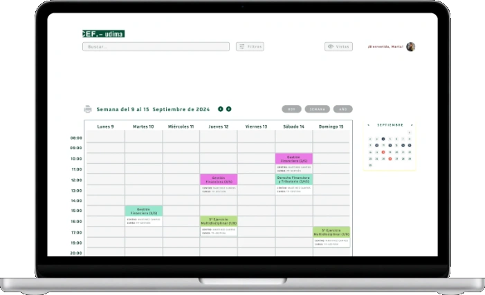
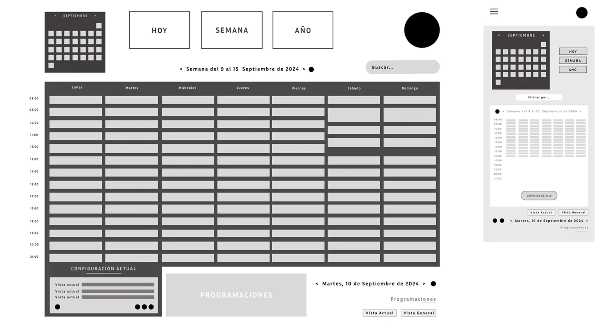
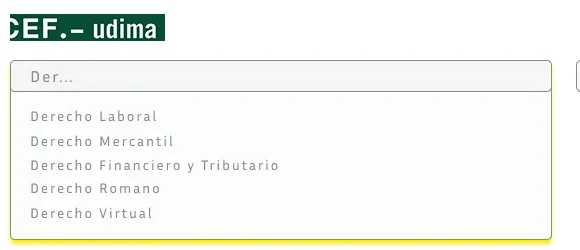
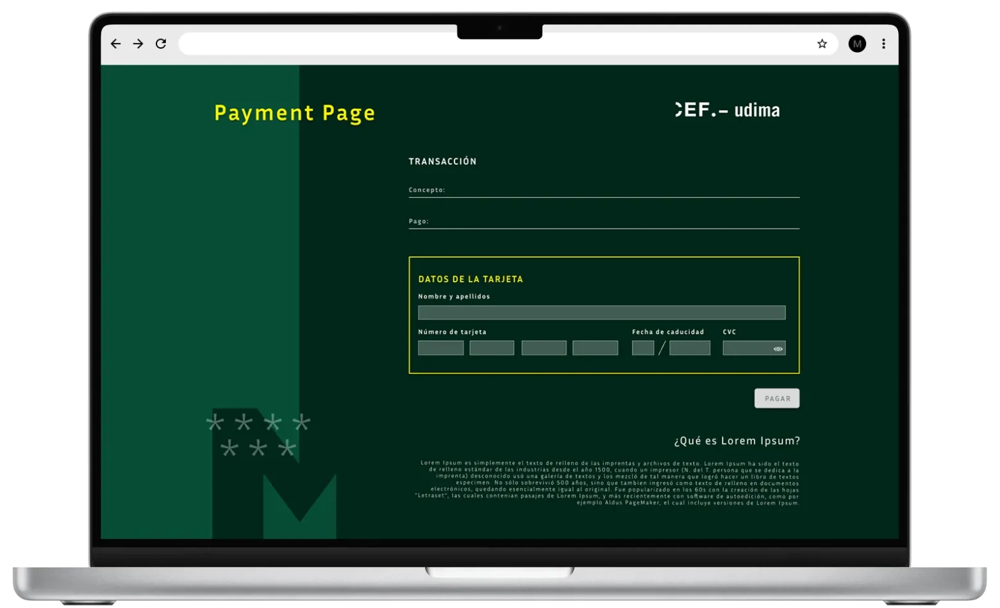

# Handoff · CEF EdTech (caso 01) · rediseño mobile + desktop

Diseño aprobado en el canvas "Case study mobile · CEF EdTech". Objetivo: integrarlo en `cef-design-system.html` **siguiendo el mismo patrón que Gym (commits `91f966f` y `ff0dd3c`) y Oracle (`1a95554`)**.

Este archivo y la carpeta `assets/cef-mobile/` están en `C:\Users\mmora\marta-portfolio\`.

## Alcance

**Mobile (`max-width: 768px`)**: artboards Mobile 01–04.
- Bloque con prefijo `.cme-*` (equivalente a `.gme-*` de Gym), oculto en desktop.
- Los 4 tabs móviles pasan a ser **Overview / Problema / Sistema / Resultados** y apuntan a `#cme-overview`, `#cme-problema`, `#cme-sistema`, `#cme-resultados`, manteniendo el tracking de pestaña activa.
- El carrusel "Entrar, organizar, pagar" (Mobile 03) es scroll horizontal con snap; reutiliza el JS de carrusel/contador que ya exista en el sitio.

**Desktop (> 768px)**: artboard "Desktop 1440", con prefijo `.cde-*` (equivalente a `.gde-*`).
- Sustituye el contenido actual del caso en desktop por la estructura del artboard: narrativa a la izquierda, evidencia a la derecha, sin carruseles.
- Contenedor: el de los casos del sitio. Las rejillas del artboard usan `auto-fit`; respétalo.

**Ambos**
- Header `.cs-top`, panel de casos, paginación `.cs-pagination-section`, "siguiente caso", CTA sticky, chatbot y scroll-to-top: los del sitio, sin duplicar. En los artboards aparecen solo como referencia visual.
- Bilingüe: todo texto en `<span class="es">` + `<span class="en">`. Traduce al EN con el tono de `gym-energy-center.html`. Los `.mm-reveal` van dentro de los spans `.es`/`.en`.
- Mantén el `noindex` y el `auth-lock.js` que ya tiene la página.

## Reglas del repo (no negociables)

- No tocar design tokens ni estilos globales. El canvas ya usa los del sitio: `--purple #a78bfa`, `--purple-deep #7c3aed`, Playfair Display en titulares, Inter en cuerpo, fondo negro.
- Única excepción de color, local al caso: el espécimen de botones (sección Sistema) usa el verde CEF `#0b5a43` (hover `#063a2b`) sobre fondo `#f4f6f5`. Defínelo como variable local dentro de `.cme-`/`.cde-`, no global.
- Sin librerías. Vanilla HTML/CSS/JS.
- Localiza por contenido, nunca por número de línea.
- Sin em-dashes en el copy, sin emojis, sin la estructura retórica "esto no era X, era Y".
- Commit con `git add -A` (no `deploy.bat`). Cache-busting `?v=` si cambias CSS/JS.

## Assets (`assets/cef-mobile/`)

| Archivo | Uso |
|---|---|
| `cal-desk.webp` | Portátil con el calendario (hero; "UI con el sistema aplicado") |
| `cal-wire.webp` | Wireframe desktop + mobile ("Del wireframe a la organización académica") |
| `cal-mob.webp` | Calendario en móvil, **fondo blanco**: va en tarjeta con fondo `#fff` |
| `search.webp` | Búsqueda predictiva, fondo blanco (solo mobile) |
| `login-mob.webp` / `login-desk.webp` | Login por perfil |
| `pay-mob.webp` | Pasarela móvil, recortada para no mostrar el Lorem Ipsum |
| `pay-desk.webp` | Pasarela desktop (cierre de Resultados) |

Las imágenes antiguas del caso que ya no aparecen en los artboards (`calendariooo.webp` como "antes", `tokens-architecture`, `button-states`, `mobile-screens`, `exp-cef-desk`) dejan de usarse. Elimina las referencias rotas a `projects/01-cef/assets/` y `assets/exp-cef-desk.png`.

## Contenido y cifras

- Tesis: "Un solo sistema, del login al pago". El sistema sostiene la herramienta nueva de organización académica (clases, cursos, asignaturas), conectada a login y pasarela de pago.
- Medido: WCAG 2.1 AA en los 3 flujos críticos (login, calendario, pago); contraste previo < 3:1; 8+ variantes de botón y campo; 4 plataformas (campus virtual, bolsa de empleo, pasarela de matriculación, calendario académico).
- **Eliminar del caso** las cifras contradictorias: 80+ / 40+ componentes, 14 plataformas, -60 % hand-off, -45 % entrega, 100 % adopción. Se sustituyen por la tarjeta discontinua "Eficiencia del equipo" con chip "Por validar" y placeholders `[Nº]`, `[−X%]` y `[Fuente de la medición]`. Deja los placeholders literales: Marta los rellenará.
- Herramientas: Figma · Tokens Studio · Stark. **Quitar "Claude MCP"** y el bloque "Copiloto IA" (anacronismo: proyecto 2023–24).
- El bloque antes/después del calendario desaparece: lo sustituye wireframe → UI final.
- Mantén la sección del sitio "Trayectoria global · Mapa de proyectos" solo si existe en el resto de casos rediseñados; si Gym ya no la tiene, quítala también aquí.
- Caso 01 / 06 y siguiente caso: los que ya tenga la paginación del sitio.

## Cómo leer los artboards

Fuente exacta del diseño (mobile a 390 px, desktop a 1440 px). `{{accent}}` = `#a78bfa`, `{{brand}}` = `#0b5a43`. `<sc-for>` es un bucle y `<sc-if>` un condicional: los datos están en `renderVals()` del script final de cada artboard. Las rutas de imagen ya apuntan a `assets/cef-mobile/`. Los altos fijos de los artboards móviles son del lienzo: en la web, alto automático.

## Verificación

Antes de commitear: Playwright a 390×844, 1024 y 1440 px. ES/EN, los 4 tabs mobile, carrusel con snap, foco visible al tabular por los botones del espécimen, sin imágenes rotas, sin scroll horizontal de página.

## Artboards

### Mobile 01 · Hero + TL;DR (`Main.dc.html`)

```html
<!doctype html>
<html lang="es">
<head>
<meta charset="utf-8">
<title>CEF EdTech · Hero</title>
<script src="./support.js"></script>
</head>
<body>
<x-dc>
<helmet>
<link rel="preconnect" href="https://fonts.googleapis.com">
<link href="https://fonts.googleapis.com/css2?family=Inter:wght@400;500;600;700&amp;family=Playfair+Display:ital,wght@0,700;0,800;1,700&amp;display=swap" rel="stylesheet">
<style>
body{margin:0;background:#000}
a{color:#a78bfa}a:hover{color:#c4b5fd}
</style>
</helmet>
<div style="width: 390px; height: 1720px; background: #000; color: rgba(255,255,255,.72); font-family: Inter, system-ui, sans-serif; overflow: hidden; position: relative">

<header style="height: 56px; padding: 0 6px; display: flex; align-items: center; justify-content: space-between; background: rgba(0,0,0,.8); border-bottom: 1px solid rgba(255,255,255,.08)">
<a href="#" aria-label="Volver a casos" style="width: 44px; height: 44px; display: flex; align-items: center; justify-content: center; color: #fff"><svg width="20" height="20" viewBox="0 0 24 24" fill="none" stroke="currentColor" stroke-width="2" stroke-linecap="round" stroke-linejoin="round" aria-hidden="true"><path d="M15 18l-6-6 6-6"></path></svg></a>
<div style="font-size: 12px; font-weight: 600; letter-spacing: .12em; text-transform: uppercase; color: rgba(255,255,255,.9)">Caso 01 <span style="color: rgba(255,255,255,.4)">/ 06</span></div>
<button type="button" aria-label="Cambiar a inglés" style="width: 44px; height: 44px; background: none; border: 0; color: rgba(255,255,255,.7); font: 600 12px Inter, sans-serif; letter-spacing: .08em">EN</button>
</header>
<nav aria-label="Secciones" style="display: grid; grid-template-columns: repeat(4, minmax(0, 1fr)); gap: 6px; padding: 10px 16px 0">
<div style="display: flex; flex-direction: column; gap: 6px"><div style="height: 3px; border-radius: 3px; background: {{accent}}"></div><span style="font-size: 10px; font-weight: 600; letter-spacing: .06em; text-transform: uppercase; color: #fff">Overview</span></div>
<div style="display: flex; flex-direction: column; gap: 6px"><div style="height: 3px; border-radius: 3px; background: rgba(255,255,255,.14)"></div><span style="font-size: 10px; font-weight: 600; letter-spacing: .06em; text-transform: uppercase; color: rgba(255,255,255,.4)">Problema</span></div>
<div style="display: flex; flex-direction: column; gap: 6px"><div style="height: 3px; border-radius: 3px; background: rgba(255,255,255,.14)"></div><span style="font-size: 10px; font-weight: 600; letter-spacing: .06em; text-transform: uppercase; color: rgba(255,255,255,.4)">Sistema</span></div>
<div style="display: flex; flex-direction: column; gap: 6px"><div style="height: 3px; border-radius: 3px; background: rgba(255,255,255,.14)"></div><span style="font-size: 10px; font-weight: 600; letter-spacing: .06em; text-transform: uppercase; color: rgba(255,255,255,.4)">Resultados</span></div>
</nav>

<section style="padding: 30px 16px 0; display: flex; flex-direction: column; gap: 16px">
<div style="display: flex; flex-wrap: wrap; gap: 8px">
<span style="padding: 6px 12px; border-radius: 999px; border: 1px solid rgba(167,139,250,.4); color: {{accent}}; font-size: 12px; font-weight: 600">EdTech · Design System</span>
<span style="padding: 6px 12px; border-radius: 999px; border: 1px solid rgba(255,255,255,.14); color: rgba(255,255,255,.75); font-size: 12px; font-weight: 500">Login · Calendario · Pago</span>
</div>
<h1 style="margin: 0; font-family: 'Playfair Display', Georgia, serif; font-weight: 800; font-size: 44px; line-height: 1.03; letter-spacing: -.02em; color: #fff">Un solo sistema, <span style="font-style: italic; color: {{accent}}">del login al pago</span></h1>
<p style="margin: 0; font-size: 16px; line-height: 1.5; color: rgba(255,255,255,.78)">CEF quería organizar en digital sus <strong style="color: #fff; font-weight: 600">clases, cursos y asignaturas</strong>. Diseñé el sistema de diseño que sostiene esa herramienta nueva y todo lo que la rodea.</p>
</section>

<figure style="margin: 22px 0 0; padding: 10px 0 6px; display: flex; flex-direction: column; gap: 12px; background: radial-gradient(ellipse at 50% 50%, rgba(167,139,250,.16), rgba(0,0,0,0) 65%)">

<figcaption style="padding: 0 16px; font-size: 13px; line-height: 1.45; color: rgba(255,255,255,.7)">La herramienta nueva: vista semanal de clases con centro, curso y número de sesión.</figcaption>
</figure>

<section aria-label="Ficha del proyecto" style="margin: 18px 16px 0; display: grid; grid-template-columns: repeat(2, minmax(0, 1fr)); gap: 1px; background: rgba(255,255,255,.1); border: 1px solid rgba(255,255,255,.1); border-radius: 16px; overflow: hidden">
<div style="background: #0a0a0c; padding: 14px 16px; display: flex; flex-direction: column; gap: 4px"><span style="font-size: 10px; font-weight: 600; letter-spacing: .12em; text-transform: uppercase; color: rgba(255,255,255,.45)">Rol</span><span style="font-size: 14px; font-weight: 600; color: #fff">Solo Product Designer</span></div>
<div style="background: #0a0a0c; padding: 14px 16px; display: flex; flex-direction: column; gap: 4px"><span style="font-size: 10px; font-weight: 600; letter-spacing: .12em; text-transform: uppercase; color: rgba(255,255,255,.45)">Duración</span><span style="font-size: 14px; font-weight: 600; color: #fff">4 meses</span></div>
<div style="background: #0a0a0c; padding: 14px 16px; display: flex; flex-direction: column; gap: 4px"><span style="font-size: 10px; font-weight: 600; letter-spacing: .12em; text-transform: uppercase; color: rgba(255,255,255,.45)">Equipo</span><span style="font-size: 14px; font-weight: 600; color: #fff">Yo + Frontend + Producto</span></div>
<div style="background: #0a0a0c; padding: 14px 16px; display: flex; flex-direction: column; gap: 4px"><span style="font-size: 10px; font-weight: 600; letter-spacing: .12em; text-transform: uppercase; color: rgba(255,255,255,.45)">Plataforma</span><span style="font-size: 14px; font-weight: 600; color: #fff">Web desktop + mobile</span></div>
<div style="grid-column: 1 / -1; background: #0a0a0c; padding: 14px 16px; display: flex; flex-direction: column; gap: 4px"><span style="font-size: 10px; font-weight: 600; letter-spacing: .12em; text-transform: uppercase; color: rgba(255,255,255,.45)">Herramientas</span><span style="font-size: 14px; font-weight: 600; color: #fff">Figma · Tokens Studio · Stark</span></div>
</section>

<section style="padding: 48px 16px 0; display: flex; flex-direction: column; gap: 18px">
<div style="display: flex; align-items: baseline; justify-content: space-between">
<h2 style="margin: 0; font-family: 'Playfair Display', Georgia, serif; font-size: 30px; line-height: 1.1; color: #fff">El caso en <span style="font-style: italic; color: {{accent}}">30 segundos</span></h2>
<span style="font-size: 12px; font-weight: 600; color: rgba(255,255,255,.4)">01</span>
</div>
<div style="display: flex; flex-direction: column">
<div style="display: flex; gap: 16px">
<div style="display: flex; flex-direction: column; align-items: center; width: 14px; padding-top: 22px"><span style="width: 12px; height: 12px; border-radius: 50%; border: 2px solid rgba(255,255,255,.5)"></span><span style="flex: 1; width: 2px; background: rgba(255,255,255,.12)"></span></div>
<div style="flex: 1; padding: 14px 0 22px; display: flex; flex-direction: column; gap: 6px">
<span style="font-size: 11px; font-weight: 600; letter-spacing: .12em; text-transform: uppercase; color: rgba(255,255,255,.5)">Problema</span>
<span style="font-family: 'Playfair Display', Georgia, serif; font-weight: 800; font-size: 50px; line-height: 1; color: #fff">&lt; 3:1</span>
<span style="font-size: 15px; line-height: 1.45; color: rgba(255,255,255,.72)">de contraste en textos y botones críticos, en 4 plataformas sin nada en común.</span>
</div>
</div>
<div style="display: flex; gap: 16px">
<div style="display: flex; flex-direction: column; align-items: center; width: 14px; padding-top: 22px"><span style="width: 12px; height: 12px; border-radius: 50%; border: 2px solid rgba(255,255,255,.5)"></span><span style="flex: 1; width: 2px; background: rgba(255,255,255,.12)"></span></div>
<div style="flex: 1; padding: 14px 0 22px; display: flex; flex-direction: column; gap: 6px">
<span style="font-size: 11px; font-weight: 600; letter-spacing: .12em; text-transform: uppercase; color: rgba(255,255,255,.5)">Decisión</span>
<span style="font-family: 'Playfair Display', Georgia, serif; font-weight: 800; font-size: 50px; line-height: 1; color: #fff">Tokens</span>
<span style="font-size: 15px; line-height: 1.45; color: rgba(255,255,255,.72)">Diseñar las reglas antes que las pantallas, para que login, calendario y pago hablen igual.</span>
</div>
</div>
<div style="display: flex; gap: 16px">
<div style="display: flex; flex-direction: column; align-items: center; width: 14px; padding-top: 22px"><span style="width: 12px; height: 12px; border-radius: 50%; background: {{accent}}; box-shadow: 0 0 0 5px rgba(167,139,250,.18)"></span></div>
<div style="flex: 1; padding: 16px 18px 18px; margin-top: 4px; border-radius: 18px; background: rgba(167,139,250,.07); border: 1px solid rgba(167,139,250,.32); display: flex; flex-direction: column; gap: 6px">
<span style="font-size: 11px; font-weight: 600; letter-spacing: .12em; text-transform: uppercase; color: {{accent}}">Resultado · auditado</span>
<span style="font-family: 'Playfair Display', Georgia, serif; font-weight: 800; font-size: 60px; line-height: 1; color: {{accent}}">AA</span>
<span style="font-size: 15px; line-height: 1.45; color: rgba(255,255,255,.85)">WCAG 2.1 en los tres flujos críticos: acceso, organización académica y pago.</span>
</div>
</div>
</div>
<a href="Problema.dc.html" style="margin-top: 10px; height: 52px; border-radius: 999px; border: 1px solid rgba(255,255,255,.16); display: flex; align-items: center; justify-content: center; gap: 10px; color: #fff; font-size: 15px; font-weight: 600; text-decoration: none">Ver el problema<svg width="18" height="18" viewBox="0 0 24 24" fill="none" stroke="currentColor" stroke-width="2" stroke-linecap="round" stroke-linejoin="round" aria-hidden="true"><path d="M12 5v14M19 12l-7 7-7-7"></path></svg></a>
</section>
</div>
</x-dc>
<script type="text/x-dc" data-dc-script data-props='{"accent":{"editor":"color","default":"#a78bfa","options":["#a78bfa","#f97316","#7c3aed"]},"$preview":{"width":390,"height":1720}}'>
class Component extends DCLogic {
renderVals() {
return { accent: this.props.accent ?? '#a78bfa' };
}
}
</script>
</body>
</html>

```

### Mobile 02 · Problema (`Problema.dc.html`)

```html
<!doctype html>
<html lang="es">
<head>
<meta charset="utf-8">
<title>CEF EdTech · Problema</title>
<script src="./support.js"></script>
</head>
<body>
<x-dc>
<helmet>
<link rel="preconnect" href="https://fonts.googleapis.com">
<link href="https://fonts.googleapis.com/css2?family=Inter:wght@400;500;600;700&amp;family=Playfair+Display:ital,wght@0,700;0,800;1,700&amp;display=swap" rel="stylesheet">
<style>
body{margin:0;background:#000}
a{color:#a78bfa}a:hover{color:#c4b5fd}
</style>
</helmet>
<div style="width: 390px; height: 2480px; background: #000; color: rgba(255,255,255,.72); font-family: Inter, system-ui, sans-serif; overflow: hidden; position: relative">

<header style="height: 56px; padding: 0 6px; display: flex; align-items: center; justify-content: space-between; background: rgba(0,0,0,.8); border-bottom: 1px solid rgba(255,255,255,.08)">
<a href="Main.dc.html" aria-label="Volver" style="width: 44px; height: 44px; display: flex; align-items: center; justify-content: center; color: #fff"><svg width="20" height="20" viewBox="0 0 24 24" fill="none" stroke="currentColor" stroke-width="2" stroke-linecap="round" stroke-linejoin="round" aria-hidden="true"><path d="M15 18l-6-6 6-6"></path></svg></a>
<div style="font-size: 12px; font-weight: 600; letter-spacing: .12em; text-transform: uppercase; color: rgba(255,255,255,.9)">Caso 01 <span style="color: rgba(255,255,255,.4)">/ 06</span></div>
<button type="button" aria-label="Cambiar a inglés" style="width: 44px; height: 44px; background: none; border: 0; color: rgba(255,255,255,.7); font: 600 12px Inter, sans-serif; letter-spacing: .08em">EN</button>
</header>
<nav aria-label="Secciones" style="display: grid; grid-template-columns: repeat(4, minmax(0, 1fr)); gap: 6px; padding: 10px 16px 0">
<div style="display: flex; flex-direction: column; gap: 6px"><div style="height: 3px; border-radius: 3px; background: rgba(167,139,250,.45)"></div><span style="font-size: 10px; font-weight: 600; letter-spacing: .06em; text-transform: uppercase; color: rgba(255,255,255,.4)">Overview</span></div>
<div style="display: flex; flex-direction: column; gap: 6px"><div style="height: 3px; border-radius: 3px; background: {{accent}}"></div><span style="font-size: 10px; font-weight: 600; letter-spacing: .06em; text-transform: uppercase; color: #fff">Problema</span></div>
<div style="display: flex; flex-direction: column; gap: 6px"><div style="height: 3px; border-radius: 3px; background: rgba(255,255,255,.14)"></div><span style="font-size: 10px; font-weight: 600; letter-spacing: .06em; text-transform: uppercase; color: rgba(255,255,255,.4)">Sistema</span></div>
<div style="display: flex; flex-direction: column; gap: 6px"><div style="height: 3px; border-radius: 3px; background: rgba(255,255,255,.14)"></div><span style="font-size: 10px; font-weight: 600; letter-spacing: .06em; text-transform: uppercase; color: rgba(255,255,255,.4)">Resultados</span></div>
</nav>

<section style="padding: 30px 16px 0; display: flex; flex-direction: column; gap: 16px">
<span style="font-size: 12px; font-weight: 600; letter-spacing: .14em; text-transform: uppercase; color: {{accent}}">02 · Contexto</span>
<h2 style="margin: 0; font-family: 'Playfair Display', Georgia, serif; font-weight: 800; font-size: 38px; line-height: 1.04; letter-spacing: -.015em; color: #fff">Un recorrido, <span style="font-style: italic; color: {{accent}}">cuatro interfaces</span></h2>
<p style="margin: 0; font-size: 15px; line-height: 1.55; color: rgba(255,255,255,.72)">Campus virtual, bolsa de empleo, pasarela de matriculación y calendario académico se construyeron en años distintos y con proveedores distintos. El alumno, que además es cliente, cruzaba varias de ellas para hacer una sola cosa.</p>
</section>

<section aria-label="Recorrido del alumno" style="margin: 26px 16px 0; padding: 18px 16px; border-radius: 20px; background: #0d0b14; border: 1px solid rgba(167,139,250,.28); display: flex; flex-direction: column; gap: 4px">
<span style="font-size: 11px; font-weight: 700; letter-spacing: .12em; text-transform: uppercase; color: rgba(255,255,255,.5); padding-bottom: 10px">El recorrido del alumno-cliente</span>
<sc-for list="{{journey}}" as="j" hint-placeholder-count="3">
<div style="display: flex; gap: 12px">
<div style="flex: none; width: 36px; display: flex; flex-direction: column; align-items: center"><span style="width: 36px; height: 36px; border-radius: 50%; background: rgba(167,139,250,.14); color: {{accent}}; display: flex; align-items: center; justify-content: center; font-size: 12px; font-weight: 700">{{j.n}}</span><span style="flex: 1; width: 2px; min-height: 14px; background: rgba(167,139,250,.25)"></span></div>
<div style="flex: 1; padding: 6px 0 18px; display: flex; flex-direction: column; gap: 4px">
<span style="font-size: 17px; font-weight: 600; color: #fff">{{j.t}}</span>
<span style="font-size: 13px; line-height: 1.4; color: rgba(255,255,255,.65)">{{j.d}}</span>
</div>
</div>
</sc-for>
<div style="padding-top: 6px; border-top: 1px dashed rgba(255,255,255,.18); font-size: 13px; line-height: 1.45; color: rgba(255,255,255,.75)">Tres pasos con estilos, botones y contrastes distintos. Si el recorrido fallaba, CEF perdía una matrícula.</div>
</section>

<section style="padding: 44px 16px 0; display: flex; flex-direction: column; gap: 16px">
<span style="font-size: 12px; font-weight: 600; letter-spacing: .14em; text-transform: uppercase; color: rgba(255,255,255,.5)">Auditoría WCAG 2.1 AA</span>
<div style="display: flex; align-items: flex-end; gap: 14px">
<span style="font-family: 'Playfair Display', Georgia, serif; font-weight: 800; font-size: 84px; line-height: .85; color: {{accent}}">&lt;3:1</span>
<span style="padding-bottom: 6px; font-size: 15px; line-height: 1.35; color: #fff; font-weight: 500">en textos secundarios y botones críticos</span>
</div>
<figure role="img" aria-label="Escala de contraste: el producto estaba por debajo de 3 a 1 y el mínimo AA para texto es 4,5 a 1" style="margin: 0; padding: 18px 0 0; display: flex; flex-direction: column; gap: 10px">
<div style="position: relative; height: 14px; border-radius: 8px; background: rgba(255,255,255,.08)">
<div style="position: absolute; left: 0; top: 0; bottom: 0; width: 33%; border-radius: 8px; background: {{accent}}"></div>
<div style="position: absolute; left: 58%; top: -8px; bottom: -8px; width: 2px; background: #fff"></div>
</div>
<div style="position: relative; height: 34px; font-size: 11px; font-weight: 600">
<span style="position: absolute; left: 0; color: rgba(255,255,255,.5)">1:1</span>
<span style="position: absolute; left: 24%; color: {{accent}}">Antes · &lt;3:1</span>
<span style="position: absolute; left: 52%; top: 16px; color: #fff">AA · 4,5:1</span>
<span style="position: absolute; right: 0; color: rgba(255,255,255,.5)">7:1</span>
</div>
</figure>
</section>

<section style="padding: 26px 16px 0; display: flex; flex-direction: column; gap: 12px">
<span style="font-size: 12px; font-weight: 600; letter-spacing: .14em; text-transform: uppercase; color: rgba(255,255,255,.5)">3 hallazgos</span>
<sc-for list="{{findings}}" as="f" hint-placeholder-count="3">
<div style="display: flex; align-items: center; gap: 14px; padding: 14px; border-radius: 16px; background: rgba(255,255,255,.035); border: 1px solid rgba(255,255,255,.09)">
<span style="flex: none; width: 44px; height: 44px; border-radius: 12px; background: rgba(167,139,250,.12); color: {{accent}}; display: flex; align-items: center; justify-content: center; font-size: 13px; font-weight: 700">{{f.k}}</span>
<div style="display: flex; flex-direction: column; gap: 3px"><span style="font-size: 15px; font-weight: 600; color: #fff">{{f.t}}</span><span style="font-size: 13px; line-height: 1.4; color: rgba(255,255,255,.62)">{{f.d}}</span></div>
</div>
</sc-for>
<div style="display: flex; flex-wrap: wrap; gap: 6px; padding-top: 4px">
<sc-for list="{{methods}}" as="m" hint-placeholder-count="4">
<span style="padding: 6px 10px; border-radius: 8px; background: rgba(255,255,255,.05); border: 1px solid rgba(255,255,255,.09); font-size: 12px; font-weight: 600; color: rgba(255,255,255,.8)">{{m}}</span>
</sc-for>
</div>
</section>

<section style="padding: 44px 16px 0; display: flex; flex-direction: column; gap: 12px">
<span style="font-size: 12px; font-weight: 600; letter-spacing: .14em; text-transform: uppercase; color: rgba(255,255,255,.5)">Requisitos imprescindibles</span>
<ul style="margin: 0; padding: 0; list-style: none; display: flex; flex-direction: column; gap: 1px; border-radius: 16px; overflow: hidden; background: rgba(255,255,255,.1); border: 1px solid rgba(255,255,255,.1)">
<sc-for list="{{reqs}}" as="r" hint-placeholder-count="4">
<li style="background: #0a0a0c; padding: 14px 16px; display: flex; gap: 12px; align-items: flex-start">
<svg width="18" height="18" viewBox="0 0 24 24" fill="none" stroke="{{accent}}" stroke-width="2.2" stroke-linecap="round" stroke-linejoin="round" aria-hidden="true" style="flex: none; margin-top: 1px"><path d="M20 6L9 17l-5-5"></path></svg>
<span style="font-size: 14px; line-height: 1.4; color: #fff">{{r}}</span>
</li>
</sc-for>
</ul>
</section>

<section style="padding: 40px 16px 0">
<div style="position: relative; display: grid; grid-template-columns: repeat(2, minmax(0, 1fr)); gap: 10px">
<div style="padding: 16px 14px 18px; border-radius: 18px; background: rgba(255,255,255,.03); border: 1px solid rgba(255,255,255,.1); display: flex; flex-direction: column; gap: 10px">
<span style="font-size: 11px; font-weight: 600; letter-spacing: .12em; text-transform: uppercase; color: rgba(255,255,255,.45)">Hallazgo</span>
<span style="font-size: 17px; font-weight: 700; line-height: 1.2; color: #fff">Cada squad reinventaba lo básico</span>
<span style="font-size: 13px; line-height: 1.4; color: rgba(255,255,255,.55)">Sin jerarquía ni tokens semánticos.</span>
</div>
<div style="padding: 16px 14px 18px; border-radius: 18px; background: rgba(167,139,250,.08); border: 1px solid rgba(167,139,250,.5); display: flex; flex-direction: column; gap: 10px">
<span style="font-size: 11px; font-weight: 600; letter-spacing: .12em; text-transform: uppercase; color: {{accent}}">Decisión</span>
<span style="font-size: 17px; font-weight: 700; line-height: 1.2; color: #fff">Un sistema desde cero</span>
<span style="font-size: 13px; line-height: 1.4; color: rgba(255,255,255,.8)">Con gobernanza en Figma y en código.</span>
</div>
<span aria-hidden="true" style="position: absolute; left: 50%; top: 50%; width: 34px; height: 34px; margin: -17px 0 0 -17px; border-radius: 50%; background: #000; border: 1px solid rgba(255,255,255,.18); display: flex; align-items: center; justify-content: center; color: {{accent}}"><svg width="16" height="16" viewBox="0 0 24 24" fill="none" stroke="currentColor" stroke-width="2.4" stroke-linecap="round" stroke-linejoin="round"><path d="M5 12h14M13 5l7 7-7 7"></path></svg></span>
</div>
</section>

<section style="margin: 40px 16px 0; padding: 22px 20px; border-radius: 20px; border: 1px solid rgba(255,255,255,.12); display: flex; flex-direction: column; gap: 10px">
<span style="font-size: 11px; font-weight: 600; letter-spacing: .12em; text-transform: uppercase; color: rgba(255,255,255,.5)">Mi enfoque</span>
<p style="margin: 0; font-family: 'Playfair Display', Georgia, serif; font-size: 22px; line-height: 1.3; color: #fff">Un sistema de diseño es un <span style="font-style: italic; color: {{accent}}">contrato operativo</span> entre diseño, accesibilidad y desarrollo.</p>
</section>
</div>
</x-dc>
<script type="text/x-dc" data-dc-script data-props='{"accent":{"editor":"color","default":"#a78bfa","options":["#a78bfa","#f97316","#7c3aed"]},"$preview":{"width":390,"height":2480}}'>
class Component extends DCLogic {
renderVals() {
return {
accent: this.props.accent ?? '#a78bfa',
journey: [
{ n: '01', t: 'Entrar', d: 'Login con 4 perfiles: alumnos CEF, alumnos UDIMA, empresas y empleados.' },
{ n: '02', t: 'Organizar', d: 'Ver clases, cursos y asignaturas en un calendario, por día, semana o año.' },
{ n: '03', t: 'Pagar', d: 'Pasarela de matriculación con los datos de la tarjeta.' }
],
findings: [
{ k: '01', t: 'Contraste insuficiente', d: 'Textos secundarios y botones críticos por debajo de 4,5:1.' },
{ k: '8+', t: 'Componentes duplicados', d: 'Más de 8 variantes de botón y campo en producción.' },
{ k: '03', t: 'Teclado roto', d: 'El foco (:focus-visible) estaba suprimido.' }
],
methods: ['Auditoría WCAG 2.1 AA', 'Stark', 'NVDA y VoiceOver', 'Inventario de componentes'],
reqs: [
'Superar la auditoría legal de accesibilidad WCAG 2.1 AA',
'Tokens sincronizados entre Figma y frontend',
'Funcionar igual en desktop y en mobile',
'Estados documentados: hover, focus, disabled y active'
]
};
}
}
</script>
</body>
</html>

```

### Mobile 03 · Sistema + herramienta (`Sistema.dc.html`)

```html
<!doctype html>
<html lang="es">
<head>
<meta charset="utf-8">
<title>CEF EdTech · Sistema</title>
<script src="./support.js"></script>
</head>
<body>
<x-dc>
<helmet>
<link rel="preconnect" href="https://fonts.googleapis.com">
<link href="https://fonts.googleapis.com/css2?family=Inter:wght@400;500;600;700&amp;family=Playfair+Display:ital,wght@0,700;0,800;1,700&amp;display=swap" rel="stylesheet">
<style>
body{margin:0;background:#000}
a{color:#a78bfa}a:hover{color:#c4b5fd}
</style>
</helmet>
<div style="width: 390px; height: 2860px; background: #000; color: rgba(255,255,255,.72); font-family: Inter, system-ui, sans-serif; overflow: hidden; position: relative">

<header style="height: 56px; padding: 0 6px; display: flex; align-items: center; justify-content: space-between; background: rgba(0,0,0,.8); border-bottom: 1px solid rgba(255,255,255,.08)">
<a href="Problema.dc.html" aria-label="Volver" style="width: 44px; height: 44px; display: flex; align-items: center; justify-content: center; color: #fff"><svg width="20" height="20" viewBox="0 0 24 24" fill="none" stroke="currentColor" stroke-width="2" stroke-linecap="round" stroke-linejoin="round" aria-hidden="true"><path d="M15 18l-6-6 6-6"></path></svg></a>
<div style="font-size: 12px; font-weight: 600; letter-spacing: .12em; text-transform: uppercase; color: rgba(255,255,255,.9)">Caso 01 <span style="color: rgba(255,255,255,.4)">/ 06</span></div>
<button type="button" aria-label="Cambiar a inglés" style="width: 44px; height: 44px; background: none; border: 0; color: rgba(255,255,255,.7); font: 600 12px Inter, sans-serif; letter-spacing: .08em">EN</button>
</header>
<nav aria-label="Secciones" style="display: grid; grid-template-columns: repeat(4, minmax(0, 1fr)); gap: 6px; padding: 10px 16px 0">
<div style="display: flex; flex-direction: column; gap: 6px"><div style="height: 3px; border-radius: 3px; background: rgba(167,139,250,.45)"></div><span style="font-size: 10px; font-weight: 600; letter-spacing: .06em; text-transform: uppercase; color: rgba(255,255,255,.4)">Overview</span></div>
<div style="display: flex; flex-direction: column; gap: 6px"><div style="height: 3px; border-radius: 3px; background: rgba(167,139,250,.45)"></div><span style="font-size: 10px; font-weight: 600; letter-spacing: .06em; text-transform: uppercase; color: rgba(255,255,255,.4)">Problema</span></div>
<div style="display: flex; flex-direction: column; gap: 6px"><div style="height: 3px; border-radius: 3px; background: {{accent}}"></div><span style="font-size: 10px; font-weight: 600; letter-spacing: .06em; text-transform: uppercase; color: #fff">Sistema</span></div>
<div style="display: flex; flex-direction: column; gap: 6px"><div style="height: 3px; border-radius: 3px; background: rgba(255,255,255,.14)"></div><span style="font-size: 10px; font-weight: 600; letter-spacing: .06em; text-transform: uppercase; color: rgba(255,255,255,.4)">Resultados</span></div>
</nav>

<section style="padding: 30px 16px 0; display: flex; flex-direction: column; gap: 12px">
<span style="font-size: 12px; font-weight: 600; letter-spacing: .14em; text-transform: uppercase; color: {{accent}}">03 · El sistema</span>
<h2 style="margin: 0; font-family: 'Playfair Display', Georgia, serif; font-weight: 800; font-size: 38px; line-height: 1.04; letter-spacing: -.015em; color: #fff">Reglas antes <span style="font-style: italic; color: {{accent}}">que pantallas</span></h2>
<p style="margin: 0; font-size: 15px; line-height: 1.55; color: rgba(255,255,255,.72)">Tres capas de tokens. Cambiar un valor arriba actualiza el login, el calendario y el pago a la vez.</p>
</section>

<figure aria-label="Arquitectura de tokens en tres capas: primitivos, semánticos y de componente" style="margin: 22px 16px 0; padding: 18px 16px; border-radius: 20px; background: #0d0b14; border: 1px solid rgba(167,139,250,.28); display: flex; flex-direction: column; gap: 0">
<sc-for list="{{tiers}}" as="t" hint-placeholder-count="3">
<div style="display: flex; flex-direction: column; align-items: stretch">
<div style="padding: 14px 16px; border-radius: 14px; background: rgba(255,255,255,.04); border: 1px solid rgba(255,255,255,.1); display: flex; flex-direction: column; gap: 8px">
<div style="display: flex; align-items: baseline; justify-content: space-between"><span style="font-size: 11px; font-weight: 700; letter-spacing: .12em; text-transform: uppercase; color: {{accent}}">{{t.n}} · {{t.k}}</span><span style="font-size: 11px; font-weight: 600; color: rgba(255,255,255,.45)">{{t.q}}</span></div>
<span style="font-size: 15px; font-weight: 600; color: #fff">{{t.t}}</span>
<div style="display: flex; flex-wrap: wrap; gap: 6px">
<sc-for list="{{t.chips}}" as="c" hint-placeholder-count="3">
<span style="padding: 4px 8px; border-radius: 6px; background: rgba(167,139,250,.1); font-size: 12px; font-weight: 600; color: rgba(255,255,255,.85)">{{c}}</span>
</sc-for>
</div>
</div>
<sc-if value="{{t.arrow}}" hint-placeholder="show">
<div aria-hidden="true" style="height: 22px; display: flex; justify-content: center; color: {{accent}}"><svg width="16" height="22" viewBox="0 0 16 22" fill="none" stroke="currentColor" stroke-width="2" stroke-linecap="round" stroke-linejoin="round"><path d="M8 2v18M3 15l5 5 5-5"></path></svg></div>
</sc-if>
</div>
</sc-for>
</figure>

<section style="margin: 36px 16px 0; display: flex; flex-direction: column; gap: 14px">
<div style="display: flex; flex-direction: column; gap: 6px">
<span style="font-size: 12px; font-weight: 600; letter-spacing: .14em; text-transform: uppercase; color: rgba(255,255,255,.5)">Accesibilidad en el token</span>
<h3 style="margin: 0; font-family: 'Playfair Display', Georgia, serif; font-weight: 800; font-size: 26px; line-height: 1.1; color: #fff">Cada estado, documentado</h3>
</div>
<div style="padding: 18px 16px; border-radius: 18px; background: #f4f6f5; display: grid; grid-template-columns: repeat(2, minmax(0, 1fr)); gap: 16px 12px">
<div style="display: flex; flex-direction: column; gap: 8px"><button type="button" style="height: 44px; border-radius: 10px; border: 0; background: {{brand}}; color: #fff; font: 600 14px Inter, sans-serif">Matricularme</button><span style="font-size: 12px; font-weight: 600; color: #3b4a44">Default</span></div>
<div style="display: flex; flex-direction: column; gap: 8px"><button type="button" style="height: 44px; border-radius: 10px; border: 0; background: #063a2b; color: #fff; font: 600 14px Inter, sans-serif">Matricularme</button><span style="font-size: 12px; font-weight: 600; color: #3b4a44">Hover</span></div>
<div style="display: flex; flex-direction: column; gap: 8px"><button type="button" style="height: 44px; border-radius: 10px; border: 0; background: {{brand}}; color: #fff; font: 600 14px Inter, sans-serif; outline: 2px solid #111; outline-offset: 2px">Matricularme</button><span style="font-size: 12px; font-weight: 600; color: #3b4a44">Focus · anillo 2px + offset</span></div>
<div style="display: flex; flex-direction: column; gap: 8px"><button type="button" disabled="true" style="height: 44px; border-radius: 10px; border: 1px dashed #8a9691; background: #e3e7e5; color: #5d6964; font: 600 14px Inter, sans-serif">Matricularme</button><span style="font-size: 12px; font-weight: 600; color: #3b4a44">Disabled</span></div>
</div>
<p style="margin: 0; font-size: 13px; line-height: 1.45; color: rgba(255,255,255,.6)">El foco visible vuelve a existir: anillo de 2px con separación, para quien navega con teclado.</p>
</section>

<section style="padding: 44px 0 0; display: flex; flex-direction: column; gap: 14px">
<div style="padding: 0 16px; display: flex; flex-direction: column; gap: 6px">
<span style="font-size: 12px; font-weight: 600; letter-spacing: .14em; text-transform: uppercase; color: {{accent}}">La herramienta nueva</span>
<h3 style="margin: 0; font-family: 'Playfair Display', Georgia, serif; font-weight: 800; font-size: 28px; line-height: 1.1; color: #fff">Del wireframe a la organización académica</h3>
</div>
<figure style="margin: 0 16px; display: flex; flex-direction: column; gap: 8px">

<figcaption style="font-size: 12px; font-weight: 600; color: rgba(255,255,255,.5)">01 · Wireframe desktop y mobile</figcaption>
</figure>
<div aria-hidden="true" style="display: flex; justify-content: center; color: {{accent}}"><svg width="18" height="18" viewBox="0 0 24 24" fill="none" stroke="currentColor" stroke-width="2.2" stroke-linecap="round" stroke-linejoin="round"><path d="M12 5v14M19 12l-7 7-7-7"></path></svg></div>
<figure style="margin: 0; display: flex; flex-direction: column; gap: 8px">

<figcaption style="padding: 0 16px; font-size: 12px; font-weight: 600; color: rgba(255,255,255,.5)">02 · UI con el sistema aplicado</figcaption>
</figure>
<div style="padding: 6px 16px 0; display: grid; grid-template-columns: repeat(2, minmax(0, 1fr)); gap: 8px">
<sc-for list="{{features}}" as="f" hint-placeholder-count="4">
<div style="padding: 14px 12px; border-radius: 14px; background: rgba(255,255,255,.04); border: 1px solid rgba(255,255,255,.1); display: flex; flex-direction: column; gap: 6px">
<span style="font-size: 14px; font-weight: 600; color: #fff">{{f.t}}</span>
<span style="font-size: 12px; line-height: 1.4; color: rgba(255,255,255,.62)">{{f.d}}</span>
</div>
</sc-for>
</div>
<figure style="margin: 4px 16px 0; padding: 14px; border-radius: 16px; background: #fff; display: flex; flex-direction: column; gap: 10px">

<figcaption style="font-size: 12px; font-weight: 600; color: #3b4a44">Búsqueda predictiva de asignaturas</figcaption>
</figure>
</section>

<section style="padding: 44px 0 0; display: flex; flex-direction: column; gap: 14px">
<div style="padding: 0 16px; display: flex; flex-direction: column; gap: 6px">
<span style="font-size: 12px; font-weight: 600; letter-spacing: .14em; text-transform: uppercase; color: rgba(255,255,255,.5)">El recorrido completo</span>
<h3 style="margin: 0; font-family: 'Playfair Display', Georgia, serif; font-weight: 800; font-size: 28px; line-height: 1.1; color: #fff">Entrar, organizar, pagar</h3>
</div>
<div style="display: flex; gap: 12px; overflow-x: auto; padding: 0 16px 4px; scroll-snap-type: x mandatory">
<sc-for list="{{flow}}" as="m" hint-placeholder-count="2">
<article style="flex: none; width: 258px; scroll-snap-align: start; border-radius: 20px; overflow: hidden; background: #0d0d10; border: 1px solid rgba(255,255,255,.1)">
<div style="position: relative; height: 340px; padding: 16px 12px 0; box-sizing: border-box; display: flex; justify-content: center; align-items: flex-end; background: {{m.bg}}">

<span style="position: absolute; left: 10px; top: 10px; padding: 4px 9px; border-radius: 999px; background: {{accent}}; color: #0b0614; font-size: 11px; font-weight: 700">{{m.n}} · {{m.k}}</span>
</div>
<div style="padding: 14px 16px 16px; border-top: 1px solid rgba(255,255,255,.08); display: flex; flex-direction: column; gap: 6px">
<span style="font-size: 17px; font-weight: 600; color: #fff">{{m.t}}</span>
<span style="font-size: 13px; line-height: 1.4; color: rgba(255,255,255,.65)">{{m.d}}</span>
</div>
</article>
</sc-for>
</div>
<div style="padding: 0 16px; display: flex; align-items: center; justify-content: space-between">
<div style="display: flex; gap: 6px" aria-hidden="true">
<span style="width: 22px; height: 6px; border-radius: 6px; background: {{accent}}"></span>
<span style="width: 6px; height: 6px; border-radius: 6px; background: rgba(255,255,255,.25)"></span>
<span style="width: 6px; height: 6px; border-radius: 6px; background: rgba(255,255,255,.25)"></span>
</div>
<span style="font-size: 12px; font-weight: 600; color: rgba(255,255,255,.5)">Desliza · 01 / 03</span>
</div>
</section>
</div>
</x-dc>
<script type="text/x-dc" data-dc-script data-props='{"accent":{"editor":"color","default":"#a78bfa","options":["#a78bfa","#f97316","#7c3aed"]},"brand":{"editor":"color","default":"#0b5a43"},"$preview":{"width":390,"height":2860}}'>
class Component extends DCLogic {
renderVals() {
return {
accent: this.props.accent ?? '#a78bfa',
brand: this.props.brand ?? '#0b5a43',
tiers: [
{ n: '01', k: 'Primitivos', q: 'el valor', t: 'Paleta CEF y escala tipográfica', chips: ['Verdes', 'Neutros', 'Escala de tipo'], arrow: true },
{ n: '02', k: 'Semánticos', q: 'la intención', t: 'Qué significa cada color', chips: ['Acción', 'Superficie', 'Error', 'Foco'], arrow: true },
{ n: '03', k: 'Componente', q: 'el uso', t: 'Dónde se aplica', chips: ['Botón', 'Campo', 'Evento de calendario'], arrow: false }
],
features: [
{ t: 'Hoy, semana, año', d: 'Tres vistas para la misma programación.' },
{ t: 'Filtros y vistas', d: 'Por centro, curso o asignatura.' },
{ t: 'Evento legible', d: 'Asignatura, sesión (3/5), centro y curso.' },
{ t: 'Mobile', d: 'Aula, grupo y perfil a un toque.' }
],
flow: [
{ n: '01', k: 'Entrar', t: 'Login por perfil', d: 'Alumnos CEF, alumnos UDIMA, empresas y empleados.', img: 'assets/cef-mobile/login-mob.webp', alt: 'Login móvil: selector de perfil y formulario de usuario y contraseña', bg: '#000' },
{ n: '02', k: 'Organizar', t: 'Calendario académico', d: 'Clases del mes, perfil y accesos a aula y grupo.', img: 'assets/cef-mobile/cal-mob.webp', alt: 'Calendario mensual en móvil con clases por colores y menú de aula, grupo y perfil', bg: '#fff' },
{ n: '03', k: 'Pagar', t: 'Pasarela de pago', d: 'Concepto, importe y tarjeta en un solo bloque.', img: 'assets/cef-mobile/pay-mob.webp', alt: 'Pasarela de pago móvil con transacción y datos de la tarjeta', bg: '#000' }
]
};
}
}
</script>
</body>
</html>

```

### Mobile 04 · Resultados + cierre (`Resultados.dc.html`)

```html
<!doctype html>
<html lang="es">
<head>
<meta charset="utf-8">
<title>CEF EdTech · Resultados</title>
<script src="./support.js"></script>
</head>
<body>
<x-dc>
<helmet>
<link rel="preconnect" href="https://fonts.googleapis.com">
<link href="https://fonts.googleapis.com/css2?family=Inter:wght@400;500;600;700&amp;family=Playfair+Display:ital,wght@0,700;0,800;1,700&amp;display=swap" rel="stylesheet">
<style>
body{margin:0;background:#000}
a{color:#a78bfa}a:hover{color:#c4b5fd}
</style>
</helmet>
<div style="width: 390px; height: 2160px; background: #000; color: rgba(255,255,255,.72); font-family: Inter, system-ui, sans-serif; overflow: hidden; position: relative">

<header style="height: 56px; padding: 0 6px; display: flex; align-items: center; justify-content: space-between; background: rgba(0,0,0,.8); border-bottom: 1px solid rgba(255,255,255,.08)">
<a href="Sistema.dc.html" aria-label="Volver" style="width: 44px; height: 44px; display: flex; align-items: center; justify-content: center; color: #fff"><svg width="20" height="20" viewBox="0 0 24 24" fill="none" stroke="currentColor" stroke-width="2" stroke-linecap="round" stroke-linejoin="round" aria-hidden="true"><path d="M15 18l-6-6 6-6"></path></svg></a>
<div style="font-size: 12px; font-weight: 600; letter-spacing: .12em; text-transform: uppercase; color: rgba(255,255,255,.9)">Caso 01 <span style="color: rgba(255,255,255,.4)">/ 06</span></div>
<button type="button" aria-label="Cambiar a inglés" style="width: 44px; height: 44px; background: none; border: 0; color: rgba(255,255,255,.7); font: 600 12px Inter, sans-serif; letter-spacing: .08em">EN</button>
</header>
<nav aria-label="Secciones" style="display: grid; grid-template-columns: repeat(4, minmax(0, 1fr)); gap: 6px; padding: 10px 16px 0">
<div style="display: flex; flex-direction: column; gap: 6px"><div style="height: 3px; border-radius: 3px; background: rgba(167,139,250,.45)"></div><span style="font-size: 10px; font-weight: 600; letter-spacing: .06em; text-transform: uppercase; color: rgba(255,255,255,.4)">Overview</span></div>
<div style="display: flex; flex-direction: column; gap: 6px"><div style="height: 3px; border-radius: 3px; background: rgba(167,139,250,.45)"></div><span style="font-size: 10px; font-weight: 600; letter-spacing: .06em; text-transform: uppercase; color: rgba(255,255,255,.4)">Problema</span></div>
<div style="display: flex; flex-direction: column; gap: 6px"><div style="height: 3px; border-radius: 3px; background: rgba(167,139,250,.45)"></div><span style="font-size: 10px; font-weight: 600; letter-spacing: .06em; text-transform: uppercase; color: rgba(255,255,255,.4)">Sistema</span></div>
<div style="display: flex; flex-direction: column; gap: 6px"><div style="height: 3px; border-radius: 3px; background: {{accent}}"></div><span style="font-size: 10px; font-weight: 600; letter-spacing: .06em; text-transform: uppercase; color: #fff">Resultados</span></div>
</nav>

<section style="padding: 30px 16px 0; display: flex; flex-direction: column; gap: 12px">
<span style="font-size: 12px; font-weight: 600; letter-spacing: .14em; text-transform: uppercase; color: {{accent}}">04 · Resultados</span>
<h2 style="margin: 0; font-family: 'Playfair Display', Georgia, serif; font-weight: 800; font-size: 38px; line-height: 1.04; letter-spacing: -.015em; color: #fff">Accesible <span style="font-style: italic; color: {{accent}}">por construcción</span></h2>
</section>

<section style="margin: 24px 16px 0; padding: 22px 20px; border-radius: 22px; background: radial-gradient(ellipse at 85% 0%, rgba(124,58,237,.35), rgba(124,58,237,0) 60%), #0d0b14; border: 1px solid rgba(167,139,250,.35); display: flex; flex-direction: column; gap: 18px">
<div style="display: flex; align-items: center; justify-content: space-between; gap: 12px">
<span style="font-size: 14px; font-weight: 600; color: #fff">Auditoría WCAG 2.1 AA</span>
<span style="flex: none; padding: 4px 9px; border-radius: 999px; border: 1px solid rgba(167,139,250,.4); color: {{accent}}; font-size: 10px; font-weight: 700; letter-spacing: .08em; text-transform: uppercase">Medido</span>
</div>
<div style="display: flex; align-items: flex-end; gap: 14px">
<span style="font-family: 'Playfair Display', Georgia, serif; font-weight: 800; font-size: 84px; line-height: .82; letter-spacing: -.02em; color: {{accent}}">100%</span>
<span style="padding-bottom: 4px; font-size: 15px; line-height: 1.35; color: rgba(255,255,255,.85)">de los flujos críticos pasan AA</span>
</div>
<ul style="margin: 0; padding: 16px 0 0; list-style: none; border-top: 1px solid rgba(255,255,255,.1); display: grid; grid-template-columns: repeat(3, minmax(0, 1fr)); gap: 8px">
<sc-for list="{{flows}}" as="f" hint-placeholder-count="3">
<li style="display: flex; flex-direction: column; gap: 6px">
<svg width="18" height="18" viewBox="0 0 24 24" fill="none" stroke="{{accent}}" stroke-width="2.4" stroke-linecap="round" stroke-linejoin="round" aria-hidden="true"><path d="M20 6L9 17l-5-5"></path></svg>
<span style="font-size: 14px; font-weight: 600; color: #fff">{{f}}</span>
</li>
</sc-for>
</ul>
</section>

<section style="margin: 12px 16px 0; display: grid; grid-template-columns: repeat(2, minmax(0, 1fr)); gap: 10px">
<div style="padding: 18px 16px; border-radius: 18px; background: rgba(255,255,255,.04); border: 1px solid rgba(255,255,255,.1); display: flex; flex-direction: column; gap: 8px"><span style="font-family: 'Playfair Display', Georgia, serif; font-weight: 800; font-size: 44px; line-height: 1; color: #fff">4</span><span style="font-size: 13px; line-height: 1.35; color: rgba(255,255,255,.7)">plataformas bajo un único sistema</span></div>
<div style="padding: 18px 16px; border-radius: 18px; background: rgba(255,255,255,.04); border: 1px solid rgba(255,255,255,.1); display: flex; flex-direction: column; gap: 8px"><span style="font-family: 'Playfair Display', Georgia, serif; font-weight: 800; font-size: 44px; line-height: 1; color: #fff">1</span><span style="font-size: 13px; line-height: 1.35; color: rgba(255,255,255,.7)">fuente de tokens para Figma y código</span></div>
</section>

<section style="margin: 12px 16px 0; padding: 20px; border-radius: 20px; border: 1px dashed rgba(255,255,255,.22); display: flex; flex-direction: column; gap: 16px">
<div style="display: flex; align-items: center; justify-content: space-between; gap: 12px">
<span style="font-size: 14px; font-weight: 600; color: #fff">Eficiencia del equipo</span>
<span style="flex: none; padding: 4px 9px; border-radius: 999px; border: 1px solid rgba(249,115,22,.55); color: #fdba74; font-size: 10px; font-weight: 700; letter-spacing: .08em; text-transform: uppercase">Por validar</span>
</div>
<div style="display: grid; grid-template-columns: repeat(2, minmax(0, 1fr)); gap: 14px">
<div style="display: flex; flex-direction: column; gap: 4px"><span style="font-family: 'Playfair Display', Georgia, serif; font-weight: 800; font-size: 34px; line-height: 1; color: rgba(255,255,255,.85)">[Nº]</span><span style="font-size: 13px; line-height: 1.35; color: rgba(255,255,255,.6)">componentes estandarizados</span></div>
<div style="display: flex; flex-direction: column; gap: 4px"><span style="font-family: 'Playfair Display', Georgia, serif; font-weight: 800; font-size: 34px; line-height: 1; color: rgba(255,255,255,.85)">[−X%]</span><span style="font-size: 13px; line-height: 1.35; color: rgba(255,255,255,.6)">tiempo de hand-off a desarrollo</span></div>
</div>
<span style="font-size: 12px; line-height: 1.5; color: rgba(255,255,255,.5)">[Fuente de la medición: cómo y cuándo se midió]</span>
</section>

<section style="padding: 44px 16px 0; display: flex; flex-direction: column; gap: 6px">
<span style="font-size: 12px; font-weight: 600; letter-spacing: .14em; text-transform: uppercase; color: rgba(255,255,255,.5)">05 · Lo que me llevo</span>
<sc-for list="{{learn}}" as="l" hint-placeholder-count="3">
<div style="display: flex; gap: 14px; padding: 18px 0; border-top: 1px solid rgba(255,255,255,.12)">
<span style="font-family: 'Playfair Display', Georgia, serif; font-style: italic; font-weight: 700; font-size: 26px; line-height: 1; color: {{accent}}; width: 34px">{{l.n}}</span>
<div style="flex: 1; display: flex; flex-direction: column; gap: 6px"><span style="font-size: 16px; font-weight: 600; color: #fff">{{l.t}}</span><span style="font-size: 14px; line-height: 1.45; color: rgba(255,255,255,.62)">{{l.d}}</span></div>
</div>
</sc-for>
</section>

<section style="padding: 24px 16px 0; display: flex; flex-direction: column; gap: 14px">

<a href="#" style="display: flex; align-items: center; gap: 16px; padding: 20px; border-radius: 22px; background: #0d0d10; border: 1px solid rgba(255,255,255,.12); text-decoration: none">
<div style="flex: 1; display: flex; flex-direction: column; gap: 6px">
<span style="font-size: 11px; font-weight: 600; letter-spacing: .12em; text-transform: uppercase; color: rgba(255,255,255,.5)">Siguiente caso · 02</span>
<span style="font-family: 'Playfair Display', Georgia, serif; font-weight: 800; font-size: 24px; line-height: 1.1; color: #fff">ILUNION Hotels CRO</span>
<span style="font-size: 14px; color: rgba(255,255,255,.62)">Optimización y test A/B en Adobe AEM</span>
</div>
<span style="flex: none; width: 48px; height: 48px; border-radius: 50%; background: #fff; color: #000; display: flex; align-items: center; justify-content: center"><svg width="20" height="20" viewBox="0 0 24 24" fill="none" stroke="currentColor" stroke-width="2" stroke-linecap="round" stroke-linejoin="round" aria-hidden="true"><path d="M5 12h14M13 5l7 7-7 7"></path></svg></span>
</a>
<a href="#" style="height: 52px; border-radius: 999px; background: {{accent}}; color: #0b0614; display: flex; align-items: center; justify-content: center; gap: 8px; font-size: 15px; font-weight: 700; text-decoration: none">Agendar llamada<svg width="14" height="14" viewBox="0 0 24 24" fill="none" stroke="currentColor" stroke-width="2.4" stroke-linecap="round" stroke-linejoin="round" aria-hidden="true"><path d="M7 17L17 7M17 7H9M17 7v8"></path></svg></a>
<a href="#" style="align-self: center; padding: 12px 0; font-size: 14px; font-weight: 500; color: rgba(255,255,255,.7)">Volver al índice</a>
</section>
</div>
</x-dc>
<script type="text/x-dc" data-dc-script data-props='{"accent":{"editor":"color","default":"#a78bfa","options":["#a78bfa","#f97316","#7c3aed"]},"$preview":{"width":390,"height":2160}}'>
class Component extends DCLogic {
renderVals() {
return {
accent: this.props.accent ?? '#a78bfa',
flows: ['Login', 'Calendario', 'Pago'],
learn: [
{ n: '01', t: 'Un sistema es un producto vivo', d: 'Diseñar reglas y tokens antes que pantallas ahorra fricción en cada entrega.' },
{ n: '02', t: 'La accesibilidad es estructural', d: 'Meter contraste y foco en el token evita parches caros después.' },
{ n: '03', t: 'Se diseña también para desarrollo', d: 'Nombrar bien los tokens es la mitad del éxito con frontend.' }
]
};
}
}
</script>
</body>
</html>

```

### Desktop 1440 · caso completo (`Desktop.dc.html`)

```html
<!doctype html>
<html lang="es">
<head>
<meta charset="utf-8">
<title>CEF EdTech · Desktop</title>
<script src="./support.js"></script>
</head>
<body>
<x-dc>
<helmet>
<link rel="preconnect" href="https://fonts.googleapis.com">
<link href="https://fonts.googleapis.com/css2?family=Inter:wght@400;500;600;700&amp;family=Playfair+Display:ital,wght@0,700;0,800;1,700&amp;display=swap" rel="stylesheet">
<style>
body{margin:0;background:#000}
a{color:#a78bfa}a:hover{color:#c4b5fd}
</style>
</helmet>
<div style="background: #000; color: rgba(255,255,255,.72); font-family: Inter, system-ui, sans-serif; overflow: hidden">

<header style="position: sticky; top: 0; z-index: 5; min-height: 72px; padding: 0 32px; display: flex; flex-wrap: wrap; align-items: center; justify-content: space-between; gap: 12px 24px; background: rgba(0,0,0,.82); border-bottom: 1px solid rgba(255,255,255,.08)">
<div style="display: flex; align-items: center; gap: 18px">
<a href="#" style="font-family: 'Playfair Display', Georgia, serif; font-weight: 800; font-size: 20px; color: #fff; text-decoration: none">MM</a>
<a href="#" style="display: flex; align-items: center; gap: 6px; padding: 12px 0; font-size: 14px; font-weight: 500; color: rgba(255,255,255,.7); text-decoration: none"><svg width="16" height="16" viewBox="0 0 24 24" fill="none" stroke="currentColor" stroke-width="2" stroke-linecap="round" stroke-linejoin="round" aria-hidden="true"><path d="M15 18l-6-6 6-6"></path></svg>Volver</a>
</div>
<nav aria-label="Secciones" style="display: flex; flex-wrap: wrap; gap: 4px">
<a href="#cef-overview" style="padding: 12px 14px; font-size: 13px; font-weight: 600; color: #fff; text-decoration: none; border-bottom: 2px solid {{accent}}">Overview</a>
<a href="#cef-problema" style="padding: 12px 14px; font-size: 13px; font-weight: 500; color: rgba(255,255,255,.55); text-decoration: none">Problema</a>
<a href="#cef-sistema" style="padding: 12px 14px; font-size: 13px; font-weight: 500; color: rgba(255,255,255,.55); text-decoration: none">Sistema</a>
<a href="#cef-resultados" style="padding: 12px 14px; font-size: 13px; font-weight: 500; color: rgba(255,255,255,.55); text-decoration: none">Resultados</a>
</nav>
<div style="display: flex; align-items: center; gap: 10px">
<button type="button" aria-label="Cambiar a inglés" style="width: 44px; height: 44px; background: none; border: 0; color: rgba(255,255,255,.7); font: 600 12px Inter, sans-serif; letter-spacing: .08em">EN</button>
<a href="#" style="height: 44px; padding: 0 18px; border-radius: 999px; background: {{accent}}; color: #0b0614; display: flex; align-items: center; gap: 6px; font-size: 14px; font-weight: 700; text-decoration: none">Agendar llamada<svg width="14" height="14" viewBox="0 0 24 24" fill="none" stroke="currentColor" stroke-width="2.4" stroke-linecap="round" stroke-linejoin="round" aria-hidden="true"><path d="M7 17L17 7M17 7H9M17 7v8"></path></svg></a>
</div>
</header>

<main style="max-width: 1200px; margin: 0 auto; padding: 0 32px">

<section id="cef-overview" style="padding: 72px 0 0; display: grid; grid-template-columns: repeat(auto-fit, minmax(min(100%, 440px), 1fr)); gap: 56px; align-items: center">
<div style="display: flex; flex-direction: column; gap: 22px">
<div style="display: flex; align-items: center; gap: 12px; flex-wrap: wrap">
<span style="font-size: 12px; font-weight: 600; letter-spacing: .14em; text-transform: uppercase; color: rgba(255,255,255,.55)">Caso 01 / 06</span>
<span style="padding: 6px 12px; border-radius: 999px; border: 1px solid rgba(167,139,250,.35); color: {{accent}}; font-size: 12px; font-weight: 600">EdTech · Design System</span>
<span style="padding: 6px 12px; border-radius: 999px; border: 1px solid rgba(255,255,255,.14); color: rgba(255,255,255,.75); font-size: 12px; font-weight: 500">Login · Calendario · Pago</span>
</div>
<h1 style="margin: 0; font-family: 'Playfair Display', Georgia, serif; font-weight: 800; font-size: 68px; line-height: 1; letter-spacing: -.02em; color: #fff">Un solo sistema, <span style="font-style: italic; color: {{accent}}">del login al pago</span></h1>
<p style="margin: 0; max-width: 540px; font-size: 19px; line-height: 1.5; color: rgba(255,255,255,.78)">CEF quería organizar en digital sus <strong style="color: #fff; font-weight: 600">clases, cursos y asignaturas</strong>. Diseñé el sistema de diseño que sostiene esa herramienta nueva y todo lo que la rodea.</p>
<dl style="margin: 8px 0 0; display: grid; grid-template-columns: repeat(auto-fit, minmax(130px, 1fr)); gap: 1px; background: rgba(255,255,255,.1); border: 1px solid rgba(255,255,255,.1); border-radius: 16px; overflow: hidden">
<div style="background: #0a0a0c; padding: 14px 16px; display: flex; flex-direction: column; gap: 4px"><dt style="font-size: 10px; font-weight: 600; letter-spacing: .12em; text-transform: uppercase; color: rgba(255,255,255,.45)">Rol</dt><dd style="margin: 0; font-size: 14px; font-weight: 600; color: #fff">Solo Product Designer</dd></div>
<div style="background: #0a0a0c; padding: 14px 16px; display: flex; flex-direction: column; gap: 4px"><dt style="font-size: 10px; font-weight: 600; letter-spacing: .12em; text-transform: uppercase; color: rgba(255,255,255,.45)">Duración</dt><dd style="margin: 0; font-size: 14px; font-weight: 600; color: #fff">4 meses</dd></div>
<div style="background: #0a0a0c; padding: 14px 16px; display: flex; flex-direction: column; gap: 4px"><dt style="font-size: 10px; font-weight: 600; letter-spacing: .12em; text-transform: uppercase; color: rgba(255,255,255,.45)">Equipo</dt><dd style="margin: 0; font-size: 14px; font-weight: 600; color: #fff">Yo + Frontend + Producto</dd></div>
<div style="background: #0a0a0c; padding: 14px 16px; display: flex; flex-direction: column; gap: 4px"><dt style="font-size: 10px; font-weight: 600; letter-spacing: .12em; text-transform: uppercase; color: rgba(255,255,255,.45)">Herramientas</dt><dd style="margin: 0; font-size: 14px; font-weight: 600; color: #fff">Figma · Tokens Studio · Stark</dd></div>
</dl>
<a href="#cef-problema" style="align-self: flex-start; height: 48px; padding: 0 22px; border-radius: 999px; border: 1px solid rgba(255,255,255,.16); display: flex; align-items: center; gap: 8px; color: #fff; font-size: 15px; font-weight: 600; text-decoration: none">Ver el problema<svg width="16" height="16" viewBox="0 0 24 24" fill="none" stroke="currentColor" stroke-width="2" stroke-linecap="round" stroke-linejoin="round" aria-hidden="true"><path d="M12 5v14M19 12l-7 7-7-7"></path></svg></a>
</div>
<figure style="margin: 0; display: flex; flex-direction: column; gap: 12px; background: radial-gradient(ellipse at 50% 50%, rgba(124,58,237,.3), rgba(124,58,237,0) 68%)">

<figcaption style="font-size: 13px; color: rgba(255,255,255,.6)">La herramienta nueva: vista semanal de clases con centro, curso y número de sesión.</figcaption>
</figure>
</section>

<section style="padding: 96px 0 0; display: flex; flex-direction: column; gap: 28px">
<div style="display: flex; align-items: baseline; justify-content: space-between; border-bottom: 1px solid rgba(255,255,255,.1); padding-bottom: 18px">
<h2 style="margin: 0; font-family: 'Playfair Display', Georgia, serif; font-size: 40px; line-height: 1.1; color: #fff">El caso en <span style="font-style: italic; color: {{accent}}">30 segundos</span></h2>
<span style="font-size: 13px; font-weight: 600; color: rgba(255,255,255,.4)">01</span>
</div>
<ol style="margin: 0; padding: 0; list-style: none; display: grid; grid-template-columns: repeat(auto-fit, minmax(300px, 1fr)); gap: 20px">
<li style="padding: 24px; border-radius: 20px; background: rgba(255,255,255,.03); border: 1px solid rgba(255,255,255,.1); display: flex; flex-direction: column; gap: 10px">
<span style="font-size: 11px; font-weight: 600; letter-spacing: .12em; text-transform: uppercase; color: rgba(255,255,255,.5)">01 · Problema</span>
<span style="font-family: 'Playfair Display', Georgia, serif; font-weight: 800; font-size: 64px; line-height: 1; color: #fff">&lt; 3:1</span>
<span style="font-size: 16px; line-height: 1.45; color: rgba(255,255,255,.72)">de contraste en textos y botones críticos, en 4 plataformas sin nada en común.</span>
</li>
<li style="padding: 24px; border-radius: 20px; background: rgba(255,255,255,.03); border: 1px solid rgba(255,255,255,.1); display: flex; flex-direction: column; gap: 10px">
<span style="font-size: 11px; font-weight: 600; letter-spacing: .12em; text-transform: uppercase; color: rgba(255,255,255,.5)">02 · Decisión</span>
<span style="font-family: 'Playfair Display', Georgia, serif; font-weight: 800; font-size: 64px; line-height: 1; color: #fff">Tokens</span>
<span style="font-size: 16px; line-height: 1.45; color: rgba(255,255,255,.72)">Diseñar las reglas antes que las pantallas, para que login, calendario y pago hablen igual.</span>
</li>
<li style="padding: 24px; border-radius: 20px; background: rgba(167,139,250,.08); border: 1px solid rgba(167,139,250,.32); display: flex; flex-direction: column; gap: 10px">
<span style="font-size: 11px; font-weight: 600; letter-spacing: .12em; text-transform: uppercase; color: {{accent}}">03 · Resultado · auditado</span>
<span style="font-family: 'Playfair Display', Georgia, serif; font-weight: 800; font-size: 64px; line-height: 1; color: {{accent}}">AA</span>
<span style="font-size: 16px; line-height: 1.45; color: rgba(255,255,255,.85)">WCAG 2.1 en los tres flujos críticos: acceso, organización académica y pago.</span>
</li>
</ol>
</section>

<section id="cef-problema" style="padding: 120px 0 0; display: flex; flex-direction: column; gap: 56px">
<div style="display: grid; grid-template-columns: repeat(auto-fit, minmax(min(100%, 440px), 1fr)); gap: 56px; align-items: start">
<div style="display: flex; flex-direction: column; gap: 16px">
<span style="font-size: 12px; font-weight: 600; letter-spacing: .14em; text-transform: uppercase; color: {{accent}}">02 · Contexto</span>
<h2 style="margin: 0; font-family: 'Playfair Display', Georgia, serif; font-weight: 800; font-size: 52px; line-height: 1.04; letter-spacing: -.015em; color: #fff">Un recorrido, <span style="font-style: italic; color: {{accent}}">cuatro interfaces</span></h2>
<p style="margin: 0; max-width: 500px; font-size: 17px; line-height: 1.55; color: rgba(255,255,255,.72)">Campus virtual, bolsa de empleo, pasarela de matriculación y calendario académico se construyeron en años distintos y con proveedores distintos. El alumno, que además es cliente, cruzaba varias de ellas para hacer una sola cosa.</p>
<div style="margin-top: 12px; padding: 22px 24px; border-radius: 20px; border: 1px solid rgba(255,255,255,.12); display: flex; flex-direction: column; gap: 8px">
<span style="font-size: 11px; font-weight: 600; letter-spacing: .12em; text-transform: uppercase; color: rgba(255,255,255,.5)">Mi enfoque</span>
<p style="margin: 0; font-family: 'Playfair Display', Georgia, serif; font-size: 24px; line-height: 1.3; color: #fff">Un sistema de diseño es un <span style="font-style: italic; color: {{accent}}">contrato operativo</span> entre diseño, accesibilidad y desarrollo.</p>
</div>
</div>
<figure aria-label="Recorrido del alumno-cliente" style="margin: 0; padding: 28px; border-radius: 28px; background: #0d0b14; border: 1px solid rgba(167,139,250,.28); display: flex; flex-direction: column">
<span style="font-size: 11px; font-weight: 700; letter-spacing: .12em; text-transform: uppercase; color: rgba(255,255,255,.5); padding-bottom: 16px">El recorrido del alumno-cliente</span>
<sc-for list="{{journey}}" as="j" hint-placeholder-count="3">
<div style="display: flex; gap: 16px">
<div style="flex: none; width: 40px; display: flex; flex-direction: column; align-items: center"><span style="width: 40px; height: 40px; border-radius: 50%; background: rgba(167,139,250,.14); color: {{accent}}; display: flex; align-items: center; justify-content: center; font-size: 13px; font-weight: 700">{{j.n}}</span><span style="flex: 1; width: 2px; min-height: 16px; background: rgba(167,139,250,.25)"></span></div>
<div style="flex: 1; padding: 8px 0 22px; display: flex; flex-direction: column; gap: 4px">
<span style="font-size: 19px; font-weight: 600; color: #fff">{{j.t}}</span>
<span style="font-size: 15px; line-height: 1.45; color: rgba(255,255,255,.65)">{{j.d}}</span>
</div>
</div>
</sc-for>
<div style="padding-top: 14px; border-top: 1px dashed rgba(255,255,255,.18); font-size: 15px; line-height: 1.45; color: rgba(255,255,255,.75)">Tres pasos con estilos, botones y contrastes distintos. Si el recorrido fallaba, CEF perdía una matrícula.</div>
</figure>
</div>

<div style="display: grid; grid-template-columns: repeat(auto-fit, minmax(min(100%, 440px), 1fr)); gap: 56px; align-items: center">
<div style="display: flex; flex-direction: column; gap: 16px">
<span style="font-size: 12px; font-weight: 600; letter-spacing: .14em; text-transform: uppercase; color: rgba(255,255,255,.5)">Auditoría WCAG 2.1 AA</span>
<div style="display: flex; align-items: flex-end; gap: 18px">
<span style="font-family: 'Playfair Display', Georgia, serif; font-weight: 800; font-size: 120px; line-height: .82; color: {{accent}}">&lt;3:1</span>
<span style="padding-bottom: 8px; font-size: 17px; line-height: 1.35; color: #fff; font-weight: 500">en textos secundarios y botones críticos</span>
</div>
<div style="display: flex; flex-wrap: wrap; gap: 8px; padding-top: 8px">
<sc-for list="{{methods}}" as="m" hint-placeholder-count="4">
<span style="padding: 7px 12px; border-radius: 8px; background: rgba(255,255,255,.05); border: 1px solid rgba(255,255,255,.09); font-size: 13px; font-weight: 600; color: rgba(255,255,255,.8)">{{m}}</span>
</sc-for>
</div>
</div>
<figure role="img" aria-label="Escala de contraste: el producto estaba por debajo de 3 a 1 y el mínimo AA para texto es 4,5 a 1" style="margin: 0; padding: 32px; border-radius: 24px; background: rgba(255,255,255,.03); border: 1px solid rgba(255,255,255,.1); display: flex; flex-direction: column; gap: 12px">
<div style="position: relative; height: 18px; border-radius: 10px; background: rgba(255,255,255,.08)">
<div style="position: absolute; left: 0; top: 0; bottom: 0; width: 33%; border-radius: 10px; background: {{accent}}"></div>
<div style="position: absolute; left: 58%; top: -10px; bottom: -10px; width: 2px; background: #fff"></div>
</div>
<div style="position: relative; height: 40px; font-size: 13px; font-weight: 600">
<span style="position: absolute; left: 0; color: rgba(255,255,255,.5)">1:1</span>
<span style="position: absolute; left: 26%; color: {{accent}}">Antes · &lt;3:1</span>
<span style="position: absolute; left: 54%; top: 20px; color: #fff">Mínimo AA · 4,5:1</span>
<span style="position: absolute; right: 0; color: rgba(255,255,255,.5)">7:1</span>
</div>
</figure>
</div>

<div style="display: grid; grid-template-columns: repeat(auto-fit, minmax(300px, 1fr)); gap: 16px">
<sc-for list="{{findings}}" as="f" hint-placeholder-count="3">
<div style="padding: 22px; border-radius: 18px; background: rgba(255,255,255,.035); border: 1px solid rgba(255,255,255,.09); display: flex; flex-direction: column; gap: 14px">
<span style="width: 44px; height: 44px; border-radius: 12px; background: rgba(167,139,250,.12); color: {{accent}}; display: flex; align-items: center; justify-content: center; font-size: 13px; font-weight: 700">{{f.k}}</span>
<span style="font-size: 18px; font-weight: 600; color: #fff">{{f.t}}</span>
<span style="font-size: 15px; line-height: 1.45; color: rgba(255,255,255,.65)">{{f.d}}</span>
</div>
</sc-for>
</div>

<div style="display: grid; grid-template-columns: repeat(auto-fit, minmax(min(100%, 440px), 1fr)); gap: 40px; align-items: center">
<div style="display: flex; flex-direction: column; gap: 14px">
<span style="font-size: 12px; font-weight: 600; letter-spacing: .14em; text-transform: uppercase; color: rgba(255,255,255,.5)">Requisitos imprescindibles</span>
<ul style="margin: 0; padding: 0; list-style: none; display: flex; flex-direction: column; gap: 1px; border-radius: 16px; overflow: hidden; background: rgba(255,255,255,.1); border: 1px solid rgba(255,255,255,.1)">
<sc-for list="{{reqs}}" as="r" hint-placeholder-count="4">
<li style="background: #0a0a0c; padding: 16px 18px; display: flex; gap: 12px; align-items: flex-start">
<svg width="18" height="18" viewBox="0 0 24 24" fill="none" stroke="{{accent}}" stroke-width="2.2" stroke-linecap="round" stroke-linejoin="round" aria-hidden="true" style="flex: none; margin-top: 1px"><path d="M20 6L9 17l-5-5"></path></svg>
<span style="font-size: 15px; line-height: 1.4; color: #fff">{{r}}</span>
</li>
</sc-for>
</ul>
</div>
<div style="position: relative; display: grid; grid-template-columns: repeat(2, minmax(0, 1fr)); gap: 14px">
<div style="padding: 22px 20px; border-radius: 20px; background: rgba(255,255,255,.03); border: 1px solid rgba(255,255,255,.1); display: flex; flex-direction: column; gap: 10px">
<span style="font-size: 11px; font-weight: 600; letter-spacing: .12em; text-transform: uppercase; color: rgba(255,255,255,.45)">Hallazgo</span>
<span style="font-size: 22px; font-weight: 700; line-height: 1.2; color: #fff">Cada squad reinventaba lo básico</span>
<span style="font-size: 14px; line-height: 1.4; color: rgba(255,255,255,.55)">Sin jerarquía ni tokens semánticos.</span>
</div>
<div style="padding: 22px 20px; border-radius: 20px; background: rgba(167,139,250,.08); border: 1px solid rgba(167,139,250,.5); display: flex; flex-direction: column; gap: 10px">
<span style="font-size: 11px; font-weight: 600; letter-spacing: .12em; text-transform: uppercase; color: {{accent}}">Decisión</span>
<span style="font-size: 22px; font-weight: 700; line-height: 1.2; color: #fff">Un sistema desde cero</span>
<span style="font-size: 14px; line-height: 1.4; color: rgba(255,255,255,.8)">Con gobernanza en Figma y en código.</span>
</div>
<span aria-hidden="true" style="position: absolute; left: 50%; top: 50%; width: 38px; height: 38px; margin: -19px 0 0 -19px; border-radius: 50%; background: #000; border: 1px solid rgba(255,255,255,.18); display: flex; align-items: center; justify-content: center; color: {{accent}}"><svg width="16" height="16" viewBox="0 0 24 24" fill="none" stroke="currentColor" stroke-width="2.4" stroke-linecap="round" stroke-linejoin="round"><path d="M5 12h14M13 5l7 7-7 7"></path></svg></span>
</div>
</div>
</section>

<section id="cef-sistema" style="padding: 120px 0 0; display: flex; flex-direction: column; gap: 64px">
<div style="display: grid; grid-template-columns: repeat(auto-fit, minmax(min(100%, 440px), 1fr)); gap: 56px; align-items: center">
<div style="display: flex; flex-direction: column; gap: 16px">
<span style="font-size: 12px; font-weight: 600; letter-spacing: .14em; text-transform: uppercase; color: {{accent}}">03 · El sistema</span>
<h2 style="margin: 0; font-family: 'Playfair Display', Georgia, serif; font-weight: 800; font-size: 52px; line-height: 1.04; letter-spacing: -.015em; color: #fff">Reglas antes <span style="font-style: italic; color: {{accent}}">que pantallas</span></h2>
<p style="margin: 0; max-width: 460px; font-size: 17px; line-height: 1.55; color: rgba(255,255,255,.72)">Tres capas de tokens. Cambiar un valor arriba actualiza el login, el calendario y el pago a la vez.</p>
</div>
<figure aria-label="Arquitectura de tokens en tres capas: primitivos, semánticos y de componente" style="margin: 0; padding: 24px; border-radius: 24px; background: #0d0b14; border: 1px solid rgba(167,139,250,.28); display: grid; grid-template-columns: repeat(auto-fit, minmax(160px, 1fr)); gap: 12px">
<sc-for list="{{tiers}}" as="t" hint-placeholder-count="3">
<div style="padding: 16px; border-radius: 14px; background: rgba(255,255,255,.04); border: 1px solid rgba(255,255,255,.1); display: flex; flex-direction: column; gap: 10px">
<span style="font-size: 11px; font-weight: 700; letter-spacing: .12em; text-transform: uppercase; color: {{accent}}">{{t.n}} · {{t.k}}</span>
<span style="font-size: 15px; font-weight: 600; line-height: 1.3; color: #fff">{{t.t}}</span>
<div style="display: flex; flex-wrap: wrap; gap: 6px">
<sc-for list="{{t.chips}}" as="c" hint-placeholder-count="3">
<span style="padding: 4px 8px; border-radius: 6px; background: rgba(167,139,250,.1); font-size: 12px; font-weight: 600; color: rgba(255,255,255,.85)">{{c}}</span>
</sc-for>
</div>
<span style="margin-top: auto; font-size: 12px; font-weight: 600; color: rgba(255,255,255,.45)">{{t.q}}</span>
</div>
</sc-for>
</figure>
</div>

<div style="display: grid; grid-template-columns: repeat(auto-fit, minmax(min(100%, 440px), 1fr)); gap: 56px; align-items: center">
<div style="padding: 28px; border-radius: 22px; background: #f4f6f5; display: grid; grid-template-columns: repeat(2, minmax(0, 1fr)); gap: 20px 16px">
<div style="display: flex; flex-direction: column; gap: 8px"><button type="button" style="height: 48px; border-radius: 10px; border: 0; background: {{brand}}; color: #fff; font: 600 15px Inter, sans-serif">Matricularme</button><span style="font-size: 13px; font-weight: 600; color: #3b4a44">Default</span></div>
<div style="display: flex; flex-direction: column; gap: 8px"><button type="button" style="height: 48px; border-radius: 10px; border: 0; background: #063a2b; color: #fff; font: 600 15px Inter, sans-serif">Matricularme</button><span style="font-size: 13px; font-weight: 600; color: #3b4a44">Hover</span></div>
<div style="display: flex; flex-direction: column; gap: 8px"><button type="button" style="height: 48px; border-radius: 10px; border: 0; background: {{brand}}; color: #fff; font: 600 15px Inter, sans-serif; outline: 2px solid #111; outline-offset: 2px">Matricularme</button><span style="font-size: 13px; font-weight: 600; color: #3b4a44">Focus · anillo 2px + offset</span></div>
<div style="display: flex; flex-direction: column; gap: 8px"><button type="button" disabled="true" style="height: 48px; border-radius: 10px; border: 1px dashed #8a9691; background: #e3e7e5; color: #5d6964; font: 600 15px Inter, sans-serif">Matricularme</button><span style="font-size: 13px; font-weight: 600; color: #3b4a44">Disabled</span></div>
</div>
<div style="display: flex; flex-direction: column; gap: 14px">
<span style="font-size: 12px; font-weight: 600; letter-spacing: .14em; text-transform: uppercase; color: rgba(255,255,255,.5)">Accesibilidad en el token</span>
<h3 style="margin: 0; font-family: 'Playfair Display', Georgia, serif; font-weight: 800; font-size: 34px; line-height: 1.1; color: #fff">Cada estado, documentado</h3>
<p style="margin: 0; font-size: 16px; line-height: 1.55; color: rgba(255,255,255,.7)">Hover, focus, disabled y active especificados con sus props, en la misma estructura que usa frontend. El foco visible vuelve a existir: anillo de 2px con separación, para quien navega con teclado.</p>
</div>
</div>

<div style="display: flex; flex-direction: column; gap: 24px">
<div style="display: flex; align-items: baseline; justify-content: space-between; gap: 20px; flex-wrap: wrap">
<h3 style="margin: 0; font-family: 'Playfair Display', Georgia, serif; font-weight: 800; font-size: 40px; line-height: 1.1; color: #fff">Del wireframe a la <span style="font-style: italic; color: {{accent}}">organización académica</span></h3>
<span style="font-size: 12px; font-weight: 600; letter-spacing: .14em; text-transform: uppercase; color: {{accent}}">La herramienta nueva</span>
</div>
<div style="display: grid; grid-template-columns: repeat(auto-fit, minmax(min(100%, 440px), 1fr)); gap: 24px; align-items: center">
<figure style="margin: 0; display: flex; flex-direction: column; gap: 10px">

<figcaption style="font-size: 13px; font-weight: 600; color: rgba(255,255,255,.5)">01 · Wireframe desktop y mobile</figcaption>
</figure>
<figure style="margin: 0; display: flex; flex-direction: column; gap: 10px">

<figcaption style="font-size: 13px; font-weight: 600; color: rgba(255,255,255,.5)">02 · UI con el sistema aplicado</figcaption>
</figure>
</div>
<div style="display: grid; grid-template-columns: repeat(auto-fit, minmax(220px, 1fr)); gap: 14px">
<sc-for list="{{features}}" as="f" hint-placeholder-count="4">
<div style="padding: 18px; border-radius: 16px; background: rgba(255,255,255,.04); border: 1px solid rgba(255,255,255,.1); display: flex; flex-direction: column; gap: 6px">
<span style="font-size: 16px; font-weight: 600; color: #fff">{{f.t}}</span>
<span style="font-size: 14px; line-height: 1.4; color: rgba(255,255,255,.62)">{{f.d}}</span>
</div>
</sc-for>
</div>
</div>

<div style="display: flex; flex-direction: column; gap: 24px">
<div style="display: flex; align-items: baseline; justify-content: space-between; gap: 20px; flex-wrap: wrap">
<h3 style="margin: 0; font-family: 'Playfair Display', Georgia, serif; font-weight: 800; font-size: 40px; line-height: 1.1; color: #fff">Entrar, organizar, pagar</h3>
<span style="font-size: 12px; font-weight: 600; letter-spacing: .14em; text-transform: uppercase; color: rgba(255,255,255,.5)">El recorrido completo · un sistema</span>
</div>
<div style="display: grid; grid-template-columns: repeat(auto-fit, minmax(280px, 1fr)); gap: 16px">
<sc-for list="{{flow}}" as="m" hint-placeholder-count="3">
<article style="border-radius: 20px; overflow: hidden; background: #0d0d10; border: 1px solid rgba(255,255,255,.1); display: flex; flex-direction: column">
<div style="position: relative; height: 380px; padding: 20px 16px 0; box-sizing: border-box; display: flex; justify-content: center; align-items: flex-end; background: {{m.bg}}">

<span style="position: absolute; left: 12px; top: 12px; padding: 4px 9px; border-radius: 999px; background: {{accent}}; color: #0b0614; font-size: 11px; font-weight: 700">{{m.n}} · {{m.k}}</span>
</div>
<div style="padding: 16px 18px 18px; border-top: 1px solid rgba(255,255,255,.08); display: flex; flex-direction: column; gap: 6px">
<span style="font-size: 18px; font-weight: 600; color: #fff">{{m.t}}</span>
<span style="font-size: 14px; line-height: 1.4; color: rgba(255,255,255,.65)">{{m.d}}</span>
</div>
</article>
</sc-for>
</div>
</div>
</section>

<section id="cef-resultados" style="padding: 120px 0 0; display: flex; flex-direction: column; gap: 40px">
<div style="display: flex; flex-direction: column; gap: 16px">
<span style="font-size: 12px; font-weight: 600; letter-spacing: .14em; text-transform: uppercase; color: {{accent}}">04 · Resultados</span>
<h2 style="margin: 0; font-family: 'Playfair Display', Georgia, serif; font-weight: 800; font-size: 52px; line-height: 1.04; letter-spacing: -.015em; color: #fff">Accesible <span style="font-style: italic; color: {{accent}}">por construcción</span></h2>
</div>
<div style="display: grid; grid-template-columns: repeat(auto-fit, minmax(min(100%, 440px), 1fr)); gap: 20px; align-items: stretch">
<div style="padding: 32px; border-radius: 26px; background: radial-gradient(ellipse at 85% 0%, rgba(124,58,237,.35), rgba(124,58,237,0) 60%), #0d0b14; border: 1px solid rgba(167,139,250,.35); display: flex; flex-direction: column; gap: 24px">
<div style="display: flex; align-items: center; justify-content: space-between; gap: 12px">
<span style="font-size: 15px; font-weight: 600; color: #fff">Auditoría WCAG 2.1 AA</span>
<span style="flex: none; padding: 4px 9px; border-radius: 999px; border: 1px solid rgba(167,139,250,.4); color: {{accent}}; font-size: 10px; font-weight: 700; letter-spacing: .08em; text-transform: uppercase">Medido</span>
</div>
<div style="display: flex; align-items: flex-end; gap: 16px">
<span style="font-family: 'Playfair Display', Georgia, serif; font-weight: 800; font-size: 110px; line-height: .82; letter-spacing: -.02em; color: {{accent}}">100%</span>
<span style="padding-bottom: 6px; font-size: 17px; line-height: 1.4; color: rgba(255,255,255,.85)">de los flujos críticos pasan AA</span>
</div>
<ul style="margin: 0; padding: 20px 0 0; list-style: none; border-top: 1px solid rgba(255,255,255,.1); display: grid; grid-template-columns: repeat(3, minmax(0, 1fr)); gap: 12px">
<sc-for list="{{flows}}" as="f" hint-placeholder-count="3">
<li style="display: flex; align-items: center; gap: 8px">
<svg width="18" height="18" viewBox="0 0 24 24" fill="none" stroke="{{accent}}" stroke-width="2.4" stroke-linecap="round" stroke-linejoin="round" aria-hidden="true"><path d="M20 6L9 17l-5-5"></path></svg>
<span style="font-size: 15px; font-weight: 600; color: #fff">{{f}}</span>
</li>
</sc-for>
</ul>
</div>
<div style="display: flex; flex-direction: column; gap: 20px">
<div style="display: grid; grid-template-columns: repeat(2, minmax(0, 1fr)); gap: 12px">
<div style="padding: 20px 18px; border-radius: 18px; background: rgba(255,255,255,.04); border: 1px solid rgba(255,255,255,.1); display: flex; flex-direction: column; gap: 8px"><span style="font-family: 'Playfair Display', Georgia, serif; font-weight: 800; font-size: 48px; line-height: 1; color: #fff">4</span><span style="font-size: 14px; line-height: 1.35; color: rgba(255,255,255,.7)">plataformas bajo un único sistema</span></div>
<div style="padding: 20px 18px; border-radius: 18px; background: rgba(255,255,255,.04); border: 1px solid rgba(255,255,255,.1); display: flex; flex-direction: column; gap: 8px"><span style="font-family: 'Playfair Display', Georgia, serif; font-weight: 800; font-size: 48px; line-height: 1; color: #fff">1</span><span style="font-size: 14px; line-height: 1.35; color: rgba(255,255,255,.7)">fuente de tokens para Figma y código</span></div>
</div>
<div style="flex: 1; padding: 24px; border-radius: 20px; border: 1px dashed rgba(255,255,255,.22); display: flex; flex-direction: column; gap: 16px">
<div style="display: flex; align-items: center; justify-content: space-between; gap: 12px">
<span style="font-size: 15px; font-weight: 600; color: #fff">Eficiencia del equipo</span>
<span style="flex: none; padding: 4px 9px; border-radius: 999px; border: 1px solid rgba(249,115,22,.55); color: #fdba74; font-size: 10px; font-weight: 700; letter-spacing: .08em; text-transform: uppercase">Por validar</span>
</div>
<div style="display: grid; grid-template-columns: repeat(2, minmax(0, 1fr)); gap: 16px">
<div style="display: flex; flex-direction: column; gap: 4px"><span style="font-family: 'Playfair Display', Georgia, serif; font-weight: 800; font-size: 40px; line-height: 1; color: rgba(255,255,255,.85)">[Nº]</span><span style="font-size: 14px; line-height: 1.35; color: rgba(255,255,255,.6)">componentes estandarizados</span></div>
<div style="display: flex; flex-direction: column; gap: 4px"><span style="font-family: 'Playfair Display', Georgia, serif; font-weight: 800; font-size: 40px; line-height: 1; color: rgba(255,255,255,.85)">[−X%]</span><span style="font-size: 14px; line-height: 1.35; color: rgba(255,255,255,.6)">tiempo de hand-off a desarrollo</span></div>
</div>
<span style="font-size: 13px; line-height: 1.5; color: rgba(255,255,255,.5)">[Fuente de la medición: cómo y cuándo se midió]</span>
</div>
</div>
</div>

<div style="padding-top: 40px; display: flex; flex-direction: column; gap: 20px">
<span style="font-size: 12px; font-weight: 600; letter-spacing: .14em; text-transform: uppercase; color: rgba(255,255,255,.5)">05 · Lo que me llevo</span>
<div style="display: grid; grid-template-columns: repeat(auto-fit, minmax(300px, 1fr)); gap: 0 32px">
<sc-for list="{{learn}}" as="l" hint-placeholder-count="3">
<div style="display: flex; gap: 16px; padding: 22px 0; border-top: 1px solid rgba(255,255,255,.12)">
<span style="font-family: 'Playfair Display', Georgia, serif; font-style: italic; font-weight: 700; font-size: 28px; line-height: 1; color: {{accent}}; width: 38px">{{l.n}}</span>
<div style="flex: 1; display: flex; flex-direction: column; gap: 6px"><span style="font-size: 18px; font-weight: 600; color: #fff">{{l.t}}</span><span style="font-size: 15px; line-height: 1.45; color: rgba(255,255,255,.62)">{{l.d}}</span></div>
</div>
</sc-for>
</div>
</div>

<div style="margin-top: 24px; display: grid; grid-template-columns: repeat(auto-fit, minmax(min(100%, 440px), 1fr)); gap: 48px; align-items: center">


</div>
</section>

<section aria-label="Paginado y acción" style="margin-top: 96px; padding: 48px 0 64px; border-top: 1px solid rgba(255,255,255,.1); display: grid; grid-template-columns: repeat(auto-fit, minmax(min(100%, 440px), 1fr)); gap: 40px; align-items: center">
<a href="#" style="display: flex; align-items: center; gap: 20px; padding: 26px 28px; border-radius: 24px; background: #0d0d10; border: 1px solid rgba(255,255,255,.12); text-decoration: none">
<div style="flex: 1; display: flex; flex-direction: column; gap: 6px">
<span style="font-size: 11px; font-weight: 600; letter-spacing: .12em; text-transform: uppercase; color: rgba(255,255,255,.5)">Siguiente caso · 02</span>
<span style="font-family: 'Playfair Display', Georgia, serif; font-weight: 800; font-size: 30px; line-height: 1.1; color: #fff">ILUNION Hotels CRO</span>
<span style="font-size: 15px; color: rgba(255,255,255,.62)">Optimización y test A/B en Adobe AEM</span>
</div>
<span style="flex: none; width: 56px; height: 56px; border-radius: 50%; background: #fff; color: #000; display: flex; align-items: center; justify-content: center"><svg width="22" height="22" viewBox="0 0 24 24" fill="none" stroke="currentColor" stroke-width="2" stroke-linecap="round" stroke-linejoin="round" aria-hidden="true"><path d="M5 12h14M13 5l7 7-7 7"></path></svg></span>
</a>
<div style="display: flex; flex-direction: column; align-items: center; gap: 18px">
<span style="font-size: 11px; font-weight: 600; letter-spacing: .12em; text-transform: uppercase; color: rgba(255,255,255,.5)">¿Vemos otro proyecto?</span>
<nav aria-label="Navegación entre casos" style="display: flex; flex-wrap: wrap; justify-content: center; align-items: center; gap: 8px">
<a href="#" aria-label="Caso anterior" style="width: 44px; height: 44px; border-radius: 50%; border: 1px solid rgba(255,255,255,.16); display: flex; align-items: center; justify-content: center; color: #fff"><svg width="16" height="16" viewBox="0 0 24 24" fill="none" stroke="currentColor" stroke-width="2" stroke-linecap="round" stroke-linejoin="round" aria-hidden="true"><path d="M15 18l-6-6 6-6"></path></svg></a>
<a href="#" aria-label="Caso 01, actual" aria-current="page" style="width: 44px; height: 44px; border-radius: 10px; background: rgba(167,139,250,.14); border: 1px solid rgba(167,139,250,.45); display: flex; align-items: center; justify-content: center; font-size: 13px; font-weight: 700; color: {{accent}}; text-decoration: none">01</a>
<a href="#" aria-label="Caso 02" style="width: 44px; height: 44px; border-radius: 10px; display: flex; align-items: center; justify-content: center; font-size: 13px; font-weight: 600; color: rgba(255,255,255,.55); text-decoration: none">02</a>
<a href="#" aria-label="Caso 03" style="width: 44px; height: 44px; border-radius: 10px; display: flex; align-items: center; justify-content: center; font-size: 13px; font-weight: 600; color: rgba(255,255,255,.55); text-decoration: none">03</a>
<a href="#" aria-label="Caso 04" style="width: 44px; height: 44px; border-radius: 10px; display: flex; align-items: center; justify-content: center; font-size: 13px; font-weight: 600; color: rgba(255,255,255,.55); text-decoration: none">04</a>
<a href="#" aria-label="Caso 05" style="width: 44px; height: 44px; border-radius: 10px; display: flex; align-items: center; justify-content: center; font-size: 13px; font-weight: 600; color: rgba(255,255,255,.55); text-decoration: none">05</a>
<a href="#" aria-label="Caso 06" style="width: 44px; height: 44px; border-radius: 10px; display: flex; align-items: center; justify-content: center; font-size: 13px; font-weight: 600; color: rgba(255,255,255,.55); text-decoration: none">06</a>
<a href="#" aria-label="Caso siguiente" style="width: 44px; height: 44px; border-radius: 50%; border: 1px solid rgba(255,255,255,.16); display: flex; align-items: center; justify-content: center; color: #fff"><svg width="16" height="16" viewBox="0 0 24 24" fill="none" stroke="currentColor" stroke-width="2" stroke-linecap="round" stroke-linejoin="round" aria-hidden="true"><path d="M9 18l6-6-6-6"></path></svg></a>
</nav>
<a href="#" style="font-size: 14px; font-weight: 500; color: rgba(255,255,255,.7); padding: 12px 0">Volver al índice</a>
</div>
</section>
</main>
</div>
</x-dc>
<script type="text/x-dc" data-dc-script data-props='{"accent":{"editor":"color","default":"#a78bfa","options":["#a78bfa","#f97316","#7c3aed"]},"brand":{"editor":"color","default":"#0b5a43"},"$preview":{"width":1440,"height":7400}}'>
class Component extends DCLogic {
renderVals() {
return {
accent: this.props.accent ?? '#a78bfa',
brand: this.props.brand ?? '#0b5a43',
journey: [
{ n: '01', t: 'Entrar', d: 'Login con 4 perfiles: alumnos CEF, alumnos UDIMA, empresas y empleados.' },
{ n: '02', t: 'Organizar', d: 'Ver clases, cursos y asignaturas en un calendario, por día, semana o año.' },
{ n: '03', t: 'Pagar', d: 'Pasarela de matriculación con los datos de la tarjeta.' }
],
methods: ['Auditoría WCAG 2.1 AA', 'Stark', 'NVDA y VoiceOver', 'Inventario de componentes'],
findings: [
{ k: '01', t: 'Contraste insuficiente', d: 'Textos secundarios y botones críticos por debajo de 4,5:1.' },
{ k: '8+', t: 'Componentes duplicados', d: 'Más de 8 variantes de botón y campo en producción.' },
{ k: '03', t: 'Teclado roto', d: 'El foco (:focus-visible) estaba suprimido.' }
],
reqs: [
'Superar la auditoría legal de accesibilidad WCAG 2.1 AA',
'Tokens sincronizados entre Figma y frontend',
'Funcionar igual en desktop y en mobile',
'Estados documentados: hover, focus, disabled y active'
],
tiers: [
{ n: '01', k: 'Primitivos', q: 'El valor', t: 'Paleta CEF y escala tipográfica', chips: ['Verdes', 'Neutros', 'Escala de tipo'] },
{ n: '02', k: 'Semánticos', q: 'La intención', t: 'Qué significa cada color', chips: ['Acción', 'Superficie', 'Error', 'Foco'] },
{ n: '03', k: 'Componente', q: 'El uso', t: 'Dónde se aplica', chips: ['Botón', 'Campo', 'Evento'] }
],
features: [
{ t: 'Hoy, semana, año', d: 'Tres vistas para la misma programación.' },
{ t: 'Filtros y búsqueda', d: 'Búsqueda predictiva por centro, curso o asignatura.' },
{ t: 'Evento legible', d: 'Asignatura, sesión (3/5), centro y curso.' },
{ t: 'Mobile', d: 'Aula, grupo y perfil a un toque.' }
],
flow: [
{ n: '01', k: 'Entrar', t: 'Login por perfil', d: 'Alumnos CEF, alumnos UDIMA, empresas y empleados.', img: 'assets/cef-mobile/login-mob.webp', alt: 'Login móvil: selector de perfil y formulario de usuario y contraseña', bg: '#000' },
{ n: '02', k: 'Organizar', t: 'Calendario académico', d: 'Clases del mes, perfil y accesos a aula y grupo.', img: 'assets/cef-mobile/cal-mob.webp', alt: 'Calendario mensual en móvil con clases por colores y menú de aula, grupo y perfil', bg: '#fff' },
{ n: '03', k: 'Pagar', t: 'Pasarela de pago', d: 'Concepto, importe y tarjeta en un solo bloque.', img: 'assets/cef-mobile/pay-mob.webp', alt: 'Pasarela de pago móvil con transacción y datos de la tarjeta', bg: '#000' }
],
flows: ['Login', 'Calendario', 'Pago'],
learn: [
{ n: '01', t: 'Un sistema es un producto vivo', d: 'Diseñar reglas y tokens antes que pantallas ahorra fricción en cada entrega.' },
{ n: '02', t: 'La accesibilidad es estructural', d: 'Meter contraste y foco en el token evita parches caros después.' },
{ n: '03', t: 'Se diseña también para desarrollo', d: 'Nombrar bien los tokens es la mitad del éxito con frontend.' }
]
};
}
}
</script>
</body>
</html>

```
