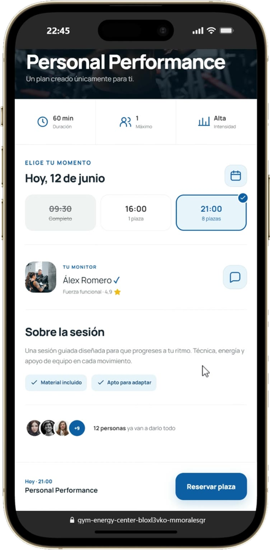
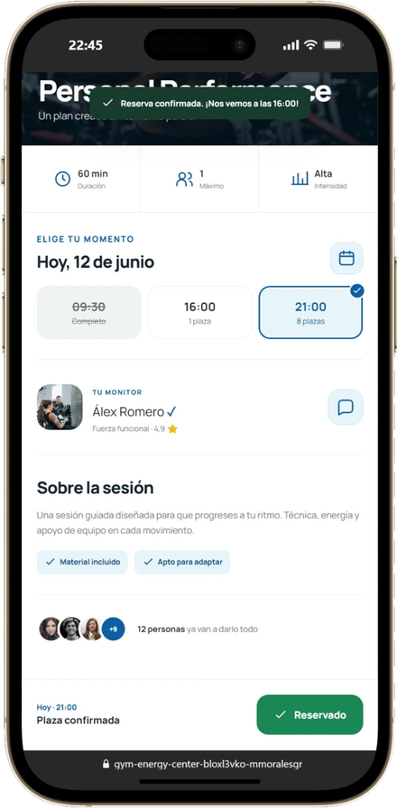

# Handoff · Gym Energy Center (caso 06) · rediseño mobile + desktop

Diseño aprobado en el canvas "Case study · Gym Energy Center". Objetivo: integrarlo en `gym-energy-center.html` **siguiendo el patrón del commit `1a95554`** ("case 05 (Oracle): integrar el rediseño mobile exacto del canvas"). Lee ese commit antes de empezar.

Este archivo y la carpeta `assets/gym-mobile/` se crearon en `C:\Users\mmora\marta-portfolio\`. Si trabajas en otro clon, cópialos a la misma ruta relativa de tu repo.

## Alcance

**Mobile (`max-width: 768px`)**: artboards Mobile 01–04.
- Bloque con prefijo `.gme-*` (equivalente a `.ome-*` de Oracle), oculto en desktop.
- Los 4 tabs móviles (Overview / Problema / Solución / Resultados) se repuntan a `#gme-overview`, `#gme-problema`, `#gme-solucion`, `#gme-resultados` y mantienen el tracking de pestaña activa.

**Desktop (> 768px)**: artboard "Desktop 1440".
- Sustituye el contenido actual del caso en desktop por la estructura del artboard: narrativa a la izquierda / evidencia a la derecha, sin carruseles, 6 módulos en rejilla.
- Contenedor: el del sitio (max-width actual de los casos). Las rejillas del artboard usan `auto-fit`; respétalo.
- Hero: montaje de los dos vídeos (portátil detrás con `mix-blend-mode: lighten`, móvil delante con `border-radius` y sombra). Copia los valores del artboard.

**Ambos**
- Header `.cs-top`, paginación `.cs-pagination-section`, "siguiente caso", CTA sticky, chatbot y scroll-to-top: los del sitio, sin duplicar. En los artboards aparecen solo como referencia visual.
- Bilingüe: todo texto en `<span class="es">` + `<span class="en">`. Traduce al EN con el tono de `it-ops-oracle.html`. Los `.mm-reveal` van dentro de los spans `.es`/`.en`.

## Reglas del repo (no negociables)

- No tocar design tokens ni estilos globales. El canvas ya usa los del sitio: `--purple #a78bfa`, `--purple-deep #7c3aed`, Playfair Display en titulares, Inter en cuerpo, fondo negro.
- Sin librerías. Vanilla HTML/CSS/JS.
- Localiza por contenido, nunca por número de línea.
- Sin em-dashes en el copy, sin emojis, sin la estructura retórica "esto no era X, era Y".
- Commit con `git add -A` (no `deploy.bat`). Cache-busting `?v=` si cambias CSS/JS.

## Assets (`assets/gym-mobile/`)

| Archivo | Uso |
|---|---|
| `hero-mobile.mp4` (póster `m-home.webp`) | Vídeo hero mobile; en desktop, el móvil del montaje (póster `m-home.png`) |
| `walkthrough-desk.mp4` (póster `d-home.webp`) | Portátil del hero desktop y vídeo de apertura de Solución en mobile |
| `m-*.png` | **PNG transparentes** (solo el teléfono). Usar siempre estos, no los `m-*.webp` |
| `m-proximo.png`, `m-detalle.png`, `m-perfil.png` | Bucle de hábito (sección Problema) |
| `m-home`, `m-muro`, `m-clases`, `m-reservas`, `m-perfil`, `m-logros` `.png` | 6 módulos (Solución): Inicio, Comunidad, Calendario, Actividades, Perfil y racha, Logros y mensajes |
| `m-detalle.png` → `m-reservado.png` | Bloque "2 taps" antes/después (Solución) |
| `d-confirmado.webp` | "Pruébalo" (Resultados) |

Los `m-*.webp` y `m-calendario`/`m-comunidad`/`d-dash`/`d-detalle` no se usan; no los subas al commit.

## Contenido y cifras

- El antiguo hueco M4 (mapa de hábitos) ya NO es una imagen: es el bucle "Síntesis · bucle de hábito" construido en HTML (detonante → acción → recompensa). Elimina la referencia rota `projects/06-gym/assets/journey-habits.webp` del HTML actual.
- Medidas (test Maze no moderado): 88 % tareas completadas, SUS 4,6/5, 0 bloqueos en reserva, 12 entrevistas.
- Hipótesis, sin medir: +34 % retención a 90 días, +52 % asistencia. Tarjeta con borde discontinuo y chip "Hipótesis". No como cifra héroe.
- Eliminar "4,8★ app store" de todo el caso: la app no se publicó.
- Prototipo: `https://gym-energy-center-bloxl3vko-mmoralesgr93-2202s-projects.vercel.app/`. Comprueba que abre sin login de Vercel; si pide auth, avisa a Marta en vez de enlazarlo.
- Siguiente caso: el que ya tenga la paginación del sitio.

## Cómo leer los artboards

Fuente exacta del diseño (mobile a 390 px, desktop a 1440 px). `{{accent}}` = `#a78bfa`. `<sc-for>` es un bucle: los datos están en `renderVals()` del script final de cada artboard. Las rutas ya apuntan a `assets/gym-mobile/`.

## Verificación

Antes de commitear: Playwright a 390×844, 1024 y 1440 px. ES/EN, los 4 tabs mobile, vídeos en autoplay, sin imágenes rotas.

## Artboards

### Mobile 01 · Hero + TL;DR (`Main.dc.html`)

```html
<!doctype html>
<html lang="es">
<head>
<meta charset="utf-8">
<title>Gym Energy · Hero</title>
<script src="./support.js"></script>
</head>
<body>
<x-dc>
<helmet>
<link rel="preconnect" href="https://fonts.googleapis.com">
<link href="https://fonts.googleapis.com/css2?family=Inter:wght@400;500;600;700&amp;family=Playfair+Display:ital,wght@0,700;0,800;1,700&amp;display=swap" rel="stylesheet">
<style>
body{margin:0;background:#000}
a{color:#a78bfa}a:hover{color:#c4b5fd}
</style>
</helmet>
<div style="width: 390px; height: 1600px; background: #000; color: rgba(255,255,255,.72); font-family: Inter, system-ui, sans-serif; overflow: hidden; position: relative">

<header style="height: 56px; padding: 0 6px; display: flex; align-items: center; justify-content: space-between; background: rgba(0,0,0,.8); border-bottom: 1px solid rgba(255,255,255,.08)">
<a href="#" aria-label="Volver a casos" style="width: 44px; height: 44px; display: flex; align-items: center; justify-content: center; color: #fff"><svg width="20" height="20" viewBox="0 0 24 24" fill="none" stroke="currentColor" stroke-width="2" stroke-linecap="round" stroke-linejoin="round" aria-hidden="true"><path d="M15 18l-6-6 6-6"></path></svg></a>
<div style="font-size: 12px; font-weight: 600; letter-spacing: .12em; text-transform: uppercase; color: rgba(255,255,255,.9)">Caso 06 <span style="color: rgba(255,255,255,.4)">/ 06</span></div>
<button type="button" aria-label="Cambiar a inglés" style="width: 44px; height: 44px; background: none; border: 0; color: rgba(255,255,255,.7); font: 600 12px Inter, sans-serif; letter-spacing: .08em">EN</button>
</header>
<nav aria-label="Secciones" style="display: grid; grid-template-columns: repeat(4, minmax(0, 1fr)); gap: 6px; padding: 10px 16px 0">
<div style="display: flex; flex-direction: column; gap: 6px"><div style="height: 3px; border-radius: 3px; background: {{accent}}"></div><span style="font-size: 10px; font-weight: 600; letter-spacing: .06em; text-transform: uppercase; color: #fff">Overview</span></div>
<div style="display: flex; flex-direction: column; gap: 6px"><div style="height: 3px; border-radius: 3px; background: rgba(255,255,255,.14)"></div><span style="font-size: 10px; font-weight: 600; letter-spacing: .06em; text-transform: uppercase; color: rgba(255,255,255,.4)">Problema</span></div>
<div style="display: flex; flex-direction: column; gap: 6px"><div style="height: 3px; border-radius: 3px; background: rgba(255,255,255,.14)"></div><span style="font-size: 10px; font-weight: 600; letter-spacing: .06em; text-transform: uppercase; color: rgba(255,255,255,.4)">Solución</span></div>
<div style="display: flex; flex-direction: column; gap: 6px"><div style="height: 3px; border-radius: 3px; background: rgba(255,255,255,.14)"></div><span style="font-size: 10px; font-weight: 600; letter-spacing: .06em; text-transform: uppercase; color: rgba(255,255,255,.4)">Resultados</span></div>
</nav>

<section style="padding: 30px 16px 0; display: flex; flex-direction: column; gap: 16px">
<div style="display: flex; flex-wrap: wrap; gap: 8px">
<span style="padding: 6px 12px; border-radius: 999px; border: 1px solid rgba(167,139,250,.4); color: {{accent}}; font-size: 12px; font-weight: 600">Fitness · B2C</span>
<span style="padding: 6px 12px; border-radius: 999px; border: 1px solid rgba(255,255,255,.14); color: rgba(255,255,255,.75); font-size: 12px; font-weight: 500">UX Research · Bootcamp</span>
</div>
<h1 style="margin: 0; font-family: 'Playfair Display', Georgia, serif; font-weight: 800; font-size: 44px; line-height: 1.03; letter-spacing: -.02em; color: #fff">Diseñar para <span style="font-style: italic; color: {{accent}}">volver mañana</span></h1>
<p style="margin: 0; font-size: 16px; line-height: 1.5; color: rgba(255,255,255,.78)">La fricción no estaba en reservar una clase; estaba en <strong style="color: #fff; font-weight: 600">volver al día siguiente</strong>.</p>
</section>

<figure style="margin: 22px 0 0; padding: 18px 0 8px; display: flex; flex-direction: column; align-items: center; gap: 12px; background: radial-gradient(ellipse at 50% 50%, rgba(167,139,250,.16), rgba(0,0,0,0) 65%)">
<video src="assets/gym-mobile/hero-mobile.mp4" poster="assets/gym-mobile/m-home.webp" autoplay="true" muted="true" loop="true" playsinline="true" aria-label="Recorrido del prototipo móvil de Gym Energy: inicio, comunidad, perfil y reserva de clase" style="display: block; width: 214px; height: 437px; object-fit: cover; border-radius: 34px; box-shadow: 0 24px 50px rgba(0,0,0,.6)"></video>
<figcaption style="align-self: stretch; padding: 0 16px; display: flex; align-items: center; justify-content: space-between">
<span style="display: flex; align-items: center; gap: 8px; font-size: 12px; font-weight: 500; color: rgba(255,255,255,.75)"><span style="width: 7px; height: 7px; border-radius: 50%; background: #ef4444"></span>Prototipo navegable · recorrido 71 s</span>
<a href="https://gym-energy-center-bloxl3vko-mmoralesgr93-2202s-projects.vercel.app/" style="font-size: 12px; font-weight: 600; padding: 12px 0">Abrir ↗</a>
</figcaption>
</figure>

<section aria-label="Ficha del proyecto" style="margin: 14px 16px 0; display: grid; grid-template-columns: repeat(2, minmax(0, 1fr)); gap: 1px; background: rgba(255,255,255,.1); border: 1px solid rgba(255,255,255,.1); border-radius: 16px; overflow: hidden">
<div style="background: #0a0a0c; padding: 14px 16px; display: flex; flex-direction: column; gap: 4px"><span style="font-size: 10px; font-weight: 600; letter-spacing: .12em; text-transform: uppercase; color: rgba(255,255,255,.45)">Rol</span><span style="font-size: 14px; font-weight: 600; color: #fff">UX Researcher &amp; UI</span></div>
<div style="background: #0a0a0c; padding: 14px 16px; display: flex; flex-direction: column; gap: 4px"><span style="font-size: 10px; font-weight: 600; letter-spacing: .12em; text-transform: uppercase; color: rgba(255,255,255,.45)">Duración</span><span style="font-size: 14px; font-weight: 600; color: #fff">6 semanas</span></div>
<div style="background: #0a0a0c; padding: 14px 16px; display: flex; flex-direction: column; gap: 4px"><span style="font-size: 10px; font-weight: 600; letter-spacing: .12em; text-transform: uppercase; color: rgba(255,255,255,.45)">Equipo</span><span style="font-size: 14px; font-weight: 600; color: #fff">4 diseñadores</span></div>
<div style="background: #0a0a0c; padding: 14px 16px; display: flex; flex-direction: column; gap: 4px"><span style="font-size: 10px; font-weight: 600; letter-spacing: .12em; text-transform: uppercase; color: rgba(255,255,255,.45)">Plataforma</span><span style="font-size: 14px; font-weight: 600; color: #fff">App móvil + desktop</span></div>
</section>

<section style="padding: 48px 16px 0; display: flex; flex-direction: column; gap: 18px">
<div style="display: flex; align-items: baseline; justify-content: space-between">
<h2 style="margin: 0; font-family: 'Playfair Display', Georgia, serif; font-size: 30px; line-height: 1.1; color: #fff">El caso en <span style="font-style: italic; color: {{accent}}">30 segundos</span></h2>
<span style="font-size: 12px; font-weight: 600; color: rgba(255,255,255,.4)">01</span>
</div>
<div style="display: flex; flex-direction: column">
<div style="display: flex; gap: 16px">
<div style="display: flex; flex-direction: column; align-items: center; width: 14px; padding-top: 22px"><span style="width: 12px; height: 12px; border-radius: 50%; border: 2px solid rgba(255,255,255,.5)"></span><span style="flex: 1; width: 2px; background: rgba(255,255,255,.12)"></span></div>
<div style="flex: 1; padding: 14px 0 22px; display: flex; flex-direction: column; gap: 6px">
<span style="font-size: 11px; font-weight: 600; letter-spacing: .12em; text-transform: uppercase; color: rgba(255,255,255,.5)">Problema</span>
<span style="font-family: 'Playfair Display', Georgia, serif; font-weight: 800; font-size: 50px; line-height: 1; color: #fff">68%</span>
<span style="font-size: 15px; line-height: 1.45; color: rgba(255,255,255,.72)">de los socios nuevos abandona antes del día 45.</span>
</div>
</div>
<div style="display: flex; gap: 16px">
<div style="display: flex; flex-direction: column; align-items: center; width: 14px; padding-top: 22px"><span style="width: 12px; height: 12px; border-radius: 50%; border: 2px solid rgba(255,255,255,.5)"></span><span style="flex: 1; width: 2px; background: rgba(255,255,255,.12)"></span></div>
<div style="flex: 1; padding: 14px 0 22px; display: flex; flex-direction: column; gap: 6px">
<span style="font-size: 11px; font-weight: 600; letter-spacing: .12em; text-transform: uppercase; color: rgba(255,255,255,.5)">Decisión</span>
<span style="font-family: 'Playfair Display', Georgia, serif; font-weight: 800; font-size: 50px; line-height: 1; color: #fff">Hábito</span>
<span style="font-size: 15px; line-height: 1.45; color: rgba(255,255,255,.72)">Diseñar la app alrededor del grupo y la racha, no del calendario.</span>
</div>
</div>
<div style="display: flex; gap: 16px">
<div style="display: flex; flex-direction: column; align-items: center; width: 14px; padding-top: 22px"><span style="width: 12px; height: 12px; border-radius: 50%; background: {{accent}}; box-shadow: 0 0 0 5px rgba(167,139,250,.18)"></span></div>
<div style="flex: 1; padding: 16px 18px 18px; margin-top: 4px; border-radius: 18px; background: rgba(167,139,250,.07); border: 1px solid rgba(167,139,250,.32); display: flex; flex-direction: column; gap: 6px">
<span style="font-size: 11px; font-weight: 600; letter-spacing: .12em; text-transform: uppercase; color: {{accent}}">Validado en test · Maze</span>
<span style="font-family: 'Playfair Display', Georgia, serif; font-weight: 800; font-size: 60px; line-height: 1; color: {{accent}}">88%</span>
<span style="font-size: 15px; line-height: 1.45; color: rgba(255,255,255,.85)">de tareas completadas sin ayuda, con reserva en 2 taps.</span>
</div>
</div>
</div>
<a href="Problema.dc.html" style="margin-top: 10px; height: 52px; border-radius: 999px; border: 1px solid rgba(255,255,255,.16); display: flex; align-items: center; justify-content: center; gap: 10px; color: #fff; font-size: 15px; font-weight: 600; text-decoration: none">Ver el problema<svg width="18" height="18" viewBox="0 0 24 24" fill="none" stroke="currentColor" stroke-width="2" stroke-linecap="round" stroke-linejoin="round" aria-hidden="true"><path d="M12 5v14M19 12l-7 7-7-7"></path></svg></a>
</section>
</div>
</x-dc>
<script type="text/x-dc" data-dc-script data-props='{"accent":{"editor":"color","default":"#a78bfa","options":["#a78bfa","#f97316","#7c3aed"]},"$preview":{"width":390,"height":1600}}'>
class Component extends DCLogic {
renderVals() {
return { accent: this.props.accent ?? '#a78bfa' };
}
}
</script>
</body>
</html>

```

### Mobile 02 · Problema (`Problema.dc.html`)

```html
<!doctype html>
<html lang="es">
<head>
<meta charset="utf-8">
<title>Gym Energy · Problema</title>
<script src="./support.js"></script>
</head>
<body>
<x-dc>
<helmet>
<link rel="preconnect" href="https://fonts.googleapis.com">
<link href="https://fonts.googleapis.com/css2?family=Inter:wght@400;500;600;700&amp;family=Playfair+Display:ital,wght@0,700;0,800;1,700&amp;display=swap" rel="stylesheet">
<style>
body{margin:0;background:#000}
a{color:#a78bfa}a:hover{color:#c4b5fd}
</style>
</helmet>
<div style="width: 390px; height: 2200px; background: #000; color: rgba(255,255,255,.72); font-family: Inter, system-ui, sans-serif; overflow: hidden; position: relative">

<header style="height: 56px; padding: 0 6px; display: flex; align-items: center; justify-content: space-between; background: rgba(0,0,0,.8); border-bottom: 1px solid rgba(255,255,255,.08)">
<a href="Main.dc.html" aria-label="Volver" style="width: 44px; height: 44px; display: flex; align-items: center; justify-content: center; color: #fff"><svg width="20" height="20" viewBox="0 0 24 24" fill="none" stroke="currentColor" stroke-width="2" stroke-linecap="round" stroke-linejoin="round" aria-hidden="true"><path d="M15 18l-6-6 6-6"></path></svg></a>
<div style="font-size: 12px; font-weight: 600; letter-spacing: .12em; text-transform: uppercase; color: rgba(255,255,255,.9)">Caso 06 <span style="color: rgba(255,255,255,.4)">/ 06</span></div>
<button type="button" aria-label="Cambiar a inglés" style="width: 44px; height: 44px; background: none; border: 0; color: rgba(255,255,255,.7); font: 600 12px Inter, sans-serif; letter-spacing: .08em">EN</button>
</header>
<nav aria-label="Secciones" style="display: grid; grid-template-columns: repeat(4, minmax(0, 1fr)); gap: 6px; padding: 10px 16px 0">
<div style="display: flex; flex-direction: column; gap: 6px"><div style="height: 3px; border-radius: 3px; background: rgba(167,139,250,.45)"></div><span style="font-size: 10px; font-weight: 600; letter-spacing: .06em; text-transform: uppercase; color: rgba(255,255,255,.4)">Overview</span></div>
<div style="display: flex; flex-direction: column; gap: 6px"><div style="height: 3px; border-radius: 3px; background: {{accent}}"></div><span style="font-size: 10px; font-weight: 600; letter-spacing: .06em; text-transform: uppercase; color: #fff">Problema</span></div>
<div style="display: flex; flex-direction: column; gap: 6px"><div style="height: 3px; border-radius: 3px; background: rgba(255,255,255,.14)"></div><span style="font-size: 10px; font-weight: 600; letter-spacing: .06em; text-transform: uppercase; color: rgba(255,255,255,.4)">Solución</span></div>
<div style="display: flex; flex-direction: column; gap: 6px"><div style="height: 3px; border-radius: 3px; background: rgba(255,255,255,.14)"></div><span style="font-size: 10px; font-weight: 600; letter-spacing: .06em; text-transform: uppercase; color: rgba(255,255,255,.4)">Resultados</span></div>
</nav>

<section style="padding: 30px 16px 0; display: flex; flex-direction: column; gap: 22px">
<div style="display: flex; flex-direction: column; gap: 12px">
<span style="font-size: 12px; font-weight: 600; letter-spacing: .14em; text-transform: uppercase; color: {{accent}}">02 · Abandono temprano</span>
<h2 style="margin: 0; font-family: 'Playfair Display', Georgia, serif; font-weight: 800; font-size: 38px; line-height: 1.04; letter-spacing: -.015em; color: #fff">Sin grupo ni progreso, <span style="font-style: italic; color: {{accent}}">nadie vuelve</span></h2>
</div>
<div style="display: flex; flex-direction: column; gap: 16px">
<div style="display: flex; align-items: flex-end; gap: 14px">
<span style="font-family: 'Playfair Display', Georgia, serif; font-weight: 800; font-size: 92px; line-height: .85; color: {{accent}}">68%</span>
<span style="padding-bottom: 6px; font-size: 15px; line-height: 1.35; color: #fff; font-weight: 500">de los socios nuevos se va antes del día 45</span>
</div>
<div role="img" aria-label="7 de cada 10 socios nuevos abandonan antes del día 45" style="display: grid; grid-template-columns: repeat(10, minmax(0, 1fr)); gap: 6px">
<span style="height: 30px; border-radius: 6px; background: {{accent}}"></span>
<span style="height: 30px; border-radius: 6px; background: {{accent}}"></span>
<span style="height: 30px; border-radius: 6px; background: {{accent}}"></span>
<span style="height: 30px; border-radius: 6px; background: {{accent}}"></span>
<span style="height: 30px; border-radius: 6px; background: {{accent}}"></span>
<span style="height: 30px; border-radius: 6px; background: {{accent}}"></span>
<span style="height: 30px; border-radius: 6px; background: {{accent}}"></span>
<span style="height: 30px; border-radius: 6px; border: 1px dashed rgba(255,255,255,.22)"></span>
<span style="height: 30px; border-radius: 6px; border: 1px dashed rgba(255,255,255,.22)"></span>
<span style="height: 30px; border-radius: 6px; border: 1px dashed rgba(255,255,255,.22)"></span>
</div>
<p style="margin: 0; font-size: 15px; line-height: 1.55; color: rgba(255,255,255,.72)">En dos semanas se sentían perdidos: sin nadie con quien ir y sin forma de ver su progreso.</p>
</div>
</section>

<section style="padding: 40px 16px 0; display: flex; flex-direction: column; gap: 14px">
<span style="font-size: 12px; font-weight: 600; letter-spacing: .14em; text-transform: uppercase; color: rgba(255,255,255,.5)">La hipótesis que se cayó</span>
<div style="position: relative; display: grid; grid-template-columns: repeat(2, minmax(0, 1fr)); gap: 10px">
<div style="padding: 16px 14px 18px; border-radius: 18px; background: rgba(255,255,255,.03); border: 1px solid rgba(255,255,255,.1); display: flex; flex-direction: column; gap: 10px">
<span style="font-size: 11px; font-weight: 600; letter-spacing: .12em; text-transform: uppercase; color: rgba(255,255,255,.45)">Creíamos</span>
<span style="font-size: 20px; font-weight: 700; line-height: 1.15; color: rgba(255,255,255,.6); text-decoration: line-through; text-decoration-color: rgba(255,255,255,.35)">Falta de tiempo</span>
<span style="font-size: 13px; line-height: 1.4; color: rgba(255,255,255,.5)">Más horarios, más clases.</span>
</div>
<div style="position: relative; padding: 16px 14px 18px; border-radius: 18px; background: rgba(167,139,250,.08); border: 1px solid rgba(167,139,250,.5); display: flex; flex-direction: column; gap: 10px">
<span style="position: absolute; right: 10px; top: -11px; padding: 4px 9px; border-radius: 999px; background: {{accent}}; color: #0b0614; font-size: 10px; font-weight: 800; letter-spacing: .08em; text-transform: uppercase">Insight</span>
<span style="font-size: 11px; font-weight: 600; letter-spacing: .12em; text-transform: uppercase; color: {{accent}}">Vimos</span>
<span style="font-size: 20px; font-weight: 700; line-height: 1.15; color: #fff">Vergüenza con las máquinas</span>
<span style="font-size: 13px; line-height: 1.4; color: rgba(255,255,255,.8)">Pesa más en la asistencia que la agenda.</span>
</div>
<span aria-hidden="true" style="position: absolute; left: 50%; top: 50%; width: 34px; height: 34px; margin: -17px 0 0 -17px; border-radius: 50%; background: #000; border: 1px solid rgba(255,255,255,.18); display: flex; align-items: center; justify-content: center; font-size: 11px; font-weight: 700; color: rgba(255,255,255,.6)">vs</span>
</div>
</section>

<section style="padding: 40px 16px 0; display: flex; flex-direction: column; gap: 12px">
<div style="display: flex; align-items: baseline; gap: 10px">
<span style="font-family: 'Playfair Display', Georgia, serif; font-weight: 800; font-size: 40px; line-height: 1; color: #fff">12</span>
<span style="font-size: 12px; font-weight: 600; letter-spacing: .14em; text-transform: uppercase; color: rgba(255,255,255,.5)">entrevistas · 3 hallazgos</span>
</div>
<div style="display: flex; align-items: center; gap: 14px; padding: 14px; border-radius: 16px; background: rgba(255,255,255,.035); border: 1px solid rgba(255,255,255,.09)">
<span style="flex: none; width: 44px; height: 44px; border-radius: 12px; background: rgba(167,139,250,.12); color: {{accent}}; display: flex; align-items: center; justify-content: center"><svg width="22" height="22" viewBox="0 0 24 24" fill="none" stroke="currentColor" stroke-width="1.8" stroke-linecap="round" stroke-linejoin="round" aria-hidden="true"><path d="M6.5 6.5v11M17.5 6.5v11M3 9v6M21 9v6M6.5 12h11"></path></svg></span>
<div style="display: flex; flex-direction: column; gap: 3px"><span style="font-size: 15px; font-weight: 600; color: #fff">Vergüenza inicial</span><span style="font-size: 13px; line-height: 1.4; color: rgba(255,255,255,.62)">No saber usar el equipo frena más que no tener tiempo.</span></div>
</div>
<div style="display: flex; align-items: center; gap: 14px; padding: 14px; border-radius: 16px; background: rgba(255,255,255,.035); border: 1px solid rgba(255,255,255,.09)">
<span style="flex: none; width: 44px; height: 44px; border-radius: 12px; background: rgba(167,139,250,.12); color: {{accent}}; display: flex; align-items: center; justify-content: center"><svg width="22" height="22" viewBox="0 0 24 24" fill="none" stroke="currentColor" stroke-width="1.8" stroke-linecap="round" stroke-linejoin="round" aria-hidden="true"><circle cx="9" cy="8" r="3.5"></circle><path d="M2.5 20a6.5 6.5 0 0 1 13 0"></path><path d="M16 4.6a3.5 3.5 0 0 1 0 6.8M18 14.5a6.5 6.5 0 0 1 3.5 5.5"></path></svg></span>
<div style="display: flex; flex-direction: column; gap: 3px"><span style="font-size: 15px; font-weight: 600; color: #fff">La fuerza del grupo</span><span style="font-size: 13px; line-height: 1.4; color: rgba(255,255,255,.62)">Saber que un amigo va a la clase hace que vayas.</span></div>
</div>
<div style="display: flex; align-items: center; gap: 14px; padding: 14px; border-radius: 16px; background: rgba(255,255,255,.035); border: 1px solid rgba(255,255,255,.09)">
<span style="flex: none; width: 44px; height: 44px; border-radius: 12px; background: rgba(167,139,250,.12); color: {{accent}}; display: flex; align-items: center; justify-content: center"><svg width="22" height="22" viewBox="0 0 24 24" fill="none" stroke="currentColor" stroke-width="1.8" stroke-linecap="round" stroke-linejoin="round" aria-hidden="true"><path d="M12 3c1 3 4 4.5 4 8.5a4 4 0 0 1-8 0c0-1.6.7-2.8 1.5-3.7.3 1.3 1 2.2 2 2.2 0-2.5-.5-4.5.5-7z"></path><path d="M6 21h12"></path></svg></span>
<div style="display: flex; flex-direction: column; gap: 3px"><span style="font-size: 15px; font-weight: 600; color: #fff">Micro-victorias</span><span style="font-size: 13px; line-height: 1.4; color: rgba(255,255,255,.62)">Ver la racha refuerza el compromiso de volver.</span></div>
</div>
</section>

<section style="padding: 44px 0 0; display: flex; flex-direction: column; gap: 16px">
<div style="padding: 0 16px; display: flex; flex-direction: column; gap: 10px">
<span style="font-size: 12px; font-weight: 600; letter-spacing: .14em; text-transform: uppercase; color: rgba(255,255,255,.5)">Síntesis · bucle de hábito</span>
<h3 style="margin: 0; font-family: 'Playfair Display', Georgia, serif; font-weight: 800; font-size: 30px; line-height: 1.08; color: #fff">Detonante <span style="color: rgba(255,255,255,.4)">→</span> acción <span style="color: rgba(255,255,255,.4)">→</span> <span style="color: {{accent}}">recompensa</span></h3>
</div>
<figure aria-label="Bucle de hábito: cada hallazgo convertido en un paso del producto" style="margin: 0 16px; padding: 18px 16px 6px; border-radius: 20px; background: #0d0b14; border: 1px solid rgba(167,139,250,.28); display: flex; flex-direction: column">
<sc-for list="{{loop}}" as="s" hint-placeholder-count="3">
<div style="display: flex; gap: 12px">
<div style="flex: none; width: 14px; display: flex; flex-direction: column; align-items: center; padding-top: 4px"><span style="width: 12px; height: 12px; border-radius: 50%; background: {{accent}}; box-shadow: 0 0 0 4px rgba(167,139,250,.18)"></span><span style="flex: 1; width: 2px; background: rgba(167,139,250,.3)"></span></div>

<div style="flex: 1; min-width: 0; padding-bottom: 20px; display: flex; flex-direction: column; gap: 6px">
<span style="font-size: 11px; font-weight: 700; letter-spacing: .12em; text-transform: uppercase; color: {{accent}}">{{s.n}} · {{s.stage}}</span>
<span style="font-size: 17px; font-weight: 600; line-height: 1.2; color: #fff">{{s.t}}</span>
<span style="align-self: flex-start; padding: 3px 8px; border-radius: 6px; background: rgba(255,255,255,.06); font-size: 11px; font-weight: 600; color: rgba(255,255,255,.75)">Responde a · {{s.f}}</span>
<span style="font-size: 13px; line-height: 1.4; color: rgba(255,255,255,.65)">{{s.e}}</span>
</div>
</div>
</sc-for>
<div style="display: flex; align-items: center; gap: 12px; padding: 4px 0 12px">
<span aria-hidden="true" style="flex: none; width: 14px; display: flex; justify-content: center; color: {{accent}}"><svg width="16" height="16" viewBox="0 0 24 24" fill="none" stroke="currentColor" stroke-width="2.2" stroke-linecap="round" stroke-linejoin="round"><path d="M3 12a9 9 0 1 0 3-6.7L3 8"></path><path d="M3 3v5h5"></path></svg></span>
<span style="font-size: 14px; font-weight: 600; color: #fff">Y vuelve al día siguiente</span>
</div>
</figure>
<div style="padding: 0 16px; display: grid; grid-template-columns: repeat(2, minmax(0, 1fr)); gap: 8px">
<sc-for list="{{methods}}" as="m" hint-placeholder-count="4">
<div style="display: flex; align-items: center; gap: 10px; padding: 12px; border-radius: 12px; background: rgba(255,255,255,.035); border: 1px solid rgba(255,255,255,.09)">
<span style="flex: none; font-size: 11px; font-weight: 700; color: {{accent}}">{{m.n}}</span>
<span style="font-size: 13px; line-height: 1.3; font-weight: 600; color: #fff">{{m.t}}</span>
</div>
</sc-for>
</div>
</section>
</div>
</x-dc>
<script type="text/x-dc" data-dc-script data-props='{"accent":{"editor":"color","default":"#a78bfa","options":["#a78bfa","#f97316","#7c3aed"]},"$preview":{"width":390,"height":2200}}'>
class Component extends DCLogic {
renderVals() {
return {
accent: this.props.accent ?? '#a78bfa',
loop: [
{ n: '01', stage: 'Detonante', t: 'Aviso en contexto', f: 'Vergüenza inicial', e: '«Tu próximo mejor entrenamiento», sugerido según tus sesiones y tu racha.', img: 'assets/gym-mobile/m-proximo.png', alt: 'Inicio con la tarjeta Tu próximo mejor entrenamiento' },
{ n: '02', stage: 'Acción', t: 'Reserva en 2 taps', f: 'La fuerza del grupo', e: '«12 personas ya van a darlo todo», junto al botón de reservar.', img: 'assets/gym-mobile/m-detalle.png', alt: 'Detalle de clase con los asistentes junto al botón Reservar plaza' },
{ n: '03', stage: 'Recompensa', t: 'Hito visible', f: 'Micro-victorias', e: 'Racha de 7 días y nivel 8, lo primero que ves en tu perfil.', img: 'assets/gym-mobile/m-perfil.png', alt: 'Perfil con 42 sesiones, racha de 7 y nivel 8' }
],
methods: [
{ n: '01', t: 'Entrevistas en profundidad' },
{ n: '02', t: 'Empathy map' },
{ n: '03', t: 'Journey mapping' },
{ n: '04', t: 'Test de usabilidad · Maze' }
]
};
}
}
</script>
</body>
</html>

```

### Mobile 03 · Solución (`Solucion.dc.html`)

```html
<!doctype html>
<html lang="es">
<head>
<meta charset="utf-8">
<title>Gym Energy · Solución</title>
<script src="./support.js"></script>
</head>
<body>
<x-dc>
<helmet>
<link rel="preconnect" href="https://fonts.googleapis.com">
<link href="https://fonts.googleapis.com/css2?family=Inter:wght@400;500;600;700&amp;family=Playfair+Display:ital,wght@0,700;0,800;1,700&amp;display=swap" rel="stylesheet">
<style>
body{margin:0;background:#000}
a{color:#a78bfa}a:hover{color:#c4b5fd}
</style>
</helmet>
<div style="width: 390px; height: 1960px; background: #000; color: rgba(255,255,255,.72); font-family: Inter, system-ui, sans-serif; overflow: hidden; position: relative">

<header style="height: 56px; padding: 0 6px; display: flex; align-items: center; justify-content: space-between; background: rgba(0,0,0,.8); border-bottom: 1px solid rgba(255,255,255,.08)">
<a href="Problema.dc.html" aria-label="Volver" style="width: 44px; height: 44px; display: flex; align-items: center; justify-content: center; color: #fff"><svg width="20" height="20" viewBox="0 0 24 24" fill="none" stroke="currentColor" stroke-width="2" stroke-linecap="round" stroke-linejoin="round" aria-hidden="true"><path d="M15 18l-6-6 6-6"></path></svg></a>
<div style="font-size: 12px; font-weight: 600; letter-spacing: .12em; text-transform: uppercase; color: rgba(255,255,255,.9)">Caso 06 <span style="color: rgba(255,255,255,.4)">/ 06</span></div>
<button type="button" aria-label="Cambiar a inglés" style="width: 44px; height: 44px; background: none; border: 0; color: rgba(255,255,255,.7); font: 600 12px Inter, sans-serif; letter-spacing: .08em">EN</button>
</header>
<nav aria-label="Secciones" style="display: grid; grid-template-columns: repeat(4, minmax(0, 1fr)); gap: 6px; padding: 10px 16px 0">
<div style="display: flex; flex-direction: column; gap: 6px"><div style="height: 3px; border-radius: 3px; background: rgba(167,139,250,.45)"></div><span style="font-size: 10px; font-weight: 600; letter-spacing: .06em; text-transform: uppercase; color: rgba(255,255,255,.4)">Overview</span></div>
<div style="display: flex; flex-direction: column; gap: 6px"><div style="height: 3px; border-radius: 3px; background: rgba(167,139,250,.45)"></div><span style="font-size: 10px; font-weight: 600; letter-spacing: .06em; text-transform: uppercase; color: rgba(255,255,255,.4)">Problema</span></div>
<div style="display: flex; flex-direction: column; gap: 6px"><div style="height: 3px; border-radius: 3px; background: {{accent}}"></div><span style="font-size: 10px; font-weight: 600; letter-spacing: .06em; text-transform: uppercase; color: #fff">Solución</span></div>
<div style="display: flex; flex-direction: column; gap: 6px"><div style="height: 3px; border-radius: 3px; background: rgba(255,255,255,.14)"></div><span style="font-size: 10px; font-weight: 600; letter-spacing: .06em; text-transform: uppercase; color: rgba(255,255,255,.4)">Resultados</span></div>
</nav>

<section style="padding: 30px 16px 0; display: flex; flex-direction: column; gap: 12px">
<span style="font-size: 12px; font-weight: 600; letter-spacing: .14em; text-transform: uppercase; color: {{accent}}">03 · La solución</span>
<h2 style="margin: 0; font-family: 'Playfair Display', Georgia, serif; font-weight: 800; font-size: 38px; line-height: 1.04; letter-spacing: -.015em; color: #fff">Práctico, social <span style="font-style: italic; color: {{accent}}">y lúdico</span></h2>
</section>

<figure style="margin: 22px 0 0; padding: 14px 0 0; display: flex; flex-direction: column; gap: 10px; background: radial-gradient(ellipse at 50% 55%, rgba(167,139,250,.14), rgba(0,0,0,0) 70%)">
<video src="assets/gym-mobile/walkthrough-desk.mp4" poster="assets/gym-mobile/d-home.webp" autoplay="true" muted="true" loop="true" playsinline="true" aria-label="Recorrido de la versión desktop: inicio, clases y reserva de Power Training" style="display: block; width: 390px; height: 224px; object-fit: contain"></video>
<figcaption style="padding: 0 16px; font-size: 13px; line-height: 1.45; color: rgba(255,255,255,.7)">La misma lógica en móvil y escritorio: reservar, ver quién va y seguir tu racha.</figcaption>
</figure>

<section style="padding: 28px 16px 0; display: grid; grid-template-columns: repeat(3, minmax(0, 1fr)); gap: 8px">
<sc-for list="{{pillars}}" as="p" hint-placeholder-count="3">
<div style="padding: 14px 12px 16px; border-radius: 16px; background: rgba(255,255,255,.04); border: 1px solid rgba(255,255,255,.1); display: flex; flex-direction: column; gap: 8px">
<span style="font-size: 10px; font-weight: 700; letter-spacing: .12em; text-transform: uppercase; color: {{accent}}">{{p.k}}</span>
<span style="font-size: 14px; line-height: 1.3; font-weight: 600; color: #fff">{{p.t}}</span>
</div>
</sc-for>
</section>

<section style="padding: 44px 0 0; display: flex; flex-direction: column; gap: 14px">
<div style="padding: 0 16px; display: flex; flex-direction: column; gap: 8px">
<span style="font-size: 12px; font-weight: 600; letter-spacing: .14em; text-transform: uppercase; color: rgba(255,255,255,.5)">De la investigación a la pantalla</span>
<h3 style="margin: 0; font-family: 'Playfair Display', Georgia, serif; font-weight: 800; font-size: 28px; line-height: 1.1; color: #fff">Cada hallazgo, una pantalla</h3>
</div>
<div style="display: flex; gap: 12px; overflow-x: auto; padding: 0 16px 4px; scroll-snap-type: x mandatory">
<sc-for list="{{mods}}" as="m" hint-placeholder-count="2">
<article style="flex: none; width: 258px; scroll-snap-align: start; border-radius: 20px; overflow: hidden; background: #0d0d10; border: 1px solid rgba(255,255,255,.1)">
<div style="position: relative; padding: 18px 0 0; display: flex; justify-content: center; background: radial-gradient(ellipse at 50% 40%, rgba(167,139,250,.12), rgba(0,0,0,0) 70%)">

<span style="position: absolute; left: 10px; top: 10px; padding: 4px 9px; border-radius: 999px; background: {{accent}}; color: #0b0614; font-size: 11px; font-weight: 700">{{m.n}} · {{m.k}}</span>
</div>
<div style="padding: 14px 16px 16px; border-top: 1px solid rgba(255,255,255,.08); display: flex; flex-direction: column; gap: 6px">
<span style="font-size: 17px; font-weight: 600; color: #fff">{{m.t}}</span>
<span style="font-size: 13px; line-height: 1.4; color: rgba(255,255,255,.65)">{{m.d}}</span>
</div>
</article>
</sc-for>
</div>
<div style="padding: 0 16px; display: flex; align-items: center; justify-content: space-between">
<div style="display: flex; gap: 6px" aria-hidden="true">
<span style="width: 22px; height: 6px; border-radius: 6px; background: {{accent}}"></span>
<span style="width: 6px; height: 6px; border-radius: 6px; background: rgba(255,255,255,.25)"></span>
<span style="width: 6px; height: 6px; border-radius: 6px; background: rgba(255,255,255,.25)"></span>
<span style="width: 6px; height: 6px; border-radius: 6px; background: rgba(255,255,255,.25)"></span>
<span style="width: 6px; height: 6px; border-radius: 6px; background: rgba(255,255,255,.25)"></span>
<span style="width: 6px; height: 6px; border-radius: 6px; background: rgba(255,255,255,.25)"></span>
</div>
<span style="font-size: 12px; font-weight: 600; color: rgba(255,255,255,.5)">Desliza · 01 / 06</span>
</div>
</section>

<section style="margin: 44px 16px 0; padding: 20px 0 22px; border-radius: 22px; background: rgba(167,139,250,.06); border: 1px solid rgba(167,139,250,.3); display: flex; flex-direction: column; gap: 18px">
<div style="padding: 0 20px; display: flex; flex-direction: column; gap: 8px">
<span style="font-size: 11px; font-weight: 600; letter-spacing: .12em; text-transform: uppercase; color: {{accent}}">El bucle clave · Reserva</span>
<span style="font-family: 'Playfair Display', Georgia, serif; font-weight: 800; font-size: 52px; line-height: 1; color: #fff">2 taps</span>
<span style="font-size: 15px; line-height: 1.45; color: rgba(255,255,255,.8)">Del hueco libre a la plaza confirmada, viendo quién más va.</span>
</div>
<div style="display: flex; align-items: center; justify-content: center; gap: 6px">

<span aria-hidden="true" style="flex: none; width: 30px; height: 30px; border-radius: 50%; background: {{accent}}; color: #0b0614; display: flex; align-items: center; justify-content: center"><svg width="16" height="16" viewBox="0 0 24 24" fill="none" stroke="currentColor" stroke-width="2.4" stroke-linecap="round" stroke-linejoin="round"><path d="M5 12h14M13 5l7 7-7 7"></path></svg></span>

</div>
<ol style="margin: 0; padding: 0 20px; list-style: none; display: grid; grid-template-columns: repeat(3, minmax(0, 1fr)); gap: 8px">
<li style="display: flex; flex-direction: column; gap: 4px"><span style="font-size: 11px; font-weight: 700; color: {{accent}}">01</span><span style="font-size: 13px; line-height: 1.3; font-weight: 600; color: #fff">Aviso en contexto</span></li>
<li style="display: flex; flex-direction: column; gap: 4px"><span style="font-size: 11px; font-weight: 700; color: {{accent}}">02</span><span style="font-size: 13px; line-height: 1.3; font-weight: 600; color: #fff">Reserva en 2 taps</span></li>
<li style="display: flex; flex-direction: column; gap: 4px"><span style="font-size: 11px; font-weight: 700; color: {{accent}}">03</span><span style="font-size: 13px; line-height: 1.3; font-weight: 600; color: #fff">Hito visible</span></li>
</ol>
</section>
</div>
</x-dc>
<script type="text/x-dc" data-dc-script data-props='{"accent":{"editor":"color","default":"#a78bfa","options":["#a78bfa","#f97316","#7c3aed"]},"$preview":{"width":390,"height":1960}}'>
class Component extends DCLogic {
renderVals() {
return {
accent: this.props.accent ?? '#a78bfa',
pillars: [
{ k: 'Práctico', t: 'Reserva en 2 taps' },
{ k: 'Social', t: 'Muro y grupos' },
{ k: 'Lúdico', t: 'Retos y rachas' }
],
mods: [
{ n: '01', k: 'Lúdico', t: 'Inicio', d: 'Tu progreso primero: «Estás más cerca de lo que crees».', img: 'assets/gym-mobile/m-home.png', alt: 'Pantalla de inicio con progreso de 62,5 kg y gráfico de barras' },
{ n: '02', k: 'Social', t: 'Comunidad', d: 'Muro de actividad para ver quién entrena y comentar.', img: 'assets/gym-mobile/m-muro.png', alt: 'Muro de comunidad con una publicación y comentarios' },
{ n: '03', k: 'Práctico', t: 'Calendario', d: 'Sesiones del día con plazas y reserva directa.', img: 'assets/gym-mobile/m-clases.png', alt: 'Calendario con la lista de sesiones del día y botón Reservar' },
{ n: '04', k: 'Práctico', t: 'Actividades', d: 'Clases para empezar y confirmación al instante.', img: 'assets/gym-mobile/m-reservas.png', alt: 'Actividades con el aviso Strength Lab añadido a tu semana' },
{ n: '05', k: 'Lúdico', t: 'Perfil y racha', d: 'Sesiones, racha y nivel: la micro-victoria a la vista.', img: 'assets/gym-mobile/m-perfil.png', alt: 'Perfil de Lara Gómez con 42 sesiones, racha de 7 y nivel 8' },
{ n: '06', k: 'Social', t: 'Logros y mensajes', d: 'Logros desbloqueados y chats con tu grupo.', img: 'assets/gym-mobile/m-logros.png', alt: 'Pantalla de logros y mensajes del grupo' }
]
};
}
}
</script>
</body>
</html>

```

### Mobile 04 · Resultados + cierre (`Resultados.dc.html`)

```html
<!doctype html>
<html lang="es">
<head>
<meta charset="utf-8">
<title>Gym Energy · Resultados</title>
<script src="./support.js"></script>
</head>
<body>
<x-dc>
<helmet>
<link rel="preconnect" href="https://fonts.googleapis.com">
<link href="https://fonts.googleapis.com/css2?family=Inter:wght@400;500;600;700&amp;family=Playfair+Display:ital,wght@0,700;0,800;1,700&amp;display=swap" rel="stylesheet">
<style>
body{margin:0;background:#000}
a{color:#a78bfa}a:hover{color:#c4b5fd}
</style>
</helmet>
<div style="width: 390px; height: 2020px; background: #000; color: rgba(255,255,255,.72); font-family: Inter, system-ui, sans-serif; overflow: hidden; position: relative">

<header style="height: 56px; padding: 0 6px; display: flex; align-items: center; justify-content: space-between; background: rgba(0,0,0,.8); border-bottom: 1px solid rgba(255,255,255,.08)">
<a href="Solucion.dc.html" aria-label="Volver" style="width: 44px; height: 44px; display: flex; align-items: center; justify-content: center; color: #fff"><svg width="20" height="20" viewBox="0 0 24 24" fill="none" stroke="currentColor" stroke-width="2" stroke-linecap="round" stroke-linejoin="round" aria-hidden="true"><path d="M15 18l-6-6 6-6"></path></svg></a>
<div style="font-size: 12px; font-weight: 600; letter-spacing: .12em; text-transform: uppercase; color: rgba(255,255,255,.9)">Caso 06 <span style="color: rgba(255,255,255,.4)">/ 06</span></div>
<button type="button" aria-label="Cambiar a inglés" style="width: 44px; height: 44px; background: none; border: 0; color: rgba(255,255,255,.7); font: 600 12px Inter, sans-serif; letter-spacing: .08em">EN</button>
</header>
<nav aria-label="Secciones" style="display: grid; grid-template-columns: repeat(4, minmax(0, 1fr)); gap: 6px; padding: 10px 16px 0">
<div style="display: flex; flex-direction: column; gap: 6px"><div style="height: 3px; border-radius: 3px; background: rgba(167,139,250,.45)"></div><span style="font-size: 10px; font-weight: 600; letter-spacing: .06em; text-transform: uppercase; color: rgba(255,255,255,.4)">Overview</span></div>
<div style="display: flex; flex-direction: column; gap: 6px"><div style="height: 3px; border-radius: 3px; background: rgba(167,139,250,.45)"></div><span style="font-size: 10px; font-weight: 600; letter-spacing: .06em; text-transform: uppercase; color: rgba(255,255,255,.4)">Problema</span></div>
<div style="display: flex; flex-direction: column; gap: 6px"><div style="height: 3px; border-radius: 3px; background: rgba(167,139,250,.45)"></div><span style="font-size: 10px; font-weight: 600; letter-spacing: .06em; text-transform: uppercase; color: rgba(255,255,255,.4)">Solución</span></div>
<div style="display: flex; flex-direction: column; gap: 6px"><div style="height: 3px; border-radius: 3px; background: {{accent}}"></div><span style="font-size: 10px; font-weight: 600; letter-spacing: .06em; text-transform: uppercase; color: #fff">Resultados</span></div>
</nav>

<section style="padding: 32px 16px 0; display: flex; flex-direction: column; gap: 20px">
<div style="display: flex; flex-direction: column; gap: 12px">
<span style="font-size: 12px; font-weight: 600; letter-spacing: .14em; text-transform: uppercase; color: {{accent}}">04 · Resultados</span>
<h2 style="margin: 0; font-family: 'Playfair Display', Georgia, serif; font-weight: 800; font-size: 40px; line-height: 1.04; letter-spacing: -.015em; color: #fff">Validado con <span style="font-style: italic; color: {{accent}}">usuarios reales</span></h2>
</div>

<div style="padding: 22px 20px 24px; border-radius: 24px; background: radial-gradient(ellipse at 85% 0%, rgba(124,58,237,.35), rgba(124,58,237,0) 60%), #0d0b14; border: 1px solid rgba(167,139,250,.35); display: flex; flex-direction: column; gap: 20px">
<div style="display: flex; align-items: center; justify-content: space-between; gap: 12px">
<span style="font-size: 13px; font-weight: 600; color: #fff">Test de usabilidad no moderado · Maze</span>
<span style="flex: none; padding: 4px 9px; border-radius: 999px; border: 1px solid rgba(167,139,250,.4); color: {{accent}}; font-size: 10px; font-weight: 700; letter-spacing: .08em; text-transform: uppercase">Medido</span>
</div>
<div style="display: flex; flex-direction: column; gap: 14px">
<div style="display: flex; flex-direction: column; gap: 7px">
<div style="display: flex; justify-content: space-between; align-items: baseline"><span style="font-size: 13px; color: #fff; font-weight: 600">Tareas completadas sin ayuda</span><span style="font-size: 20px; font-weight: 700; color: {{accent}}">88%</span></div>
<div style="display: flex; gap: 4px; align-items: center"><div style="width: 88%; height: 14px; border-radius: 7px; background: {{accent}}"></div><div style="flex: 1; height: 14px; border-radius: 7px; border: 1px dashed rgba(167,139,250,.45)"></div></div>
</div>
<div style="display: flex; flex-direction: column; gap: 7px">
<div style="display: flex; justify-content: space-between; align-items: baseline"><span style="font-size: 13px; color: #fff; font-weight: 600">Satisfacción SUS</span><span style="font-size: 20px; font-weight: 700; color: {{accent}}">4,6<span style="font-size: 13px; color: rgba(255,255,255,.55)"> / 5</span></span></div>
<div style="display: flex; gap: 4px; align-items: center"><div style="width: 92%; height: 14px; border-radius: 7px; background: {{accent}}"></div><div style="flex: 1; height: 14px; border-radius: 7px; border: 1px dashed rgba(167,139,250,.45)"></div></div>
</div>
</div>
<div style="display: flex; align-items: flex-end; gap: 14px; padding-top: 16px; border-top: 1px solid rgba(255,255,255,.1)">
<span style="font-family: 'Playfair Display', Georgia, serif; font-weight: 800; font-size: 72px; line-height: .85; letter-spacing: -.02em; color: {{accent}}">0</span>
<span style="padding-bottom: 4px; font-size: 14px; line-height: 1.4; color: rgba(255,255,255,.85)"><strong style="color: #fff">bloqueos</strong> detectados en el flujo de reserva</span>
</div>
</div>
<div style="display: grid; grid-template-columns: repeat(3, minmax(0, 1fr)); gap: 10px">
<div style="padding: 16px 12px; border-radius: 18px; background: rgba(255,255,255,.04); border: 1px solid rgba(255,255,255,.1); display: flex; flex-direction: column; gap: 8px"><span style="font-family: 'Playfair Display', Georgia, serif; font-weight: 800; font-size: 36px; line-height: 1; color: #fff">2<span style="font-size: 16px"> taps</span></span><span style="font-size: 12px; line-height: 1.35; color: rgba(255,255,255,.7)">para reservar una clase</span></div>
<div style="padding: 16px 12px; border-radius: 18px; background: rgba(255,255,255,.04); border: 1px solid rgba(255,255,255,.1); display: flex; flex-direction: column; gap: 8px"><span style="font-family: 'Playfair Display', Georgia, serif; font-weight: 800; font-size: 36px; line-height: 1; color: #fff">12</span><span style="font-size: 12px; line-height: 1.35; color: rgba(255,255,255,.7)">entrevistas en profundidad</span></div>
<div style="padding: 16px 12px; border-radius: 18px; background: rgba(255,255,255,.04); border: 1px solid rgba(255,255,255,.1); display: flex; flex-direction: column; gap: 8px"><span style="font-family: 'Playfair Display', Georgia, serif; font-weight: 800; font-size: 36px; line-height: 1; color: #fff">6<span style="font-size: 16px"> sem</span></span><span style="font-size: 12px; line-height: 1.35; color: rgba(255,255,255,.7)">de research a prototipo</span></div>
</div>

<div style="padding: 18px; border-radius: 18px; border: 1px dashed rgba(255,255,255,.2); display: flex; flex-direction: column; gap: 14px">
<div style="display: flex; align-items: center; justify-content: space-between; gap: 12px">
<span style="font-size: 13px; font-weight: 600; color: #fff">Impacto esperado en el gimnasio</span>
<span style="flex: none; padding: 4px 9px; border-radius: 999px; border: 1px solid rgba(255,255,255,.2); color: rgba(255,255,255,.7); font-size: 10px; font-weight: 700; letter-spacing: .08em; text-transform: uppercase">Hipótesis</span>
</div>
<div style="display: grid; grid-template-columns: repeat(2, minmax(0, 1fr)); gap: 12px">
<div style="display: flex; flex-direction: column; gap: 4px"><span style="font-family: 'Playfair Display', Georgia, serif; font-weight: 800; font-size: 32px; line-height: 1; color: rgba(255,255,255,.85)">+34%</span><span style="font-size: 12px; line-height: 1.35; color: rgba(255,255,255,.6)">retención a 90 días</span></div>
<div style="display: flex; flex-direction: column; gap: 4px"><span style="font-family: 'Playfair Display', Georgia, serif; font-weight: 800; font-size: 32px; line-height: 1; color: rgba(255,255,255,.85)">+52%</span><span style="font-size: 12px; line-height: 1.35; color: rgba(255,255,255,.6)">asistencia a clases colectivas</span></div>
</div>
<span style="font-size: 12px; line-height: 1.5; color: rgba(255,255,255,.5)">Objetivos del planteamiento; no se midieron en producción.</span>
</div>
</section>

<section style="padding: 52px 16px 0; display: flex; flex-direction: column; gap: 14px">
<span style="font-size: 12px; font-weight: 600; letter-spacing: .14em; text-transform: uppercase; color: rgba(255,255,255,.5)">05 · Lo que me llevo</span>
<div style="display: flex; gap: 16px; padding: 18px 0; border-top: 1px solid rgba(255,255,255,.1)">
<span style="font-family: 'Playfair Display', Georgia, serif; font-style: italic; font-weight: 700; font-size: 26px; line-height: 1; color: {{accent}}; width: 34px">01</span>
<div style="flex: 1; display: flex; flex-direction: column; gap: 4px"><span style="font-size: 17px; font-weight: 600; color: #fff">Investigar antes de diseñar</span><span style="font-size: 14px; line-height: 1.45; color: rgba(255,255,255,.62)">El insight de la vergüenza no salía en ningún brief.</span></div>
</div>
<div style="display: flex; gap: 16px; padding: 18px 0; border-top: 1px solid rgba(255,255,255,.1)">
<span style="font-family: 'Playfair Display', Georgia, serif; font-style: italic; font-weight: 700; font-size: 26px; line-height: 1; color: {{accent}}; width: 34px">02</span>
<div style="flex: 1; display: flex; flex-direction: column; gap: 4px"><span style="font-size: 17px; font-weight: 600; color: #fff">Colaboración en equipo</span><span style="font-size: 14px; line-height: 1.45; color: rgba(255,255,255,.62)">La evidencia de usuario alinea a 4 diseñadores mejor que las opiniones.</span></div>
</div>
<div style="display: flex; gap: 16px; padding: 18px 0; border-top: 1px solid rgba(255,255,255,.1); border-bottom: 1px solid rgba(255,255,255,.1)">
<span style="font-family: 'Playfair Display', Georgia, serif; font-style: italic; font-weight: 700; font-size: 26px; line-height: 1; color: {{accent}}; width: 34px">03</span>
<div style="flex: 1; display: flex; flex-direction: column; gap: 4px"><span style="font-size: 17px; font-weight: 600; color: #fff">Probar con usuarios reales</span><span style="font-size: 14px; line-height: 1.45; color: rgba(255,255,255,.62)">Sus reacciones tumbaron nuestras primeras hipótesis.</span></div>
</div>
</section>

<section style="padding: 44px 0 0; display: flex; flex-direction: column; gap: 12px">
<div style="padding: 0 16px; display: flex; flex-direction: column; gap: 8px">
<span style="font-size: 12px; font-weight: 600; letter-spacing: .14em; text-transform: uppercase; color: rgba(255,255,255,.5)">Pruébalo</span>
<h3 style="margin: 0; font-family: 'Playfair Display', Georgia, serif; font-weight: 800; font-size: 28px; line-height: 1.1; color: #fff">El prototipo, <span style="font-style: italic; color: {{accent}}">navegable</span></h3>
</div>

<a href="https://gym-energy-center-bloxl3vko-mmoralesgr93-2202s-projects.vercel.app/" style="margin: 0 16px; height: 52px; border-radius: 999px; border: 1px solid rgba(167,139,250,.45); display: flex; align-items: center; justify-content: center; gap: 8px; color: {{accent}}; font-size: 15px; font-weight: 600; text-decoration: none">Abrir prototipo ↗</a>
</section>

<section style="padding: 36px 16px 0; display: flex; flex-direction: column; gap: 12px">
<a href="#" style="display: flex; align-items: center; gap: 16px; padding: 20px; border-radius: 22px; background: #0d0d10; border: 1px solid rgba(255,255,255,.12); text-decoration: none">
<div style="flex: 1; display: flex; flex-direction: column; gap: 6px">
<span style="font-size: 11px; font-weight: 600; letter-spacing: .12em; text-transform: uppercase; color: rgba(255,255,255,.5)">Siguiente caso · 01</span>
<span style="font-family: 'Playfair Display', Georgia, serif; font-weight: 800; font-size: 26px; line-height: 1.1; color: #fff">CEF EdTech</span>
<span style="font-size: 14px; color: rgba(255,255,255,.62)">Design system</span>
</div>
<span style="flex: none; width: 52px; height: 52px; border-radius: 50%; background: #fff; color: #000; display: flex; align-items: center; justify-content: center"><svg width="22" height="22" viewBox="0 0 24 24" fill="none" stroke="currentColor" stroke-width="2" stroke-linecap="round" stroke-linejoin="round" aria-hidden="true"><path d="M5 12h14M13 5l7 7-7 7"></path></svg></span>
</a>
</section>

<section aria-label="Paginado y acción" style="margin-top: 36px; padding: 28px 16px 32px; border-top: 1px solid rgba(255,255,255,.1); display: flex; flex-direction: column; gap: 18px">
<span style="font-size: 11px; font-weight: 600; letter-spacing: .12em; text-transform: uppercase; color: rgba(255,255,255,.5); text-align: center">¿Vemos otro proyecto?</span>
<nav aria-label="Navegación entre casos" style="display: flex; align-items: center; justify-content: space-between">
<a href="#" aria-label="Caso anterior" style="flex: none; width: 44px; height: 44px; border-radius: 50%; border: 1px solid rgba(255,255,255,.16); display: flex; align-items: center; justify-content: center; color: #fff"><svg width="16" height="16" viewBox="0 0 24 24" fill="none" stroke="currentColor" stroke-width="2" stroke-linecap="round" stroke-linejoin="round" aria-hidden="true"><path d="M15 18l-6-6 6-6"></path></svg></a>
<div style="display: flex; gap: 4px">
<a href="#" aria-label="Caso 01" style="width: 40px; height: 44px; border-radius: 10px; display: flex; align-items: center; justify-content: center; font-size: 13px; font-weight: 600; color: rgba(255,255,255,.55); text-decoration: none">01</a>
<a href="#" aria-label="Caso 02" style="width: 40px; height: 44px; border-radius: 10px; display: flex; align-items: center; justify-content: center; font-size: 13px; font-weight: 600; color: rgba(255,255,255,.55); text-decoration: none">02</a>
<a href="#" aria-label="Caso 03" style="width: 40px; height: 44px; border-radius: 10px; display: flex; align-items: center; justify-content: center; font-size: 13px; font-weight: 600; color: rgba(255,255,255,.55); text-decoration: none">03</a>
<a href="#" aria-label="Caso 04" style="width: 40px; height: 44px; border-radius: 10px; display: flex; align-items: center; justify-content: center; font-size: 13px; font-weight: 600; color: rgba(255,255,255,.55); text-decoration: none">04</a>
<a href="#" aria-label="Caso 05" style="width: 40px; height: 44px; border-radius: 10px; display: flex; align-items: center; justify-content: center; font-size: 13px; font-weight: 600; color: rgba(255,255,255,.55); text-decoration: none">05</a>
<a href="#" aria-label="Caso 06, actual" aria-current="page" style="width: 40px; height: 44px; border-radius: 10px; background: rgba(167,139,250,.14); border: 1px solid rgba(167,139,250,.45); display: flex; align-items: center; justify-content: center; font-size: 13px; font-weight: 700; color: {{accent}}; text-decoration: none">06</a>
</div>
<a href="#" aria-label="Caso siguiente" style="flex: none; width: 44px; height: 44px; border-radius: 50%; border: 1px solid rgba(255,255,255,.16); display: flex; align-items: center; justify-content: center; color: #fff"><svg width="16" height="16" viewBox="0 0 24 24" fill="none" stroke="currentColor" stroke-width="2" stroke-linecap="round" stroke-linejoin="round" aria-hidden="true"><path d="M9 18l6-6-6-6"></path></svg></a>
</nav>
<div style="display: flex; flex-direction: column; gap: 4px">
<a href="#" style="height: 52px; border-radius: 999px; background: {{accent}}; color: #0b0614; display: flex; align-items: center; justify-content: center; gap: 8px; font-size: 16px; font-weight: 700; text-decoration: none">Agendar llamada<svg width="18" height="18" viewBox="0 0 24 24" fill="none" stroke="currentColor" stroke-width="2.2" stroke-linecap="round" stroke-linejoin="round" aria-hidden="true"><path d="M7 17L17 7M17 7H9M17 7v8"></path></svg></a>
<a href="#" style="height: 44px; display: flex; align-items: center; justify-content: center; color: rgba(255,255,255,.7); font-size: 14px; font-weight: 500">Volver al índice</a>
</div>
</section>
</div>
</x-dc>
<script type="text/x-dc" data-dc-script data-props='{"accent":{"editor":"color","default":"#a78bfa","options":["#a78bfa","#f97316","#7c3aed"]},"$preview":{"width":390,"height":2020}}'>
class Component extends DCLogic {
renderVals() {
return { accent: this.props.accent ?? '#a78bfa' };
}
}
</script>
</body>
</html>

```

### Desktop 1440 · caso completo (`Desktop.dc.html`)

```html
<!doctype html>
<html lang="es">
<head>
<meta charset="utf-8">
<title>Gym Energy · Desktop</title>
<script src="./support.js"></script>
</head>
<body>
<x-dc>
<helmet>
<link rel="preconnect" href="https://fonts.googleapis.com">
<link href="https://fonts.googleapis.com/css2?family=Inter:wght@400;500;600;700&amp;family=Playfair+Display:ital,wght@0,700;0,800;1,700&amp;display=swap" rel="stylesheet">
<style>
body{margin:0;background:#000}
a{color:#a78bfa}a:hover{color:#c4b5fd}
</style>
</helmet>
<div style="background: #000; color: rgba(255,255,255,.72); font-family: Inter, system-ui, sans-serif; overflow: hidden">

<header style="position: sticky; top: 0; z-index: 5; height: 72px; padding: 0 32px; display: flex; align-items: center; justify-content: space-between; gap: 24px; background: rgba(0,0,0,.82); border-bottom: 1px solid rgba(255,255,255,.08)">
<div style="display: flex; align-items: center; gap: 18px">
<a href="#" style="font-family: 'Playfair Display', Georgia, serif; font-weight: 800; font-size: 20px; color: #fff; text-decoration: none">MM</a>
<a href="#" style="display: flex; align-items: center; gap: 6px; padding: 12px 0; font-size: 14px; font-weight: 500; color: rgba(255,255,255,.7); text-decoration: none"><svg width="16" height="16" viewBox="0 0 24 24" fill="none" stroke="currentColor" stroke-width="2" stroke-linecap="round" stroke-linejoin="round" aria-hidden="true"><path d="M15 18l-6-6 6-6"></path></svg>Volver</a>
</div>
<nav aria-label="Secciones" style="display: flex; gap: 4px">
<a href="#gd-overview" style="padding: 12px 14px; font-size: 13px; font-weight: 600; color: #fff; text-decoration: none; border-bottom: 2px solid {{accent}}">Overview</a>
<a href="#gd-problema" style="padding: 12px 14px; font-size: 13px; font-weight: 500; color: rgba(255,255,255,.55); text-decoration: none">Problema</a>
<a href="#gd-solucion" style="padding: 12px 14px; font-size: 13px; font-weight: 500; color: rgba(255,255,255,.55); text-decoration: none">Solución</a>
<a href="#gd-resultados" style="padding: 12px 14px; font-size: 13px; font-weight: 500; color: rgba(255,255,255,.55); text-decoration: none">Resultados</a>
</nav>
<div style="display: flex; align-items: center; gap: 10px">
<button type="button" aria-label="Cambiar a inglés" style="width: 44px; height: 44px; background: none; border: 0; color: rgba(255,255,255,.7); font: 600 12px Inter, sans-serif; letter-spacing: .08em">EN</button>
<a href="#" aria-label="LinkedIn" style="width: 44px; height: 44px; display: flex; align-items: center; justify-content: center; color: rgba(255,255,255,.75)"><svg width="18" height="18" viewBox="0 0 24 24" fill="none" stroke="currentColor" stroke-width="1.8" stroke-linecap="round" stroke-linejoin="round" aria-hidden="true"><rect x="3" y="3" width="18" height="18" rx="3"></rect><path d="M8 10v7M8 7v.01M12 17v-4a2 2 0 0 1 4 0v4M12 10v7"></path></svg></a>
<a href="#" style="height: 44px; padding: 0 18px; border-radius: 999px; background: {{accent}}; color: #0b0614; display: flex; align-items: center; gap: 6px; font-size: 14px; font-weight: 700; text-decoration: none">Agendar llamada<svg width="14" height="14" viewBox="0 0 24 24" fill="none" stroke="currentColor" stroke-width="2.4" stroke-linecap="round" stroke-linejoin="round" aria-hidden="true"><path d="M7 17L17 7M17 7H9M17 7v8"></path></svg></a>
</div>
</header>

<main style="max-width: 1200px; margin: 0 auto; padding: 0 32px">

<section id="gd-overview" style="padding: 72px 0 0; display: grid; grid-template-columns: repeat(auto-fit, minmax(440px, 1fr)); gap: 56px; align-items: center">
<div style="display: flex; flex-direction: column; gap: 22px">
<div style="display: flex; align-items: center; gap: 12px; flex-wrap: wrap">
<span style="font-size: 12px; font-weight: 600; letter-spacing: .14em; text-transform: uppercase; color: rgba(255,255,255,.55)">Caso 06 / 06</span>
<span style="padding: 6px 12px; border-radius: 999px; border: 1px solid rgba(167,139,250,.35); color: {{accent}}; font-size: 12px; font-weight: 600">Fitness · B2C</span>
<span style="padding: 6px 12px; border-radius: 999px; border: 1px solid rgba(255,255,255,.14); color: rgba(255,255,255,.75); font-size: 12px; font-weight: 500">UX Research · Bootcamp</span>
</div>
<h1 style="margin: 0; font-family: 'Playfair Display', Georgia, serif; font-weight: 800; font-size: 68px; line-height: 1; letter-spacing: -.02em; color: #fff">Diseñar para <span style="font-style: italic; color: {{accent}}">volver mañana</span></h1>
<p style="margin: 0; max-width: 520px; font-size: 19px; line-height: 1.5; color: rgba(255,255,255,.78)">La fricción no estaba en reservar una clase; estaba en <strong style="color: #fff; font-weight: 600">volver al día siguiente</strong>.</p>
<dl style="margin: 8px 0 0; display: grid; grid-template-columns: repeat(4, minmax(0, 1fr)); gap: 1px; background: rgba(255,255,255,.1); border: 1px solid rgba(255,255,255,.1); border-radius: 16px; overflow: hidden">
<div style="background: #0a0a0c; padding: 14px 16px; display: flex; flex-direction: column; gap: 4px"><dt style="font-size: 10px; font-weight: 600; letter-spacing: .12em; text-transform: uppercase; color: rgba(255,255,255,.45)">Rol</dt><dd style="margin: 0; font-size: 14px; font-weight: 600; color: #fff">UX Researcher &amp; UI</dd></div>
<div style="background: #0a0a0c; padding: 14px 16px; display: flex; flex-direction: column; gap: 4px"><dt style="font-size: 10px; font-weight: 600; letter-spacing: .12em; text-transform: uppercase; color: rgba(255,255,255,.45)">Duración</dt><dd style="margin: 0; font-size: 14px; font-weight: 600; color: #fff">6 semanas</dd></div>
<div style="background: #0a0a0c; padding: 14px 16px; display: flex; flex-direction: column; gap: 4px"><dt style="font-size: 10px; font-weight: 600; letter-spacing: .12em; text-transform: uppercase; color: rgba(255,255,255,.45)">Equipo</dt><dd style="margin: 0; font-size: 14px; font-weight: 600; color: #fff">4 diseñadores</dd></div>
<div style="background: #0a0a0c; padding: 14px 16px; display: flex; flex-direction: column; gap: 4px"><dt style="font-size: 10px; font-weight: 600; letter-spacing: .12em; text-transform: uppercase; color: rgba(255,255,255,.45)">Plataforma</dt><dd style="margin: 0; font-size: 14px; font-weight: 600; color: #fff">Móvil + desktop</dd></div>
</dl>
<div style="display: flex; gap: 12px; flex-wrap: wrap">
<a href="https://gym-energy-center-bloxl3vko-mmoralesgr93-2202s-projects.vercel.app/" style="height: 48px; padding: 0 22px; border-radius: 999px; border: 1px solid rgba(167,139,250,.45); display: flex; align-items: center; gap: 8px; color: {{accent}}; font-size: 15px; font-weight: 600; text-decoration: none">Abrir prototipo ↗</a>
<a href="#gd-problema" style="height: 48px; padding: 0 22px; border-radius: 999px; border: 1px solid rgba(255,255,255,.16); display: flex; align-items: center; gap: 8px; color: #fff; font-size: 15px; font-weight: 600; text-decoration: none">Ver el problema<svg width="16" height="16" viewBox="0 0 24 24" fill="none" stroke="currentColor" stroke-width="2" stroke-linecap="round" stroke-linejoin="round" aria-hidden="true"><path d="M12 5v14M19 12l-7 7-7-7"></path></svg></a>
</div>
</div>
<figure style="margin: 0; position: relative; height: 540px">
<div aria-hidden="true" style="position: absolute; left: 8%; right: 0; top: 40px; bottom: 60px; border-radius: 50%; background: radial-gradient(ellipse at 50% 50%, rgba(124,58,237,.38), rgba(124,58,237,0) 70%)"></div>
<video src="assets/gym-mobile/walkthrough-desk.mp4" poster="assets/gym-mobile/d-home.webp" autoplay="true" muted="true" loop="true" playsinline="true" aria-label="Recorrido de la versión desktop del prototipo" style="position: absolute; right: 0; top: 70px; width: 470px; height: 270px; object-fit: contain; mix-blend-mode: lighten"></video>
<video src="assets/gym-mobile/hero-mobile.mp4" poster="assets/gym-mobile/m-home.png" autoplay="true" muted="true" loop="true" playsinline="true" aria-label="Recorrido del prototipo móvil: inicio, comunidad, perfil y reserva" style="position: absolute; left: 30px; top: 150px; width: 176px; height: 359px; object-fit: cover; border-radius: 28px; box-shadow: 0 30px 60px rgba(0,0,0,.65), 0 0 0 1px rgba(255,255,255,.06)"></video>
<figcaption style="position: absolute; right: 0; bottom: 24px; display: flex; align-items: center; gap: 8px; font-size: 12px; font-weight: 500; color: rgba(255,255,255,.75)"><span style="width: 7px; height: 7px; border-radius: 50%; background: #ef4444"></span>Prototipo navegable · móvil y desktop</figcaption>
</figure>
</section>

<section style="padding: 96px 0 0; display: flex; flex-direction: column; gap: 28px">
<div style="display: flex; align-items: baseline; justify-content: space-between; border-bottom: 1px solid rgba(255,255,255,.1); padding-bottom: 18px">
<h2 style="margin: 0; font-family: 'Playfair Display', Georgia, serif; font-size: 40px; line-height: 1.1; color: #fff">El caso en <span style="font-style: italic; color: {{accent}}">30 segundos</span></h2>
<span style="font-size: 13px; font-weight: 600; color: rgba(255,255,255,.4)">01</span>
</div>
<ol style="margin: 0; padding: 0; list-style: none; display: grid; grid-template-columns: repeat(auto-fit, minmax(300px, 1fr)); gap: 20px">
<li style="padding: 24px; border-radius: 20px; background: rgba(255,255,255,.03); border: 1px solid rgba(255,255,255,.1); display: flex; flex-direction: column; gap: 10px">
<span style="font-size: 11px; font-weight: 600; letter-spacing: .12em; text-transform: uppercase; color: rgba(255,255,255,.5)">01 · Problema</span>
<span style="font-family: 'Playfair Display', Georgia, serif; font-weight: 800; font-size: 64px; line-height: 1; color: #fff">68%</span>
<span style="font-size: 16px; line-height: 1.45; color: rgba(255,255,255,.72)">de los socios nuevos abandona antes del día 45.</span>
</li>
<li style="padding: 24px; border-radius: 20px; background: rgba(255,255,255,.03); border: 1px solid rgba(255,255,255,.1); display: flex; flex-direction: column; gap: 10px">
<span style="font-size: 11px; font-weight: 600; letter-spacing: .12em; text-transform: uppercase; color: rgba(255,255,255,.5)">02 · Decisión</span>
<span style="font-family: 'Playfair Display', Georgia, serif; font-weight: 800; font-size: 64px; line-height: 1; color: #fff">Hábito</span>
<span style="font-size: 16px; line-height: 1.45; color: rgba(255,255,255,.72)">Diseñar la app alrededor del grupo y la racha, no del calendario.</span>
</li>
<li style="padding: 24px; border-radius: 20px; background: rgba(167,139,250,.08); border: 1px solid rgba(167,139,250,.32); display: flex; flex-direction: column; gap: 10px">
<span style="font-size: 11px; font-weight: 600; letter-spacing: .12em; text-transform: uppercase; color: {{accent}}">03 · Validado en test · Maze</span>
<span style="font-family: 'Playfair Display', Georgia, serif; font-weight: 800; font-size: 64px; line-height: 1; color: {{accent}}">88%</span>
<span style="font-size: 16px; line-height: 1.45; color: rgba(255,255,255,.85)">de tareas completadas sin ayuda, con reserva en 2 taps.</span>
</li>
</ol>
</section>

<section id="gd-problema" style="padding: 120px 0 0; display: flex; flex-direction: column; gap: 56px">
<div style="display: grid; grid-template-columns: repeat(auto-fit, minmax(440px, 1fr)); gap: 56px; align-items: end">
<div style="display: flex; flex-direction: column; gap: 16px">
<span style="font-size: 12px; font-weight: 600; letter-spacing: .14em; text-transform: uppercase; color: {{accent}}">02 · Abandono temprano</span>
<h2 style="margin: 0; font-family: 'Playfair Display', Georgia, serif; font-weight: 800; font-size: 52px; line-height: 1.04; letter-spacing: -.015em; color: #fff">Sin grupo ni progreso, <span style="font-style: italic; color: {{accent}}">nadie vuelve</span></h2>
<p style="margin: 0; max-width: 480px; font-size: 17px; line-height: 1.55; color: rgba(255,255,255,.72)">En dos semanas se sentían perdidos: sin nadie con quien ir y sin forma de ver su progreso.</p>
</div>
<div style="display: flex; flex-direction: column; gap: 16px">
<div style="display: flex; align-items: flex-end; gap: 18px">
<span style="font-family: 'Playfair Display', Georgia, serif; font-weight: 800; font-size: 120px; line-height: .82; color: {{accent}}">68%</span>
<span style="padding-bottom: 8px; font-size: 17px; line-height: 1.35; color: #fff; font-weight: 500">de los socios nuevos se va antes del día 45</span>
</div>
<div role="img" aria-label="7 de cada 10 socios nuevos abandonan antes del día 45" style="display: grid; grid-template-columns: repeat(10, minmax(0, 1fr)); gap: 8px">
<span style="height: 40px; border-radius: 8px; background: {{accent}}"></span>
<span style="height: 40px; border-radius: 8px; background: {{accent}}"></span>
<span style="height: 40px; border-radius: 8px; background: {{accent}}"></span>
<span style="height: 40px; border-radius: 8px; background: {{accent}}"></span>
<span style="height: 40px; border-radius: 8px; background: {{accent}}"></span>
<span style="height: 40px; border-radius: 8px; background: {{accent}}"></span>
<span style="height: 40px; border-radius: 8px; background: {{accent}}"></span>
<span style="height: 40px; border-radius: 8px; border: 1px dashed rgba(255,255,255,.22)"></span>
<span style="height: 40px; border-radius: 8px; border: 1px dashed rgba(255,255,255,.22)"></span>
<span style="height: 40px; border-radius: 8px; border: 1px dashed rgba(255,255,255,.22)"></span>
</div>
</div>
</div>

<div style="display: grid; grid-template-columns: repeat(auto-fit, minmax(440px, 1fr)); gap: 56px; align-items: center">
<div style="display: flex; flex-direction: column; gap: 12px">
<span style="font-size: 12px; font-weight: 600; letter-spacing: .14em; text-transform: uppercase; color: rgba(255,255,255,.5)">La hipótesis que se cayó</span>
<h3 style="margin: 0; font-family: 'Playfair Display', Georgia, serif; font-weight: 800; font-size: 34px; line-height: 1.1; color: #fff">El problema no era la agenda</h3>
<p style="margin: 0; max-width: 440px; font-size: 16px; line-height: 1.55; color: rgba(255,255,255,.7)">Entramos pensando en más horarios y más clases. Las entrevistas apuntaron a otro sitio.</p>
</div>
<div style="position: relative; display: grid; grid-template-columns: repeat(2, minmax(0, 1fr)); gap: 14px">
<div style="padding: 22px 20px; border-radius: 20px; background: rgba(255,255,255,.03); border: 1px solid rgba(255,255,255,.1); display: flex; flex-direction: column; gap: 10px">
<span style="font-size: 11px; font-weight: 600; letter-spacing: .12em; text-transform: uppercase; color: rgba(255,255,255,.45)">Creíamos</span>
<span style="font-size: 24px; font-weight: 700; line-height: 1.15; color: rgba(255,255,255,.6); text-decoration: line-through; text-decoration-color: rgba(255,255,255,.35)">Falta de tiempo</span>
<span style="font-size: 14px; line-height: 1.4; color: rgba(255,255,255,.5)">Más horarios, más clases.</span>
</div>
<div style="position: relative; padding: 22px 20px; border-radius: 20px; background: rgba(167,139,250,.08); border: 1px solid rgba(167,139,250,.5); display: flex; flex-direction: column; gap: 10px">
<span style="position: absolute; right: 12px; top: -11px; padding: 4px 9px; border-radius: 999px; background: {{accent}}; color: #0b0614; font-size: 10px; font-weight: 800; letter-spacing: .08em; text-transform: uppercase">Insight</span>
<span style="font-size: 11px; font-weight: 600; letter-spacing: .12em; text-transform: uppercase; color: {{accent}}">Vimos</span>
<span style="font-size: 24px; font-weight: 700; line-height: 1.15; color: #fff">Vergüenza con las máquinas</span>
<span style="font-size: 14px; line-height: 1.4; color: rgba(255,255,255,.8)">Pesa más en la asistencia que la agenda.</span>
</div>
<span aria-hidden="true" style="position: absolute; left: 50%; top: 50%; width: 36px; height: 36px; margin: -18px 0 0 -18px; border-radius: 50%; background: #000; border: 1px solid rgba(255,255,255,.18); display: flex; align-items: center; justify-content: center; font-size: 11px; font-weight: 700; color: rgba(255,255,255,.6)">vs</span>
</div>
</div>

<div style="display: flex; flex-direction: column; gap: 20px">
<div style="display: flex; align-items: baseline; gap: 12px">
<span style="font-family: 'Playfair Display', Georgia, serif; font-weight: 800; font-size: 48px; line-height: 1; color: #fff">12</span>
<span style="font-size: 12px; font-weight: 600; letter-spacing: .14em; text-transform: uppercase; color: rgba(255,255,255,.5)">entrevistas · 3 hallazgos</span>
</div>
<div style="display: grid; grid-template-columns: repeat(auto-fit, minmax(300px, 1fr)); gap: 16px">
<sc-for list="{{findings}}" as="f" hint-placeholder-count="3">
<div style="padding: 22px; border-radius: 18px; background: rgba(255,255,255,.035); border: 1px solid rgba(255,255,255,.09); display: flex; flex-direction: column; gap: 14px">
<span style="width: 44px; height: 44px; border-radius: 12px; background: rgba(167,139,250,.12); color: {{accent}}; display: flex; align-items: center; justify-content: center; font-size: 13px; font-weight: 700">{{f.n}}</span>
<span style="font-size: 18px; font-weight: 600; color: #fff">{{f.t}}</span>
<span style="font-size: 15px; line-height: 1.45; color: rgba(255,255,255,.65)">{{f.d}}</span>
</div>
</sc-for>
</div>
</div>

<div style="display: flex; flex-direction: column; gap: 28px">
<div style="display: grid; grid-template-columns: repeat(auto-fit, minmax(440px, 1fr)); gap: 40px; align-items: end">
<div style="display: flex; flex-direction: column; gap: 16px">
<span style="font-size: 12px; font-weight: 600; letter-spacing: .14em; text-transform: uppercase; color: rgba(255,255,255,.5)">Síntesis · bucle de hábito</span>
<h3 style="margin: 0; font-family: 'Playfair Display', Georgia, serif; font-weight: 800; font-size: 34px; line-height: 1.1; color: #fff">Detonante <span style="color: rgba(255,255,255,.4)">→</span> acción <span style="color: rgba(255,255,255,.4)">→</span> <span style="color: {{accent}}">recompensa</span></h3>
<div style="display: grid; grid-template-columns: repeat(2, minmax(0, 1fr)); gap: 8px">
<sc-for list="{{methods}}" as="m" hint-placeholder-count="4">
<div style="display: flex; align-items: center; gap: 10px; padding: 12px; border-radius: 12px; background: rgba(255,255,255,.035); border: 1px solid rgba(255,255,255,.09)">
<span style="flex: none; font-size: 11px; font-weight: 700; color: {{accent}}">{{m.n}}</span>
<span style="font-size: 14px; line-height: 1.3; font-weight: 600; color: #fff">{{m.t}}</span>
</div>
</sc-for>
</div>
</div>
<p style="margin: 0; font-size: 16px; line-height: 1.55; color: rgba(255,255,255,.7)">Cada hallazgo se convirtió en un paso del producto. Así el socio tiene un motivo para abrir la app, una forma rápida de ir y algo que ganar al volver.</p>
</div>
<figure aria-label="Bucle de hábito: cada hallazgo convertido en un paso del producto" style="margin: 0; padding: 32px; border-radius: 28px; background: #0d0b14; border: 1px solid rgba(167,139,250,.28); display: flex; flex-direction: column; gap: 24px">
<div style="display: grid; grid-template-columns: repeat(auto-fit, minmax(300px, 1fr)); gap: 20px">
<sc-for list="{{loop}}" as="s" hint-placeholder-count="3">
<div style="display: flex; gap: 18px; align-items: center; padding: 18px; border-radius: 20px; background: rgba(255,255,255,.03); border: 1px solid rgba(255,255,255,.08)">

<div style="flex: 1; min-width: 0; display: flex; flex-direction: column; gap: 8px">
<span style="font-size: 11px; font-weight: 700; letter-spacing: .12em; text-transform: uppercase; color: {{accent}}">{{s.n}} · {{s.stage}}</span>
<span style="font-size: 20px; font-weight: 600; line-height: 1.2; color: #fff">{{s.t}}</span>
<span style="align-self: flex-start; padding: 3px 8px; border-radius: 6px; background: rgba(255,255,255,.06); font-size: 11px; font-weight: 600; color: rgba(255,255,255,.75)">Responde a · {{s.f}}</span>
<span style="font-size: 14px; line-height: 1.45; color: rgba(255,255,255,.65)">{{s.e}}</span>
</div>
</div>
</sc-for>
</div>
<div style="display: flex; align-items: center; gap: 14px; padding-top: 18px; border-top: 1px dashed rgba(167,139,250,.35)">
<span aria-hidden="true" style="flex: none; width: 36px; height: 36px; border-radius: 50%; background: rgba(167,139,250,.14); color: {{accent}}; display: flex; align-items: center; justify-content: center"><svg width="18" height="18" viewBox="0 0 24 24" fill="none" stroke="currentColor" stroke-width="2.2" stroke-linecap="round" stroke-linejoin="round"><path d="M3 12a9 9 0 1 0 3-6.7L3 8"></path><path d="M3 3v5h5"></path></svg></span>
<span style="font-size: 16px; font-weight: 600; color: #fff">Y vuelve al día siguiente</span>
<span style="font-size: 14px; color: rgba(255,255,255,.55)">El hito de hoy es el detonante de mañana.</span>
</div>
</figure>
</div>
</section>

<section id="gd-solucion" style="padding: 120px 0 0; display: flex; flex-direction: column; gap: 48px">
<div style="display: grid; grid-template-columns: repeat(auto-fit, minmax(440px, 1fr)); gap: 56px; align-items: end">
<div style="display: flex; flex-direction: column; gap: 16px">
<span style="font-size: 12px; font-weight: 600; letter-spacing: .14em; text-transform: uppercase; color: {{accent}}">03 · La solución</span>
<h2 style="margin: 0; font-family: 'Playfair Display', Georgia, serif; font-weight: 800; font-size: 52px; line-height: 1.04; letter-spacing: -.015em; color: #fff">Práctico, social <span style="font-style: italic; color: {{accent}}">y lúdico</span></h2>
</div>
<div style="display: grid; grid-template-columns: repeat(3, minmax(0, 1fr)); gap: 10px">
<sc-for list="{{pillars}}" as="p" hint-placeholder-count="3">
<div style="padding: 16px 14px; border-radius: 16px; background: rgba(255,255,255,.04); border: 1px solid rgba(255,255,255,.1); display: flex; flex-direction: column; gap: 8px">
<span style="font-size: 10px; font-weight: 700; letter-spacing: .12em; text-transform: uppercase; color: {{accent}}">{{p.k}}</span>
<span style="font-size: 15px; line-height: 1.3; font-weight: 600; color: #fff">{{p.t}}</span>
</div>
</sc-for>
</div>
</div>

<div style="display: flex; flex-direction: column; gap: 22px">
<div style="display: flex; align-items: baseline; justify-content: space-between; gap: 20px; flex-wrap: wrap">
<h3 style="margin: 0; font-family: 'Playfair Display', Georgia, serif; font-weight: 800; font-size: 34px; line-height: 1.1; color: #fff">Cada hallazgo, una pantalla</h3>
<span style="font-size: 12px; font-weight: 600; letter-spacing: .14em; text-transform: uppercase; color: rgba(255,255,255,.5)">De la investigación a la pantalla</span>
</div>
<div style="display: grid; grid-template-columns: repeat(auto-fit, minmax(170px, 1fr)); gap: 14px">
<sc-for list="{{mods}}" as="m" hint-placeholder-count="6">
<article style="border-radius: 18px; overflow: hidden; background: #0d0d10; border: 1px solid rgba(255,255,255,.1); display: flex; flex-direction: column">
<div style="padding: 16px 0 0; display: flex; justify-content: center; background: radial-gradient(ellipse at 50% 40%, rgba(167,139,250,.14), rgba(0,0,0,0) 70%)">

</div>
<div style="padding: 12px 14px 16px; border-top: 1px solid rgba(255,255,255,.08); display: flex; flex-direction: column; gap: 6px">
<span style="font-size: 10px; font-weight: 700; letter-spacing: .1em; text-transform: uppercase; color: {{accent}}">{{m.n}} · {{m.k}}</span>
<span style="font-size: 15px; font-weight: 600; color: #fff">{{m.t}}</span>
<span style="font-size: 13px; line-height: 1.4; color: rgba(255,255,255,.62)">{{m.d}}</span>
</div>
</article>
</sc-for>
</div>
</div>

<div style="padding: 40px; border-radius: 28px; background: radial-gradient(ellipse at 80% 20%, rgba(124,58,237,.25), rgba(124,58,237,0) 60%), #0d0b14; border: 1px solid rgba(167,139,250,.3); display: grid; grid-template-columns: repeat(auto-fit, minmax(360px, 1fr)); gap: 40px; align-items: center">
<div style="display: flex; flex-direction: column; gap: 16px">
<span style="font-size: 12px; font-weight: 600; letter-spacing: .12em; text-transform: uppercase; color: {{accent}}">El bucle clave · Reserva</span>
<span style="font-family: 'Playfair Display', Georgia, serif; font-weight: 800; font-size: 88px; line-height: .9; color: #fff">2 taps</span>
<span style="max-width: 420px; font-size: 17px; line-height: 1.5; color: rgba(255,255,255,.8)">Del hueco libre a la plaza confirmada, viendo quién más va.</span>
<ol style="margin: 8px 0 0; padding: 0; list-style: none; display: grid; grid-template-columns: repeat(3, minmax(0, 1fr)); gap: 12px; border-top: 1px solid rgba(255,255,255,.1); padding-top: 18px">
<li style="display: flex; flex-direction: column; gap: 4px"><span style="font-size: 12px; font-weight: 700; color: {{accent}}">01</span><span style="font-size: 15px; line-height: 1.3; font-weight: 600; color: #fff">Aviso en contexto</span></li>
<li style="display: flex; flex-direction: column; gap: 4px"><span style="font-size: 12px; font-weight: 700; color: {{accent}}">02</span><span style="font-size: 15px; line-height: 1.3; font-weight: 600; color: #fff">Reserva en 2 taps</span></li>
<li style="display: flex; flex-direction: column; gap: 4px"><span style="font-size: 12px; font-weight: 700; color: {{accent}}">03</span><span style="font-size: 15px; line-height: 1.3; font-weight: 600; color: #fff">Hito visible</span></li>
</ol>
</div>
<div style="display: flex; align-items: center; justify-content: center; gap: 14px">

<span aria-hidden="true" style="flex: none; width: 40px; height: 40px; border-radius: 50%; background: {{accent}}; color: #0b0614; display: flex; align-items: center; justify-content: center"><svg width="18" height="18" viewBox="0 0 24 24" fill="none" stroke="currentColor" stroke-width="2.4" stroke-linecap="round" stroke-linejoin="round"><path d="M5 12h14M13 5l7 7-7 7"></path></svg></span>

</div>
</div>
</section>

<section id="gd-resultados" style="padding: 120px 0 0; display: flex; flex-direction: column; gap: 40px">
<div style="display: flex; flex-direction: column; gap: 16px">
<span style="font-size: 12px; font-weight: 600; letter-spacing: .14em; text-transform: uppercase; color: {{accent}}">04 · Resultados</span>
<h2 style="margin: 0; font-family: 'Playfair Display', Georgia, serif; font-weight: 800; font-size: 52px; line-height: 1.04; letter-spacing: -.015em; color: #fff">Validado con <span style="font-style: italic; color: {{accent}}">usuarios reales</span></h2>
</div>
<div style="display: grid; grid-template-columns: repeat(auto-fit, minmax(440px, 1fr)); gap: 20px; align-items: stretch">
<div style="padding: 32px; border-radius: 26px; background: radial-gradient(ellipse at 85% 0%, rgba(124,58,237,.35), rgba(124,58,237,0) 60%), #0d0b14; border: 1px solid rgba(167,139,250,.35); display: flex; flex-direction: column; gap: 24px">
<div style="display: flex; align-items: center; justify-content: space-between; gap: 12px">
<span style="font-size: 15px; font-weight: 600; color: #fff">Test de usabilidad no moderado · Maze</span>
<span style="flex: none; padding: 4px 9px; border-radius: 999px; border: 1px solid rgba(167,139,250,.4); color: {{accent}}; font-size: 10px; font-weight: 700; letter-spacing: .08em; text-transform: uppercase">Medido</span>
</div>
<div style="display: flex; flex-direction: column; gap: 18px">
<div style="display: flex; flex-direction: column; gap: 8px">
<div style="display: flex; justify-content: space-between; align-items: baseline"><span style="font-size: 14px; color: #fff; font-weight: 600">Tareas completadas sin ayuda</span><span style="font-size: 24px; font-weight: 700; color: {{accent}}">88%</span></div>
<div style="display: flex; gap: 4px; align-items: center"><div style="width: 88%; height: 16px; border-radius: 8px; background: {{accent}}"></div><div style="flex: 1; height: 16px; border-radius: 8px; border: 1px dashed rgba(167,139,250,.45)"></div></div>
</div>
<div style="display: flex; flex-direction: column; gap: 8px">
<div style="display: flex; justify-content: space-between; align-items: baseline"><span style="font-size: 14px; color: #fff; font-weight: 600">Satisfacción SUS</span><span style="font-size: 24px; font-weight: 700; color: {{accent}}">4,6<span style="font-size: 14px; color: rgba(255,255,255,.55)"> / 5</span></span></div>
<div style="display: flex; gap: 4px; align-items: center"><div style="width: 92%; height: 16px; border-radius: 8px; background: {{accent}}"></div><div style="flex: 1; height: 16px; border-radius: 8px; border: 1px dashed rgba(167,139,250,.45)"></div></div>
</div>
</div>
<div style="display: flex; align-items: flex-end; gap: 16px; padding-top: 20px; border-top: 1px solid rgba(255,255,255,.1)">
<span style="font-family: 'Playfair Display', Georgia, serif; font-weight: 800; font-size: 96px; line-height: .82; letter-spacing: -.02em; color: {{accent}}">0</span>
<span style="padding-bottom: 6px; font-size: 16px; line-height: 1.4; color: rgba(255,255,255,.85)"><strong style="color: #fff">bloqueos</strong> detectados en el flujo de reserva</span>
</div>
</div>
<div style="display: flex; flex-direction: column; gap: 20px">
<div style="display: grid; grid-template-columns: repeat(3, minmax(0, 1fr)); gap: 12px">
<div style="padding: 20px 16px; border-radius: 18px; background: rgba(255,255,255,.04); border: 1px solid rgba(255,255,255,.1); display: flex; flex-direction: column; gap: 8px"><span style="font-family: 'Playfair Display', Georgia, serif; font-weight: 800; font-size: 42px; line-height: 1; color: #fff">2<span style="font-size: 18px"> taps</span></span><span style="font-size: 13px; line-height: 1.35; color: rgba(255,255,255,.7)">para reservar una clase</span></div>
<div style="padding: 20px 16px; border-radius: 18px; background: rgba(255,255,255,.04); border: 1px solid rgba(255,255,255,.1); display: flex; flex-direction: column; gap: 8px"><span style="font-family: 'Playfair Display', Georgia, serif; font-weight: 800; font-size: 42px; line-height: 1; color: #fff">12</span><span style="font-size: 13px; line-height: 1.35; color: rgba(255,255,255,.7)">entrevistas en profundidad</span></div>
<div style="padding: 20px 16px; border-radius: 18px; background: rgba(255,255,255,.04); border: 1px solid rgba(255,255,255,.1); display: flex; flex-direction: column; gap: 8px"><span style="font-family: 'Playfair Display', Georgia, serif; font-weight: 800; font-size: 42px; line-height: 1; color: #fff">6<span style="font-size: 18px"> sem</span></span><span style="font-size: 13px; line-height: 1.35; color: rgba(255,255,255,.7)">de research a prototipo</span></div>
</div>
<div style="flex: 1; padding: 24px; border-radius: 20px; border: 1px dashed rgba(255,255,255,.2); display: flex; flex-direction: column; gap: 16px">
<div style="display: flex; align-items: center; justify-content: space-between; gap: 12px">
<span style="font-size: 14px; font-weight: 600; color: #fff">Impacto esperado en el gimnasio</span>
<span style="flex: none; padding: 4px 9px; border-radius: 999px; border: 1px solid rgba(255,255,255,.2); color: rgba(255,255,255,.7); font-size: 10px; font-weight: 700; letter-spacing: .08em; text-transform: uppercase">Hipótesis</span>
</div>
<div style="display: grid; grid-template-columns: repeat(2, minmax(0, 1fr)); gap: 16px">
<div style="display: flex; flex-direction: column; gap: 4px"><span style="font-family: 'Playfair Display', Georgia, serif; font-weight: 800; font-size: 40px; line-height: 1; color: rgba(255,255,255,.85)">+34%</span><span style="font-size: 13px; line-height: 1.35; color: rgba(255,255,255,.6)">retención a 90 días</span></div>
<div style="display: flex; flex-direction: column; gap: 4px"><span style="font-family: 'Playfair Display', Georgia, serif; font-weight: 800; font-size: 40px; line-height: 1; color: rgba(255,255,255,.85)">+52%</span><span style="font-size: 13px; line-height: 1.35; color: rgba(255,255,255,.6)">asistencia a clases colectivas</span></div>
</div>
<span style="font-size: 13px; line-height: 1.5; color: rgba(255,255,255,.5)">Objetivos del planteamiento; no se midieron en producción.</span>
</div>
</div>
</div>

<div style="padding-top: 40px; display: flex; flex-direction: column; gap: 20px">
<span style="font-size: 12px; font-weight: 600; letter-spacing: .14em; text-transform: uppercase; color: rgba(255,255,255,.5)">05 · Lo que me llevo</span>
<div style="display: grid; grid-template-columns: repeat(auto-fit, minmax(300px, 1fr)); gap: 0 32px">
<sc-for list="{{learn}}" as="l" hint-placeholder-count="3">
<div style="display: flex; gap: 16px; padding: 22px 0; border-top: 1px solid rgba(255,255,255,.12)">
<span style="font-family: 'Playfair Display', Georgia, serif; font-style: italic; font-weight: 700; font-size: 28px; line-height: 1; color: {{accent}}; width: 38px">{{l.n}}</span>
<div style="flex: 1; display: flex; flex-direction: column; gap: 6px"><span style="font-size: 18px; font-weight: 600; color: #fff">{{l.t}}</span><span style="font-size: 15px; line-height: 1.45; color: rgba(255,255,255,.62)">{{l.d}}</span></div>
</div>
</sc-for>
</div>
</div>

<div style="margin-top: 40px; display: grid; grid-template-columns: repeat(auto-fit, minmax(440px, 1fr)); gap: 48px; align-items: center">

<div style="display: flex; flex-direction: column; gap: 16px">
<span style="font-size: 12px; font-weight: 600; letter-spacing: .14em; text-transform: uppercase; color: rgba(255,255,255,.5)">Pruébalo</span>
<h3 style="margin: 0; font-family: 'Playfair Display', Georgia, serif; font-weight: 800; font-size: 40px; line-height: 1.08; color: #fff">El prototipo, <span style="font-style: italic; color: {{accent}}">navegable</span></h3>
<p style="margin: 0; font-size: 16px; line-height: 1.55; color: rgba(255,255,255,.7)">Reserva una clase, mira el muro y sigue tu racha, en móvil o en escritorio.</p>
<a href="https://gym-energy-center-bloxl3vko-mmoralesgr93-2202s-projects.vercel.app/" style="align-self: flex-start; height: 52px; padding: 0 26px; border-radius: 999px; border: 1px solid rgba(167,139,250,.45); display: flex; align-items: center; gap: 8px; color: {{accent}}; font-size: 15px; font-weight: 600; text-decoration: none">Abrir prototipo ↗</a>
</div>
</div>
</section>

<section aria-label="Paginado y acción" style="margin-top: 96px; padding: 48px 0 64px; border-top: 1px solid rgba(255,255,255,.1); display: grid; grid-template-columns: repeat(auto-fit, minmax(440px, 1fr)); gap: 40px; align-items: center">
<a href="#" style="display: flex; align-items: center; gap: 20px; padding: 26px 28px; border-radius: 24px; background: #0d0d10; border: 1px solid rgba(255,255,255,.12); text-decoration: none">
<div style="flex: 1; display: flex; flex-direction: column; gap: 6px">
<span style="font-size: 11px; font-weight: 600; letter-spacing: .12em; text-transform: uppercase; color: rgba(255,255,255,.5)">Siguiente caso · 01</span>
<span style="font-family: 'Playfair Display', Georgia, serif; font-weight: 800; font-size: 30px; line-height: 1.1; color: #fff">CEF EdTech</span>
<span style="font-size: 15px; color: rgba(255,255,255,.62)">Design system</span>
</div>
<span style="flex: none; width: 56px; height: 56px; border-radius: 50%; background: #fff; color: #000; display: flex; align-items: center; justify-content: center"><svg width="22" height="22" viewBox="0 0 24 24" fill="none" stroke="currentColor" stroke-width="2" stroke-linecap="round" stroke-linejoin="round" aria-hidden="true"><path d="M5 12h14M13 5l7 7-7 7"></path></svg></span>
</a>
<div style="display: flex; flex-direction: column; align-items: center; gap: 18px">
<span style="font-size: 11px; font-weight: 600; letter-spacing: .12em; text-transform: uppercase; color: rgba(255,255,255,.5)">¿Vemos otro proyecto?</span>
<nav aria-label="Navegación entre casos" style="display: flex; align-items: center; gap: 8px">
<a href="#" aria-label="Caso anterior" style="width: 44px; height: 44px; border-radius: 50%; border: 1px solid rgba(255,255,255,.16); display: flex; align-items: center; justify-content: center; color: #fff"><svg width="16" height="16" viewBox="0 0 24 24" fill="none" stroke="currentColor" stroke-width="2" stroke-linecap="round" stroke-linejoin="round" aria-hidden="true"><path d="M15 18l-6-6 6-6"></path></svg></a>
<a href="#" aria-label="Caso 01" style="width: 44px; height: 44px; border-radius: 10px; display: flex; align-items: center; justify-content: center; font-size: 13px; font-weight: 600; color: rgba(255,255,255,.55); text-decoration: none">01</a>
<a href="#" aria-label="Caso 02" style="width: 44px; height: 44px; border-radius: 10px; display: flex; align-items: center; justify-content: center; font-size: 13px; font-weight: 600; color: rgba(255,255,255,.55); text-decoration: none">02</a>
<a href="#" aria-label="Caso 03" style="width: 44px; height: 44px; border-radius: 10px; display: flex; align-items: center; justify-content: center; font-size: 13px; font-weight: 600; color: rgba(255,255,255,.55); text-decoration: none">03</a>
<a href="#" aria-label="Caso 04" style="width: 44px; height: 44px; border-radius: 10px; display: flex; align-items: center; justify-content: center; font-size: 13px; font-weight: 600; color: rgba(255,255,255,.55); text-decoration: none">04</a>
<a href="#" aria-label="Caso 05" style="width: 44px; height: 44px; border-radius: 10px; display: flex; align-items: center; justify-content: center; font-size: 13px; font-weight: 600; color: rgba(255,255,255,.55); text-decoration: none">05</a>
<a href="#" aria-label="Caso 06, actual" aria-current="page" style="width: 44px; height: 44px; border-radius: 10px; background: rgba(167,139,250,.14); border: 1px solid rgba(167,139,250,.45); display: flex; align-items: center; justify-content: center; font-size: 13px; font-weight: 700; color: {{accent}}; text-decoration: none">06</a>
<a href="#" aria-label="Caso siguiente" style="width: 44px; height: 44px; border-radius: 50%; border: 1px solid rgba(255,255,255,.16); display: flex; align-items: center; justify-content: center; color: #fff"><svg width="16" height="16" viewBox="0 0 24 24" fill="none" stroke="currentColor" stroke-width="2" stroke-linecap="round" stroke-linejoin="round" aria-hidden="true"><path d="M9 18l6-6-6-6"></path></svg></a>
</nav>
<a href="#" style="font-size: 14px; font-weight: 500; color: rgba(255,255,255,.7); padding: 12px 0">Volver al índice</a>
</div>
</section>
</main>
</div>
</x-dc>
<script type="text/x-dc" data-dc-script data-props='{"accent":{"editor":"color","default":"#a78bfa","options":["#a78bfa","#f97316","#7c3aed"]},"$preview":{"width":1440,"height":6500}}'>
class Component extends DCLogic {
renderVals() {
return {
accent: this.props.accent ?? '#a78bfa',
loop: [
{ n: '01', stage: 'Detonante', t: 'Aviso en contexto', f: 'Vergüenza inicial', e: '«Tu próximo mejor entrenamiento», sugerido según tus sesiones y tu racha.', img: 'assets/gym-mobile/m-proximo.png', alt: 'Inicio con la tarjeta Tu próximo mejor entrenamiento' },
{ n: '02', stage: 'Acción', t: 'Reserva en 2 taps', f: 'La fuerza del grupo', e: '«12 personas ya van a darlo todo», junto al botón de reservar.', img: 'assets/gym-mobile/m-detalle.png', alt: 'Detalle de clase con los asistentes junto al botón Reservar plaza' },
{ n: '03', stage: 'Recompensa', t: 'Hito visible', f: 'Micro-victorias', e: 'Racha de 7 días y nivel 8, lo primero que ves en tu perfil.', img: 'assets/gym-mobile/m-perfil.png', alt: 'Perfil con 42 sesiones, racha de 7 y nivel 8' }
],
findings: [
{ n: '01', t: 'Vergüenza inicial', d: 'No saber usar el equipo frena más que no tener tiempo.' },
{ n: '02', t: 'La fuerza del grupo', d: 'Saber que un amigo va a la clase hace que vayas.' },
{ n: '03', t: 'Micro-victorias', d: 'Ver la racha refuerza el compromiso de volver.' }
],
methods: [
{ n: '01', t: 'Entrevistas en profundidad' },
{ n: '02', t: 'Empathy map' },
{ n: '03', t: 'Journey mapping' },
{ n: '04', t: 'Test de usabilidad · Maze' }
],
pillars: [
{ k: 'Práctico', t: 'Reserva en 2 taps' },
{ k: 'Social', t: 'Muro y grupos' },
{ k: 'Lúdico', t: 'Retos y rachas' }
],
mods: [
{ n: '01', k: 'Lúdico', t: 'Inicio', d: 'Tu progreso primero.', img: 'assets/gym-mobile/m-home.png', alt: 'Pantalla de inicio con progreso de 62,5 kg y gráfico de barras' },
{ n: '02', k: 'Social', t: 'Comunidad', d: 'Ver quién entrena y comentar.', img: 'assets/gym-mobile/m-muro.png', alt: 'Muro de comunidad con una publicación y comentarios' },
{ n: '03', k: 'Práctico', t: 'Calendario', d: 'Sesiones del día y reserva directa.', img: 'assets/gym-mobile/m-clases.png', alt: 'Calendario con la lista de sesiones del día y botón Reservar' },
{ n: '04', k: 'Práctico', t: 'Actividades', d: 'Confirmación al instante.', img: 'assets/gym-mobile/m-reservas.png', alt: 'Actividades con el aviso Strength Lab añadido a tu semana' },
{ n: '05', k: 'Lúdico', t: 'Perfil y racha', d: 'La micro-victoria a la vista.', img: 'assets/gym-mobile/m-perfil.png', alt: 'Perfil de Lara Gómez con 42 sesiones, racha de 7 y nivel 8' },
{ n: '06', k: 'Social', t: 'Logros y mensajes', d: 'Logros y chats con tu grupo.', img: 'assets/gym-mobile/m-logros.png', alt: 'Pantalla de logros y mensajes del grupo' }
],
learn: [
{ n: '01', t: 'Investigar antes de diseñar', d: 'El insight de la vergüenza no salía en ningún brief.' },
{ n: '02', t: 'Colaboración en equipo', d: 'La evidencia de usuario alinea a 4 diseñadores mejor que las opiniones.' },
{ n: '03', t: 'Probar con usuarios reales', d: 'Sus reacciones tumbaron nuestras primeras hipótesis.' }
]
};
}
}
</script>
</body>
</html>

```
