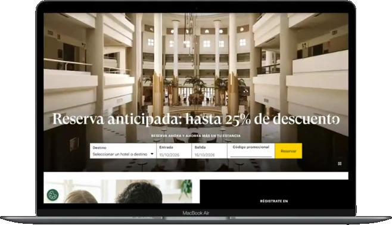
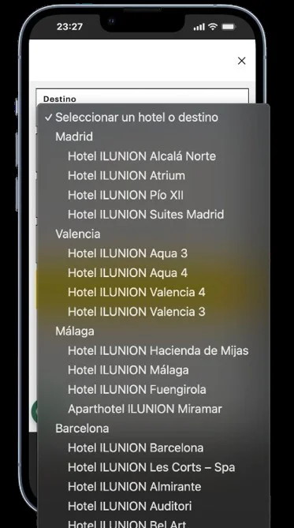
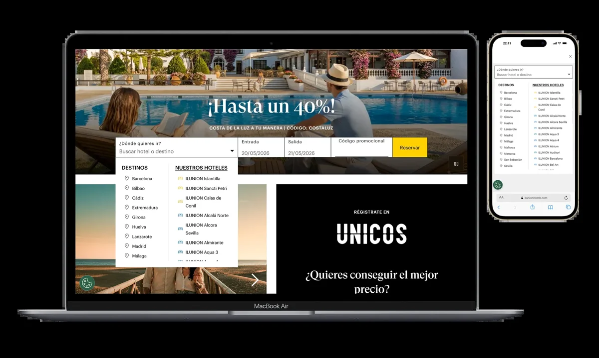
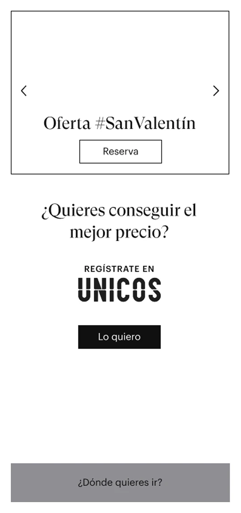
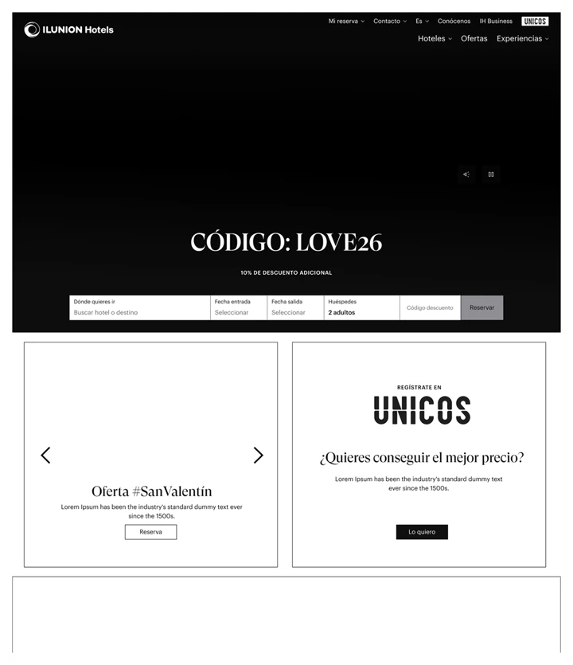

# Handoff · ILUNION CRO (caso 02) · rediseño desktop

Diseño aprobado en el canvas "ILUNION CRO · Desktop" (artboard "Desktop · ILUNION CRO · caso completo", 1440). Objetivo: sustituir el bloque desktop actual `#ide-root` de `ilunion-cro.html` por esta maquetación. **Sigue el patrón del commit `d0bbbbe`** ("caso 02 (ILUNION): un solo caso con 2 iniciativas, mobile + desktop del canvas") y de `ff0dd3c` (Gym desktop). Léelos antes de empezar.

## Alcance

**Solo desktop (`min-width: 769px`)**: el bloque `.ide` / `#ide-root` y sus reglas `.ide-*` dentro del `<style>` de `ilunion-cro.html`.
- No tocar el bloque mobile `.ime` / `#ime-root` ni sus estilos. Mobile queda como está.
- No tocar el contenido legacy (`main > .cs-hero` y siguientes); sigue oculto como hoy.
- Mantén los ids de ancla `#ide-overview`, `#ide-problema`, `#ide-research`, `#ide-persona`, `#ide-solucion`, `#ide-resultados` (añade `#ide-motor` y `#ide-recompo` para las dos iniciativas) y `scroll-margin-top: 88px`.
- Contenedor: el actual de `.ide` (`width: min(1440px, 94%)`). Las rejillas del artboard usan `auto-fit` con `minmax(440px, 1fr)`; respétalo y revisa el tramo 769–1100 px (ya hay un `@media (min-width: 769px) and (max-width: 1100px)`: ahí las rejillas de 2 columnas fijas pasan a 1).

**Estructura nueva, en este orden**
1. Hero: texto a la izquierda; a la derecha portátil `recompo-hero-desk.webp` detrás y vídeo `ofertas-movil.mp4` delante dentro de un marco de móvil (padding 7 px, radio 30/23 px, sombra). Halo radial morado detrás.
2. El caso en 30 segundos: 4 tarjetas (Problema 3,36% · Iniciativa 1 Motor · Iniciativa 2 Recomponer · Impacto 6,5% destacada).
3. 02 Problema: titular + 75% con barra de 4 segmentos (3 llenos) | panel "Antes" con `antes-ofertas` + `antes-unicos-landing`.
4. Research: 3 cifras en tira (10k+, 250+, 2 h) + recorrido de 4 pasos con línea conectora.
5. Discovery: bloque naranja Detectado → Decisión.
6. Persona + journey: tarjeta de Inés (izquierda) + tabla de 5 pasos con fila Dolor (borde discontinuo) y fila Oportunidad (morado; el paso 4 en naranja = loyalty). La tabla tiene `min-width: 640px` y scroll horizontal dentro de su caja.
7. 03 Iniciativa 1: 3 patrones de fricción | antes (`antes-selector-destino`) / después (`motor-despues`) | Funcionó / Por qué se retiró + regla que pasa a la iniciativa 2.
8. 04 Iniciativa 2: orden Antes → Después (5 bloques frente a 5) + chips Hick/Gestalt | vídeo `ofertas-desk.mp4` en marco de navegador. Debajo, ICE en 3 posiciones.
9. Proceso: tarjeta Mobile (wf + final) y tarjeta Desktop (wf + final) con 3 anotaciones numeradas cada una.
10. Ley de Fitts: vídeo `cta-fijo.mp4` en marco de móvil + antes/después + +93%.
11. 05 Resultados: gráfico de barras A/B (alturas proporcionales: A 114 px, B 220 px), ×1,9, +93%, 13%, tarjeta loyalty 50% con barra partida. Debajo, `unicos-modulo.webp` + nota de confidencialidad.
12. 06 Aprendizajes (3) y Trayectoria (4 nodos en línea de tiempo, ILUNION marcado "Estás aquí").

**Del sitio, sin duplicar**: header `.cs-top`, barra de progreso, paginación `.cs-pagination-section`, "siguiente caso" (03 · Paolo Pizzeria, como en mobile), CTA sticky, chatbot y scroll-to-top. En el artboard aparecen solo como referencia visual; el header y el paginado del artboard NO se implementan.

## Sistema de color (importante)

- `--purple #a78bfa` (`{{accent}}` en el artboard) = diseño y experimento.
- `#f97316` (`{{loyal}}`, equivale a `--orange` del sitio) = **solo ÚNICOS / loyalty**. No usar el naranja para nada más.
- Verde `#4ade80` solo en los chips "Medido" y "Funcionó". Fondos de tarjeta `#0a0a0c`, `#0d0d10`, `#0d0b14` (morado), `#0d0b0a` (naranja).
- Usa las variables existentes del sitio donde ya existan; no crees tokens globales nuevos.

## Reglas del repo (no negociables)

- No tocar design tokens ni estilos globales; todo va en las reglas `.ide-*` del `<style>` de la página.
- Sin librerías. Vanilla HTML/CSS/JS.
- Localiza por contenido, nunca por número de línea.
- Bilingüe: todo texto en `<span class="es">` + `<span class="en">`. **Reutiliza las traducciones EN que ya existen en `#ide-root` y `#ime-root`**; traduce solo lo nuevo, con el mismo tono. Los `.mm-reveal` van dentro de los spans `.es`/`.en`.
- Pasa los estilos inline del artboard a clases `.ide-*` (no dejes `style=""` salvo valores únicos).
- Sin em-dashes en el copy, sin emojis, sin la estructura retórica "esto no era X, era Y".
- Vídeos: `autoplay muted loop playsinline`, con `poster` y `aria-label`. `preload="metadata"`.
- Imágenes: `loading="lazy"` salvo el hero; `width`/`height` reales para evitar CLS.
- Commit con `git add -A` (no `deploy.bat`). Cache-busting `?v=` si cambias CSS/JS externos.

## Assets (ya están en el repo, no hay que subir nada)

| Archivo (`assets/ilunion-mobile/`) | Tamaño | Uso |
|---|---|---|
| `recompo-hero-desk.webp` | 2672×1534 | Hero, portátil |
| `ofertas-movil.mp4` (póster `ofertas-movil-poster.webp`) | 440×894 | Hero, móvil delante |
| `antes-ofertas.webp` | 284×275 | Problema, antes |
| `antes-unicos-landing.webp` | 136×261 | Problema, antes |
| `../avatar-ines.jpg` | 1024×1024 | Persona |
| `antes-selector-destino.webp` | 373×669 | Iniciativa 1, antes |
| `motor-despues.webp` | 1200×719 | Iniciativa 1, después |
| `ofertas-desk.mp4` (póster `ofertas-desk-poster.webp`) | 800×460 | Iniciativa 2 |
| `wf-mobile.webp` / `final-mobile.webp` | 539×1149 / 360×708 | Proceso mobile |
| `wf-desk.webp` / `final-desk.webp` | 720×835 / 720×448 | Proceso desktop |
| `cta-fijo.mp4` (póster `cta-fijo-poster.webp`) | 440×494 | Ley de Fitts |
| `unicos-modulo.webp` | 440×570 | Resultados, loyalty |

## Contenido y cifras

- Mismas cifras que hoy, sin añadir ninguna: 3,36% → 6,5%, ×1,9, +3,14 pp, p < 0,05, +93% búsquedas iniciadas, 13% de la venta directa, 50% conversiones de socios ÚNICOS, 75% tráfico de pago con intención de reservar, 10k+ logs, 250+ sesiones, 2 h.
- No escribir "100% confianza estadística" en ningún sitio.
- Quitar el "10" suelto que hoy aparece pegado a "Aprendizajes y progresión" en el bloque desktop.
- Nota de confidencialidad visible en Resultados.
- Trayectoria: Bootcamp · Gym Energy Center, 2020–22 · Paolo Pizzeria, 2023–24 · ILUNION Hotels CRO (actual, sin enlace), 2024–25 · CEF EdTech. Enlaces a `gym-energy-center.html`, `paolo-pizzeria.html`, `cef-design-system.html`.

## Cómo leer el artboard

Es la fuente exacta del diseño a 1440 px. `{{accent}}` = `#a78bfa`, `{{loyal}}` = `#f97316`. `<sc-for>` es un bucle: los datos están en `renderVals()` del script final. `<x-dc>`, `<helmet>` y `support.js` son del editor del canvas; no los copies. Las rutas ya apuntan a `assets/`.

## Verificación

Antes de commitear: Playwright a 1024, 1280 y 1440 px (y 390×844 para confirmar que mobile no cambió). ES/EN, anclas de la cabecera, vídeos en autoplay, sin imágenes rotas, sin scroll horizontal de página, contraste AA del texto gris sobre negro.

## Artboard · Desktop 1440 (`Main.dc.html`)

```html
<!doctype html>
<html lang="es">
<head>
<meta charset="utf-8">
<title>ILUNION CRO · Desktop</title>
<script src="./support.js"></script>
</head>
<body>
<x-dc>
<helmet>
<link rel="preconnect" href="https://fonts.googleapis.com">
<link href="https://fonts.googleapis.com/css2?family=Inter:wght@400;500;600;700&amp;family=Playfair+Display:ital,wght@0,700;0,800;1,700;1,800&amp;display=swap" rel="stylesheet">
<style>
body{margin:0;background:#000}
a{color:#a78bfa}a:hover{color:#c4b5fd}
</style>
</helmet>
<div style="background: #000; color: rgba(255,255,255,.72); font-family: Inter, system-ui, sans-serif; overflow: hidden">

<header style="position: sticky; top: 0; z-index: 5; height: 72px; padding: 0 32px; display: flex; align-items: center; justify-content: space-between; gap: 24px; background: rgba(0,0,0,.84); border-bottom: 1px solid rgba(255,255,255,.08)">
<div style="display: flex; align-items: center; gap: 18px">
<a href="#" style="font-family: 'Playfair Display', Georgia, serif; font-weight: 800; font-size: 20px; color: #fff; text-decoration: none">MM</a>
<a href="#" style="display: flex; align-items: center; gap: 6px; padding: 12px 0; font-size: 14px; font-weight: 500; color: rgba(255,255,255,.7); text-decoration: none"><svg width="16" height="16" viewBox="0 0 24 24" fill="none" stroke="currentColor" stroke-width="2" stroke-linecap="round" stroke-linejoin="round" aria-hidden="true"><path d="M15 18l-6-6 6-6"></path></svg>Volver</a>
</div>
<nav aria-label="Secciones" style="display: flex; gap: 2px; flex-wrap: wrap">
<a href="#il-overview" style="padding: 12px 12px; font-size: 13px; font-weight: 600; color: #fff; text-decoration: none; border-bottom: 2px solid {{accent}}">Overview</a>
<a href="#il-problema" style="padding: 12px 12px; font-size: 13px; font-weight: 500; color: rgba(255,255,255,.55); text-decoration: none">Problema</a>
<a href="#il-motor" style="padding: 12px 12px; font-size: 13px; font-weight: 500; color: rgba(255,255,255,.55); text-decoration: none">Iniciativa 1</a>
<a href="#il-recompo" style="padding: 12px 12px; font-size: 13px; font-weight: 500; color: rgba(255,255,255,.55); text-decoration: none">Iniciativa 2</a>
<a href="#il-resultados" style="padding: 12px 12px; font-size: 13px; font-weight: 500; color: rgba(255,255,255,.55); text-decoration: none">Resultados</a>
</nav>
<div style="display: flex; align-items: center; gap: 10px">
<button type="button" aria-label="Cambiar a inglés" style="width: 44px; height: 44px; background: none; border: 0; color: rgba(255,255,255,.7); font: 600 12px Inter, sans-serif; letter-spacing: .08em">EN</button>
<a href="#" aria-label="LinkedIn" style="width: 44px; height: 44px; display: flex; align-items: center; justify-content: center; color: rgba(255,255,255,.75)"><svg width="18" height="18" viewBox="0 0 24 24" fill="none" stroke="currentColor" stroke-width="1.8" stroke-linecap="round" stroke-linejoin="round" aria-hidden="true"><rect x="3" y="3" width="18" height="18" rx="3"></rect><path d="M8 10v7M8 7v.01M12 17v-4a2 2 0 0 1 4 0v4M12 10v7"></path></svg></a>
<a href="#" style="height: 44px; padding: 0 18px; border-radius: 999px; background: {{accent}}; color: #0b0614; display: flex; align-items: center; gap: 6px; font-size: 14px; font-weight: 700; text-decoration: none">Agendar llamada<svg width="14" height="14" viewBox="0 0 24 24" fill="none" stroke="currentColor" stroke-width="2.4" stroke-linecap="round" stroke-linejoin="round" aria-hidden="true"><path d="M7 17L17 7M17 7H9M17 7v8"></path></svg></a>
</div>
</header>

<main style="max-width: 1200px; margin: 0 auto; padding: 0 32px">

<!-- HERO -->
<section id="il-overview" style="padding: 72px 0 0; display: grid; grid-template-columns: repeat(auto-fit, minmax(440px, 1fr)); gap: 48px; align-items: center">
<div style="display: flex; flex-direction: column; gap: 22px">
<div style="display: flex; align-items: center; gap: 10px; flex-wrap: wrap">
<span style="font-size: 12px; font-weight: 600; letter-spacing: .14em; text-transform: uppercase; color: rgba(255,255,255,.55)">Caso 02 / 05</span>
<span style="padding: 6px 12px; border-radius: 999px; border: 1px solid rgba(167,139,250,.35); color: {{accent}}; font-size: 12px; font-weight: 600">Hotelería · Canal directo</span>
<span style="padding: 6px 12px; border-radius: 999px; border: 1px solid rgba(255,255,255,.14); color: rgba(255,255,255,.75); font-size: 12px; font-weight: 500">CRO · 2 iniciativas</span>
</div>
<h1 style="margin: 0; font-family: 'Playfair Display', Georgia, serif; font-weight: 800; font-size: 72px; line-height: .98; letter-spacing: -.02em; color: #fff">Las mismas piezas, <span style="font-style: italic; color: {{accent}}">otro orden</span></h1>
<p style="margin: 0; max-width: 500px; font-size: 19px; line-height: 1.5; color: rgba(255,255,255,.78)">De <strong style="color: #fff; font-weight: 600">3,36%</strong> a <strong style="color: #fff; font-weight: 600">6,5%</strong> de conversión reordenando los componentes de la home según lo que hacían los socios <strong style="color: {{loyal}}; font-weight: 600">ÚNICOS</strong>.</p>
<dl style="margin: 6px 0 0; display: grid; grid-template-columns: repeat(2, minmax(0, 1fr)); gap: 1px; background: rgba(255,255,255,.1); border: 1px solid rgba(255,255,255,.1); border-radius: 16px; overflow: hidden">
<div style="background: #0a0a0c; padding: 14px 16px; display: flex; flex-direction: column; gap: 4px"><dt style="font-size: 10px; font-weight: 600; letter-spacing: .12em; text-transform: uppercase; color: rgba(255,255,255,.5)">Rol</dt><dd style="margin: 0; font-size: 14px; font-weight: 600; color: #fff">Product Designer responsable</dd></div>
<div style="background: #0a0a0c; padding: 14px 16px; display: flex; flex-direction: column; gap: 4px"><dt style="font-size: 10px; font-weight: 600; letter-spacing: .12em; text-transform: uppercase; color: rgba(255,255,255,.5)">Alcance</dt><dd style="margin: 0; font-size: 14px; font-weight: 600; color: #fff">2 iniciativas</dd></div>
<div style="background: #0a0a0c; padding: 14px 16px; display: flex; flex-direction: column; gap: 4px"><dt style="font-size: 10px; font-weight: 600; letter-spacing: .12em; text-transform: uppercase; color: rgba(255,255,255,.5)">Equipo</dt><dd style="margin: 0; font-size: 14px; font-weight: 600; color: #fff">Yo + backend + marketing</dd></div>
<div style="background: #0a0a0c; padding: 14px 16px; display: flex; flex-direction: column; gap: 4px"><dt style="font-size: 10px; font-weight: 600; letter-spacing: .12em; text-transform: uppercase; color: rgba(255,255,255,.5)">Plataforma</dt><dd style="margin: 0; font-size: 14px; font-weight: 600; color: #fff">Web · AEM</dd></div>
</dl>
<div style="display: flex; gap: 12px; flex-wrap: wrap">
<a href="#il-problema" style="height: 48px; padding: 0 22px; border-radius: 999px; border: 1px solid rgba(255,255,255,.16); display: flex; align-items: center; gap: 8px; color: #fff; font-size: 15px; font-weight: 600; text-decoration: none">Ver el problema<svg width="16" height="16" viewBox="0 0 24 24" fill="none" stroke="currentColor" stroke-width="2" stroke-linecap="round" stroke-linejoin="round" aria-hidden="true"><path d="M12 5v14M19 12l-7 7-7-7"></path></svg></a>
<a href="#il-resultados" style="height: 48px; padding: 0 22px; border-radius: 999px; border: 1px solid rgba(167,139,250,.45); display: flex; align-items: center; gap: 8px; color: {{accent}}; font-size: 15px; font-weight: 600; text-decoration: none">Ir al resultado · 6,5%</a>
</div>
</div>
<figure style="margin: 0; position: relative; height: 560px">
<div aria-hidden="true" style="position: absolute; left: -40px; right: -40px; top: 40px; bottom: 40px; border-radius: 50%; background: radial-gradient(ellipse at 55% 50%, rgba(124,58,237,.34), rgba(124,58,237,0) 68%)"></div>

<div style="position: absolute; left: 0; bottom: 34px; width: 176px; padding: 7px; border-radius: 30px; background: #121214; border: 1px solid rgba(255,255,255,.16); box-shadow: 0 30px 60px rgba(0,0,0,.6)">
<video src="assets/ilunion-mobile/ofertas-movil.mp4" poster="assets/ilunion-mobile/ofertas-movil-poster.webp" autoplay="true" muted="true" loop="true" playsinline="true" aria-label="Recorrido de la home recompuesta en móvil: oferta con Reserva ya y bloque ÚNICOS" style="display: block; width: 100%; height: auto; aspect-ratio: 440 / 894; border-radius: 23px; object-fit: cover"></video>
</div>
<figcaption style="position: absolute; right: 0; bottom: 10px; display: flex; align-items: center; gap: 8px; font-size: 12px; font-weight: 500; color: rgba(255,255,255,.75)"><span style="width: 7px; height: 7px; border-radius: 50%; background: #22c55e"></span>En producción · móvil y desktop</figcaption>
</figure>
</section>

<!-- 30 SEGUNDOS -->
<section style="padding: 96px 0 0; display: flex; flex-direction: column; gap: 28px">
<div style="display: flex; align-items: baseline; justify-content: space-between; border-bottom: 1px solid rgba(255,255,255,.1); padding-bottom: 18px">
<h2 style="margin: 0; font-family: 'Playfair Display', Georgia, serif; font-size: 40px; line-height: 1.1; color: #fff">El caso en <span style="font-style: italic; color: {{accent}}">30 segundos</span></h2>
<span style="font-size: 13px; font-weight: 600; color: rgba(255,255,255,.4)">01</span>
</div>
<ol style="margin: 0; padding: 0; list-style: none; display: grid; grid-template-columns: repeat(auto-fit, minmax(240px, 1fr)); gap: 14px">
<li style="padding: 24px; border-radius: 20px; background: rgba(255,255,255,.03); border: 1px solid rgba(255,255,255,.1); display: flex; flex-direction: column; gap: 10px">
<span style="font-size: 11px; font-weight: 600; letter-spacing: .12em; text-transform: uppercase; color: rgba(255,255,255,.55)">Problema</span>
<span style="font-family: 'Playfair Display', Georgia, serif; font-weight: 800; font-size: 56px; line-height: 1; color: rgba(255,255,255,.85)">3,36%</span>
<span style="font-size: 15px; line-height: 1.45; color: rgba(255,255,255,.7)">de conversión con el motor enterrado bajo promociones.</span>
</li>
<li style="padding: 24px; border-radius: 20px; background: rgba(255,255,255,.03); border: 1px solid rgba(255,255,255,.1); display: flex; flex-direction: column; gap: 10px">
<span style="font-size: 11px; font-weight: 600; letter-spacing: .12em; text-transform: uppercase; color: rgba(255,255,255,.55)">Iniciativa 1 · Experimento</span>
<span style="font-family: 'Playfair Display', Georgia, serif; font-weight: 800; font-size: 56px; line-height: 1; color: #fff">Motor</span>
<span style="font-size: 15px; line-height: 1.45; color: rgba(255,255,255,.7)">Un selector de destino que derivó tráfico. Funcionó y se retiró.</span>
</li>
<li style="padding: 24px; border-radius: 20px; background: rgba(255,255,255,.03); border: 1px solid rgba(255,255,255,.1); display: flex; flex-direction: column; gap: 10px">
<span style="font-size: 11px; font-weight: 600; letter-spacing: .12em; text-transform: uppercase; color: rgba(255,255,255,.55)">Iniciativa 2 · En producción</span>
<span style="font-family: 'Playfair Display', Georgia, serif; font-weight: 800; font-size: 56px; line-height: 1; color: #fff">Recomponer</span>
<span style="font-size: 15px; line-height: 1.45; color: rgba(255,255,255,.7)">Motor y ventaja de socio antes que el escaparate.</span>
</li>
<li style="padding: 24px; border-radius: 20px; background: rgba(167,139,250,.09); border: 1px solid rgba(167,139,250,.38); display: flex; flex-direction: column; gap: 10px">
<span style="font-size: 11px; font-weight: 600; letter-spacing: .12em; text-transform: uppercase; color: {{accent}}">Impacto medido · test A/B</span>
<span style="font-family: 'Playfair Display', Georgia, serif; font-weight: 800; font-size: 56px; line-height: 1; color: {{accent}}">6,5%</span>
<span style="font-size: 15px; line-height: 1.45; color: rgba(255,255,255,.85)">×1,9 la conversión · p &lt; 0,05 · <span style="color: {{loyal}}; font-weight: 600">50% socios ÚNICOS</span></span>
</li>
</ol>
</section>

<!-- PROBLEMA -->
<section id="il-problema" style="padding: 120px 0 0; display: flex; flex-direction: column; gap: 64px">
<div style="display: grid; grid-template-columns: repeat(auto-fit, minmax(440px, 1fr)); gap: 56px; align-items: center">
<div style="display: flex; flex-direction: column; gap: 18px">
<span style="font-size: 12px; font-weight: 600; letter-spacing: .14em; text-transform: uppercase; color: {{accent}}">02 · El problema</span>
<h2 style="margin: 0; font-family: 'Playfair Display', Georgia, serif; font-weight: 800; font-size: 52px; line-height: 1.04; letter-spacing: -.015em; color: #fff">Venían a reservar <span style="font-style: italic; color: {{accent}}">y no buscaban</span></h2>
<p style="margin: 0; max-width: 460px; font-size: 17px; line-height: 1.55; color: rgba(255,255,255,.72)">La home se había montado como escaparate de marca. El usuario quería comprobar disponibilidad cuanto antes.</p>
<div style="margin-top: 12px; padding-top: 24px; border-top: 1px solid rgba(255,255,255,.1); display: flex; flex-direction: column; gap: 16px">
<div style="display: flex; align-items: flex-end; gap: 18px">
<span style="font-family: 'Playfair Display', Georgia, serif; font-weight: 800; font-size: 112px; line-height: .82; color: {{accent}}">75%</span>
<span style="padding-bottom: 6px; max-width: 240px; font-size: 16px; line-height: 1.35; color: #fff; font-weight: 500">del tráfico de pago llegaba con intención de reservar</span>
</div>
<div role="img" aria-label="3 de cada 4 visitas de pago querían reservar" style="display: grid; grid-template-columns: repeat(4, minmax(0, 1fr)); gap: 8px">
<span style="height: 14px; border-radius: 7px; background: {{accent}}"></span>
<span style="height: 14px; border-radius: 7px; background: {{accent}}"></span>
<span style="height: 14px; border-radius: 7px; background: {{accent}}"></span>
<span style="height: 14px; border-radius: 7px; border: 1px dashed rgba(255,255,255,.25)"></span>
</div>
</div>
</div>
<figure style="margin: 0; padding: 28px; border-radius: 28px; background: #0d0d10; border: 1px solid rgba(255,255,255,.1); display: flex; flex-direction: column; gap: 20px">
<div style="display: flex; align-items: center; justify-content: space-between; gap: 12px">
<span style="padding: 5px 10px; border-radius: 999px; background: rgba(255,255,255,.1); color: #fff; font-size: 11px; font-weight: 700; letter-spacing: .08em; text-transform: uppercase">Antes</span>
<span style="font-size: 12px; color: rgba(255,255,255,.55)">Capturas de producción</span>
</div>
<div style="display: grid; grid-template-columns: 1.9fr 1fr; gap: 16px; align-items: end">
<div style="display: flex; flex-direction: column; gap: 10px">

<span style="font-size: 13px; line-height: 1.4; color: rgba(255,255,255,.7)"><strong style="color: #fff; font-weight: 600">Ofertas en texto largo.</strong> La ventaja de socio, en el 4.º párrafo.</span>
</div>
<div style="display: flex; flex-direction: column; gap: 10px">

<span style="font-size: 13px; line-height: 1.4; color: rgba(255,255,255,.7)"><strong style="color: {{loyal}}; font-weight: 600">ÚNICOS</strong> en una landing aparte.</span>
</div>
</div>
</figure>
</div>

<!-- research -->
<div style="display: flex; flex-direction: column; gap: 32px">
<div style="display: grid; grid-template-columns: repeat(auto-fit, minmax(440px, 1fr)); gap: 56px; align-items: end">
<div style="display: flex; flex-direction: column; gap: 14px">
<span style="font-size: 12px; font-weight: 600; letter-spacing: .14em; text-transform: uppercase; color: rgba(255,255,255,.55)">Research · aprender de los datos</span>
<h3 style="margin: 0; font-family: 'Playfair Display', Georgia, serif; font-weight: 800; font-size: 40px; line-height: 1.08; color: #fff">Comportamiento, <span style="font-style: italic; color: {{accent}}">no opiniones</span></h3>
<p style="margin: 0; max-width: 440px; font-size: 16px; line-height: 1.55; color: rgba(255,255,255,.7)">La IA aceleró el análisis. La lectura de los patrones y las decisiones fueron mías.</p>
</div>
<div style="display: grid; grid-template-columns: repeat(3, minmax(0, 1fr)); gap: 1px; background: rgba(255,255,255,.1); border: 1px solid rgba(255,255,255,.1); border-radius: 20px; overflow: hidden">
<div style="background: #0a0a0c; padding: 22px 20px; display: flex; flex-direction: column; gap: 6px"><span style="font-family: 'Playfair Display', Georgia, serif; font-weight: 800; font-size: 44px; line-height: 1; color: #fff">10k+</span><span style="font-size: 13px; line-height: 1.35; color: rgba(255,255,255,.65)">logs de Adobe Analytics</span></div>
<div style="background: #0a0a0c; padding: 22px 20px; display: flex; flex-direction: column; gap: 6px"><span style="font-family: 'Playfair Display', Georgia, serif; font-weight: 800; font-size: 44px; line-height: 1; color: #fff">250+</span><span style="font-size: 13px; line-height: 1.35; color: rgba(255,255,255,.65)">sesiones en Clarity</span></div>
<div style="background: #0a0a0c; padding: 22px 20px; display: flex; flex-direction: column; gap: 6px"><span style="font-family: 'Playfair Display', Georgia, serif; font-weight: 800; font-size: 44px; line-height: 1; color: {{accent}}">2 h</span><span style="font-size: 13px; line-height: 1.35; color: rgba(255,255,255,.65)">para agrupar los logs con Claude</span></div>
</div>
</div>
<ol style="margin: 0; padding: 0; list-style: none; position: relative; display: grid; grid-template-columns: repeat(auto-fit, minmax(240px, 1fr)); gap: 16px">
<li aria-hidden="true" style="position: absolute; left: 22px; right: 22px; top: 22px; height: 1px; background: linear-gradient(90deg, rgba(167,139,250,.6), rgba(167,139,250,.15))"></li>
<li style="position: relative; display: flex; flex-direction: column; gap: 12px; padding-right: 12px">
<span style="width: 44px; height: 44px; border-radius: 50%; background: #000; border: 1px solid {{accent}}; color: {{accent}}; display: flex; align-items: center; justify-content: center; font-size: 13px; font-weight: 700">01</span>
<span style="font-size: 18px; font-weight: 600; color: #fff">Recoger</span>
<span style="font-size: 14px; line-height: 1.45; color: rgba(255,255,255,.65)">Logs de conversión y grabaciones de sesión del funnel.</span>
</li>
<li style="position: relative; display: flex; flex-direction: column; gap: 12px; padding-right: 12px">
<span style="width: 44px; height: 44px; border-radius: 50%; background: #000; border: 1px solid {{accent}}; color: {{accent}}; display: flex; align-items: center; justify-content: center; font-size: 13px; font-weight: 700">02</span>
<span style="font-size: 18px; font-weight: 600; color: #fff">Agrupar</span>
<span style="font-size: 14px; line-height: 1.45; color: rgba(255,255,255,.65)">Clústeres por punto de abandono y tipo de usuario.</span>
</li>
<li style="position: relative; display: flex; flex-direction: column; gap: 12px; padding-right: 12px">
<span style="width: 44px; height: 44px; border-radius: 50%; background: #000; border: 1px solid {{accent}}; color: {{accent}}; display: flex; align-items: center; justify-content: center; font-size: 13px; font-weight: 700">03</span>
<span style="font-size: 18px; font-weight: 600; color: #fff">Leer patrones</span>
<span style="font-size: 14px; line-height: 1.45; color: rgba(255,255,255,.65)">Heatmaps y scroll depth para ver dónde se perdía el tráfico.</span>
</li>
<li style="position: relative; display: flex; flex-direction: column; gap: 12px; padding-right: 12px">
<span style="width: 44px; height: 44px; border-radius: 50%; background: {{accent}}; border: 1px solid {{accent}}; color: #0b0614; display: flex; align-items: center; justify-content: center; font-size: 13px; font-weight: 700">04</span>
<span style="font-size: 18px; font-weight: 600; color: #fff">Priorizar</span>
<span style="font-size: 14px; line-height: 1.45; color: rgba(255,255,255,.65)">Cada patrón, una hipótesis puntuada con ICE.</span>
</li>
</ol>
</div>

<!-- discovery -->
<div style="padding: 40px; border-radius: 28px; background: radial-gradient(ellipse at 90% 10%, rgba(249,115,22,.16), rgba(249,115,22,0) 55%), #0d0b0a; border: 1px solid rgba(249,115,22,.28); display: grid; grid-template-columns: repeat(auto-fit, minmax(340px, 1fr)); gap: 40px; align-items: center">
<div style="display: flex; flex-direction: column; gap: 14px">
<span style="font-size: 12px; font-weight: 600; letter-spacing: .14em; text-transform: uppercase; color: {{loyal}}">Discovery · el segmento que convierte</span>
<h3 style="margin: 0; font-family: 'Playfair Display', Georgia, serif; font-weight: 800; font-size: 40px; line-height: 1.08; color: #fff">El socio ya sabía <span style="font-style: italic; color: {{loyal}}">a qué venía</span></h3>
</div>
<div style="position: relative; display: grid; grid-template-columns: repeat(2, minmax(0, 1fr)); gap: 14px">
<div style="padding: 22px 20px; border-radius: 18px; background: rgba(255,255,255,.03); border: 1px solid rgba(255,255,255,.1); display: flex; flex-direction: column; gap: 10px">
<span style="font-size: 11px; font-weight: 700; letter-spacing: .12em; text-transform: uppercase; color: rgba(255,255,255,.55)">Detectado</span>
<span style="font-size: 16px; line-height: 1.45; color: rgba(255,255,255,.8)">La ventaja ÚNICOS vivía en el 4.º párrafo de cada oferta o en una landing aparte.</span>
</div>
<div style="padding: 22px 20px; border-radius: 18px; background: rgba(249,115,22,.08); border: 1px solid rgba(249,115,22,.45); display: flex; flex-direction: column; gap: 10px">
<span style="font-size: 11px; font-weight: 700; letter-spacing: .12em; text-transform: uppercase; color: {{loyal}}">Decisión</span>
<span style="font-size: 16px; line-height: 1.45; color: #fff">Un componente ÚNICOS propio dentro del recorrido, con el <strong style="color: {{loyal}}">10%</strong> a la vista.</span>
</div>
<span aria-hidden="true" style="position: absolute; left: 50%; top: 50%; width: 34px; height: 34px; margin: -17px 0 0 -17px; border-radius: 50%; background: #0d0b0a; border: 1px solid rgba(249,115,22,.45); color: {{loyal}}; display: flex; align-items: center; justify-content: center"><svg width="16" height="16" viewBox="0 0 24 24" fill="none" stroke="currentColor" stroke-width="2" stroke-linecap="round" stroke-linejoin="round"><path d="M5 12h14M13 5l7 7-7 7"></path></svg></span>
</div>
</div>

<!-- persona + journey -->
<div style="display: flex; flex-direction: column; gap: 28px">
<div style="display: flex; align-items: baseline; justify-content: space-between; gap: 20px; flex-wrap: wrap">
<div style="display: flex; flex-direction: column; gap: 10px">
<span style="font-size: 12px; font-weight: 600; letter-spacing: .14em; text-transform: uppercase; color: rgba(255,255,255,.55)">User persona &amp; journey</span>
<h3 style="margin: 0; font-family: 'Playfair Display', Georgia, serif; font-weight: 800; font-size: 40px; line-height: 1.08; color: #fff">Para quién <span style="font-style: italic; color: {{accent}}">diseñaba</span></h3>
</div>
<p style="margin: 0; max-width: 420px; font-size: 15px; line-height: 1.5; color: rgba(255,255,255,.65)">Tráfico de Paid Media que llega con intención de reservar y sin tiempo para explorar.</p>
</div>
<div style="display: grid; grid-template-columns: minmax(300px, 360px) minmax(0, 1fr); gap: 20px; align-items: stretch">
<article style="padding: 26px; border-radius: 22px; background: #0d0d10; border: 1px solid rgba(255,255,255,.1); display: flex; flex-direction: column; gap: 20px">
<div style="display: flex; align-items: center; gap: 14px">

<div style="display: flex; flex-direction: column; gap: 3px">
<span style="font-size: 20px; font-weight: 700; color: #fff">Inés, 38</span>
<span style="font-size: 13px; color: rgba(255,255,255,.65)">Viajera vacacional · reserva desde el móvil</span>
</div>
</div>
<div style="display: grid; grid-template-columns: repeat(2, minmax(0, 1fr)); gap: 16px">
<div style="display: flex; flex-direction: column; gap: 8px">
<span style="font-size: 10px; font-weight: 700; letter-spacing: .12em; text-transform: uppercase; color: {{accent}}">Objetivos</span>
<span style="font-size: 14px; line-height: 1.4; color: #fff">Ver el precio final rápido</span>
<span style="font-size: 14px; line-height: 1.4; color: #fff">Reservar en menos de 3 minutos</span>
</div>
<div style="display: flex; flex-direction: column; gap: 8px">
<span style="font-size: 10px; font-weight: 700; letter-spacing: .12em; text-transform: uppercase; color: rgba(255,255,255,.55)">Frustraciones</span>
<span style="font-size: 14px; line-height: 1.4; color: rgba(255,255,255,.75)">No encontrar el buscador</span>
<span style="font-size: 14px; line-height: 1.4; color: rgba(255,255,255,.75)">Selector de fechas que falla</span>
</div>
</div>
<blockquote style="margin: auto 0 0; padding: 18px 0 0; border-top: 1px solid rgba(255,255,255,.1); font-family: 'Playfair Display', Georgia, serif; font-style: italic; font-weight: 700; font-size: 20px; line-height: 1.3; color: #fff">“Si tengo que buscar dónde se reserva, me voy a Booking.”</blockquote>
<span style="font-size: 11px; color: rgba(255,255,255,.5)">Persona ilustrativa</span>
</article>
<div style="padding: 26px; border-radius: 22px; background: rgba(255,255,255,.02); border: 1px solid rgba(255,255,255,.1); display: flex; flex-direction: column; gap: 18px">
<div style="display: flex; align-items: center; justify-content: space-between; gap: 16px; flex-wrap: wrap">
<span style="font-size: 18px; font-weight: 600; color: #fff">Cada dolor, una oportunidad</span>
<div style="display: flex; gap: 16px; font-size: 12px; color: rgba(255,255,255,.7)">
<span style="display: flex; align-items: center; gap: 6px"><span style="width: 10px; height: 10px; border-radius: 3px; border: 1px dashed rgba(255,255,255,.5)"></span>Dolor</span>
<span style="display: flex; align-items: center; gap: 6px"><span style="width: 10px; height: 10px; border-radius: 3px; background: {{accent}}"></span>Oportunidad</span>
<span style="display: flex; align-items: center; gap: 6px"><span style="width: 10px; height: 10px; border-radius: 3px; background: {{loyal}}"></span>Loyalty</span>
</div>
</div>
<div style="overflow-x: auto">
<div style="min-width: 640px; display: grid; grid-template-columns: 96px repeat(5, minmax(0, 1fr)); gap: 8px">
<span></span>
<span style="display: flex; align-items: center; gap: 8px; padding-bottom: 6px; border-bottom: 1px solid rgba(255,255,255,.14); font-size: 13px; font-weight: 600; color: #fff"><span style="font-size: 11px; color: {{accent}}">1</span>Llega desde Paid</span>
<span style="display: flex; align-items: center; gap: 8px; padding-bottom: 6px; border-bottom: 1px solid rgba(255,255,255,.14); font-size: 13px; font-weight: 600; color: #fff"><span style="font-size: 11px; color: {{accent}}">2</span>Busca el motor</span>
<span style="display: flex; align-items: center; gap: 8px; padding-bottom: 6px; border-bottom: 1px solid rgba(255,255,255,.14); font-size: 13px; font-weight: 600; color: #fff"><span style="font-size: 11px; color: {{accent}}">3</span>Elige fechas</span>
<span style="display: flex; align-items: center; gap: 8px; padding-bottom: 6px; border-bottom: 1px solid rgba(255,255,255,.14); font-size: 13px; font-weight: 600; color: #fff"><span style="font-size: 11px; color: {{accent}}">4</span>Compara</span>
<span style="display: flex; align-items: center; gap: 8px; padding-bottom: 6px; border-bottom: 1px solid rgba(255,255,255,.14); font-size: 13px; font-weight: 600; color: #fff"><span style="font-size: 11px; color: {{accent}}">5</span>Reserva</span>

<span style="align-self: center; font-size: 10px; font-weight: 700; letter-spacing: .12em; text-transform: uppercase; color: rgba(255,255,255,.55)">Dolor</span>
<span></span>
<span style="padding: 12px; border-radius: 12px; border: 1px dashed rgba(255,255,255,.28); font-size: 13px; line-height: 1.35; color: rgba(255,255,255,.75)">Motor bajo el hero y las promos</span>
<span style="padding: 12px; border-radius: 12px; border: 1px dashed rgba(255,255,255,.28); font-size: 13px; line-height: 1.35; color: rgba(255,255,255,.75)">Errores táctiles en el selector</span>
<span style="padding: 12px; border-radius: 12px; border: 1px dashed rgba(255,255,255,.28); font-size: 13px; line-height: 1.35; color: rgba(255,255,255,.75)">Precio poco claro</span>
<span></span>

<span style="align-self: center; font-size: 10px; font-weight: 700; letter-spacing: .12em; text-transform: uppercase; color: {{accent}}">Oportunidad</span>
<span style="padding: 12px; border-radius: 12px; background: rgba(167,139,250,.14); border: 1px solid rgba(167,139,250,.4); font-size: 13px; line-height: 1.35; font-weight: 600; color: #fff">Mensaje alineado con el anuncio</span>
<span style="padding: 12px; border-radius: 12px; background: rgba(167,139,250,.14); border: 1px solid rgba(167,139,250,.4); font-size: 13px; line-height: 1.35; font-weight: 600; color: #fff">Motor en el primer scroll</span>
<span style="padding: 12px; border-radius: 12px; background: rgba(167,139,250,.14); border: 1px solid rgba(167,139,250,.4); font-size: 13px; line-height: 1.35; font-weight: 600; color: #fff">Swipe nativo</span>
<span style="padding: 12px; border-radius: 12px; background: rgba(249,115,22,.14); border: 1px solid rgba(249,115,22,.5); font-size: 13px; line-height: 1.35; font-weight: 600; color: #fff">Ventaja de socio ÚNICOS visible</span>
<span style="padding: 12px; border-radius: 12px; background: rgba(167,139,250,.14); border: 1px solid rgba(167,139,250,.4); font-size: 13px; line-height: 1.35; font-weight: 600; color: #fff">CTA fijo (Ley de Fitts)</span>
</div>
</div>
</div>
</div>
</div>
</section>

<!-- INICIATIVA 1 -->
<section id="il-motor" style="padding: 120px 0 0; display: flex; flex-direction: column; gap: 48px">
<div style="display: grid; grid-template-columns: repeat(auto-fit, minmax(440px, 1fr)); gap: 56px; align-items: end">
<div style="display: flex; flex-direction: column; gap: 16px">
<span style="font-size: 12px; font-weight: 600; letter-spacing: .14em; text-transform: uppercase; color: {{accent}}">03 · Iniciativa 1 · Experimento en el motor</span>
<h2 style="margin: 0; font-family: 'Playfair Display', Georgia, serif; font-weight: 800; font-size: 52px; line-height: 1.04; letter-spacing: -.015em; color: #fff">Llevar el tráfico <span style="font-style: italic; color: {{accent}}">al hotel correcto</span></h2>
<p style="margin: 0; max-width: 460px; font-size: 17px; line-height: 1.55; color: rgba(255,255,255,.72)">Antes de tocar la home, probé a rediseñar el motor de reservas para derivar tráfico entre los hoteles de la cadena.</p>
</div>
<div style="display: flex; flex-direction: column; gap: 10px">
<span style="font-size: 11px; font-weight: 700; letter-spacing: .12em; text-transform: uppercase; color: rgba(255,255,255,.55)">3 patrones de fricción en el motor</span>
<div style="display: flex; align-items: center; gap: 14px; padding: 14px 16px; border-radius: 14px; background: rgba(255,255,255,.03); border: 1px solid rgba(255,255,255,.1)"><span style="font-size: 12px; font-weight: 700; color: {{accent}}">01</span><span style="font-size: 15px; font-weight: 500; color: #fff">Motor enterrado bajo hero y promociones</span></div>
<div style="display: flex; align-items: center; gap: 14px; padding: 14px 16px; border-radius: 14px; background: rgba(255,255,255,.03); border: 1px solid rgba(255,255,255,.1)"><span style="font-size: 12px; font-weight: 700; color: {{accent}}">02</span><span style="font-size: 15px; font-weight: 500; color: #fff">Rage clicks en el selector de fechas móvil</span></div>
<div style="display: flex; align-items: center; gap: 14px; padding: 14px 16px; border-radius: 14px; background: rgba(249,115,22,.07); border: 1px solid rgba(249,115,22,.35)"><span style="font-size: 12px; font-weight: 700; color: {{loyal}}">03</span><span style="font-size: 15px; font-weight: 500; color: #fff">Ventaja de socio ÚNICOS invisible frente a Booking</span></div>
</div>
</div>

<div style="display: flex; flex-direction: column; gap: 20px">
<div style="display: flex; align-items: baseline; justify-content: space-between; gap: 20px; flex-wrap: wrap">
<h3 style="margin: 0; font-family: 'Playfair Display', Georgia, serif; font-weight: 800; font-size: 34px; line-height: 1.1; color: #fff">De una lista eterna <span style="color: rgba(255,255,255,.4)">→</span> <span style="color: {{accent}}">a dos columnas</span></h3>
<span style="font-size: 12px; font-weight: 600; letter-spacing: .14em; text-transform: uppercase; color: rgba(255,255,255,.55)">El experimento · selector de destino</span>
</div>
<div style="display: grid; grid-template-columns: minmax(240px, 1fr) minmax(0, 2.6fr); gap: 16px; align-items: stretch">
<figure style="margin: 0; padding: 22px; border-radius: 24px; background: #0d0d10; border: 1px solid rgba(255,255,255,.1); display: flex; flex-direction: column; gap: 16px">
<span style="align-self: flex-start; padding: 5px 10px; border-radius: 999px; background: rgba(255,255,255,.1); color: #fff; font-size: 11px; font-weight: 700; letter-spacing: .08em; text-transform: uppercase">Antes</span>

<figcaption style="font-size: 14px; line-height: 1.4; color: rgba(255,255,255,.7)">Lista nativa del sistema.</figcaption>
</figure>
<figure style="margin: 0; padding: 22px; border-radius: 24px; background: radial-gradient(ellipse at 50% 55%, rgba(124,58,237,.28), rgba(124,58,237,0) 65%), #0d0b14; border: 1px solid rgba(167,139,250,.35); display: flex; flex-direction: column; gap: 16px">
<span style="align-self: flex-start; padding: 5px 10px; border-radius: 999px; background: {{accent}}; color: #0b0614; font-size: 11px; font-weight: 700; letter-spacing: .08em; text-transform: uppercase">Después</span>

<figcaption style="font-size: 14px; line-height: 1.4; color: rgba(255,255,255,.8)">Panel propio con <strong style="color: #fff">Destinos</strong> y <strong style="color: #fff">Nuestros hoteles</strong>.</figcaption>
</figure>
</div>
</div>

<div style="display: grid; grid-template-columns: repeat(auto-fit, minmax(440px, 1fr)); gap: 20px; align-items: stretch">
<div style="display: flex; flex-direction: column; gap: 14px">
<span style="font-size: 12px; font-weight: 600; letter-spacing: .14em; text-transform: uppercase; color: rgba(255,255,255,.55)">Resultado del experimento</span>
<h3 style="margin: 0; font-family: 'Playfair Display', Georgia, serif; font-weight: 800; font-size: 40px; line-height: 1.08; color: #fff">Funcionó, <span style="font-style: italic; color: {{accent}}">y se retiró</span></h3>
<div style="display: grid; grid-template-columns: repeat(2, minmax(0, 1fr)); gap: 12px; margin-top: 6px">
<div style="padding: 20px; border-radius: 18px; background: rgba(34,197,94,.06); border: 1px solid rgba(34,197,94,.3); display: flex; flex-direction: column; gap: 8px">
<span style="display: flex; align-items: center; gap: 6px; font-size: 11px; font-weight: 700; letter-spacing: .12em; text-transform: uppercase; color: #4ade80"><svg width="14" height="14" viewBox="0 0 24 24" fill="none" stroke="currentColor" stroke-width="2.4" stroke-linecap="round" stroke-linejoin="round" aria-hidden="true"><path d="M20 6L9 17l-5-5"></path></svg>Funcionó</span>
<span style="font-size: 15px; line-height: 1.45; color: rgba(255,255,255,.85)">Derivó tráfico hacia los hoteles que había que impulsar.</span>
</div>
<div style="padding: 20px; border-radius: 18px; background: rgba(255,255,255,.03); border: 1px solid rgba(255,255,255,.12); display: flex; flex-direction: column; gap: 8px">
<span style="display: flex; align-items: center; gap: 6px; font-size: 11px; font-weight: 700; letter-spacing: .12em; text-transform: uppercase; color: rgba(255,255,255,.7)"><svg width="14" height="14" viewBox="0 0 24 24" fill="none" stroke="currentColor" stroke-width="2.2" stroke-linecap="round" stroke-linejoin="round" aria-hidden="true"><circle cx="12" cy="12" r="9"></circle><path d="M12 7v5l3 2"></path></svg>Por qué se retiró</span>
<span style="font-size: 15px; line-height: 1.45; color: rgba(255,255,255,.75)">El tráfico se reparte por hotel según el trimestre. Una pieza fija no seguía ese ritmo.</span>
</div>
</div>
</div>
<div style="padding: 32px; border-radius: 24px; background: radial-gradient(ellipse at 85% 0%, rgba(124,58,237,.3), rgba(124,58,237,0) 60%), #0d0b14; border: 1px solid rgba(167,139,250,.35); display: flex; flex-direction: column; justify-content: center; gap: 14px">
<span style="font-size: 11px; font-weight: 700; letter-spacing: .12em; text-transform: uppercase; color: {{accent}}">Lo que pasó a la iniciativa 2</span>
<span style="font-family: 'Playfair Display', Georgia, serif; font-weight: 700; font-style: italic; font-size: 28px; line-height: 1.25; color: #fff">Diseñar piezas que aguanten campañas que cambian cada trimestre.</span>
</div>
</div>
</section>

<!-- INICIATIVA 2 -->
<section id="il-recompo" style="padding: 120px 0 0; display: flex; flex-direction: column; gap: 48px">
<div style="display: grid; grid-template-columns: repeat(auto-fit, minmax(440px, 1fr)); gap: 56px; align-items: end">
<div style="display: flex; flex-direction: column; gap: 16px">
<span style="font-size: 12px; font-weight: 600; letter-spacing: .14em; text-transform: uppercase; color: {{accent}}">04 · Iniciativa 2 · Re-componetización</span>
<h2 style="margin: 0; font-family: 'Playfair Display', Georgia, serif; font-weight: 800; font-size: 52px; line-height: 1.04; letter-spacing: -.015em; color: #fff">Recomponer, <span style="font-style: italic; color: {{accent}}">no rediseñar</span></h2>
</div>
<p style="margin: 0; max-width: 480px; font-size: 17px; line-height: 1.55; color: rgba(255,255,255,.72)">Mismos componentes de AEM y misma identidad. Cambia el orden: primero reservar, después inspirar.</p>
</div>

<div style="display: grid; grid-template-columns: repeat(auto-fit, minmax(440px, 1fr)); gap: 20px; align-items: stretch">
<div style="display: grid; grid-template-columns: minmax(0, 1fr) 40px minmax(0, 1fr); gap: 8px; padding: 26px; border-radius: 24px; background: #0d0d10; border: 1px solid rgba(255,255,255,.1)">
<div style="display: flex; flex-direction: column; gap: 8px">
<span style="font-size: 11px; font-weight: 700; letter-spacing: .12em; text-transform: uppercase; color: rgba(255,255,255,.55); padding-bottom: 4px">Antes</span>
<span style="height: 52px; padding: 0 14px; border-radius: 12px; border: 1px dashed rgba(255,255,255,.22); display: flex; align-items: center; gap: 10px; font-size: 14px; color: rgba(255,255,255,.6)"><span style="font-size: 11px; font-weight: 700">1</span>Hero inspiracional</span>
<span style="height: 52px; padding: 0 14px; border-radius: 12px; border: 1px dashed rgba(255,255,255,.22); display: flex; align-items: center; gap: 10px; font-size: 14px; color: rgba(255,255,255,.6)"><span style="font-size: 11px; font-weight: 700">2</span>Texto de campaña</span>
<span style="height: 52px; padding: 0 14px; border-radius: 12px; border: 1px dashed rgba(249,115,22,.4); display: flex; align-items: center; gap: 10px; font-size: 14px; color: rgba(255,255,255,.6)"><span style="font-size: 11px; font-weight: 700">3</span>ÚNICOS en el 4.º párrafo</span>
<span style="height: 52px; padding: 0 14px; border-radius: 12px; border: 1px dashed rgba(255,255,255,.22); display: flex; align-items: center; gap: 10px; font-size: 14px; color: rgba(255,255,255,.6)"><span style="font-size: 11px; font-weight: 700">4</span>Tarjetas de ofertas</span>
<span style="height: 52px; padding: 0 14px; border-radius: 12px; border: 1px dashed rgba(167,139,250,.5); display: flex; align-items: center; gap: 10px; font-size: 14px; color: rgba(255,255,255,.75)"><span style="font-size: 11px; font-weight: 700">5</span>Motor de reservas</span>
</div>
<div aria-hidden="true" style="display: flex; align-items: center; justify-content: center; padding-top: 24px; color: rgba(255,255,255,.4)"><svg width="22" height="22" viewBox="0 0 24 24" fill="none" stroke="currentColor" stroke-width="2" stroke-linecap="round" stroke-linejoin="round"><path d="M5 12h14M13 5l7 7-7 7"></path></svg></div>
<div style="display: flex; flex-direction: column; gap: 8px">
<span style="font-size: 11px; font-weight: 700; letter-spacing: .12em; text-transform: uppercase; color: {{accent}}; padding-bottom: 4px">Después</span>
<span style="height: 52px; padding: 0 14px; border-radius: 12px; background: {{accent}}; display: flex; align-items: center; gap: 10px; font-size: 14px; font-weight: 700; color: #0b0614"><span style="font-size: 11px">1</span>Hero + motor</span>
<span style="height: 52px; padding: 0 14px; border-radius: 12px; background: rgba(167,139,250,.14); border: 1px solid rgba(167,139,250,.4); display: flex; align-items: center; gap: 10px; font-size: 14px; font-weight: 600; color: #fff"><span style="font-size: 11px; color: {{accent}}">2</span>Ofertas con «Reserva ya»</span>
<span style="height: 52px; padding: 0 14px; border-radius: 12px; background: rgba(249,115,22,.16); border: 1px solid rgba(249,115,22,.55); display: flex; align-items: center; gap: 10px; font-size: 14px; font-weight: 600; color: #fff"><span style="font-size: 11px; color: {{loyal}}">3</span>ÚNICOS · 10% dto</span>
<span style="height: 52px; padding: 0 14px; border-radius: 12px; background: rgba(255,255,255,.05); border: 1px solid rgba(255,255,255,.14); display: flex; align-items: center; gap: 10px; font-size: 14px; font-weight: 600; color: #fff"><span style="font-size: 11px; color: {{accent}}">4</span>Hoteles filtrados</span>
<span style="height: 52px; padding: 0 14px; border-radius: 12px; background: rgba(255,255,255,.05); border: 1px solid rgba(255,255,255,.14); display: flex; align-items: center; gap: 10px; font-size: 14px; font-weight: 600; color: #fff"><span style="font-size: 11px; color: {{accent}}">5</span>CTA «Reserva» fijo</span>
</div>
<div style="grid-column: 1 / -1; margin-top: 14px; padding-top: 16px; border-top: 1px solid rgba(255,255,255,.1); display: flex; gap: 8px; flex-wrap: wrap">
<span style="padding: 7px 12px; border-radius: 999px; border: 1px solid rgba(255,255,255,.16); font-size: 12px; color: rgba(255,255,255,.8)"><strong style="color: #fff">Hick</strong> · menos opciones antes de buscar</span>
<span style="padding: 7px 12px; border-radius: 999px; border: 1px solid rgba(255,255,255,.16); font-size: 12px; color: rgba(255,255,255,.8)"><strong style="color: #fff">Gestalt</strong> · fechas, huéspedes y CTA juntos</span>
</div>
</div>
<figure style="margin: 0; padding: 22px; border-radius: 24px; background: radial-gradient(ellipse at 50% 50%, rgba(124,58,237,.22), rgba(124,58,237,0) 65%), #0d0b14; border: 1px solid rgba(167,139,250,.28); display: flex; flex-direction: column; justify-content: center; gap: 14px">
<div style="border-radius: 14px; overflow: hidden; border: 1px solid rgba(255,255,255,.12); background: #111">
<div aria-hidden="true" style="height: 26px; padding: 0 12px; display: flex; align-items: center; gap: 6px; background: #1a1a1d; border-bottom: 1px solid rgba(255,255,255,.08)"><span style="width: 8px; height: 8px; border-radius: 50%; background: rgba(255,255,255,.25)"></span><span style="width: 8px; height: 8px; border-radius: 50%; background: rgba(255,255,255,.25)"></span><span style="width: 8px; height: 8px; border-radius: 50%; background: rgba(255,255,255,.25)"></span></div>
<video src="assets/ilunion-mobile/ofertas-desk.mp4" poster="assets/ilunion-mobile/ofertas-desk-poster.webp" autoplay="true" muted="true" loop="true" playsinline="true" aria-label="Recorrido de la home recompuesta en desktop: motor en el hero, ofertas en carrusel y bloque ÚNICOS al lado" style="display: block; width: 100%; height: auto; aspect-ratio: 800 / 460; object-fit: cover"></video>
</div>
<figcaption style="font-size: 14px; line-height: 1.45; color: rgba(255,255,255,.75)">El motor vive dentro del hero y el componente ÚNICOS acompaña a cada oferta.</figcaption>
</figure>
</div>

<div style="display: grid; grid-template-columns: minmax(260px, 340px) minmax(0, 1fr); gap: 40px; align-items: center; padding: 28px 0; border-top: 1px solid rgba(255,255,255,.1); border-bottom: 1px solid rgba(255,255,255,.1)">
<div style="display: flex; flex-direction: column; gap: 8px">
<span style="font-size: 12px; font-weight: 600; letter-spacing: .14em; text-transform: uppercase; color: rgba(255,255,255,.55)">Priorización · ICE</span>
<span style="font-family: 'Playfair Display', Georgia, serif; font-weight: 800; font-size: 28px; line-height: 1.15; color: #fff">Qué se construyó primero</span>
</div>
<ol style="margin: 0; padding: 0; list-style: none; display: grid; grid-template-columns: repeat(3, minmax(0, 1fr)); gap: 12px">
<li style="display: flex; align-items: center; gap: 14px; padding: 16px; border-radius: 16px; background: rgba(167,139,250,.1); border: 1px solid rgba(167,139,250,.38)"><span style="font-family: 'Playfair Display', Georgia, serif; font-weight: 800; font-size: 32px; line-height: 1; color: {{accent}}">1</span><span style="font-size: 14px; line-height: 1.35; font-weight: 600; color: #fff">Motor en el primer scroll</span></li>
<li style="display: flex; align-items: center; gap: 14px; padding: 16px; border-radius: 16px; background: rgba(255,255,255,.03); border: 1px solid rgba(255,255,255,.1)"><span style="font-family: 'Playfair Display', Georgia, serif; font-weight: 800; font-size: 32px; line-height: 1; color: rgba(255,255,255,.7)">2</span><span style="font-size: 14px; line-height: 1.35; font-weight: 600; color: #fff">Componente ÚNICOS con el 10%</span></li>
<li style="display: flex; align-items: center; gap: 14px; padding: 16px; border-radius: 16px; background: rgba(255,255,255,.03); border: 1px solid rgba(255,255,255,.1)"><span style="font-family: 'Playfair Display', Georgia, serif; font-weight: 800; font-size: 32px; line-height: 1; color: rgba(255,255,255,.55)">3</span><span style="font-size: 14px; line-height: 1.35; font-weight: 600; color: #fff">Selector de fechas con swipe</span></li>
</ol>
</div>

<!-- proceso -->
<div style="display: flex; flex-direction: column; gap: 22px">
<div style="display: flex; align-items: baseline; justify-content: space-between; gap: 20px; flex-wrap: wrap">
<h3 style="margin: 0; font-family: 'Playfair Display', Georgia, serif; font-weight: 800; font-size: 34px; line-height: 1.1; color: #fff">Dos breakpoints, <span style="font-style: italic; color: {{accent}}">el mismo orden</span></h3>
<span style="font-size: 12px; font-weight: 600; letter-spacing: .14em; text-transform: uppercase; color: rgba(255,255,255,.55)">Proceso · de wireframe a producción</span>
</div>
<div style="display: grid; grid-template-columns: minmax(0, 1fr) minmax(0, 1.55fr); gap: 16px; align-items: stretch">
<article style="padding: 22px; border-radius: 24px; background: #0d0d10; border: 1px solid rgba(255,255,255,.1); display: flex; flex-direction: column; gap: 18px">
<div style="display: flex; align-items: center; justify-content: space-between"><span style="font-size: 16px; font-weight: 600; color: #fff">Mobile</span><span style="font-size: 12px; color: rgba(255,255,255,.55)">Wireframe → Producción</span></div>
<div style="display: grid; grid-template-columns: repeat(2, minmax(0, 1fr)); gap: 12px; align-items: start">
<div style="position: relative"><span style="position: absolute; left: 8px; top: 8px; padding: 3px 8px; border-radius: 999px; background: #000; color: #fff; font-size: 10px; font-weight: 700">Lo-fi</span></div>
<div style="position: relative"><span style="position: absolute; left: 8px; top: 8px; padding: 3px 8px; border-radius: 999px; background: {{accent}}; color: #0b0614; font-size: 10px; font-weight: 700">Final</span></div>
</div>
<ol style="margin: auto 0 0; padding: 14px 0 0; list-style: none; display: flex; flex-direction: column; gap: 8px; border-top: 1px solid rgba(255,255,255,.1)">
<li style="display: flex; gap: 10px; font-size: 14px; color: rgba(255,255,255,.8)"><span style="font-weight: 700; color: {{accent}}">1</span>Oferta con botón «Reserva»</li>
<li style="display: flex; gap: 10px; font-size: 14px; color: rgba(255,255,255,.8)"><span style="font-weight: 700; color: {{loyal}}">2</span>Bloque ÚNICOS · 10% dto</li>
<li style="display: flex; gap: 10px; font-size: 14px; color: rgba(255,255,255,.8)"><span style="font-weight: 700; color: {{accent}}">3</span>Buscador fijo abajo</li>
</ol>
</article>
<article style="padding: 22px; border-radius: 24px; background: #0d0d10; border: 1px solid rgba(255,255,255,.1); display: flex; flex-direction: column; gap: 18px">
<div style="display: flex; align-items: center; justify-content: space-between"><span style="font-size: 16px; font-weight: 600; color: #fff">Desktop</span><span style="font-size: 12px; color: rgba(255,255,255,.55)">Wireframe → Producción</span></div>
<div style="display: grid; grid-template-columns: minmax(0, .86fr) minmax(0, 1.14fr); gap: 12px; align-items: start">
<div style="position: relative"><span style="position: absolute; left: 8px; top: 8px; padding: 3px 8px; border-radius: 999px; background: #000; color: #fff; font-size: 10px; font-weight: 700">Lo-fi</span></div>
<div style="position: relative"><span style="position: absolute; left: 8px; top: 8px; padding: 3px 8px; border-radius: 999px; background: {{accent}}; color: #0b0614; font-size: 10px; font-weight: 700">Final</span></div>
</div>
<ol style="margin: auto 0 0; padding: 14px 0 0; list-style: none; display: grid; grid-template-columns: repeat(3, minmax(0, 1fr)); gap: 8px; border-top: 1px solid rgba(255,255,255,.1)">
<li style="display: flex; gap: 10px; font-size: 14px; color: rgba(255,255,255,.8)"><span style="font-weight: 700; color: {{accent}}">1</span>Hero con motor de reservas</li>
<li style="display: flex; gap: 10px; font-size: 14px; color: rgba(255,255,255,.8)"><span style="font-weight: 700; color: {{accent}}">2</span>Oferta en carrusel</li>
<li style="display: flex; gap: 10px; font-size: 14px; color: rgba(255,255,255,.8)"><span style="font-weight: 700; color: {{loyal}}">3</span>Bloque ÚNICOS al lado</li>
</ol>
</article>
</div>
</div>

<!-- Fitts -->
<div style="padding: 40px; border-radius: 28px; background: radial-gradient(ellipse at 15% 30%, rgba(124,58,237,.26), rgba(124,58,237,0) 60%), #0d0b14; border: 1px solid rgba(167,139,250,.3); display: grid; grid-template-columns: minmax(260px, 360px) minmax(0, 1fr); gap: 48px; align-items: center">
<div style="padding: 8px; border-radius: 30px; background: #121214; border: 1px solid rgba(255,255,255,.16); box-shadow: 0 30px 60px rgba(0,0,0,.5)">
<video src="assets/ilunion-mobile/cta-fijo.mp4" poster="assets/ilunion-mobile/cta-fijo-poster.webp" autoplay="true" muted="true" loop="true" playsinline="true" aria-label="El botón Reservar fijo abajo abre el motor desde cualquier oferta" style="display: block; width: 100%; height: auto; aspect-ratio: 440 / 494; border-radius: 22px; object-fit: cover"></video>
</div>
<div style="display: flex; flex-direction: column; gap: 18px">
<span style="font-size: 12px; font-weight: 600; letter-spacing: .14em; text-transform: uppercase; color: {{accent}}">La pieza clave · Ley de Fitts</span>
<h3 style="margin: 0; font-family: 'Playfair Display', Georgia, serif; font-weight: 800; font-size: 44px; line-height: 1.06; color: #fff">Reservar <span style="font-style: italic; color: {{accent}}">sin volver arriba</span></h3>
<p style="margin: 0; max-width: 480px; font-size: 16px; line-height: 1.55; color: rgba(255,255,255,.75)">El botón «Reservar» se queda fijo abajo, donde llega el pulgar. Desde cualquier oferta u hotel, un toque abre el motor.</p>
<div style="display: grid; grid-template-columns: repeat(2, minmax(0, 1fr)); gap: 12px">
<div style="padding: 16px; border-radius: 16px; background: rgba(255,255,255,.03); border: 1px solid rgba(255,255,255,.1); display: flex; flex-direction: column; gap: 6px"><span style="font-size: 10px; font-weight: 700; letter-spacing: .12em; text-transform: uppercase; color: rgba(255,255,255,.55)">Antes</span><span style="font-size: 14px; line-height: 1.4; color: rgba(255,255,255,.75)">Scroll hasta arriba para encontrar el motor</span></div>
<div style="padding: 16px; border-radius: 16px; background: rgba(167,139,250,.1); border: 1px solid rgba(167,139,250,.4); display: flex; flex-direction: column; gap: 6px"><span style="font-size: 10px; font-weight: 700; letter-spacing: .12em; text-transform: uppercase; color: {{accent}}">Después</span><span style="font-size: 14px; line-height: 1.4; color: #fff">Un toque desde cualquier pantalla</span></div>
</div>
<div style="display: flex; align-items: flex-end; gap: 16px; padding-top: 18px; border-top: 1px solid rgba(255,255,255,.1)">
<span style="font-family: 'Playfair Display', Georgia, serif; font-weight: 800; font-size: 80px; line-height: .82; color: {{accent}}">+93%</span>
<span style="padding-bottom: 4px; font-size: 16px; line-height: 1.35; color: #fff; font-weight: 500">búsquedas iniciadas en el motor</span>
</div>
</div>
</div>
</section>

<!-- RESULTADOS -->
<section id="il-resultados" style="padding: 120px 0 0; display: flex; flex-direction: column; gap: 40px">
<div style="display: flex; flex-direction: column; gap: 16px">
<span style="font-size: 12px; font-weight: 600; letter-spacing: .14em; text-transform: uppercase; color: {{accent}}">05 · Resultados</span>
<h2 style="margin: 0; font-family: 'Playfair Display', Georgia, serif; font-weight: 800; font-size: 52px; line-height: 1.04; letter-spacing: -.015em; color: #fff">Casi el doble <span style="font-style: italic; color: {{accent}}">de conversión</span></h2>
</div>
<div style="display: grid; grid-template-columns: minmax(0, 1.35fr) minmax(0, 1fr); gap: 20px; align-items: stretch">
<div style="padding: 32px; border-radius: 26px; background: radial-gradient(ellipse at 85% 0%, rgba(124,58,237,.35), rgba(124,58,237,0) 60%), #0d0b14; border: 1px solid rgba(167,139,250,.35); display: flex; flex-direction: column; gap: 26px">
<div style="display: flex; align-items: center; justify-content: space-between; gap: 12px">
<span style="font-size: 15px; font-weight: 600; color: #fff">Conversión del funnel · test A/B</span>
<span style="flex: none; padding: 4px 10px; border-radius: 999px; background: rgba(34,197,94,.12); border: 1px solid rgba(34,197,94,.4); color: #4ade80; font-size: 10px; font-weight: 700; letter-spacing: .08em; text-transform: uppercase">Medido</span>
</div>
<div role="img" aria-label="Variante A 3,36% frente a variante B 6,5%" style="height: 300px; display: grid; grid-template-columns: repeat(2, minmax(0, 1fr)); gap: 32px; align-items: end; padding: 0 12px; border-bottom: 1px solid rgba(255,255,255,.18)">
<div style="display: flex; flex-direction: column; align-items: center; gap: 10px">
<span style="font-family: 'Playfair Display', Georgia, serif; font-weight: 800; font-size: 40px; line-height: 1; color: rgba(255,255,255,.8)">3,36%</span>
<div style="width: 100%; max-width: 150px; height: 114px; border-radius: 12px 12px 0 0; background: rgba(255,255,255,.22)"></div>
</div>
<div style="display: flex; flex-direction: column; align-items: center; gap: 10px">
<span style="font-family: 'Playfair Display', Georgia, serif; font-weight: 800; font-size: 56px; line-height: 1; color: {{accent}}">6,5%</span>
<div style="width: 100%; max-width: 150px; height: 220px; border-radius: 12px 12px 0 0; background: {{accent}}"></div>
</div>
</div>
<div style="display: grid; grid-template-columns: repeat(2, minmax(0, 1fr)); gap: 32px; padding: 0 12px; margin-top: -14px; text-align: center">
<span style="font-size: 13px; color: rgba(255,255,255,.65)">A · Home original</span>
<span style="font-size: 13px; font-weight: 600; color: #fff">B · Home recompuesta</span>
</div>
<div style="display: flex; align-items: flex-end; gap: 16px; padding-top: 20px; border-top: 1px solid rgba(255,255,255,.1)">
<span style="font-family: 'Playfair Display', Georgia, serif; font-weight: 800; font-size: 88px; line-height: .82; letter-spacing: -.02em; color: {{accent}}">×1,9</span>
<span style="padding-bottom: 6px; font-size: 16px; line-height: 1.4; color: rgba(255,255,255,.85)"><strong style="color: #fff">+3,14 pp</strong> con significancia estadística (p &lt; 0,05)</span>
</div>
</div>
<div style="display: flex; flex-direction: column; gap: 16px">
<div style="display: grid; grid-template-columns: repeat(2, minmax(0, 1fr)); gap: 12px">
<div style="padding: 22px 18px; border-radius: 18px; background: rgba(255,255,255,.04); border: 1px solid rgba(255,255,255,.1); display: flex; flex-direction: column; gap: 8px"><span style="font-family: 'Playfair Display', Georgia, serif; font-weight: 800; font-size: 46px; line-height: 1; color: #fff">+93%</span><span style="font-size: 13px; line-height: 1.35; color: rgba(255,255,255,.7)">inicios de búsqueda</span></div>
<div style="padding: 22px 18px; border-radius: 18px; background: rgba(255,255,255,.04); border: 1px solid rgba(255,255,255,.1); display: flex; flex-direction: column; gap: 8px"><span style="font-family: 'Playfair Display', Georgia, serif; font-weight: 800; font-size: 46px; line-height: 1; color: #fff">13%</span><span style="font-size: 13px; line-height: 1.35; color: rgba(255,255,255,.7)">de la venta directa total</span></div>
</div>
<div style="flex: 1; padding: 26px; border-radius: 22px; background: radial-gradient(ellipse at 100% 0%, rgba(249,115,22,.2), rgba(249,115,22,0) 60%), #0d0b0a; border: 1px solid rgba(249,115,22,.38); display: flex; flex-direction: column; gap: 16px">
<span style="font-size: 11px; font-weight: 700; letter-spacing: .12em; text-transform: uppercase; color: {{loyal}}">Foco loyalty · socios ÚNICOS</span>
<span style="font-family: 'Playfair Display', Georgia, serif; font-weight: 800; font-size: 28px; line-height: 1.15; color: #fff">La mitad de la venta, de socios</span>
<div style="display: flex; align-items: flex-end; gap: 14px">
<span style="font-family: 'Playfair Display', Georgia, serif; font-weight: 800; font-size: 72px; line-height: .82; color: {{loyal}}">50%</span>
<span style="padding-bottom: 4px; font-size: 14px; line-height: 1.4; color: rgba(255,255,255,.8)">de las conversiones tras el cambio fueron de socios ÚNICOS</span>
</div>
<div role="img" aria-label="50% de las conversiones de socios ÚNICOS" style="display: flex; height: 14px; border-radius: 7px; overflow: hidden; gap: 3px"><span style="flex: 1; background: {{loyal}}"></span><span style="flex: 1; background: rgba(255,255,255,.18)"></span></div>
</div>
</div>
</div>

<div style="display: grid; grid-template-columns: minmax(200px, 260px) minmax(0, 1fr); gap: 40px; align-items: center; padding: 28px; border-radius: 24px; background: #0d0d10; border: 1px solid rgba(255,255,255,.1)">

<div style="display: flex; flex-direction: column; gap: 12px">
<span style="font-size: 12px; font-weight: 600; letter-spacing: .14em; text-transform: uppercase; color: {{loyal}}">La pieza que lo movió</span>
<span style="font-family: 'Playfair Display', Georgia, serif; font-weight: 800; font-size: 32px; line-height: 1.12; color: #fff">El componente ÚNICOS en el recorrido</span>
<span style="font-size: 13px; line-height: 1.5; color: rgba(255,255,255,.55)">Algunos datos redondeados por confidencialidad. Medición con Adobe Analytics y Microsoft Clarity.</span>
</div>
</div>
</section>

<!-- APRENDIZAJES -->
<section style="padding: 120px 0 0; display: flex; flex-direction: column; gap: 22px">
<span style="font-size: 12px; font-weight: 600; letter-spacing: .14em; text-transform: uppercase; color: {{accent}}">06 · Aprendizajes y progresión</span>
<h2 style="margin: 0; font-family: 'Playfair Display', Georgia, serif; font-weight: 800; font-size: 44px; line-height: 1.08; color: #fff">Lo que este proyecto <span style="font-style: italic; color: {{accent}}">desbloqueó en mí</span></h2>
<div style="display: grid; grid-template-columns: repeat(auto-fit, minmax(300px, 1fr)); gap: 0 32px">
<sc-for list="{{learn}}" as="l" hint-placeholder-count="3">
<div style="display: flex; gap: 16px; padding: 22px 0; border-top: 1px solid rgba(255,255,255,.12)">
<span style="font-family: 'Playfair Display', Georgia, serif; font-style: italic; font-weight: 700; font-size: 28px; line-height: 1; color: {{accent}}; width: 38px">{{l.n}}</span>
<div style="flex: 1; display: flex; flex-direction: column; gap: 6px"><span style="font-size: 18px; font-weight: 600; color: #fff">{{l.t}}</span><span style="font-size: 15px; line-height: 1.45; color: rgba(255,255,255,.65)">{{l.d}}</span></div>
</div>
</sc-for>
</div>
</section>

<!-- TRAYECTORIA -->
<section style="padding: 100px 0 0; display: flex; flex-direction: column; gap: 28px">
<div style="display: grid; grid-template-columns: repeat(auto-fit, minmax(440px, 1fr)); gap: 40px; align-items: end">
<div style="display: flex; flex-direction: column; gap: 12px">
<span style="font-size: 12px; font-weight: 600; letter-spacing: .14em; text-transform: uppercase; color: rgba(255,255,255,.55)">Trayectoria · mapa de proyectos</span>
<h3 style="margin: 0; font-family: 'Playfair Display', Georgia, serif; font-weight: 800; font-size: 34px; line-height: 1.12; color: #fff">Mi evolución a través de los proyectos</h3>
</div>
<p style="margin: 0; max-width: 480px; font-size: 15px; line-height: 1.55; color: rgba(255,255,255,.65)">De la investigación cualitativa inicial al diseño que mueve métricas de negocio y a los sistemas a escala.</p>
</div>
<ol style="margin: 0; padding: 0; list-style: none; position: relative; display: grid; grid-template-columns: repeat(4, minmax(0, 1fr)); gap: 14px">
<li aria-hidden="true" style="position: absolute; left: 0; right: 0; top: 7px; height: 1px; background: rgba(255,255,255,.16)"></li>
<li style="position: relative; display: flex; flex-direction: column; gap: 14px">
<span style="width: 15px; height: 15px; border-radius: 50%; background: #000; border: 2px solid rgba(255,255,255,.4)"></span>
<a href="#" style="padding: 20px; border-radius: 18px; background: rgba(255,255,255,.03); border: 1px solid rgba(255,255,255,.1); display: flex; flex-direction: column; gap: 6px; text-decoration: none"><span style="font-size: 11px; font-weight: 700; letter-spacing: .1em; text-transform: uppercase; color: rgba(255,255,255,.55)">Bootcamp</span><span style="font-size: 18px; font-weight: 700; color: #fff">Gym Energy Center</span><span style="font-size: 13px; line-height: 1.4; color: rgba(255,255,255,.65)">UX Research cualitativo y hábitos</span><span style="margin-top: 6px; font-size: 13px; font-weight: 600; color: {{accent}}">Ver caso →</span></a>
</li>
<li style="position: relative; display: flex; flex-direction: column; gap: 14px">
<span style="width: 15px; height: 15px; border-radius: 50%; background: #000; border: 2px solid rgba(255,255,255,.4)"></span>
<a href="#" style="padding: 20px; border-radius: 18px; background: rgba(255,255,255,.03); border: 1px solid rgba(255,255,255,.1); display: flex; flex-direction: column; gap: 6px; text-decoration: none"><span style="font-size: 11px; font-weight: 700; letter-spacing: .1em; text-transform: uppercase; color: rgba(255,255,255,.55)">2020–22</span><span style="font-size: 18px; font-weight: 700; color: #fff">Paolo Pizzeria</span><span style="font-size: 13px; line-height: 1.4; color: rgba(255,255,255,.65)">Diseño integral y desarrollo web</span><span style="margin-top: 6px; font-size: 13px; font-weight: 600; color: {{accent}}">Ver caso →</span></a>
</li>
<li style="position: relative; display: flex; flex-direction: column; gap: 14px">
<span style="width: 15px; height: 15px; border-radius: 50%; background: {{accent}}; box-shadow: 0 0 0 5px rgba(167,139,250,.22)"></span>
<div style="padding: 20px; border-radius: 18px; background: rgba(167,139,250,.1); border: 1px solid rgba(167,139,250,.45); display: flex; flex-direction: column; gap: 6px"><span style="font-size: 11px; font-weight: 700; letter-spacing: .1em; text-transform: uppercase; color: {{accent}}">2023–24 · Estás aquí</span><span style="font-size: 18px; font-weight: 700; color: #fff">ILUNION Hotels CRO</span><span style="font-size: 13px; line-height: 1.4; color: rgba(255,255,255,.75)">Diseño que mueve métricas y A/B testing</span></div>
</li>
<li style="position: relative; display: flex; flex-direction: column; gap: 14px">
<span style="width: 15px; height: 15px; border-radius: 50%; background: #000; border: 2px solid rgba(255,255,255,.4)"></span>
<a href="#" style="padding: 20px; border-radius: 18px; background: rgba(255,255,255,.03); border: 1px solid rgba(255,255,255,.1); display: flex; flex-direction: column; gap: 6px; text-decoration: none"><span style="font-size: 11px; font-weight: 700; letter-spacing: .1em; text-transform: uppercase; color: rgba(255,255,255,.55)">2024–25</span><span style="font-size: 18px; font-weight: 700; color: #fff">CEF EdTech</span><span style="font-size: 13px; line-height: 1.4; color: rgba(255,255,255,.65)">Pensamiento sistémico y WCAG AA</span><span style="margin-top: 6px; font-size: 13px; font-weight: 600; color: {{accent}}">Ver caso →</span></a>
</li>
</ol>
</section>

<!-- PAGINADO -->
<section aria-label="Paginado y acción" style="margin-top: 96px; padding: 48px 0 64px; border-top: 1px solid rgba(255,255,255,.1); display: flex; flex-direction: column; align-items: center; gap: 18px">
<span style="font-size: 11px; font-weight: 600; letter-spacing: .12em; text-transform: uppercase; color: rgba(255,255,255,.55)">¿Vemos otro proyecto?</span>
<nav aria-label="Navegación entre casos" style="display: flex; align-items: center; gap: 8px">
<a href="#" aria-label="Caso anterior" style="width: 44px; height: 44px; border-radius: 50%; border: 1px solid rgba(255,255,255,.16); display: flex; align-items: center; justify-content: center; color: #fff"><svg width="16" height="16" viewBox="0 0 24 24" fill="none" stroke="currentColor" stroke-width="2" stroke-linecap="round" stroke-linejoin="round" aria-hidden="true"><path d="M15 18l-6-6 6-6"></path></svg></a>
<a href="#" aria-label="Caso 01" style="width: 44px; height: 44px; border-radius: 10px; display: flex; align-items: center; justify-content: center; font-size: 13px; font-weight: 600; color: rgba(255,255,255,.6); text-decoration: none">01</a>
<a href="#" aria-label="Caso 02, actual" aria-current="page" style="width: 44px; height: 44px; border-radius: 10px; background: rgba(167,139,250,.14); border: 1px solid rgba(167,139,250,.45); display: flex; align-items: center; justify-content: center; font-size: 13px; font-weight: 700; color: {{accent}}; text-decoration: none">02</a>
<a href="#" aria-label="Caso 03" style="width: 44px; height: 44px; border-radius: 10px; display: flex; align-items: center; justify-content: center; font-size: 13px; font-weight: 600; color: rgba(255,255,255,.6); text-decoration: none">03</a>
<a href="#" aria-label="Caso 04" style="width: 44px; height: 44px; border-radius: 10px; display: flex; align-items: center; justify-content: center; font-size: 13px; font-weight: 600; color: rgba(255,255,255,.6); text-decoration: none">04</a>
<a href="#" aria-label="Caso 05" style="width: 44px; height: 44px; border-radius: 10px; display: flex; align-items: center; justify-content: center; font-size: 13px; font-weight: 600; color: rgba(255,255,255,.6); text-decoration: none">05</a>
<a href="#" aria-label="Caso siguiente" style="width: 44px; height: 44px; border-radius: 50%; border: 1px solid rgba(255,255,255,.16); display: flex; align-items: center; justify-content: center; color: #fff"><svg width="16" height="16" viewBox="0 0 24 24" fill="none" stroke="currentColor" stroke-width="2" stroke-linecap="round" stroke-linejoin="round" aria-hidden="true"><path d="M9 18l6-6-6-6"></path></svg></a>
</nav>
<div style="display: flex; align-items: center; gap: 20px">
<a href="#" style="height: 48px; padding: 0 22px; border-radius: 999px; background: {{accent}}; color: #0b0614; display: flex; align-items: center; gap: 6px; font-size: 15px; font-weight: 700; text-decoration: none">Agendar llamada</a>
<a href="#" style="font-size: 14px; font-weight: 500; color: rgba(255,255,255,.7); padding: 12px 0">Volver al índice</a>
</div>
</section>
</main>
</div>
</x-dc>
<script type="text/x-dc" data-dc-script data-props='{"accent":{"editor":"color","default":"#a78bfa","options":["#a78bfa","#7c3aed","#c4b5fd"]},"loyal":{"editor":"color","default":"#f97316","options":["#f97316","#fb923c"]},"$preview":{"width":1440,"height":11200}}'>
class Component extends DCLogic {
renderVals() {
return {
accent: this.props.accent ?? '#a78bfa',
loyal: this.props.loyal ?? '#f97316',
learn: [
{ n: '01', t: 'Escuchar después de lanzar', d: 'Clarity reveló que se usaba el buscador para explorar destinos. Eso abrió una nueva línea estratégica.' },
{ n: '02', t: 'Hablar el idioma del negocio', d: 'Presentar con significancia estadística cambió cómo se escuchaba el diseño en la empresa.' },
{ n: '03', t: 'Qué haría diferente', d: 'Validar antes el selector móvil con tests de usabilidad moderados.' }
]
};
}
}
</script>
</body>
</html>

```
