# Handoff · Paolo Pizzeria (caso 03) · rediseño mobile + desktop

Diseño aprobado en el canvas "Case study · Paolo Pizzeria". Objetivo: integrarlo en `paolo-pizzeria.html` **siguiendo el mismo patrón que ILUNION (`d0bbbbe`), CEF (`1dfaf63`) y Gym (`91f966f` + `ff0dd3c`)**. Léelos antes de empezar: este caso se monta igual (bloque mobile + bloque desktop dentro de la página, estilos locales en el `<style>` de la página, contenido legacy oculto).

Este archivo está en la raíz del repo. Los assets ya están en `projects/04-paolo/assets/`.

## Alcance

**Mobile (`max-width: 768px`)**: artboards Mobile 01–05, en este orden y como una sola página continua (en el canvas están partidos en 5 artboards solo por tamaño).
- Bloque `.pme` / `#pme-root` con prefijo `.pme-*` (equivalente a `.ime-*` / `.cme-*`), oculto en desktop.
- Los tabs móviles pasan a ser **Overview / Problema / Marca / Producto / Resultados** y apuntan a `#pme-overview`, `#pme-problema`, `#pme-marca`, `#pme-producto`, `#pme-resultados`, manteniendo el tracking de pestaña activa de `case-study-mobile.js`.
- El header de cada artboard (flecha, "Caso 03 / 05", EN) y la barra de 5 tabs son **referencia visual**: en la web los da el header del sitio. No los dupliques.
- Los botones "Ver el problema / Ver la marca / Ver el producto digital / Ver resultados" del final de cada artboard son anclas a la sección siguiente (`#pme-…`), no enlaces a archivos.
- Carrusel "Una web, tres trabajos" (Mobile 04): scroll horizontal con snap; reutiliza el JS de carrusel/contador que ya existe en el sitio (el del caso Oracle o CEF).

**Desktop (`min-width: 769px`)**: artboard "Desktop 1440", bloque `.pde` / `#pde-root` con prefijo `.pde-*` (equivalente a `.ide-*`).
- Anclas `#pde-overview`, `#pde-problema`, `#pde-marca`, `#pde-producto`, `#pde-resultados` (en el artboard se llaman `#pz-*`), con `scroll-margin-top: 88px`.
- La `.cs-toc` del header del sitio ya tiene 5 entradas (Overview, Problema, Branding, Producto, Resultados): repúntalas a las nuevas anclas y cambia la etiqueta "Branding" por **Marca** (`<span class="en">Brand</span>` se mantiene). Haz que funcione con los dos bloques como en ILUNION.
- Contenedor: el mismo que `.ide` (`width: min(1440px, 94%)`). Las rejillas usan `auto-fit` con `minmax(440px, 1fr)`; respétalo y añade el tramo `@media (min-width: 769px) and (max-width: 1100px)` como en ILUNION, donde las rejillas de 2 columnas fijas pasan a 1 (incluida la rejilla de marca `13fr 15fr`).
- El header sticky del artboard y su paginado final son **referencia visual**: no se implementan.

**Ambos**
- Contenido legacy (`main > .cs-hero` y secciones siguientes, `a.next`, la sección "Trayectoria global"): oculto, igual que en ILUNION. No lo borres.
- Del sitio, sin duplicar: header `.cs-top`, panel de casos, barra de progreso, "siguiente caso" (`it-ops-oracle.html`, 04), paginación `.cs-pagination-section`, barra fija móvil, chatbot y scroll-to-top. Si en ILUNION/CEF el "siguiente caso" y la paginación se muestran dentro del bloque nuevo, haz lo mismo aquí.
- Mantén el `noindex` y el `auth-lock.js` que ya tiene la página.

## Sistema de color (importante)

Mismo sistema que el resto de casos:
- `--purple #a78bfa` (`{{accent}}` en los artboards) para acento, chips, cifras destacadas y barras. `--purple-deep #7c3aed` solo en los halos radiales.
- Texto sobre botón/chip morado: `#0b0614`.
- Fondos de tarjeta: `#0a0a0c`, `#0d0d10`, `#0d0b14` (morado).
- **Sin naranja** en la UI de este caso. El ámbar y el granate solo aparecen dentro de las piezas de marca de Paolo: fotos y las 4 muestras de la paleta (Carbón `#111`, Harina `#f4ecdd`, Horno `#f2a52b`, Tomate `#8c1d2a`). Esas 4 muestras son contenido, defínelas inline o como variables locales de `.pme`/`.pde`, nunca globales.
- Usa las variables existentes del sitio donde ya existan; no crees tokens globales nuevos.

## Reglas del repo (no negociables)

- No tocar design tokens ni estilos globales; todo va en reglas `.pme-*` / `.pde-*` del `<style>` de la página.
- Sin librerías. Vanilla HTML/CSS/JS.
- Localiza por contenido, nunca por número de línea.
- Bilingüe: todo texto en `<span class="es">` + `<span class="en">`. Reutiliza las traducciones EN que ya existen en el contenido legacy de `paolo-pizzeria.html` cuando el texto coincida; traduce lo nuevo con el tono de `ilunion-cro.html`. Los `.mm-reveal` van dentro de los spans `.es`/`.en`.
- Pasa los estilos inline del artboard a clases `.pme-*` / `.pde-*` (no dejes `style=""` salvo valores únicos).
- Sin em-dashes en el copy, sin emojis, sin la estructura retórica "esto no era X, era Y" (la frase legacy "el dilema no era tener una web bonita: era salvar…" desaparece).
- Iconos: SVG inline de trazo, como en los artboards.
- Vídeo del hero: `autoplay muted loop playsinline`, `preload="metadata"`, `poster` y `aria-label`. Detrás del vídeo va la misma imagen `hero-poster.webp` como capa fija (así el hero nunca queda vacío si el vídeo no arranca), y encima el degradado oscuro.
- Imágenes: `loading="lazy"` salvo las del hero; `width`/`height` reales (tabla de abajo) para evitar CLS. Alt de los artboards.
- Altos fijos de los artboards móviles (1640, 1900…) son del lienzo: en la web, alto automático. Lo mismo para los `width: 358px` de las imágenes móviles: en la web, `width: 100%` con su `aspect-ratio`.
- Commit con `git add -A` (no `deploy.bat`). Cache-busting `?v=` si cambias CSS/JS externos.

## Assets (`projects/04-paolo/assets/`)

Ya están en el repo. Tres archivos nuevos en esta entrega: `hero-poster.webp` (fotograma del vídeo), `composicion-platos.webp` y `logo-paolo-blanco.png` (copias con nombre limpio de `composicion de platos.webp` y `logo-fusion-vertical.jpg-removebg-preview.sinfondo.blanco.png`).

| Archivo | Tamaño | Uso |
|---|---|---|
| `hero-banner.mp4` + `hero-poster.webp` | 1280×720 | Hero (mobile y desk) |
| `logo-paolo-blanco.png` | 846×188 | Hero y tarjeta de identidad |
| `img-paolo-mobile.webp` | 768×1546 | Móvil del hero; "Final" en Producto |
| `take-away.webp` | 1200×1797 | Marca · caja kraft |
| `02-uniforms.webp` | 2372×1425 | Marca · uniformes (se ve entero, sin recorte lateral) |
| `plano-sombrillas-montaje.webp` | 1536×1024 | Marca · plano técnico, siempre sobre fondo `#fff` |
| `wifreframe-mobile.webp` / `wifreframe-desk.webp` | 785×1382 / 1450×835 | Producto · lo-fi |
| `web1.webp`, `web2.webp`, `web4.webp`, `web5.webp` | 2672×1536 | Producto · pantallas clave y localizador |
| `diavola.webp`, `tartufo.webp`, `napoli.webp` | 1200×959 | Producto · fotografía |
| `reserva.chat.webp`, `agenta.ia.mobile.webp` | 768×1546 | Producto · asistente |
| `composicion-platos.webp` | 1200×509 | Resultados · banda de imagen |

Dejan de usarse en la página: `05-menu.webp` (carta impresa, descartada en diseño), `web3.webp`, `seccion.ia.webp`, `story-table.webp`, `web.webp` y el carrusel de 5 módulos legacy. No borres los archivos.

## Contenido y cifras

- Mismas cifras que hoy, sin añadir ninguna: 35% de comisión de agregadores, 1 → 5 locales (métrica principal, "Medido"), 0 € en comisiones, +28% pedidos directos online, +40% rapidez de comanda en sala, −40% de espera (flujo QR), <90 s, 48 px, 7 opciones (Miller), masa de 48 h.
- El "100% venta directa" del legacy se expresa como "0 € en comisiones"; no repitas el bloque de resultados dos veces como hoy.
- Cronología en la ficha: **2020 – 2022**. Quita "(Evolución 2026)" de la ficha. El asistente de reservas va etiquetado solo como "Evolución", sin año. **Pendiente de Marta:** confirmar el año real del asistente; no inventes uno.
- **Pendiente de Marta:** si +28% y +40% no tienen fuente medida, pasarán a "Estimación". De momento se publican como están.
- La sección legacy "Trayectoria global · Mapa de proyectos" no está en el diseño: ocúltala con el resto del legacy.
- Caso 03 / 05; siguiente caso 04 · IT Ops & Oracle ERP.

## Cómo leer los artboards

Fuente exacta del diseño (mobile a 390 px, desktop a 1440 px). `{{accent}}` = `#a78bfa`. `<sc-for>` es un bucle: los datos están en `renderVals()` del script final de cada artboard. `<x-dc>`, `<helmet>`, `support.js` y `data-props` son del editor del canvas; no los copies. Las rutas de imagen ya apuntan a `projects/04-paolo/assets/`. Los `href="X.dc.html"` son navegación entre artboards del canvas: en la web, anclas.

## Verificación

Antes de commitear: Playwright a 390×844, 1024, 1280 y 1440 px. ES/EN, los 5 tabs mobile y las 5 anclas desktop, carrusel con snap, vídeo del hero en autoplay (y la imagen fija visible si se bloquea el vídeo), sin imágenes rotas, sin scroll horizontal de página, contraste AA del texto gris sobre negro. Comprueba que ILUNION, CEF y Gym no cambian.

## Artboards

### Mobile 01 · Hero + ficha + TL;DR (`Main.dc.html`)

```html
<!doctype html>
<html lang="es">
<head>
<meta charset="utf-8">
<title>Paolo · Hero</title>
<script src="./support.js"></script>
</head>
<body>
<x-dc>
<helmet>
<link rel="preconnect" href="https://fonts.googleapis.com">
<link href="https://fonts.googleapis.com/css2?family=Inter:wght@400;500;600;700&amp;family=Playfair+Display:ital,wght@0,700;0,800;1,700;1,800&amp;display=swap" rel="stylesheet">
<style>
body{margin:0;background:#000}
a{color:#a78bfa}a:hover{color:#c4b5fd}
</style>
</helmet>
<div style="width: 390px; height: 1640px; background: #000; color: rgba(255,255,255,.72); font-family: Inter, system-ui, sans-serif; overflow: hidden; position: relative">

<header style="height: 56px; padding: 0 6px; display: flex; align-items: center; justify-content: space-between; background: rgba(0,0,0,.8); border-bottom: 1px solid rgba(255,255,255,.08)">
<a href="#" aria-label="Volver a casos" style="width: 44px; height: 44px; display: flex; align-items: center; justify-content: center; color: #fff"><svg width="20" height="20" viewBox="0 0 24 24" fill="none" stroke="currentColor" stroke-width="2" stroke-linecap="round" stroke-linejoin="round" aria-hidden="true"><path d="M15 18l-6-6 6-6"></path></svg></a>
<div style="font-size: 12px; font-weight: 600; letter-spacing: .12em; text-transform: uppercase; color: rgba(255,255,255,.9)">Caso 03 <span style="color: rgba(255,255,255,.4)">/ 05</span></div>
<button type="button" aria-label="Cambiar a inglés" style="width: 44px; height: 44px; background: none; border: 0; color: rgba(255,255,255,.7); font: 600 12px Inter, sans-serif; letter-spacing: .08em">EN</button>
</header>
<nav aria-label="Secciones" style="display: grid; grid-template-columns: repeat(5, minmax(0, 1fr)); gap: 6px; padding: 10px 16px 0">
<div style="display: flex; flex-direction: column; gap: 6px"><div style="height: 3px; border-radius: 3px; background: {{accent}}"></div><span style="font-size: 9px; font-weight: 600; letter-spacing: .05em; text-transform: uppercase; color: #fff">Overview</span></div>
<div style="display: flex; flex-direction: column; gap: 6px"><div style="height: 3px; border-radius: 3px; background: rgba(255,255,255,.14)"></div><span style="font-size: 9px; font-weight: 600; letter-spacing: .05em; text-transform: uppercase; color: rgba(255,255,255,.45)">Problema</span></div>
<div style="display: flex; flex-direction: column; gap: 6px"><div style="height: 3px; border-radius: 3px; background: rgba(255,255,255,.14)"></div><span style="font-size: 9px; font-weight: 600; letter-spacing: .05em; text-transform: uppercase; color: rgba(255,255,255,.45)">Marca</span></div>
<div style="display: flex; flex-direction: column; gap: 6px"><div style="height: 3px; border-radius: 3px; background: rgba(255,255,255,.14)"></div><span style="font-size: 9px; font-weight: 600; letter-spacing: .05em; text-transform: uppercase; color: rgba(255,255,255,.45)">Producto</span></div>
<div style="display: flex; flex-direction: column; gap: 6px"><div style="height: 3px; border-radius: 3px; background: rgba(255,255,255,.14)"></div><span style="font-size: 9px; font-weight: 600; letter-spacing: .05em; text-transform: uppercase; color: rgba(255,255,255,.45)">Resultados</span></div>
</nav>

<section style="padding: 30px 16px 0; display: flex; flex-direction: column; gap: 16px">
<div style="display: flex; flex-wrap: wrap; gap: 8px">
<span style="padding: 6px 12px; border-radius: 999px; border: 1px solid rgba(167,139,250,.4); color: {{accent}}; font-size: 12px; font-weight: 600">Restauración · B2C</span>
<span style="padding: 6px 12px; border-radius: 999px; border: 1px solid rgba(255,255,255,.14); color: rgba(255,255,255,.75); font-size: 12px; font-weight: 500">De 0 a 1 · en solitario</span>
</div>
<h1 style="margin: 0; font-family: 'Playfair Display', Georgia, serif; font-weight: 800; font-size: 42px; line-height: 1.04; letter-spacing: -.02em; color: #fff">De cero presencia a <span style="font-style: italic; color: {{accent}}">ecosistema omnicanal</span></h1>
<p style="margin: 0; font-size: 16px; line-height: 1.5; color: rgba(255,255,255,.78)">Marca, espacio físico y producto digital para una pizzería de Madrid que en 2020 dependía <strong style="color: #fff; font-weight: 600">al 100% de la sala</strong>.</p>
</section>

<figure style="margin: 28px 0 0; position: relative; height: 360px">

<video src="projects/04-paolo/assets/hero-banner.mp4" poster="projects/04-paolo/assets/hero-poster.webp" autoplay="true" muted="true" loop="true" playsinline="true" aria-label="Masa artesana de fermentación lenta en el obrador de Paolo" style="position: absolute; left: 0; top: 0; display: block; width: 390px; height: 300px; object-fit: cover"></video>
<div aria-hidden="true" style="position: absolute; left: 0; top: 0; width: 390px; height: 300px; background: linear-gradient(180deg, rgba(0,0,0,.15) 0%, rgba(0,0,0,0) 40%, rgba(0,0,0,.9) 100%)"></div>
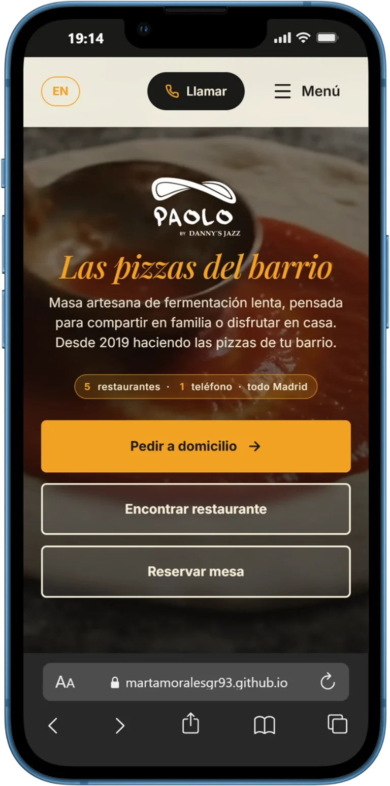
<figcaption style="position: absolute; left: 16px; top: 274px; display: flex; align-items: center; gap: 8px; font-size: 12px; font-weight: 500; color: rgba(255,255,255,.75)"><span style="width: 7px; height: 7px; border-radius: 50%; background: {{accent}}"></span>Web en producción · 5 locales</figcaption>
</figure>

<section aria-label="Ficha del proyecto" style="margin: 22px 16px 0; display: grid; grid-template-columns: repeat(2, minmax(0, 1fr)); gap: 1px; background: rgba(255,255,255,.1); border: 1px solid rgba(255,255,255,.1); border-radius: 16px; overflow: hidden">
<div style="background: #0a0a0c; padding: 14px 16px; display: flex; flex-direction: column; gap: 4px"><span style="font-size: 10px; font-weight: 600; letter-spacing: .12em; text-transform: uppercase; color: rgba(255,255,255,.5)">Rol</span><span style="font-size: 14px; font-weight: 600; color: #fff">Product Designer &amp; Dev</span></div>
<div style="background: #0a0a0c; padding: 14px 16px; display: flex; flex-direction: column; gap: 4px"><span style="font-size: 10px; font-weight: 600; letter-spacing: .12em; text-transform: uppercase; color: rgba(255,255,255,.5)">Cronología</span><span style="font-size: 14px; font-weight: 600; color: #fff">2020 – 2022</span></div>
<div style="background: #0a0a0c; padding: 14px 16px; display: flex; flex-direction: column; gap: 4px"><span style="font-size: 10px; font-weight: 600; letter-spacing: .12em; text-transform: uppercase; color: rgba(255,255,255,.5)">Alcance</span><span style="font-size: 14px; font-weight: 600; color: #fff">Físico + digital</span></div>
<div style="background: #0a0a0c; padding: 14px 16px; display: flex; flex-direction: column; gap: 4px"><span style="font-size: 10px; font-weight: 600; letter-spacing: .12em; text-transform: uppercase; color: rgba(255,255,255,.5)">Equipo</span><span style="font-size: 14px; font-weight: 600; color: #fff">Solo · end to end</span></div>
<div style="grid-column: 1 / -1; background: #0a0a0c; padding: 14px 16px; display: flex; flex-direction: column; gap: 4px"><span style="font-size: 10px; font-weight: 600; letter-spacing: .12em; text-transform: uppercase; color: rgba(255,255,255,.5)">Stack</span><span style="font-size: 14px; font-weight: 600; color: #fff">Figma · HTML5 / SCSS / JS · Netlify · Clarity</span></div>
</section>

<section style="padding: 48px 16px 0; display: flex; flex-direction: column; gap: 18px">
<div style="display: flex; align-items: baseline; justify-content: space-between">
<h2 style="margin: 0; font-family: 'Playfair Display', Georgia, serif; font-size: 30px; line-height: 1.1; color: #fff">El caso en <span style="font-style: italic; color: {{accent}}">30 segundos</span></h2>
<span style="font-size: 12px; font-weight: 600; color: rgba(255,255,255,.4)">01</span>
</div>
<div style="display: flex; flex-direction: column">
<div style="display: flex; gap: 16px">
<div style="display: flex; flex-direction: column; align-items: center; width: 14px; padding-top: 22px"><span style="width: 12px; height: 12px; border-radius: 50%; border: 2px solid rgba(255,255,255,.5)"></span><span style="flex: 1; width: 2px; background: rgba(255,255,255,.12)"></span></div>
<div style="flex: 1; padding: 14px 0 22px; display: flex; flex-direction: column; gap: 6px">
<span style="font-size: 11px; font-weight: 600; letter-spacing: .12em; text-transform: uppercase; color: rgba(255,255,255,.55)">Problema</span>
<span style="font-family: 'Playfair Display', Georgia, serif; font-weight: 800; font-size: 50px; line-height: 1; color: #fff">35%</span>
<span style="font-size: 15px; line-height: 1.45; color: rgba(255,255,255,.72)">de comisión de los agregadores. Sin canal propio, el delivery no salía a cuenta.</span>
</div>
</div>
<div style="display: flex; gap: 16px">
<div style="display: flex; flex-direction: column; align-items: center; width: 14px; padding-top: 22px"><span style="width: 12px; height: 12px; border-radius: 50%; border: 2px solid rgba(255,255,255,.5)"></span><span style="flex: 1; width: 2px; background: rgba(255,255,255,.12)"></span></div>
<div style="flex: 1; padding: 14px 0 22px; display: flex; flex-direction: column; gap: 6px">
<span style="font-size: 11px; font-weight: 600; letter-spacing: .12em; text-transform: uppercase; color: rgba(255,255,255,.55)">Decisión</span>
<span style="font-family: 'Playfair Display', Georgia, serif; font-weight: 800; font-size: 50px; line-height: 1; color: #fff">Canal propio</span>
<span style="font-size: 15px; line-height: 1.45; color: rgba(255,255,255,.72)">Marca, packaging, carta QR y pedidos directos, diseñados y programados a medida.</span>
</div>
</div>
<div style="display: flex; gap: 16px">
<div style="display: flex; flex-direction: column; align-items: center; width: 14px; padding-top: 22px"><span style="width: 12px; height: 12px; border-radius: 50%; background: {{accent}}; box-shadow: 0 0 0 5px rgba(167,139,250,.2)"></span></div>
<div style="flex: 1; padding: 16px 18px 18px; margin-top: 4px; border-radius: 18px; background: rgba(167,139,250,.08); border: 1px solid rgba(167,139,250,.35); display: flex; flex-direction: column; gap: 6px">
<span style="font-size: 11px; font-weight: 600; letter-spacing: .12em; text-transform: uppercase; color: {{accent}}">Impacto medido</span>
<span style="font-family: 'Playfair Display', Georgia, serif; font-weight: 800; font-size: 60px; line-height: 1; color: {{accent}}">1 → 5</span>
<span style="font-size: 15px; line-height: 1.45; color: rgba(255,255,255,.85)">restaurantes en Madrid con el mismo producto, sin rediseño.</span>
</div>
</div>
</div>
<a href="Problema.dc.html" style="margin-top: 10px; height: 52px; border-radius: 999px; border: 1px solid rgba(255,255,255,.16); display: flex; align-items: center; justify-content: center; gap: 10px; color: #fff; font-size: 15px; font-weight: 600; text-decoration: none">Ver el problema<svg width="18" height="18" viewBox="0 0 24 24" fill="none" stroke="currentColor" stroke-width="2" stroke-linecap="round" stroke-linejoin="round" aria-hidden="true"><path d="M12 5v14M19 12l-7 7-7-7"></path></svg></a>
</section>
</div>
</x-dc>
<script type="text/x-dc" data-dc-script data-props='{"accent":{"editor":"color","default":"#a78bfa","options":["#a78bfa","#f97316","#7c3aed"]},"$preview":{"width":390,"height":1640}}'>
class Component extends DCLogic {
renderVals() {
return { accent: this.props.accent ?? '#a78bfa' };
}
}
</script>
</body>
</html>
```

### Mobile 02 · Problema + usuarios + flujos (`Problema.dc.html`)

```html
<!doctype html>
<html lang="es">
<head>
<meta charset="utf-8">
<title>Paolo · Problema</title>
<script src="./support.js"></script>
</head>
<body>
<x-dc>
<helmet>
<link rel="preconnect" href="https://fonts.googleapis.com">
<link href="https://fonts.googleapis.com/css2?family=Inter:wght@400;500;600;700&amp;family=Playfair+Display:ital,wght@0,700;0,800;1,700;1,800&amp;display=swap" rel="stylesheet">
<style>
body{margin:0;background:#000}
a{color:#a78bfa}a:hover{color:#c4b5fd}
</style>
</helmet>
<div style="width: 390px; height: 1900px; background: #000; color: rgba(255,255,255,.72); font-family: Inter, system-ui, sans-serif; overflow: hidden; position: relative">

<header style="height: 56px; padding: 0 6px; display: flex; align-items: center; justify-content: space-between; background: rgba(0,0,0,.8); border-bottom: 1px solid rgba(255,255,255,.08)">
<a href="Main.dc.html" aria-label="Volver" style="width: 44px; height: 44px; display: flex; align-items: center; justify-content: center; color: #fff"><svg width="20" height="20" viewBox="0 0 24 24" fill="none" stroke="currentColor" stroke-width="2" stroke-linecap="round" stroke-linejoin="round" aria-hidden="true"><path d="M15 18l-6-6 6-6"></path></svg></a>
<div style="font-size: 12px; font-weight: 600; letter-spacing: .12em; text-transform: uppercase; color: rgba(255,255,255,.9)">Caso 03 <span style="color: rgba(255,255,255,.4)">/ 05</span></div>
<button type="button" aria-label="Cambiar a inglés" style="width: 44px; height: 44px; background: none; border: 0; color: rgba(255,255,255,.7); font: 600 12px Inter, sans-serif; letter-spacing: .08em">EN</button>
</header>
<nav aria-label="Secciones" style="display: grid; grid-template-columns: repeat(5, minmax(0, 1fr)); gap: 6px; padding: 10px 16px 0">
<div style="display: flex; flex-direction: column; gap: 6px"><div style="height: 3px; border-radius: 3px; background: rgba(167,139,250,.45)"></div><span style="font-size: 9px; font-weight: 600; letter-spacing: .05em; text-transform: uppercase; color: rgba(255,255,255,.45)">Overview</span></div>
<div style="display: flex; flex-direction: column; gap: 6px"><div style="height: 3px; border-radius: 3px; background: {{accent}}"></div><span style="font-size: 9px; font-weight: 600; letter-spacing: .05em; text-transform: uppercase; color: #fff">Problema</span></div>
<div style="display: flex; flex-direction: column; gap: 6px"><div style="height: 3px; border-radius: 3px; background: rgba(255,255,255,.14)"></div><span style="font-size: 9px; font-weight: 600; letter-spacing: .05em; text-transform: uppercase; color: rgba(255,255,255,.45)">Marca</span></div>
<div style="display: flex; flex-direction: column; gap: 6px"><div style="height: 3px; border-radius: 3px; background: rgba(255,255,255,.14)"></div><span style="font-size: 9px; font-weight: 600; letter-spacing: .05em; text-transform: uppercase; color: rgba(255,255,255,.45)">Producto</span></div>
<div style="display: flex; flex-direction: column; gap: 6px"><div style="height: 3px; border-radius: 3px; background: rgba(255,255,255,.14)"></div><span style="font-size: 9px; font-weight: 600; letter-spacing: .05em; text-transform: uppercase; color: rgba(255,255,255,.45)">Resultados</span></div>
</nav>

<section style="padding: 30px 16px 0; display: flex; flex-direction: column; gap: 20px">
<div style="display: flex; flex-direction: column; gap: 12px">
<span style="font-size: 12px; font-weight: 600; letter-spacing: .14em; text-transform: uppercase; color: {{accent}}">02 · El origen</span>
<h2 style="margin: 0; font-family: 'Playfair Display', Georgia, serif; font-weight: 800; font-size: 38px; line-height: 1.04; letter-spacing: -.015em; color: #fff">Vender a domicilio <span style="font-style: italic; color: {{accent}}">sin regalar el margen</span></h2>
<p style="margin: 0; font-size: 15px; line-height: 1.55; color: rgba(255,255,255,.72)">Abrió en 2019 en Conde Duque, sin infraestructura digital. En marzo de 2020 la sala cerró y los agregadores eran la única salida.</p>
</div>
<div style="padding: 18px; border-radius: 18px; background: rgba(255,255,255,.03); border: 1px solid rgba(255,255,255,.1); display: flex; flex-direction: column; gap: 14px">
<span style="font-size: 11px; font-weight: 600; letter-spacing: .12em; text-transform: uppercase; color: rgba(255,255,255,.55)">Cada pizza vendida vía agregador</span>
<div role="img" aria-label="De cada pedido, el 65% queda para Paolo y el 35% se lo lleva el agregador" style="display: flex; height: 52px; border-radius: 12px; overflow: hidden">
<div style="width: 65%; background: rgba(255,255,255,.1); display: flex; align-items: center; padding: 0 14px; font-size: 13px; font-weight: 600; color: #fff">65% Paolo</div>
<div style="width: 35%; background: {{accent}}; display: flex; align-items: center; justify-content: center; font-size: 13px; font-weight: 800; color: #0b0614">35%</div>
</div>
<span style="font-size: 14px; line-height: 1.45; color: rgba(255,255,255,.72)">Comisión de Glovo y Uber Eats en pandemia, sobre un producto artesano de margen corto.</span>
</div>
</section>

<section style="padding: 36px 16px 0; display: flex; flex-direction: column; gap: 12px">
<span style="font-size: 12px; font-weight: 600; letter-spacing: .14em; text-transform: uppercase; color: rgba(255,255,255,.55)">3 patrones de fricción</span>
<div style="display: flex; align-items: center; gap: 14px; padding: 14px; border-radius: 16px; background: rgba(255,255,255,.035); border: 1px solid rgba(255,255,255,.09)">
<span style="flex: none; width: 44px; height: 44px; border-radius: 12px; background: rgba(167,139,250,.12); color: {{accent}}; display: flex; align-items: center; justify-content: center"><svg width="22" height="22" viewBox="0 0 24 24" fill="none" stroke="currentColor" stroke-width="1.8" stroke-linecap="round" stroke-linejoin="round" aria-hidden="true"><circle cx="12" cy="12" r="9"></circle><path d="M3 12h18M12 3a14 14 0 0 1 0 18M12 3a14 14 0 0 0 0 18"></path><path d="M4 4l16 16"></path></svg></span>
<span style="font-size: 15px; line-height: 1.35; color: #fff; font-weight: 500">Cero presencia digital con el local cerrado</span>
</div>
<div style="display: flex; align-items: center; gap: 14px; padding: 14px; border-radius: 16px; background: rgba(255,255,255,.035); border: 1px solid rgba(255,255,255,.09)">
<span style="flex: none; width: 44px; height: 44px; border-radius: 12px; background: rgba(167,139,250,.12); color: {{accent}}; display: flex; align-items: center; justify-content: center"><svg width="22" height="22" viewBox="0 0 24 24" fill="none" stroke="currentColor" stroke-width="1.8" stroke-linecap="round" stroke-linejoin="round" aria-hidden="true"><path d="M22 16.9v3a2 2 0 0 1-2.2 2 19.8 19.8 0 0 1-8.6-3.1 19.5 19.5 0 0 1-6-6A19.8 19.8 0 0 1 2.1 4.2 2 2 0 0 1 4.1 2h3a2 2 0 0 1 2 1.7c.1.9.4 1.8.7 2.7a2 2 0 0 1-.5 2.1L8 9.8a16 16 0 0 0 6 6l1.3-1.3a2 2 0 0 1 2.1-.4c.9.3 1.8.6 2.7.7a2 2 0 0 1 1.7 2z"></path></svg></span>
<span style="font-size: 15px; line-height: 1.35; color: #fff; font-weight: 500">Carta en papel y <strong style="color: {{accent}}">teléfono colapsado</strong> en hora punta</span>
</div>
<div style="display: flex; align-items: center; gap: 14px; padding: 14px; border-radius: 16px; background: rgba(255,255,255,.035); border: 1px solid rgba(255,255,255,.09)">
<span style="flex: none; width: 44px; height: 44px; border-radius: 12px; background: rgba(167,139,250,.12); color: {{accent}}; display: flex; align-items: center; justify-content: center"><svg width="22" height="22" viewBox="0 0 24 24" fill="none" stroke="currentColor" stroke-width="1.8" stroke-linecap="round" stroke-linejoin="round" aria-hidden="true"><rect x="1" y="7" width="14" height="10" rx="1"></rect><path d="M15 10h4l3 3v4h-7"></path><circle cx="6" cy="18.5" r="1.8"></circle><circle cx="18" cy="18.5" r="1.8"></circle></svg></span>
<span style="font-size: 15px; line-height: 1.35; color: #fff; font-weight: 500">Sin canal directo para pedidos a domicilio</span>
</div>
<div style="margin-top: 8px; border-radius: 18px; overflow: hidden; border: 1px solid rgba(167,139,250,.35)">
<div style="padding: 14px 16px; background: rgba(255,255,255,.03); display: flex; flex-direction: column; gap: 4px"><span style="font-size: 11px; font-weight: 600; letter-spacing: .12em; text-transform: uppercase; color: rgba(255,255,255,.55)">Hallazgo</span><span style="font-size: 15px; line-height: 1.4; color: #fff">El negocio necesitaba un canal de venta que preservase el margen artesano.</span></div>
<div style="padding: 14px 16px; background: rgba(167,139,250,.1); border-top: 1px solid rgba(167,139,250,.35); display: flex; flex-direction: column; gap: 4px"><span style="font-size: 11px; font-weight: 600; letter-spacing: .12em; text-transform: uppercase; color: {{accent}}">Decisión</span><span style="font-size: 15px; line-height: 1.4; color: #fff; font-weight: 600">Diseñar de 0 a 1 marca, packaging, carta QR y web propia.</span></div>
</div>
</section>

<section style="padding: 48px 16px 0; display: flex; flex-direction: column; gap: 14px">
<span style="font-size: 12px; font-weight: 600; letter-spacing: .14em; text-transform: uppercase; color: rgba(255,255,255,.55)">Usuarios · 2 perfiles reales</span>
<h3 style="margin: 0; font-family: 'Playfair Display', Georgia, serif; font-weight: 800; font-size: 30px; line-height: 1.08; color: #fff">Dos contextos, <span style="font-style: italic; color: {{accent}}">dos leyes</span></h3>
<div style="display: grid; grid-template-columns: repeat(2, minmax(0, 1fr)); gap: 10px">
<div style="padding: 16px 14px; border-radius: 18px; background: rgba(255,255,255,.03); border: 1px solid rgba(255,255,255,.1); display: flex; flex-direction: column; gap: 12px">
<div style="display: flex; flex-direction: column; gap: 2px"><span style="font-size: 11px; font-weight: 600; letter-spacing: .1em; text-transform: uppercase; color: rgba(255,255,255,.55)">Delivery</span><span style="font-family: 'Playfair Display', Georgia, serif; font-weight: 800; font-size: 32px; line-height: 1; color: #fff">&lt;90 s</span><span style="font-size: 12px; color: rgba(255,255,255,.6)">para pedir desde el sofá</span></div>
<div role="img" aria-label="La carta agrupada en bloques de hasta 7 opciones" style="display: grid; grid-template-columns: repeat(7, minmax(0, 1fr)); gap: 3px">
<span style="height: 16px; border-radius: 3px; background: {{accent}}"></span><span style="height: 16px; border-radius: 3px; background: {{accent}}"></span><span style="height: 16px; border-radius: 3px; background: {{accent}}"></span><span style="height: 16px; border-radius: 3px; background: {{accent}}"></span><span style="height: 16px; border-radius: 3px; background: {{accent}}"></span><span style="height: 16px; border-radius: 3px; background: {{accent}}"></span><span style="height: 16px; border-radius: 3px; background: {{accent}}"></span>
</div>
<div style="padding-top: 10px; border-top: 1px solid rgba(255,255,255,.1); display: flex; flex-direction: column; gap: 4px"><span style="font-size: 13px; font-weight: 700; color: {{accent}}">Ley de Miller</span><span style="font-size: 13px; line-height: 1.4; color: rgba(255,255,255,.78)">Carta en bloques de máx. 7 opciones.</span></div>
</div>
<div style="padding: 16px 14px; border-radius: 18px; background: rgba(255,255,255,.03); border: 1px solid rgba(255,255,255,.1); display: flex; flex-direction: column; gap: 12px">
<div style="display: flex; flex-direction: column; gap: 2px"><span style="font-size: 11px; font-weight: 600; letter-spacing: .1em; text-transform: uppercase; color: rgba(255,255,255,.55)">En sala</span><span style="font-family: 'Playfair Display', Georgia, serif; font-weight: 800; font-size: 32px; line-height: 1; color: #fff">Sin app</span><span style="font-size: 12px; color: rgba(255,255,255,.6)">QR, poca luz, alérgenos</span></div>
<div role="img" aria-label="Botón táctil de 48 píxeles en la zona del pulgar" style="height: 16px; display: flex; align-items: center; gap: 6px"><span style="flex: 1; height: 16px; border-radius: 8px; background: {{accent}}"></span><span style="font-size: 11px; font-weight: 700; color: #fff">48px</span></div>
<div style="padding-top: 10px; border-top: 1px solid rgba(255,255,255,.1); display: flex; flex-direction: column; gap: 4px"><span style="font-size: 13px; font-weight: 700; color: {{accent}}">Ley de Fitts</span><span style="font-size: 13px; line-height: 1.4; color: rgba(255,255,255,.78)">Áreas ≥48px y CTA en zona del pulgar.</span></div>
</div>
</div>
</section>

<section style="padding: 44px 16px 0; display: flex; flex-direction: column; gap: 12px">
<span style="font-size: 12px; font-weight: 600; letter-spacing: .14em; text-transform: uppercase; color: rgba(255,255,255,.55)">3 flujos transaccionales</span>
<sc-for list="{{flows}}" as="f" hint-placeholder-count="3">
<div style="padding: 16px; border-radius: 18px; background: rgba(255,255,255,.035); border: 1px solid rgba(255,255,255,.09); display: flex; flex-direction: column; gap: 12px">
<div style="display: flex; align-items: center; justify-content: space-between"><span style="font-size: 16px; font-weight: 700; color: #fff">{{f.title}}</span><span style="font-size: 11px; font-weight: 700; color: {{accent}}">{{f.n}}</span></div>
<div style="display: grid; grid-template-columns: minmax(0, 1fr) 14px minmax(0, 1fr) 14px minmax(0, 1fr); align-items: center; gap: 4px">
<span style="padding: 8px; border-radius: 10px; background: rgba(255,255,255,.06); font-size: 12px; line-height: 1.3; color: rgba(255,255,255,.85); text-align: center">{{f.a}}</span>
<svg width="14" height="14" viewBox="0 0 24 24" fill="none" stroke="rgba(255,255,255,.4)" stroke-width="2" stroke-linecap="round" stroke-linejoin="round" aria-hidden="true"><path d="M9 18l6-6-6-6"></path></svg>
<span style="padding: 8px; border-radius: 10px; background: rgba(255,255,255,.06); font-size: 12px; line-height: 1.3; color: rgba(255,255,255,.85); text-align: center">{{f.b}}</span>
<svg width="14" height="14" viewBox="0 0 24 24" fill="none" stroke="rgba(255,255,255,.4)" stroke-width="2" stroke-linecap="round" stroke-linejoin="round" aria-hidden="true"><path d="M9 18l6-6-6-6"></path></svg>
<span style="padding: 8px; border-radius: 10px; background: rgba(167,139,250,.14); font-size: 12px; line-height: 1.3; font-weight: 600; color: #fff; text-align: center">{{f.c}}</span>
</div>
</div>
</sc-for>
<a href="Marca.dc.html" style="margin-top: 14px; height: 52px; border-radius: 999px; border: 1px solid rgba(255,255,255,.16); display: flex; align-items: center; justify-content: center; gap: 10px; color: #fff; font-size: 15px; font-weight: 600; text-decoration: none">Ver la marca<svg width="18" height="18" viewBox="0 0 24 24" fill="none" stroke="currentColor" stroke-width="2" stroke-linecap="round" stroke-linejoin="round" aria-hidden="true"><path d="M12 5v14M19 12l-7 7-7-7"></path></svg></a>
</section>
</div>
</x-dc>
<script type="text/x-dc" data-dc-script data-props='{"accent":{"editor":"color","default":"#a78bfa","options":["#a78bfa","#f97316","#7c3aed"]},"$preview":{"width":390,"height":1900}}'>
class Component extends DCLogic {
renderVals() {
return {
accent: this.props.accent ?? '#a78bfa',
flows: [
{ n: '01', title: 'Pedido directo', a: 'Google o Instagram', b: 'Selección visual', c: 'Comanda a cocina por WhatsApp' },
{ n: '02', title: 'Carta QR en mesa', a: 'QR sin instalar app', b: 'Carga inmediata', c: '−40% de espera' },
{ n: '03', title: 'Reserva multi-local', a: 'Local más cercano', b: 'Aforo y horario', c: 'Reserva sin centralita' }
]
};
}
}
</script>
</body>
</html>
```

### Mobile 03 · Marca y espacio (`Marca.dc.html`)

```html
<!doctype html>
<html lang="es">
<head>
<meta charset="utf-8">
<title>Paolo · Marca y espacio</title>
<script src="./support.js"></script>
</head>
<body>
<x-dc>
<helmet>
<link rel="preconnect" href="https://fonts.googleapis.com">
<link href="https://fonts.googleapis.com/css2?family=Inter:wght@400;500;600;700&amp;family=Playfair+Display:ital,wght@0,700;0,800;1,700;1,800&amp;display=swap" rel="stylesheet">
<style>
body{margin:0;background:#000}
a{color:#a78bfa}a:hover{color:#c4b5fd}
</style>
</helmet>
<div style="width: 390px; height: 1940px; background: #000; color: rgba(255,255,255,.72); font-family: Inter, system-ui, sans-serif; overflow: hidden; position: relative">

<header style="height: 56px; padding: 0 6px; display: flex; align-items: center; justify-content: space-between; background: rgba(0,0,0,.8); border-bottom: 1px solid rgba(255,255,255,.08)">
<a href="Problema.dc.html" aria-label="Volver" style="width: 44px; height: 44px; display: flex; align-items: center; justify-content: center; color: #fff"><svg width="20" height="20" viewBox="0 0 24 24" fill="none" stroke="currentColor" stroke-width="2" stroke-linecap="round" stroke-linejoin="round" aria-hidden="true"><path d="M15 18l-6-6 6-6"></path></svg></a>
<div style="font-size: 12px; font-weight: 600; letter-spacing: .12em; text-transform: uppercase; color: rgba(255,255,255,.9)">Caso 03 <span style="color: rgba(255,255,255,.4)">/ 05</span></div>
<button type="button" aria-label="Cambiar a inglés" style="width: 44px; height: 44px; background: none; border: 0; color: rgba(255,255,255,.7); font: 600 12px Inter, sans-serif; letter-spacing: .08em">EN</button>
</header>
<nav aria-label="Secciones" style="display: grid; grid-template-columns: repeat(5, minmax(0, 1fr)); gap: 6px; padding: 10px 16px 0">
<div style="display: flex; flex-direction: column; gap: 6px"><div style="height: 3px; border-radius: 3px; background: rgba(167,139,250,.45)"></div><span style="font-size: 9px; font-weight: 600; letter-spacing: .05em; text-transform: uppercase; color: rgba(255,255,255,.45)">Overview</span></div>
<div style="display: flex; flex-direction: column; gap: 6px"><div style="height: 3px; border-radius: 3px; background: rgba(167,139,250,.45)"></div><span style="font-size: 9px; font-weight: 600; letter-spacing: .05em; text-transform: uppercase; color: rgba(255,255,255,.45)">Problema</span></div>
<div style="display: flex; flex-direction: column; gap: 6px"><div style="height: 3px; border-radius: 3px; background: {{accent}}"></div><span style="font-size: 9px; font-weight: 600; letter-spacing: .05em; text-transform: uppercase; color: #fff">Marca</span></div>
<div style="display: flex; flex-direction: column; gap: 6px"><div style="height: 3px; border-radius: 3px; background: rgba(255,255,255,.14)"></div><span style="font-size: 9px; font-weight: 600; letter-spacing: .05em; text-transform: uppercase; color: rgba(255,255,255,.45)">Producto</span></div>
<div style="display: flex; flex-direction: column; gap: 6px"><div style="height: 3px; border-radius: 3px; background: rgba(255,255,255,.14)"></div><span style="font-size: 9px; font-weight: 600; letter-spacing: .05em; text-transform: uppercase; color: rgba(255,255,255,.45)">Resultados</span></div>
</nav>

<section style="padding: 30px 16px 0; display: flex; flex-direction: column; gap: 18px">
<div aria-label="Proceso en 5 fases, fase 3 de 5" style="display: grid; grid-template-columns: repeat(5, minmax(0, 1fr)); gap: 4px">
<div style="display: flex; flex-direction: column; gap: 6px"><span style="width: 24px; height: 24px; border-radius: 50%; background: rgba(167,139,250,.2); color: {{accent}}; font-size: 11px; font-weight: 700; display: flex; align-items: center; justify-content: center">1</span><span style="font-size: 10px; line-height: 1.25; color: rgba(255,255,255,.55)">Estrategia</span></div>
<div style="display: flex; flex-direction: column; gap: 6px"><span style="width: 24px; height: 24px; border-radius: 50%; background: rgba(167,139,250,.2); color: {{accent}}; font-size: 11px; font-weight: 700; display: flex; align-items: center; justify-content: center">2</span><span style="font-size: 10px; line-height: 1.25; color: rgba(255,255,255,.55)">Research</span></div>
<div style="display: flex; flex-direction: column; gap: 6px"><span style="width: 24px; height: 24px; border-radius: 50%; background: {{accent}}; color: #0b0614; font-size: 11px; font-weight: 800; display: flex; align-items: center; justify-content: center">3</span><span style="font-size: 10px; line-height: 1.25; font-weight: 600; color: #fff">Marca y espacio</span></div>
<div style="display: flex; flex-direction: column; gap: 6px"><span style="width: 24px; height: 24px; border-radius: 50%; border: 1px solid rgba(255,255,255,.2); color: rgba(255,255,255,.5); font-size: 11px; font-weight: 700; display: flex; align-items: center; justify-content: center">4</span><span style="font-size: 10px; line-height: 1.25; color: rgba(255,255,255,.55)">UX / UI</span></div>
<div style="display: flex; flex-direction: column; gap: 6px"><span style="width: 24px; height: 24px; border-radius: 50%; border: 1px solid rgba(255,255,255,.2); color: rgba(255,255,255,.5); font-size: 11px; font-weight: 700; display: flex; align-items: center; justify-content: center">5</span><span style="font-size: 10px; line-height: 1.25; color: rgba(255,255,255,.55)">Código</span></div>
</div>
<div style="display: flex; flex-direction: column; gap: 12px">
<span style="font-size: 12px; font-weight: 600; letter-spacing: .14em; text-transform: uppercase; color: {{accent}}">03 · Marca y espacio</span>
<h2 style="margin: 0; font-family: 'Playfair Display', Georgia, serif; font-weight: 800; font-size: 38px; line-height: 1.04; letter-spacing: -.015em; color: #fff">El producto empieza <span style="font-style: italic; color: {{accent}}">en la calle</span></h2>
<p style="margin: 0; font-size: 15px; line-height: 1.55; color: rgba(255,255,255,.72)">Caja, rótulo y uniforme cuentan la misma propuesta artesana que la web.</p>
</div>
</section>

<section aria-label="Identidad" style="margin: 26px 16px 0; padding: 26px 20px 20px; border-radius: 22px; background: #0d0d10; border: 1px solid rgba(255,255,255,.1); display: flex; flex-direction: column; gap: 22px">

<div style="display: grid; grid-template-columns: repeat(4, minmax(0, 1fr)); gap: 8px">
<div style="display: flex; flex-direction: column; gap: 6px"><span style="height: 44px; border-radius: 10px; background: #111; border: 1px solid rgba(255,255,255,.18)"></span><span style="font-size: 11px; color: rgba(255,255,255,.6)">Carbón</span></div>
<div style="display: flex; flex-direction: column; gap: 6px"><span style="height: 44px; border-radius: 10px; background: #f4ecdd"></span><span style="font-size: 11px; color: rgba(255,255,255,.6)">Harina</span></div>
<div style="display: flex; flex-direction: column; gap: 6px"><span style="height: 44px; border-radius: 10px; background: #f2a52b"></span><span style="font-size: 11px; color: rgba(255,255,255,.6)">Horno</span></div>
<div style="display: flex; flex-direction: column; gap: 6px"><span style="height: 44px; border-radius: 10px; background: #8c1d2a"></span><span style="font-size: 11px; color: rgba(255,255,255,.6)">Tomate</span></div>
</div>
<div style="display: flex; align-items: baseline; justify-content: space-between; padding-top: 14px; border-top: 1px solid rgba(255,255,255,.1)"><span style="font-family: 'Playfair Display', Georgia, serif; font-style: italic; font-weight: 700; font-size: 24px; color: #fff">Las pizzas del barrio</span><span style="font-size: 11px; font-weight: 600; letter-spacing: .1em; text-transform: uppercase; color: rgba(255,255,255,.5)">Claim</span></div>
</section>

<section style="padding: 40px 16px 0; display: flex; flex-direction: column; gap: 14px">
<span style="font-size: 12px; font-weight: 600; letter-spacing: .14em; text-transform: uppercase; color: rgba(255,255,255,.55)">3 piezas físicas</span>
<div style="display: flex; flex-direction: column; gap: 10px">
<figure style="margin: 0; position: relative; border-radius: 18px; overflow: hidden">
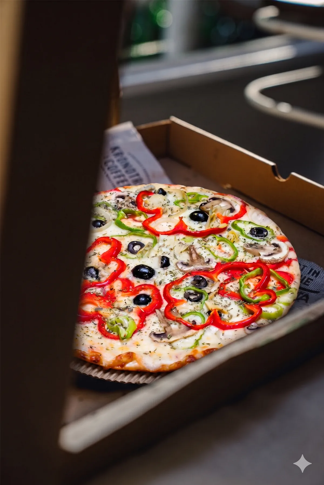
<figcaption style="position: absolute; left: 0; right: 0; bottom: 0; padding: 48px 16px 14px; background: linear-gradient(180deg, rgba(0,0,0,0), rgba(0,0,0,.85)); display: flex; flex-direction: column; gap: 2px"><span style="font-size: 10px; font-weight: 600; letter-spacing: .12em; text-transform: uppercase; color: {{accent}}">Packaging</span><span style="font-size: 15px; font-weight: 600; color: #fff">Caja térmica kraft</span></figcaption>
</figure>
<figure style="margin: 0; position: relative; border-radius: 18px; overflow: hidden; background: #ececec">
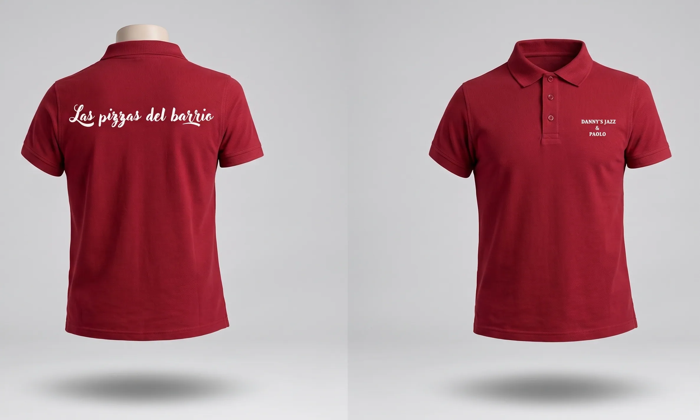
<figcaption style="position: absolute; left: 12px; top: 12px; display: flex; align-items: center; gap: 8px; padding: 7px 12px; border-radius: 999px; background: rgba(0,0,0,.78); font-size: 12px; font-weight: 600; color: #fff"><span style="font-size: 10px; font-weight: 700; letter-spacing: .12em; text-transform: uppercase; color: {{accent}}">Sala</span>Uniformes</figcaption>
</figure>
</div>
</section>

<section style="padding: 40px 16px 0; display: flex; flex-direction: column; gap: 14px">
<div style="display: flex; flex-direction: column; gap: 8px">
<span style="font-size: 12px; font-weight: 600; letter-spacing: .14em; text-transform: uppercase; color: rgba(255,255,255,.55)">Espacio · plano técnico</span>
<h3 style="margin: 0; font-family: 'Playfair Display', Georgia, serif; font-weight: 800; font-size: 28px; line-height: 1.1; color: #fff">Fachada, rótulos y terraza</h3>
</div>
<figure style="margin: 0; border-radius: 18px; overflow: hidden; background: #fff; border: 1px solid rgba(255,255,255,.1)">
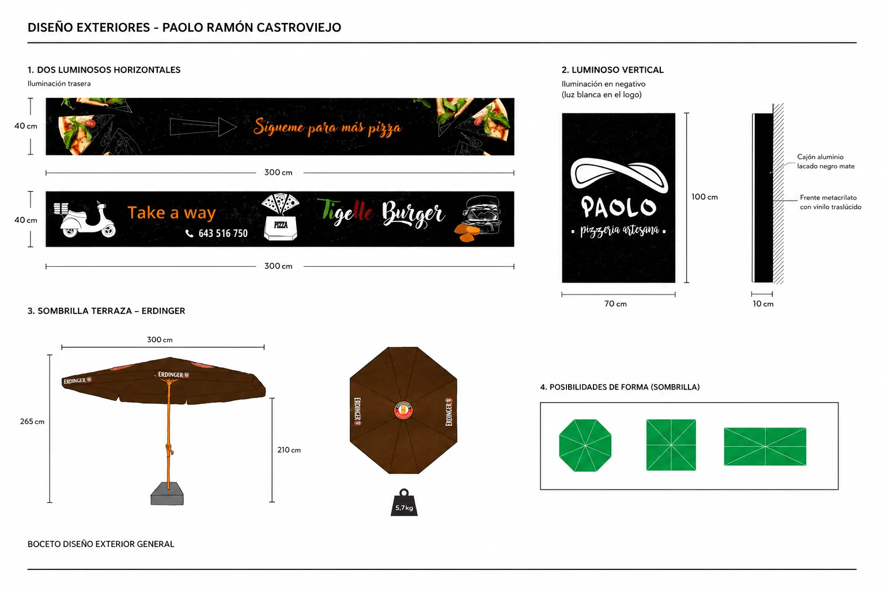
</figure>
<p style="margin: 0; font-size: 14px; line-height: 1.5; color: rgba(255,255,255,.7)">Luminosos, sombrillas y vinilos con medidas de montaje para captar al transeúnte.</p>
<a href="Producto.dc.html" style="margin-top: 14px; height: 52px; border-radius: 999px; border: 1px solid rgba(255,255,255,.16); display: flex; align-items: center; justify-content: center; gap: 10px; color: #fff; font-size: 15px; font-weight: 600; text-decoration: none">Ver el producto digital<svg width="18" height="18" viewBox="0 0 24 24" fill="none" stroke="currentColor" stroke-width="2" stroke-linecap="round" stroke-linejoin="round" aria-hidden="true"><path d="M12 5v14M19 12l-7 7-7-7"></path></svg></a>
</section>
</div>
</x-dc>
<script type="text/x-dc" data-dc-script data-props='{"accent":{"editor":"color","default":"#a78bfa","options":["#a78bfa","#f97316","#7c3aed"]},"$preview":{"width":390,"height":1940}}'>
class Component extends DCLogic {
renderVals() {
return { accent: this.props.accent ?? '#a78bfa' };
}
}
</script>
</body>
</html>
```

### Mobile 04 · Producto digital (`Producto.dc.html`)

```html
<!doctype html>
<html lang="es">
<head>
<meta charset="utf-8">
<title>Paolo · Producto digital</title>
<script src="./support.js"></script>
</head>
<body>
<x-dc>
<helmet>
<link rel="preconnect" href="https://fonts.googleapis.com">
<link href="https://fonts.googleapis.com/css2?family=Inter:wght@400;500;600;700&amp;family=Playfair+Display:ital,wght@0,700;0,800;1,700;1,800&amp;display=swap" rel="stylesheet">
<style>
body{margin:0;background:#000}
a{color:#a78bfa}a:hover{color:#c4b5fd}
</style>
</helmet>
<div style="width: 390px; height: 2160px; background: #000; color: rgba(255,255,255,.72); font-family: Inter, system-ui, sans-serif; overflow: hidden; position: relative">

<header style="height: 56px; padding: 0 6px; display: flex; align-items: center; justify-content: space-between; background: rgba(0,0,0,.8); border-bottom: 1px solid rgba(255,255,255,.08)">
<a href="Marca.dc.html" aria-label="Volver" style="width: 44px; height: 44px; display: flex; align-items: center; justify-content: center; color: #fff"><svg width="20" height="20" viewBox="0 0 24 24" fill="none" stroke="currentColor" stroke-width="2" stroke-linecap="round" stroke-linejoin="round" aria-hidden="true"><path d="M15 18l-6-6 6-6"></path></svg></a>
<div style="font-size: 12px; font-weight: 600; letter-spacing: .12em; text-transform: uppercase; color: rgba(255,255,255,.9)">Caso 03 <span style="color: rgba(255,255,255,.4)">/ 05</span></div>
<button type="button" aria-label="Cambiar a inglés" style="width: 44px; height: 44px; background: none; border: 0; color: rgba(255,255,255,.7); font: 600 12px Inter, sans-serif; letter-spacing: .08em">EN</button>
</header>
<nav aria-label="Secciones" style="display: grid; grid-template-columns: repeat(5, minmax(0, 1fr)); gap: 6px; padding: 10px 16px 0">
<div style="display: flex; flex-direction: column; gap: 6px"><div style="height: 3px; border-radius: 3px; background: rgba(167,139,250,.45)"></div><span style="font-size: 9px; font-weight: 600; letter-spacing: .05em; text-transform: uppercase; color: rgba(255,255,255,.45)">Overview</span></div>
<div style="display: flex; flex-direction: column; gap: 6px"><div style="height: 3px; border-radius: 3px; background: rgba(167,139,250,.45)"></div><span style="font-size: 9px; font-weight: 600; letter-spacing: .05em; text-transform: uppercase; color: rgba(255,255,255,.45)">Problema</span></div>
<div style="display: flex; flex-direction: column; gap: 6px"><div style="height: 3px; border-radius: 3px; background: rgba(167,139,250,.45)"></div><span style="font-size: 9px; font-weight: 600; letter-spacing: .05em; text-transform: uppercase; color: rgba(255,255,255,.45)">Marca</span></div>
<div style="display: flex; flex-direction: column; gap: 6px"><div style="height: 3px; border-radius: 3px; background: {{accent}}"></div><span style="font-size: 9px; font-weight: 600; letter-spacing: .05em; text-transform: uppercase; color: #fff">Producto</span></div>
<div style="display: flex; flex-direction: column; gap: 6px"><div style="height: 3px; border-radius: 3px; background: rgba(255,255,255,.14)"></div><span style="font-size: 9px; font-weight: 600; letter-spacing: .05em; text-transform: uppercase; color: rgba(255,255,255,.45)">Resultados</span></div>
</nav>

<section style="padding: 30px 16px 0; display: flex; flex-direction: column; gap: 12px">
<span style="font-size: 12px; font-weight: 600; letter-spacing: .14em; text-transform: uppercase; color: {{accent}}">04 · Producto digital</span>
<h2 style="margin: 0; font-family: 'Playfair Display', Georgia, serif; font-weight: 800; font-size: 38px; line-height: 1.04; letter-spacing: -.015em; color: #fff">Diseñado <span style="font-style: italic; color: {{accent}}">y programado</span> por mí</h2>
<p style="margin: 0; font-size: 15px; line-height: 1.55; color: rgba(255,255,255,.72)">HTML5, SCSS y JS vanilla en Netlify: sin frameworks, para cargar al instante con mala cobertura dentro del local.</p>
</section>

<section style="padding: 26px 16px 0; display: flex; flex-direction: column; gap: 12px">
<div style="display: grid; grid-template-columns: repeat(2, minmax(0, 1fr)); gap: 10px">
<figure style="margin: 0; display: flex; flex-direction: column; gap: 8px">
<div style="position: relative; height: 320px; border-radius: 18px; background: #f4f4f4; display: flex; align-items: center; justify-content: center; overflow: hidden">
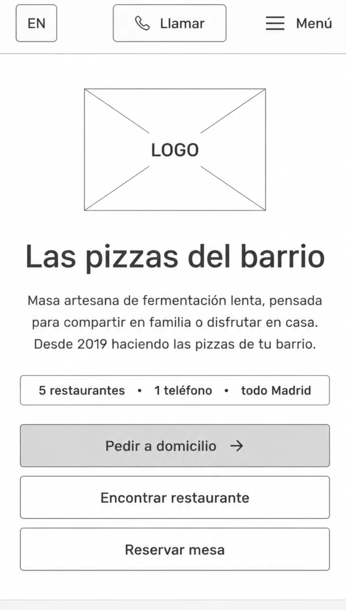
<span style="position: absolute; left: 10px; top: 10px; padding: 4px 9px; border-radius: 999px; background: #000; color: #fff; font-size: 11px; font-weight: 700">Lo-fi</span>
</div>
<figcaption style="font-size: 12px; line-height: 1.4; color: rgba(255,255,255,.65)">Una mano, CTA en zona del pulgar</figcaption>
</figure>
<figure style="margin: 0; display: flex; flex-direction: column; gap: 8px">
<div style="position: relative; height: 320px; border-radius: 18px; background: radial-gradient(ellipse at 50% 55%, rgba(124,58,237,.22), rgba(0,0,0,0) 70%), #0d0d10; border: 1px solid rgba(255,255,255,.1); display: flex; align-items: center; justify-content: center; overflow: hidden">

<span style="position: absolute; left: 10px; top: 10px; padding: 4px 9px; border-radius: 999px; background: {{accent}}; color: #0b0614; font-size: 11px; font-weight: 700">Final</span>
</div>
<figcaption style="font-size: 12px; line-height: 1.4; color: rgba(255,255,255,.65)">3 acciones: pedir, encontrar, reservar</figcaption>
</figure>
</div>
</section>

<section style="padding: 40px 0 0; display: flex; flex-direction: column; gap: 14px">
<div style="padding: 0 16px; display: flex; flex-direction: column; gap: 8px">
<span style="font-size: 12px; font-weight: 600; letter-spacing: .14em; text-transform: uppercase; color: rgba(255,255,255,.55)">Pantallas clave</span>
<h3 style="margin: 0; font-family: 'Playfair Display', Georgia, serif; font-weight: 800; font-size: 28px; line-height: 1.1; color: #fff">Una web, tres trabajos</h3>
</div>
<div style="display: flex; gap: 12px; overflow-x: auto; padding: 0 16px 4px; scroll-snap-type: x mandatory">
<sc-for list="{{screens}}" as="s" hint-placeholder-count="3">
<article style="flex: none; width: 322px; scroll-snap-align: start; border-radius: 20px; overflow: hidden; background: #0d0d10; border: 1px solid rgba(255,255,255,.1)">
<div style="padding: 14px 8px 0; background: radial-gradient(ellipse at 50% 70%, rgba(124,58,237,.2), rgba(0,0,0,0) 70%)"></div>
<div style="padding: 14px 16px 16px; display: flex; flex-direction: column; gap: 8px">
<span style="font-size: 11px; font-weight: 600; letter-spacing: .12em; text-transform: uppercase; color: {{accent}}">{{s.n}} · {{s.tag}}</span>
<span style="font-size: 17px; font-weight: 600; color: #fff">{{s.title}}</span>
<span style="font-size: 14px; line-height: 1.45; color: rgba(255,255,255,.7)">{{s.body}}</span>
</div>
</article>
</sc-for>
</div>
<div style="padding: 0 16px; display: flex; align-items: center; justify-content: space-between">
<div style="display: flex; gap: 6px" aria-hidden="true">
<span style="width: 22px; height: 6px; border-radius: 6px; background: {{accent}}"></span>
<span style="width: 6px; height: 6px; border-radius: 6px; background: rgba(255,255,255,.25)"></span>
<span style="width: 6px; height: 6px; border-radius: 6px; background: rgba(255,255,255,.25)"></span>
</div>
<span style="font-size: 12px; font-weight: 600; color: rgba(255,255,255,.55)">Desliza · 01 / 03</span>
</div>
</section>

<section style="margin: 40px 16px 0; border-radius: 22px; overflow: hidden; background: rgba(167,139,250,.07); border: 1px solid rgba(167,139,250,.35)">
<div style="padding: 14px 8px 0">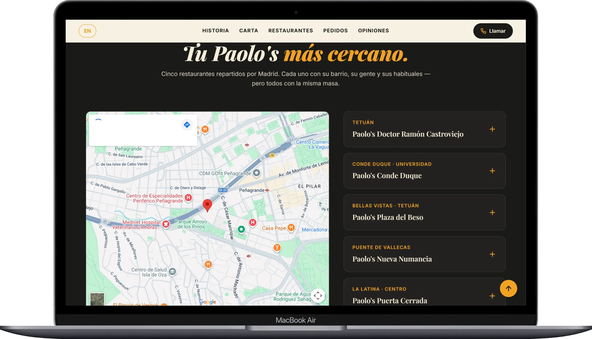</div>
<div style="padding: 18px 20px 20px; display: flex; flex-direction: column; gap: 10px">
<span style="font-size: 11px; font-weight: 600; letter-spacing: .12em; text-transform: uppercase; color: {{accent}}">Decisión con datos · Clarity</span>
<span style="font-family: 'Playfair Display', Georgia, serif; font-weight: 800; font-size: 26px; line-height: 1.15; color: #fff">El selector de local, primero en móvil</span>
<span style="font-size: 14px; line-height: 1.5; color: rgba(255,255,255,.8)">Las sesiones mostraban que el usuario buscaba su local más cercano antes que la carta.</span>
</div>
</section>

<section style="padding: 48px 16px 0; display: flex; flex-direction: column; gap: 14px">
<div style="display: flex; flex-direction: column; gap: 8px">
<span style="font-size: 12px; font-weight: 600; letter-spacing: .14em; text-transform: uppercase; color: rgba(255,255,255,.55)">Evolución · dirección de arte</span>
<h3 style="margin: 0; font-family: 'Playfair Display', Georgia, serif; font-weight: 800; font-size: 28px; line-height: 1.1; color: #fff">Fotografía que vende la masa de 48 h</h3>
</div>
<div style="display: grid; grid-template-columns: repeat(3, minmax(0, 1fr)); gap: 8px">
<sc-for list="{{pizzas}}" as="p" hint-placeholder-count="3">
<figure style="margin: 0; display: flex; flex-direction: column; gap: 6px">

<figcaption style="font-family: 'Playfair Display', Georgia, serif; font-style: italic; font-weight: 700; font-size: 15px; color: #fff">{{p.name}}</figcaption>
</figure>
</sc-for>
</div>
</section>

<section style="padding: 40px 16px 0; display: flex; flex-direction: column; gap: 14px">
<div style="display: flex; flex-direction: column; gap: 8px">
<span style="font-size: 12px; font-weight: 600; letter-spacing: .14em; text-transform: uppercase; color: rgba(255,255,255,.55)">Evolución · asistente de reservas</span>
<h3 style="margin: 0; font-family: 'Playfair Display', Georgia, serif; font-weight: 800; font-size: 28px; line-height: 1.1; color: #fff">La centralita de las 20:30, <span style="font-style: italic; color: {{accent}}">fuera de sala</span></h3>
</div>
<div style="padding: 18px 10px 0; border-radius: 20px; background: radial-gradient(ellipse at 50% 80%, rgba(124,58,237,.22), rgba(0,0,0,0) 70%), #0d0d10; border: 1px solid rgba(255,255,255,.1); display: flex; justify-content: center; gap: 14px">
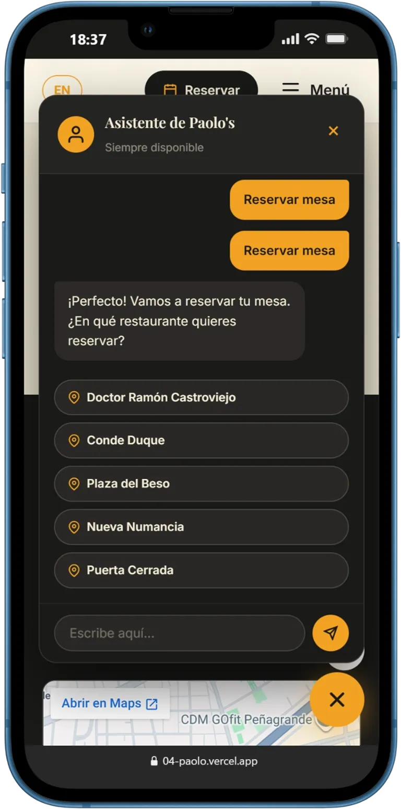
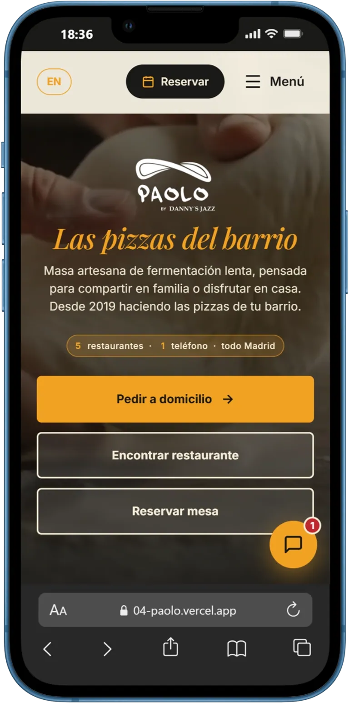
</div>
<div style="display: flex; flex-direction: column; gap: 8px">
<div style="display: flex; gap: 10px; font-size: 14px; line-height: 1.4; color: #fff"><span style="flex: none; color: {{accent}}; font-weight: 700">01</span>Local, comensales y turno sin salir del navegador</div>
<div style="display: flex; gap: 10px; font-size: 14px; line-height: 1.4; color: #fff"><span style="flex: none; color: {{accent}}; font-weight: 700">02</span>Alérgenos y celiaquía resueltos al momento</div>
<div style="display: flex; gap: 10px; font-size: 14px; line-height: 1.4; color: #fff"><span style="flex: none; color: {{accent}}; font-weight: 700">03</span>Respuestas deterministas: sin alucinaciones</div>
</div>
<a href="Resultados.dc.html" style="margin-top: 14px; height: 52px; border-radius: 999px; border: 1px solid rgba(255,255,255,.16); display: flex; align-items: center; justify-content: center; gap: 10px; color: #fff; font-size: 15px; font-weight: 600; text-decoration: none">Ver resultados<svg width="18" height="18" viewBox="0 0 24 24" fill="none" stroke="currentColor" stroke-width="2" stroke-linecap="round" stroke-linejoin="round" aria-hidden="true"><path d="M12 5v14M19 12l-7 7-7-7"></path></svg></a>
</section>
</div>
</x-dc>
<script type="text/x-dc" data-dc-script data-props='{"accent":{"editor":"color","default":"#a78bfa","options":["#a78bfa","#f97316","#7c3aed"]},"$preview":{"width":390,"height":2160}}'>
class Component extends DCLogic {
renderVals() {
return {
accent: this.props.accent ?? '#a78bfa',
screens: [
{ n: '01', tag: 'Hero', title: 'Masa de 48 h como diferencial', body: 'Fermentación lenta e ingredientes D.O. italianos, antes que el precio.', img: 'projects/04-paolo/assets/web1.webp', alt: 'Portada web: Las pizzas del barrio, para compartir' },
{ n: '02', tag: 'Carta', title: 'Carta por categorías y filtros', body: 'Clásicas, especiales y alérgenos con precio visible en cada tarjeta.', img: 'projects/04-paolo/assets/web4.webp', alt: 'Carta interactiva: Cada pizza cuenta algo, con filtros por categoría' },
{ n: '03', tag: 'Pedido', title: 'Pedido directo a casa', body: 'Del plato a la comanda por WhatsApp, sin comisión de intermediarios.', img: 'projects/04-paolo/assets/web2.webp', alt: 'Sección Llévanos a casa para pedir a domicilio' }
],
pizzas: [
{ name: 'Diavola', img: 'projects/04-paolo/assets/diavola.webp', alt: 'Pizza Diavola con salame picante' },
{ name: 'Tartufo', img: 'projects/04-paolo/assets/tartufo.webp', alt: 'Pizza Tartufo con trufa negra y setas' },
{ name: 'Napoli', img: 'projects/04-paolo/assets/napoli.webp', alt: 'Pizza Napoli con anchoas y alcaparras' }
]
};
}
}
</script>
</body>
</html>
```

### Mobile 05 · Resultados + cierre (`Resultados.dc.html`)

```html
<!doctype html>
<html lang="es">
<head>
<meta charset="utf-8">
<title>Paolo · Resultados</title>
<script src="./support.js"></script>
</head>
<body>
<x-dc>
<helmet>
<link rel="preconnect" href="https://fonts.googleapis.com">
<link href="https://fonts.googleapis.com/css2?family=Inter:wght@400;500;600;700&amp;family=Playfair+Display:ital,wght@0,700;0,800;1,700;1,800&amp;display=swap" rel="stylesheet">
<style>
body{margin:0;background:#000}
a{color:#a78bfa}a:hover{color:#c4b5fd}
</style>
</helmet>
<div style="width: 390px; height: 1900px; background: #000; color: rgba(255,255,255,.72); font-family: Inter, system-ui, sans-serif; overflow: hidden; position: relative">

<header style="height: 56px; padding: 0 6px; display: flex; align-items: center; justify-content: space-between; background: rgba(0,0,0,.8); border-bottom: 1px solid rgba(255,255,255,.08)">
<a href="Producto.dc.html" aria-label="Volver" style="width: 44px; height: 44px; display: flex; align-items: center; justify-content: center; color: #fff"><svg width="20" height="20" viewBox="0 0 24 24" fill="none" stroke="currentColor" stroke-width="2" stroke-linecap="round" stroke-linejoin="round" aria-hidden="true"><path d="M15 18l-6-6 6-6"></path></svg></a>
<div style="font-size: 12px; font-weight: 600; letter-spacing: .12em; text-transform: uppercase; color: rgba(255,255,255,.9)">Caso 03 <span style="color: rgba(255,255,255,.4)">/ 05</span></div>
<button type="button" aria-label="Cambiar a inglés" style="width: 44px; height: 44px; background: none; border: 0; color: rgba(255,255,255,.7); font: 600 12px Inter, sans-serif; letter-spacing: .08em">EN</button>
</header>
<nav aria-label="Secciones" style="display: grid; grid-template-columns: repeat(5, minmax(0, 1fr)); gap: 6px; padding: 10px 16px 0">
<div style="display: flex; flex-direction: column; gap: 6px"><div style="height: 3px; border-radius: 3px; background: rgba(167,139,250,.45)"></div><span style="font-size: 9px; font-weight: 600; letter-spacing: .05em; text-transform: uppercase; color: rgba(255,255,255,.45)">Overview</span></div>
<div style="display: flex; flex-direction: column; gap: 6px"><div style="height: 3px; border-radius: 3px; background: rgba(167,139,250,.45)"></div><span style="font-size: 9px; font-weight: 600; letter-spacing: .05em; text-transform: uppercase; color: rgba(255,255,255,.45)">Problema</span></div>
<div style="display: flex; flex-direction: column; gap: 6px"><div style="height: 3px; border-radius: 3px; background: rgba(167,139,250,.45)"></div><span style="font-size: 9px; font-weight: 600; letter-spacing: .05em; text-transform: uppercase; color: rgba(255,255,255,.45)">Marca</span></div>
<div style="display: flex; flex-direction: column; gap: 6px"><div style="height: 3px; border-radius: 3px; background: rgba(167,139,250,.45)"></div><span style="font-size: 9px; font-weight: 600; letter-spacing: .05em; text-transform: uppercase; color: rgba(255,255,255,.45)">Producto</span></div>
<div style="display: flex; flex-direction: column; gap: 6px"><div style="height: 3px; border-radius: 3px; background: {{accent}}"></div><span style="font-size: 9px; font-weight: 600; letter-spacing: .05em; text-transform: uppercase; color: #fff">Resultados</span></div>
</nav>

<section style="padding: 30px 16px 0; display: flex; flex-direction: column; gap: 18px">
<div style="display: flex; flex-direction: column; gap: 12px">
<span style="font-size: 12px; font-weight: 600; letter-spacing: .14em; text-transform: uppercase; color: {{accent}}">05 · Resultados</span>
<h2 style="margin: 0; font-family: 'Playfair Display', Georgia, serif; font-weight: 800; font-size: 38px; line-height: 1.04; letter-spacing: -.015em; color: #fff">Un producto que <span style="font-style: italic; color: {{accent}}">escaló sin rediseño</span></h2>
</div>
<div style="padding: 22px 20px; border-radius: 22px; background: rgba(167,139,250,.08); border: 1px solid rgba(167,139,250,.4); display: flex; flex-direction: column; gap: 14px">
<span style="font-size: 11px; font-weight: 600; letter-spacing: .12em; text-transform: uppercase; color: {{accent}}">Métrica principal · medida</span>
<div style="display: flex; align-items: flex-end; gap: 14px">
<span style="font-family: 'Playfair Display', Georgia, serif; font-weight: 800; font-size: 88px; line-height: .85; color: {{accent}}">1→5</span>
<span style="padding-bottom: 4px; font-size: 15px; line-height: 1.35; font-weight: 500; color: #fff">restaurantes en Madrid con el mismo producto</span>
</div>
<div role="img" aria-label="De un local en 2020 a cinco locales" style="display: grid; grid-template-columns: repeat(5, minmax(0, 1fr)); gap: 6px">
<span style="height: 34px; border-radius: 8px; background: {{accent}}; display: flex; align-items: center; justify-content: center; font-size: 11px; font-weight: 700; color: #0b0614">2020</span>
<span style="height: 34px; border-radius: 8px; background: rgba(167,139,250,.5)"></span>
<span style="height: 34px; border-radius: 8px; background: rgba(167,139,250,.5)"></span>
<span style="height: 34px; border-radius: 8px; background: rgba(167,139,250,.5)"></span>
<span style="height: 34px; border-radius: 8px; background: rgba(167,139,250,.5)"></span>
</div>
</div>
<div style="display: grid; grid-template-columns: repeat(3, minmax(0, 1fr)); gap: 8px">
<div style="padding: 16px 12px; border-radius: 16px; background: rgba(255,255,255,.035); border: 1px solid rgba(255,255,255,.1); display: flex; flex-direction: column; gap: 8px"><span style="font-family: 'Playfair Display', Georgia, serif; font-weight: 800; font-size: 34px; line-height: 1; color: #fff">0 €</span><span style="font-size: 12px; line-height: 1.35; color: rgba(255,255,255,.7)">en comisiones a agregadores</span></div>
<div style="padding: 16px 12px; border-radius: 16px; background: rgba(255,255,255,.035); border: 1px solid rgba(255,255,255,.1); display: flex; flex-direction: column; gap: 8px"><span style="font-family: 'Playfair Display', Georgia, serif; font-weight: 800; font-size: 34px; line-height: 1; color: #fff">+28%</span><span style="font-size: 12px; line-height: 1.35; color: rgba(255,255,255,.7)">pedidos directos online</span></div>
<div style="padding: 16px 12px; border-radius: 16px; background: rgba(255,255,255,.035); border: 1px solid rgba(255,255,255,.1); display: flex; flex-direction: column; gap: 8px"><span style="font-family: 'Playfair Display', Georgia, serif; font-weight: 800; font-size: 34px; line-height: 1; color: #fff">+40%</span><span style="font-size: 12px; line-height: 1.35; color: rgba(255,255,255,.7)">rapidez de comanda en sala</span></div>
</div>
</section>

<figure style="margin: 36px 0 0; position: relative">
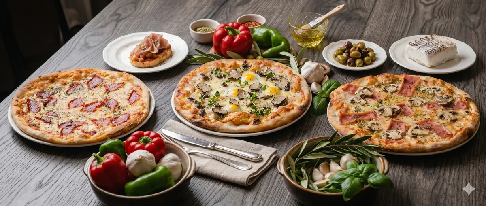
<div aria-hidden="true" style="position: absolute; left: 0; top: 0; width: 390px; height: 166px; background: linear-gradient(180deg, rgba(0,0,0,.5), rgba(0,0,0,0) 40%, rgba(0,0,0,0) 60%, rgba(0,0,0,.6))"></div>
</figure>

<section style="padding: 40px 16px 0; display: flex; flex-direction: column; gap: 6px">
<span style="font-size: 12px; font-weight: 600; letter-spacing: .14em; text-transform: uppercase; color: rgba(255,255,255,.55); padding-bottom: 8px">Lo que me llevo</span>
<div style="display: flex; gap: 16px; padding: 18px 0; border-top: 1px solid rgba(255,255,255,.1)">
<span style="font-family: 'Playfair Display', Georgia, serif; font-style: italic; font-weight: 700; font-size: 26px; line-height: 1; color: {{accent}}; width: 34px">01</span>
<div style="flex: 1; display: flex; flex-direction: column; gap: 4px"><span style="font-size: 17px; font-weight: 600; color: #fff">Programar enseña el coste de cada decisión</span><span style="font-size: 14px; line-height: 1.45; color: rgba(255,255,255,.65)">Cada tipografía y sombra en Figma pesa en la carga y el rebote.</span></div>
</div>
<div style="display: flex; gap: 16px; padding: 18px 0; border-top: 1px solid rgba(255,255,255,.1)">
<span style="font-family: 'Playfair Display', Georgia, serif; font-style: italic; font-weight: 700; font-size: 26px; line-height: 1; color: {{accent}}; width: 34px">02</span>
<div style="flex: 1; display: flex; flex-direction: column; gap: 4px"><span style="font-size: 17px; font-weight: 600; color: #fff">El contexto físico manda</span><span style="font-size: 14px; line-height: 1.45; color: rgba(255,255,255,.65)">Un QR sobre madera exige contraste con poca luz y botones a una mano.</span></div>
</div>
<div style="display: flex; gap: 16px; padding: 18px 0; border-top: 1px solid rgba(255,255,255,.1); border-bottom: 1px solid rgba(255,255,255,.1)">
<span style="font-family: 'Playfair Display', Georgia, serif; font-style: italic; font-weight: 700; font-size: 26px; line-height: 1; color: {{accent}}; width: 34px">03</span>
<div style="flex: 1; display: flex; flex-direction: column; gap: 4px"><span style="font-size: 17px; font-weight: 600; color: #fff">Los datos deciden el siguiente paso</span><span style="font-size: 14px; line-height: 1.45; color: rgba(255,255,255,.65)">Clarity sirvió para iterar, no para justificar lo ya hecho.</span></div>
</div>
</section>

<section style="padding: 36px 16px 0; display: flex; flex-direction: column; gap: 12px">
<a href="#" style="display: flex; align-items: center; gap: 16px; padding: 20px; border-radius: 22px; background: #0d0d10; border: 1px solid rgba(255,255,255,.12); text-decoration: none">
<div style="flex: 1; display: flex; flex-direction: column; gap: 6px">
<span style="font-size: 11px; font-weight: 600; letter-spacing: .12em; text-transform: uppercase; color: rgba(255,255,255,.55)">Siguiente caso · 04</span>
<span style="font-family: 'Playfair Display', Georgia, serif; font-weight: 800; font-size: 26px; line-height: 1.1; color: #fff">IT Ops &amp; Oracle ERP</span>
<span style="font-size: 14px; color: rgba(255,255,255,.65)">Diagnóstico Build vs Buy</span>
</div>
<span style="flex: none; width: 52px; height: 52px; border-radius: 50%; background: #fff; color: #000; display: flex; align-items: center; justify-content: center"><svg width="22" height="22" viewBox="0 0 24 24" fill="none" stroke="currentColor" stroke-width="2" stroke-linecap="round" stroke-linejoin="round" aria-hidden="true"><path d="M5 12h14M13 5l7 7-7 7"></path></svg></span>
</a>
</section>

<section aria-label="Paginado y acción" style="margin-top: 36px; padding: 28px 16px 32px; border-top: 1px solid rgba(255,255,255,.1); display: flex; flex-direction: column; gap: 18px">
<span style="font-size: 11px; font-weight: 600; letter-spacing: .12em; text-transform: uppercase; color: rgba(255,255,255,.55); text-align: center">¿Vemos otro proyecto?</span>
<nav aria-label="Navegación entre casos" style="display: flex; align-items: center; justify-content: space-between">
<a href="Main.dc.html" aria-label="Caso anterior" style="flex: none; width: 44px; height: 44px; border-radius: 50%; border: 1px solid rgba(255,255,255,.16); display: flex; align-items: center; justify-content: center; color: #fff"><svg width="16" height="16" viewBox="0 0 24 24" fill="none" stroke="currentColor" stroke-width="2" stroke-linecap="round" stroke-linejoin="round" aria-hidden="true"><path d="M15 18l-6-6 6-6"></path></svg></a>
<div style="display: flex; gap: 6px">
<a href="#" aria-label="Caso 01" style="width: 44px; height: 44px; border-radius: 10px; display: flex; align-items: center; justify-content: center; font-size: 13px; font-weight: 600; color: rgba(255,255,255,.6); text-decoration: none">01</a>
<a href="#" aria-label="Caso 02" style="width: 44px; height: 44px; border-radius: 10px; display: flex; align-items: center; justify-content: center; font-size: 13px; font-weight: 600; color: rgba(255,255,255,.6); text-decoration: none">02</a>
<a href="#" aria-label="Caso 03, actual" aria-current="page" style="width: 44px; height: 44px; border-radius: 10px; background: rgba(167,139,250,.14); border: 1px solid rgba(167,139,250,.5); display: flex; align-items: center; justify-content: center; font-size: 13px; font-weight: 700; color: {{accent}}; text-decoration: none">03</a>
<a href="#" aria-label="Caso 04" style="width: 44px; height: 44px; border-radius: 10px; display: flex; align-items: center; justify-content: center; font-size: 13px; font-weight: 600; color: rgba(255,255,255,.6); text-decoration: none">04</a>
<a href="#" aria-label="Caso 05" style="width: 44px; height: 44px; border-radius: 10px; display: flex; align-items: center; justify-content: center; font-size: 13px; font-weight: 600; color: rgba(255,255,255,.6); text-decoration: none">05</a>
</div>
<a href="#" aria-label="Caso siguiente" style="flex: none; width: 44px; height: 44px; border-radius: 50%; border: 1px solid rgba(255,255,255,.16); display: flex; align-items: center; justify-content: center; color: #fff"><svg width="16" height="16" viewBox="0 0 24 24" fill="none" stroke="currentColor" stroke-width="2" stroke-linecap="round" stroke-linejoin="round" aria-hidden="true"><path d="M9 18l6-6-6-6"></path></svg></a>
</nav>
<div style="display: flex; flex-direction: column; gap: 4px">
<a href="#" style="height: 52px; border-radius: 999px; background: {{accent}}; color: #0b0614; display: flex; align-items: center; justify-content: center; gap: 8px; font-size: 16px; font-weight: 700; text-decoration: none">Agendar llamada<svg width="18" height="18" viewBox="0 0 24 24" fill="none" stroke="currentColor" stroke-width="2.2" stroke-linecap="round" stroke-linejoin="round" aria-hidden="true"><path d="M7 17L17 7M17 7H9M17 7v8"></path></svg></a>
<a href="#" style="height: 44px; display: flex; align-items: center; justify-content: center; color: rgba(255,255,255,.7); font-size: 14px; font-weight: 500">Volver al índice</a>
</div>
</section>
</div>
</x-dc>
<script type="text/x-dc" data-dc-script data-props='{"accent":{"editor":"color","default":"#a78bfa","options":["#a78bfa","#f97316","#7c3aed"]},"$preview":{"width":390,"height":1900}}'>
class Component extends DCLogic {
renderVals() {
return { accent: this.props.accent ?? '#a78bfa' };
}
}
</script>
</body>
</html>
```

### Desktop 1440 · caso completo (`Desk.dc.html`)

```html
<!doctype html>
<html lang="es">
<head>
<meta charset="utf-8">
<title>Paolo · Desktop</title>
<script src="./support.js"></script>
</head>
<body>
<x-dc>
<helmet>
<link rel="preconnect" href="https://fonts.googleapis.com">
<link href="https://fonts.googleapis.com/css2?family=Inter:wght@400;500;600;700&amp;family=Playfair+Display:ital,wght@0,700;0,800;1,700&amp;display=swap" rel="stylesheet">
<style>
body{margin:0;background:#000}
a{color:#a78bfa}a:hover{color:#c4b5fd}
</style>
</helmet>
<div style="background: #000; color: rgba(255,255,255,.72); font-family: Inter, system-ui, sans-serif; overflow: hidden">

<header style="position: sticky; top: 0; z-index: 5; height: 72px; padding: 0 32px; display: flex; align-items: center; justify-content: space-between; gap: 24px; background: rgba(0,0,0,.82); border-bottom: 1px solid rgba(255,255,255,.08)">
<div style="display: flex; align-items: center; gap: 18px">
<a href="#" style="font-family: 'Playfair Display', Georgia, serif; font-weight: 800; font-size: 20px; color: #fff; text-decoration: none">MM</a>
<a href="#" style="display: flex; align-items: center; gap: 6px; padding: 12px 0; font-size: 14px; font-weight: 500; color: rgba(255,255,255,.7); text-decoration: none"><svg width="16" height="16" viewBox="0 0 24 24" fill="none" stroke="currentColor" stroke-width="2" stroke-linecap="round" stroke-linejoin="round" aria-hidden="true"><path d="M15 18l-6-6 6-6"></path></svg>Volver</a>
</div>
<nav aria-label="Secciones" style="display: flex; gap: 4px; flex-wrap: wrap">
<a href="#pz-overview" style="padding: 12px 14px; font-size: 13px; font-weight: 600; color: #fff; text-decoration: none; border-bottom: 2px solid {{accent}}">Overview</a>
<a href="#pz-problema" style="padding: 12px 14px; font-size: 13px; font-weight: 500; color: rgba(255,255,255,.55); text-decoration: none">Problema</a>
<a href="#pz-marca" style="padding: 12px 14px; font-size: 13px; font-weight: 500; color: rgba(255,255,255,.55); text-decoration: none">Marca</a>
<a href="#pz-producto" style="padding: 12px 14px; font-size: 13px; font-weight: 500; color: rgba(255,255,255,.55); text-decoration: none">Producto</a>
<a href="#pz-resultados" style="padding: 12px 14px; font-size: 13px; font-weight: 500; color: rgba(255,255,255,.55); text-decoration: none">Resultados</a>
</nav>
<div style="display: flex; align-items: center; gap: 10px">
<button type="button" aria-label="Cambiar a inglés" style="width: 44px; height: 44px; background: none; border: 0; color: rgba(255,255,255,.7); font: 600 12px Inter, sans-serif; letter-spacing: .08em">EN</button>
<a href="#" aria-label="LinkedIn" style="width: 44px; height: 44px; display: flex; align-items: center; justify-content: center; color: rgba(255,255,255,.75)"><svg width="18" height="18" viewBox="0 0 24 24" fill="none" stroke="currentColor" stroke-width="1.8" stroke-linecap="round" stroke-linejoin="round" aria-hidden="true"><rect x="3" y="3" width="18" height="18" rx="3"></rect><path d="M8 10v7M8 7v.01M12 17v-4a2 2 0 0 1 4 0v4M12 10v7"></path></svg></a>
<a href="#" style="height: 44px; padding: 0 18px; border-radius: 999px; background: {{accent}}; color: #0b0614; display: flex; align-items: center; gap: 6px; font-size: 14px; font-weight: 700; text-decoration: none">Agendar llamada<svg width="14" height="14" viewBox="0 0 24 24" fill="none" stroke="currentColor" stroke-width="2.4" stroke-linecap="round" stroke-linejoin="round" aria-hidden="true"><path d="M7 17L17 7M17 7H9M17 7v8"></path></svg></a>
</div>
</header>

<main style="max-width: 1200px; margin: 0 auto; padding: 0 32px">

<section id="pz-overview" style="padding: 72px 0 0; display: grid; grid-template-columns: repeat(auto-fit, minmax(440px, 1fr)); gap: 56px; align-items: center">
<div style="display: flex; flex-direction: column; gap: 22px">
<div style="display: flex; align-items: center; gap: 12px; flex-wrap: wrap">
<span style="font-size: 12px; font-weight: 600; letter-spacing: .14em; text-transform: uppercase; color: rgba(255,255,255,.55)">Caso 03 / 05</span>
<span style="padding: 6px 12px; border-radius: 999px; border: 1px solid rgba(167,139,250,.35); color: {{accent}}; font-size: 12px; font-weight: 600">Restauración · B2C</span>
<span style="padding: 6px 12px; border-radius: 999px; border: 1px solid rgba(255,255,255,.14); color: rgba(255,255,255,.75); font-size: 12px; font-weight: 500">De 0 a 1 · en solitario</span>
</div>
<h1 style="margin: 0; font-family: 'Playfair Display', Georgia, serif; font-weight: 800; font-size: 64px; line-height: 1.02; letter-spacing: -.02em; color: #fff">De cero presencia a <span style="font-style: italic; color: {{accent}}">ecosistema omnicanal</span></h1>
<p style="margin: 0; max-width: 520px; font-size: 19px; line-height: 1.5; color: rgba(255,255,255,.78)">Marca, espacio físico y producto digital para una pizzería de Madrid que en 2020 dependía <strong style="color: #fff; font-weight: 600">al 100% de la sala</strong>.</p>
<dl style="margin: 8px 0 0; display: grid; grid-template-columns: repeat(4, minmax(0, 1fr)); gap: 1px; background: rgba(255,255,255,.1); border: 1px solid rgba(255,255,255,.1); border-radius: 16px; overflow: hidden">
<div style="background: #0a0a0c; padding: 14px 16px; display: flex; flex-direction: column; gap: 4px"><dt style="font-size: 10px; font-weight: 600; letter-spacing: .12em; text-transform: uppercase; color: rgba(255,255,255,.5)">Rol</dt><dd style="margin: 0; font-size: 14px; font-weight: 600; color: #fff">Product Designer &amp; Dev</dd></div>
<div style="background: #0a0a0c; padding: 14px 16px; display: flex; flex-direction: column; gap: 4px"><dt style="font-size: 10px; font-weight: 600; letter-spacing: .12em; text-transform: uppercase; color: rgba(255,255,255,.5)">Cronología</dt><dd style="margin: 0; font-size: 14px; font-weight: 600; color: #fff">2020 – 2022</dd></div>
<div style="background: #0a0a0c; padding: 14px 16px; display: flex; flex-direction: column; gap: 4px"><dt style="font-size: 10px; font-weight: 600; letter-spacing: .12em; text-transform: uppercase; color: rgba(255,255,255,.5)">Alcance</dt><dd style="margin: 0; font-size: 14px; font-weight: 600; color: #fff">Físico + digital</dd></div>
<div style="background: #0a0a0c; padding: 14px 16px; display: flex; flex-direction: column; gap: 4px"><dt style="font-size: 10px; font-weight: 600; letter-spacing: .12em; text-transform: uppercase; color: rgba(255,255,255,.5)">Stack</dt><dd style="margin: 0; font-size: 14px; font-weight: 600; color: #fff">HTML · SCSS · JS</dd></div>
</dl>
<div style="display: flex; gap: 12px; flex-wrap: wrap">
<a href="#pz-problema" style="height: 48px; padding: 0 22px; border-radius: 999px; border: 1px solid rgba(255,255,255,.16); display: flex; align-items: center; gap: 8px; color: #fff; font-size: 15px; font-weight: 600; text-decoration: none">Ver el problema<svg width="16" height="16" viewBox="0 0 24 24" fill="none" stroke="currentColor" stroke-width="2" stroke-linecap="round" stroke-linejoin="round" aria-hidden="true"><path d="M12 5v14M19 12l-7 7-7-7"></path></svg></a>
</div>
</div>
<figure style="margin: 0; position: relative; height: 560px">
<div aria-hidden="true" style="position: absolute; left: 0; right: 0; top: 40px; bottom: 40px; border-radius: 50%; background: radial-gradient(ellipse at 50% 50%, rgba(124,58,237,.38), rgba(124,58,237,0) 70%)"></div>

<video src="projects/04-paolo/assets/hero-banner.mp4" poster="projects/04-paolo/assets/hero-poster.webp" autoplay="true" muted="true" loop="true" playsinline="true" aria-label="Masa artesana de fermentación lenta en el obrador de Paolo" style="position: absolute; left: 0; top: 70px; width: 82%; height: auto; aspect-ratio: 16 / 9; object-fit: cover; border-radius: 20px; box-shadow: 0 0 0 1px rgba(255,255,255,.08)"></video>


<figcaption style="position: absolute; left: 0; bottom: 24px; display: flex; align-items: center; gap: 8px; font-size: 12px; font-weight: 500; color: rgba(255,255,255,.75)"><span style="width: 7px; height: 7px; border-radius: 50%; background: {{accent}}"></span>Web en producción · 5 locales</figcaption>
</figure>
</section>

<section style="padding: 96px 0 0; display: flex; flex-direction: column; gap: 28px">
<div style="display: flex; align-items: baseline; justify-content: space-between; border-bottom: 1px solid rgba(255,255,255,.1); padding-bottom: 18px">
<h2 style="margin: 0; font-family: 'Playfair Display', Georgia, serif; font-size: 40px; line-height: 1.1; color: #fff">El caso en <span style="font-style: italic; color: {{accent}}">30 segundos</span></h2>
<span style="font-size: 13px; font-weight: 600; color: rgba(255,255,255,.4)">01</span>
</div>
<ol style="margin: 0; padding: 0; list-style: none; display: grid; grid-template-columns: repeat(auto-fit, minmax(300px, 1fr)); gap: 20px">
<li style="padding: 24px; border-radius: 20px; background: rgba(255,255,255,.03); border: 1px solid rgba(255,255,255,.1); display: flex; flex-direction: column; gap: 10px">
<span style="font-size: 11px; font-weight: 600; letter-spacing: .12em; text-transform: uppercase; color: rgba(255,255,255,.55)">01 · Problema</span>
<span style="font-family: 'Playfair Display', Georgia, serif; font-weight: 800; font-size: 64px; line-height: 1; color: #fff">35%</span>
<span style="font-size: 16px; line-height: 1.45; color: rgba(255,255,255,.72)">de comisión de los agregadores. Sin canal propio, el delivery no salía a cuenta.</span>
</li>
<li style="padding: 24px; border-radius: 20px; background: rgba(255,255,255,.03); border: 1px solid rgba(255,255,255,.1); display: flex; flex-direction: column; gap: 10px">
<span style="font-size: 11px; font-weight: 600; letter-spacing: .12em; text-transform: uppercase; color: rgba(255,255,255,.55)">02 · Decisión</span>
<span style="font-family: 'Playfair Display', Georgia, serif; font-weight: 800; font-size: 64px; line-height: 1; color: #fff">Canal propio</span>
<span style="font-size: 16px; line-height: 1.45; color: rgba(255,255,255,.72)">Marca, packaging, carta QR y pedidos directos, diseñados y programados a medida.</span>
</li>
<li style="padding: 24px; border-radius: 20px; background: rgba(167,139,250,.08); border: 1px solid rgba(167,139,250,.32); display: flex; flex-direction: column; gap: 10px">
<span style="font-size: 11px; font-weight: 600; letter-spacing: .12em; text-transform: uppercase; color: {{accent}}">03 · Impacto medido</span>
<span style="font-family: 'Playfair Display', Georgia, serif; font-weight: 800; font-size: 64px; line-height: 1; color: {{accent}}">1 → 5</span>
<span style="font-size: 16px; line-height: 1.45; color: rgba(255,255,255,.85)">restaurantes en Madrid con el mismo producto, sin rediseño.</span>
</li>
</ol>
</section>

<section id="pz-problema" style="padding: 120px 0 0; display: flex; flex-direction: column; gap: 56px">
<div style="display: grid; grid-template-columns: repeat(auto-fit, minmax(440px, 1fr)); gap: 56px; align-items: end">
<div style="display: flex; flex-direction: column; gap: 16px">
<span style="font-size: 12px; font-weight: 600; letter-spacing: .14em; text-transform: uppercase; color: {{accent}}">02 · El origen</span>
<h2 style="margin: 0; font-family: 'Playfair Display', Georgia, serif; font-weight: 800; font-size: 52px; line-height: 1.04; letter-spacing: -.015em; color: #fff">Vender a domicilio <span style="font-style: italic; color: {{accent}}">sin regalar el margen</span></h2>
<p style="margin: 0; max-width: 480px; font-size: 17px; line-height: 1.55; color: rgba(255,255,255,.72)">Abrió en 2019 en Conde Duque, sin infraestructura digital. En marzo de 2020 la sala cerró y los agregadores eran la única salida.</p>
</div>
<div style="padding: 26px; border-radius: 22px; background: rgba(255,255,255,.03); border: 1px solid rgba(255,255,255,.1); display: flex; flex-direction: column; gap: 18px">
<span style="font-size: 11px; font-weight: 600; letter-spacing: .12em; text-transform: uppercase; color: rgba(255,255,255,.55)">Cada pizza vendida vía agregador</span>
<div role="img" aria-label="De cada pedido, el 65% queda para Paolo y el 35% se lo lleva el agregador" style="display: flex; height: 64px; border-radius: 14px; overflow: hidden">
<div style="width: 65%; background: rgba(255,255,255,.1); display: flex; align-items: center; padding: 0 18px; font-size: 15px; font-weight: 600; color: #fff">65% Paolo</div>
<div style="width: 35%; background: {{accent}}; display: flex; align-items: center; justify-content: center; font-family: 'Playfair Display', Georgia, serif; font-size: 28px; font-weight: 800; color: #0b0614">35%</div>
</div>
<span style="font-size: 15px; line-height: 1.45; color: rgba(255,255,255,.72)">Comisión de Glovo y Uber Eats en pandemia, sobre un producto artesano de margen corto.</span>
</div>
</div>

<div style="display: grid; grid-template-columns: repeat(auto-fit, minmax(440px, 1fr)); gap: 48px; align-items: start">
<div style="display: flex; flex-direction: column; gap: 20px">
<div style="display: flex; align-items: baseline; gap: 12px">
<span style="font-family: 'Playfair Display', Georgia, serif; font-weight: 800; font-size: 48px; line-height: 1; color: #fff">3</span>
<span style="font-size: 12px; font-weight: 600; letter-spacing: .14em; text-transform: uppercase; color: rgba(255,255,255,.55)">patrones de fricción</span>
</div>
<div style="display: flex; align-items: center; gap: 16px; padding: 18px; border-radius: 18px; background: rgba(255,255,255,.035); border: 1px solid rgba(255,255,255,.09)">
<span style="flex: none; width: 44px; height: 44px; border-radius: 12px; background: rgba(167,139,250,.12); color: {{accent}}; display: flex; align-items: center; justify-content: center"><svg width="22" height="22" viewBox="0 0 24 24" fill="none" stroke="currentColor" stroke-width="1.8" stroke-linecap="round" stroke-linejoin="round" aria-hidden="true"><circle cx="12" cy="12" r="9"></circle><path d="M3 12h18M12 3a14 14 0 0 1 0 18M12 3a14 14 0 0 0 0 18"></path><path d="M4 4l16 16"></path></svg></span>
<div style="display: flex; flex-direction: column; gap: 2px"><span style="font-size: 17px; font-weight: 600; color: #fff">Cero presencia digital</span><span style="font-size: 14px; color: rgba(255,255,255,.65)">Con el local cerrado, el negocio desaparecía.</span></div>
</div>
<div style="display: flex; align-items: center; gap: 16px; padding: 18px; border-radius: 18px; background: rgba(255,255,255,.035); border: 1px solid rgba(255,255,255,.09)">
<span style="flex: none; width: 44px; height: 44px; border-radius: 12px; background: rgba(167,139,250,.12); color: {{accent}}; display: flex; align-items: center; justify-content: center"><svg width="22" height="22" viewBox="0 0 24 24" fill="none" stroke="currentColor" stroke-width="1.8" stroke-linecap="round" stroke-linejoin="round" aria-hidden="true"><path d="M22 16.9v3a2 2 0 0 1-2.2 2 19.8 19.8 0 0 1-8.6-3.1 19.5 19.5 0 0 1-6-6A19.8 19.8 0 0 1 2.1 4.2 2 2 0 0 1 4.1 2h3a2 2 0 0 1 2 1.7c.1.9.4 1.8.7 2.7a2 2 0 0 1-.5 2.1L8 9.8a16 16 0 0 0 6 6l1.3-1.3a2 2 0 0 1 2.1-.4c.9.3 1.8.6 2.7.7a2 2 0 0 1 1.7 2z"></path></svg></span>
<div style="display: flex; flex-direction: column; gap: 2px"><span style="font-size: 17px; font-weight: 600; color: #fff">Teléfono colapsado</span><span style="font-size: 14px; color: rgba(255,255,255,.65)">Carta en papel y llamadas en hora punta.</span></div>
</div>
<div style="display: flex; align-items: center; gap: 16px; padding: 18px; border-radius: 18px; background: rgba(255,255,255,.035); border: 1px solid rgba(255,255,255,.09)">
<span style="flex: none; width: 44px; height: 44px; border-radius: 12px; background: rgba(167,139,250,.12); color: {{accent}}; display: flex; align-items: center; justify-content: center"><svg width="22" height="22" viewBox="0 0 24 24" fill="none" stroke="currentColor" stroke-width="1.8" stroke-linecap="round" stroke-linejoin="round" aria-hidden="true"><rect x="1" y="7" width="14" height="10" rx="1"></rect><path d="M15 10h4l3 3v4h-7"></path><circle cx="6" cy="18.5" r="1.8"></circle><circle cx="18" cy="18.5" r="1.8"></circle></svg></span>
<div style="display: flex; flex-direction: column; gap: 2px"><span style="font-size: 17px; font-weight: 600; color: #fff">Sin canal de delivery</span><span style="font-size: 14px; color: rgba(255,255,255,.65)">Ningún pedido a domicilio sin intermediario.</span></div>
</div>
</div>
<div style="display: flex; flex-direction: column; gap: 20px">
<div style="display: flex; align-items: baseline; gap: 12px">
<span style="font-family: 'Playfair Display', Georgia, serif; font-weight: 800; font-size: 48px; line-height: 1; color: #fff">2</span>
<span style="font-size: 12px; font-weight: 600; letter-spacing: .14em; text-transform: uppercase; color: rgba(255,255,255,.55)">perfiles · 2 leyes</span>
</div>
<div style="display: grid; grid-template-columns: repeat(2, minmax(0, 1fr)); gap: 14px">
<div style="padding: 22px 20px; border-radius: 20px; background: rgba(255,255,255,.03); border: 1px solid rgba(255,255,255,.1); display: flex; flex-direction: column; gap: 14px">
<div style="display: flex; flex-direction: column; gap: 4px"><span style="font-size: 11px; font-weight: 600; letter-spacing: .1em; text-transform: uppercase; color: rgba(255,255,255,.55)">Delivery</span><span style="font-family: 'Playfair Display', Georgia, serif; font-weight: 800; font-size: 40px; line-height: 1; color: #fff">&lt;90 s</span><span style="font-size: 13px; color: rgba(255,255,255,.6)">para pedir desde el sofá</span></div>
<div role="img" aria-label="La carta agrupada en bloques de hasta 7 opciones" style="display: grid; grid-template-columns: repeat(7, minmax(0, 1fr)); gap: 4px">
<span style="height: 20px; border-radius: 4px; background: {{accent}}"></span><span style="height: 20px; border-radius: 4px; background: {{accent}}"></span><span style="height: 20px; border-radius: 4px; background: {{accent}}"></span><span style="height: 20px; border-radius: 4px; background: {{accent}}"></span><span style="height: 20px; border-radius: 4px; background: {{accent}}"></span><span style="height: 20px; border-radius: 4px; background: {{accent}}"></span><span style="height: 20px; border-radius: 4px; background: {{accent}}"></span>
</div>
<div style="padding-top: 12px; border-top: 1px solid rgba(255,255,255,.1); display: flex; flex-direction: column; gap: 4px"><span style="font-size: 14px; font-weight: 700; color: {{accent}}">Ley de Miller</span><span style="font-size: 14px; line-height: 1.4; color: rgba(255,255,255,.78)">Carta en bloques de máx. 7 opciones.</span></div>
</div>
<div style="padding: 22px 20px; border-radius: 20px; background: rgba(255,255,255,.03); border: 1px solid rgba(255,255,255,.1); display: flex; flex-direction: column; gap: 14px">
<div style="display: flex; flex-direction: column; gap: 4px"><span style="font-size: 11px; font-weight: 600; letter-spacing: .1em; text-transform: uppercase; color: rgba(255,255,255,.55)">En sala</span><span style="font-family: 'Playfair Display', Georgia, serif; font-weight: 800; font-size: 40px; line-height: 1; color: #fff">Sin app</span><span style="font-size: 13px; color: rgba(255,255,255,.6)">QR, poca luz, alérgenos</span></div>
<div role="img" aria-label="Botón táctil de 48 píxeles en la zona del pulgar" style="height: 20px; display: flex; align-items: center; gap: 8px"><span style="flex: 1; height: 20px; border-radius: 10px; background: {{accent}}"></span><span style="font-size: 12px; font-weight: 700; color: #fff">48px</span></div>
<div style="padding-top: 12px; border-top: 1px solid rgba(255,255,255,.1); display: flex; flex-direction: column; gap: 4px"><span style="font-size: 14px; font-weight: 700; color: {{accent}}">Ley de Fitts</span><span style="font-size: 14px; line-height: 1.4; color: rgba(255,255,255,.78)">Áreas ≥48px y CTA en zona del pulgar.</span></div>
</div>
</div>
</div>
</div>

<div style="display: flex; flex-direction: column; gap: 20px">
<div style="display: flex; align-items: baseline; justify-content: space-between; gap: 20px; flex-wrap: wrap">
<h3 style="margin: 0; font-family: 'Playfair Display', Georgia, serif; font-weight: 800; font-size: 34px; line-height: 1.1; color: #fff">3 flujos, <span style="font-style: italic; color: {{accent}}">sin intermediarios</span></h3>
<span style="font-size: 12px; font-weight: 600; letter-spacing: .14em; text-transform: uppercase; color: rgba(255,255,255,.55)">Hallazgo → decisión: canal de venta propio</span>
</div>
<div style="display: grid; grid-template-columns: repeat(auto-fit, minmax(320px, 1fr)); gap: 16px">
<sc-for list="{{flows}}" as="f" hint-placeholder-count="3">
<div style="padding: 22px; border-radius: 20px; background: rgba(255,255,255,.035); border: 1px solid rgba(255,255,255,.09); display: flex; flex-direction: column; gap: 16px">
<div style="display: flex; align-items: center; justify-content: space-between"><span style="font-size: 18px; font-weight: 700; color: #fff">{{f.title}}</span><span style="font-size: 12px; font-weight: 700; color: {{accent}}">{{f.n}}</span></div>
<ol style="margin: 0; padding: 0; list-style: none; display: flex; flex-direction: column; gap: 8px">
<li style="padding: 10px 12px; border-radius: 10px; background: rgba(255,255,255,.06); font-size: 14px; color: rgba(255,255,255,.85)">{{f.a}}</li>
<li style="padding: 10px 12px; border-radius: 10px; background: rgba(255,255,255,.06); font-size: 14px; color: rgba(255,255,255,.85)">{{f.b}}</li>
<li style="padding: 10px 12px; border-radius: 10px; background: rgba(167,139,250,.14); font-size: 14px; font-weight: 600; color: #fff">{{f.c}}</li>
</ol>
</div>
</sc-for>
</div>
</div>
</section>

<section id="pz-marca" style="padding: 120px 0 0; display: flex; flex-direction: column; gap: 48px">
<div style="display: grid; grid-template-columns: repeat(auto-fit, minmax(440px, 1fr)); gap: 56px; align-items: end">
<div style="display: flex; flex-direction: column; gap: 16px">
<span style="font-size: 12px; font-weight: 600; letter-spacing: .14em; text-transform: uppercase; color: {{accent}}">03 · Marca y espacio</span>
<h2 style="margin: 0; font-family: 'Playfair Display', Georgia, serif; font-weight: 800; font-size: 52px; line-height: 1.04; letter-spacing: -.015em; color: #fff">El producto empieza <span style="font-style: italic; color: {{accent}}">en la calle</span></h2>
<p style="margin: 0; max-width: 480px; font-size: 17px; line-height: 1.55; color: rgba(255,255,255,.72)">Caja, rótulo y uniforme cuentan la misma propuesta artesana que la web.</p>
</div>
<div style="padding: 28px; border-radius: 24px; background: #0d0d10; border: 1px solid rgba(255,255,255,.1); display: flex; flex-direction: column; gap: 22px">

<div style="display: grid; grid-template-columns: repeat(4, minmax(0, 1fr)); gap: 10px">
<div style="display: flex; flex-direction: column; gap: 6px"><span style="height: 48px; border-radius: 10px; background: #111; border: 1px solid rgba(255,255,255,.18)"></span><span style="font-size: 12px; color: rgba(255,255,255,.6)">Carbón</span></div>
<div style="display: flex; flex-direction: column; gap: 6px"><span style="height: 48px; border-radius: 10px; background: #f4ecdd"></span><span style="font-size: 12px; color: rgba(255,255,255,.6)">Harina</span></div>
<div style="display: flex; flex-direction: column; gap: 6px"><span style="height: 48px; border-radius: 10px; background: #f2a52b"></span><span style="font-size: 12px; color: rgba(255,255,255,.6)">Horno</span></div>
<div style="display: flex; flex-direction: column; gap: 6px"><span style="height: 48px; border-radius: 10px; background: #8c1d2a"></span><span style="font-size: 12px; color: rgba(255,255,255,.6)">Tomate</span></div>
</div>
<div style="display: flex; align-items: baseline; justify-content: space-between; padding-top: 14px; border-top: 1px solid rgba(255,255,255,.1)"><span style="font-family: 'Playfair Display', Georgia, serif; font-style: italic; font-weight: 700; font-size: 26px; color: #fff">Las pizzas del barrio</span><span style="font-size: 11px; font-weight: 600; letter-spacing: .1em; text-transform: uppercase; color: rgba(255,255,255,.55)">Claim</span></div>
</div>
</div>

<div style="display: grid; grid-template-columns: 13fr 15fr; gap: 16px">
<figure style="grid-row: 1 / 3; margin: 0; position: relative; min-height: 520px; border-radius: 22px; overflow: hidden">

<figcaption style="position: absolute; left: 0; right: 0; bottom: 0; padding: 60px 20px 20px; background: linear-gradient(180deg, rgba(0,0,0,0), rgba(0,0,0,.85)); display: flex; flex-direction: column; gap: 4px"><span style="font-size: 11px; font-weight: 600; letter-spacing: .12em; text-transform: uppercase; color: {{accent}}">Packaging</span><span style="font-size: 18px; font-weight: 600; color: #fff">Caja térmica kraft</span><span style="font-size: 14px; color: rgba(255,255,255,.7)">Conservación, ventilación y unboxing.</span></figcaption>
</figure>
<figure style="margin: 0; position: relative; border-radius: 22px; overflow: hidden; background: #ececec">

<figcaption style="position: absolute; left: 16px; top: 16px; display: flex; align-items: center; gap: 8px; padding: 8px 14px; border-radius: 999px; background: rgba(0,0,0,.78); font-size: 13px; font-weight: 600; color: #fff"><span style="font-size: 10px; font-weight: 700; letter-spacing: .12em; text-transform: uppercase; color: {{accent}}">Sala</span>Uniformes</figcaption>
</figure>
<figure style="margin: 0; position: relative; padding: 56px 20px 16px; border-radius: 22px; background: #fff">

<figcaption style="position: absolute; left: 16px; top: 16px; display: flex; align-items: center; gap: 8px; padding: 8px 14px; border-radius: 999px; background: #111; font-size: 13px; font-weight: 600; color: #fff"><span style="font-size: 10px; font-weight: 700; letter-spacing: .12em; text-transform: uppercase; color: {{accent}}">Espacio</span>Fachada, rótulos y terraza</figcaption>
</figure>
</div>
</section>

<section id="pz-producto" style="padding: 120px 0 0; display: flex; flex-direction: column; gap: 48px">
<div style="display: grid; grid-template-columns: repeat(auto-fit, minmax(440px, 1fr)); gap: 56px; align-items: end">
<div style="display: flex; flex-direction: column; gap: 16px">
<span style="font-size: 12px; font-weight: 600; letter-spacing: .14em; text-transform: uppercase; color: {{accent}}">04 · Producto digital</span>
<h2 style="margin: 0; font-family: 'Playfair Display', Georgia, serif; font-weight: 800; font-size: 52px; line-height: 1.04; letter-spacing: -.015em; color: #fff">Diseñado <span style="font-style: italic; color: {{accent}}">y programado</span> por mí</h2>
</div>
<div style="display: grid; grid-template-columns: repeat(3, minmax(0, 1fr)); gap: 10px">
<div style="padding: 16px 14px; border-radius: 16px; background: rgba(255,255,255,.04); border: 1px solid rgba(255,255,255,.1); display: flex; flex-direction: column; gap: 8px"><span style="font-size: 10px; font-weight: 700; letter-spacing: .12em; text-transform: uppercase; color: {{accent}}">Stack</span><span style="font-size: 15px; line-height: 1.3; font-weight: 600; color: #fff">HTML5, SCSS y JS vanilla</span></div>
<div style="padding: 16px 14px; border-radius: 16px; background: rgba(255,255,255,.04); border: 1px solid rgba(255,255,255,.1); display: flex; flex-direction: column; gap: 8px"><span style="font-size: 10px; font-weight: 700; letter-spacing: .12em; text-transform: uppercase; color: {{accent}}">Deploy</span><span style="font-size: 15px; line-height: 1.3; font-weight: 600; color: #fff">Netlify, integración continua</span></div>
<div style="padding: 16px 14px; border-radius: 16px; background: rgba(255,255,255,.04); border: 1px solid rgba(255,255,255,.1); display: flex; flex-direction: column; gap: 8px"><span style="font-size: 10px; font-weight: 700; letter-spacing: .12em; text-transform: uppercase; color: {{accent}}">Por qué</span><span style="font-size: 15px; line-height: 1.3; font-weight: 600; color: #fff">Carga rápida con mala cobertura</span></div>
</div>
</div>

<div style="display: grid; grid-template-columns: repeat(auto-fit, minmax(440px, 1fr)); gap: 16px">
<figure style="margin: 0; border-radius: 22px; overflow: hidden; background: #0d0d10; border: 1px solid rgba(255,255,255,.1); display: flex; flex-direction: column">
<div style="position: relative; background: #f4f4f4; display: grid; grid-template-columns: 2.4fr 1fr; gap: 16px; align-items: center; padding: 24px">
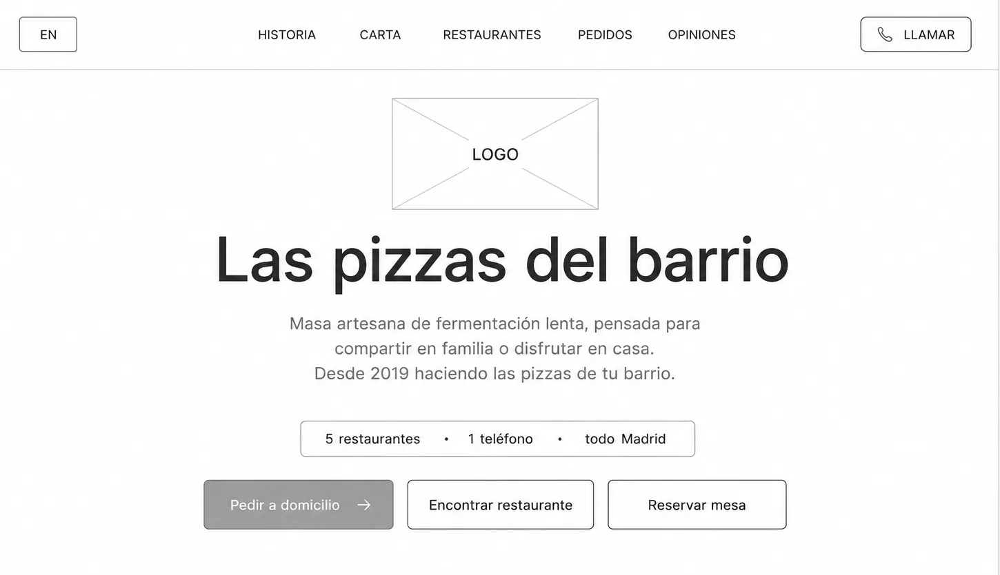

<span style="position: absolute; left: 12px; top: 12px; padding: 4px 9px; border-radius: 999px; background: #000; color: #fff; font-size: 11px; font-weight: 700">Lo-fi</span>
</div>
<figcaption style="padding: 14px 18px 18px; display: flex; flex-direction: column; gap: 4px"><span style="font-size: 10px; font-weight: 700; letter-spacing: .1em; text-transform: uppercase; color: {{accent}}">Wireframes · mobile-first</span><span style="font-size: 16px; font-weight: 600; color: #fff">Una mano, CTA en zona del pulgar</span></figcaption>
</figure>
<figure style="margin: 0; border-radius: 22px; overflow: hidden; background: radial-gradient(ellipse at 50% 45%, rgba(124,58,237,.24), rgba(0,0,0,0) 70%), #0d0d10; border: 1px solid rgba(255,255,255,.1); display: flex; flex-direction: column">
<div style="position: relative; display: grid; grid-template-columns: 2.4fr 1fr; gap: 16px; align-items: center; padding: 24px">
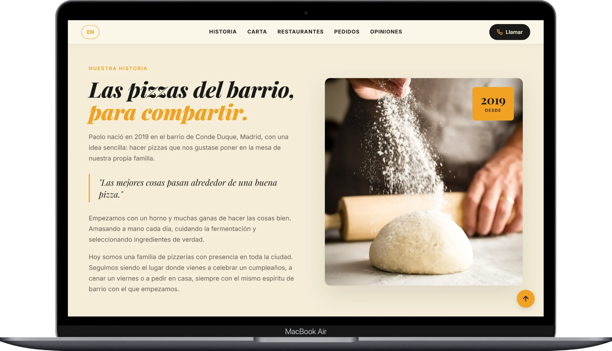

<span style="position: absolute; left: 12px; top: 12px; padding: 4px 9px; border-radius: 999px; background: {{accent}}; color: #0b0614; font-size: 11px; font-weight: 700">Final</span>
</div>
<figcaption style="padding: 14px 18px 18px; display: flex; flex-direction: column; gap: 4px"><span style="font-size: 10px; font-weight: 700; letter-spacing: .1em; text-transform: uppercase; color: {{accent}}">En producción</span><span style="font-size: 16px; font-weight: 600; color: #fff">3 acciones: pedir, encontrar, reservar</span></figcaption>
</figure>
</div>

<div style="display: flex; flex-direction: column; gap: 22px">
<div style="display: flex; align-items: baseline; justify-content: space-between; gap: 20px; flex-wrap: wrap">
<h3 style="margin: 0; font-family: 'Playfair Display', Georgia, serif; font-weight: 800; font-size: 34px; line-height: 1.1; color: #fff">Una web, tres trabajos</h3>
<span style="font-size: 12px; font-weight: 600; letter-spacing: .14em; text-transform: uppercase; color: rgba(255,255,255,.55)">Pantallas clave en producción</span>
</div>
<div style="display: grid; grid-template-columns: repeat(auto-fit, minmax(320px, 1fr)); gap: 16px">
<sc-for list="{{screens}}" as="s" hint-placeholder-count="3">
<article style="border-radius: 18px; overflow: hidden; background: #0d0d10; border: 1px solid rgba(255,255,255,.1); display: flex; flex-direction: column">
<div style="padding: 18px 12px 6px; background: radial-gradient(ellipse at 50% 70%, rgba(124,58,237,.2), rgba(0,0,0,0) 70%)"></div>
<div style="padding: 12px 16px 18px; border-top: 1px solid rgba(255,255,255,.08); display: flex; flex-direction: column; gap: 6px">
<span style="font-size: 10px; font-weight: 700; letter-spacing: .1em; text-transform: uppercase; color: {{accent}}">{{s.n}} · {{s.tag}}</span>
<span style="font-size: 16px; font-weight: 600; color: #fff">{{s.title}}</span>
<span style="font-size: 14px; line-height: 1.45; color: rgba(255,255,255,.65)">{{s.body}}</span>
</div>
</article>
</sc-for>
</div>
</div>

<div style="padding: 40px; border-radius: 28px; background: radial-gradient(ellipse at 80% 20%, rgba(124,58,237,.25), rgba(124,58,237,0) 60%), #0d0b14; border: 1px solid rgba(167,139,250,.3); display: grid; grid-template-columns: repeat(auto-fit, minmax(360px, 1fr)); gap: 40px; align-items: center">
<div style="display: flex; flex-direction: column; gap: 16px">
<span style="font-size: 12px; font-weight: 600; letter-spacing: .12em; text-transform: uppercase; color: {{accent}}">Decisión con datos · Clarity</span>
<span style="font-family: 'Playfair Display', Georgia, serif; font-weight: 800; font-size: 44px; line-height: 1.08; color: #fff">El selector de local, <span style="font-style: italic; color: {{accent}}">primero en móvil</span></span>
<span style="max-width: 420px; font-size: 17px; line-height: 1.5; color: rgba(255,255,255,.8)">Las sesiones mostraban que el usuario buscaba su local más cercano antes que la carta.</span>
<ol style="margin: 8px 0 0; padding: 18px 0 0; list-style: none; display: grid; grid-template-columns: repeat(3, minmax(0, 1fr)); gap: 12px; border-top: 1px solid rgba(255,255,255,.1)">
<li style="display: flex; flex-direction: column; gap: 4px"><span style="font-size: 12px; font-weight: 700; color: {{accent}}">01</span><span style="font-size: 15px; line-height: 1.3; font-weight: 600; color: #fff">Horario y teléfono por local</span></li>
<li style="display: flex; flex-direction: column; gap: 4px"><span style="font-size: 12px; font-weight: 700; color: {{accent}}">02</span><span style="font-size: 15px; line-height: 1.3; font-weight: 600; color: #fff">Enlace directo al mapa</span></li>
<li style="display: flex; flex-direction: column; gap: 4px"><span style="font-size: 12px; font-weight: 700; color: {{accent}}">03</span><span style="font-size: 15px; line-height: 1.3; font-weight: 600; color: #fff">Reserva sin centralita</span></li>
</ol>
</div>

</div>

<div style="display: grid; grid-template-columns: repeat(auto-fit, minmax(440px, 1fr)); gap: 48px; align-items: start">
<div style="display: flex; flex-direction: column; gap: 18px">
<span style="font-size: 12px; font-weight: 600; letter-spacing: .14em; text-transform: uppercase; color: rgba(255,255,255,.55)">Evolución · dirección de arte</span>
<h3 style="margin: 0; font-family: 'Playfair Display', Georgia, serif; font-weight: 800; font-size: 34px; line-height: 1.1; color: #fff">Fotografía que vende la masa de 48 h</h3>
<div style="display: grid; grid-template-columns: repeat(3, minmax(0, 1fr)); gap: 12px">
<sc-for list="{{pizzas}}" as="p" hint-placeholder-count="3">
<figure style="margin: 0; display: flex; flex-direction: column; gap: 8px">

<figcaption style="display: flex; flex-direction: column; gap: 2px"><span style="font-family: 'Playfair Display', Georgia, serif; font-style: italic; font-weight: 700; font-size: 18px; color: #fff">{{p.name}}</span><span style="font-size: 13px; line-height: 1.35; color: rgba(255,255,255,.6)">{{p.desc}}</span></figcaption>
</figure>
</sc-for>
</div>
</div>
<div style="display: flex; flex-direction: column; gap: 18px">
<span style="font-size: 12px; font-weight: 600; letter-spacing: .14em; text-transform: uppercase; color: rgba(255,255,255,.55)">Evolución · asistente de reservas</span>
<h3 style="margin: 0; font-family: 'Playfair Display', Georgia, serif; font-weight: 800; font-size: 34px; line-height: 1.1; color: #fff">La centralita de las 20:30, <span style="font-style: italic; color: {{accent}}">fuera de sala</span></h3>
<div style="display: grid; grid-template-columns: 1fr 1fr 1.3fr; gap: 14px; align-items: center">


<ol style="margin: 0; padding: 0; list-style: none; display: flex; flex-direction: column; gap: 14px">
<li style="display: flex; flex-direction: column; gap: 2px; padding-bottom: 12px; border-bottom: 1px solid rgba(255,255,255,.1)"><span style="font-size: 12px; font-weight: 700; color: {{accent}}">01</span><span style="font-size: 14px; line-height: 1.4; color: #fff">Local, comensales y turno sin salir del navegador</span></li>
<li style="display: flex; flex-direction: column; gap: 2px; padding-bottom: 12px; border-bottom: 1px solid rgba(255,255,255,.1)"><span style="font-size: 12px; font-weight: 700; color: {{accent}}">02</span><span style="font-size: 14px; line-height: 1.4; color: #fff">Alérgenos y celiaquía resueltos al momento</span></li>
<li style="display: flex; flex-direction: column; gap: 2px"><span style="font-size: 12px; font-weight: 700; color: {{accent}}">03</span><span style="font-size: 14px; line-height: 1.4; color: #fff">Respuestas deterministas: sin alucinaciones</span></li>
</ol>
</div>
</div>
</div>
</section>

<section id="pz-resultados" style="padding: 120px 0 0; display: flex; flex-direction: column; gap: 40px">
<div style="display: flex; flex-direction: column; gap: 16px">
<span style="font-size: 12px; font-weight: 600; letter-spacing: .14em; text-transform: uppercase; color: {{accent}}">05 · Resultados</span>
<h2 style="margin: 0; font-family: 'Playfair Display', Georgia, serif; font-weight: 800; font-size: 52px; line-height: 1.04; letter-spacing: -.015em; color: #fff">Un producto que <span style="font-style: italic; color: {{accent}}">escaló sin rediseño</span></h2>
</div>
<div style="display: grid; grid-template-columns: repeat(auto-fit, minmax(440px, 1fr)); gap: 20px; align-items: stretch">
<div style="padding: 32px; border-radius: 26px; background: radial-gradient(ellipse at 85% 0%, rgba(124,58,237,.35), rgba(124,58,237,0) 60%), #0d0b14; border: 1px solid rgba(167,139,250,.35); display: flex; flex-direction: column; gap: 24px">
<div style="display: flex; align-items: center; justify-content: space-between; gap: 12px">
<span style="font-size: 15px; font-weight: 600; color: #fff">Restaurantes con el mismo producto</span>
<span style="flex: none; padding: 4px 9px; border-radius: 999px; border: 1px solid rgba(167,139,250,.4); color: {{accent}}; font-size: 10px; font-weight: 700; letter-spacing: .08em; text-transform: uppercase">Medido</span>
</div>
<div role="img" aria-label="De un local en 2020 a cinco locales" style="display: grid; grid-template-columns: repeat(5, minmax(0, 1fr)); gap: 8px">
<span style="height: 56px; border-radius: 12px; background: {{accent}}; display: flex; align-items: center; justify-content: center; font-size: 12px; font-weight: 700; color: #0b0614">2020</span>
<span style="height: 56px; border-radius: 12px; background: rgba(167,139,250,.45)"></span>
<span style="height: 56px; border-radius: 12px; background: rgba(167,139,250,.45)"></span>
<span style="height: 56px; border-radius: 12px; background: rgba(167,139,250,.45)"></span>
<span style="height: 56px; border-radius: 12px; background: rgba(167,139,250,.45)"></span>
</div>
<div style="display: flex; align-items: flex-end; gap: 16px; padding-top: 20px; border-top: 1px solid rgba(255,255,255,.1)">
<span style="font-family: 'Playfair Display', Georgia, serif; font-weight: 800; font-size: 96px; line-height: .82; letter-spacing: -.02em; color: {{accent}}">1→5</span>
<span style="padding-bottom: 6px; font-size: 16px; line-height: 1.4; color: rgba(255,255,255,.85)">locales en Madrid <strong style="color: #fff">sin rediseñar</strong> el producto</span>
</div>
</div>
<div style="display: flex; flex-direction: column; gap: 20px">
<div style="display: grid; grid-template-columns: repeat(3, minmax(0, 1fr)); gap: 12px">
<div style="padding: 20px 16px; border-radius: 18px; background: rgba(255,255,255,.04); border: 1px solid rgba(255,255,255,.1); display: flex; flex-direction: column; gap: 8px"><span style="font-family: 'Playfair Display', Georgia, serif; font-weight: 800; font-size: 42px; line-height: 1; color: #fff">0 €</span><span style="font-size: 13px; line-height: 1.35; color: rgba(255,255,255,.7)">en comisiones a agregadores</span></div>
<div style="padding: 20px 16px; border-radius: 18px; background: rgba(255,255,255,.04); border: 1px solid rgba(255,255,255,.1); display: flex; flex-direction: column; gap: 8px"><span style="font-family: 'Playfair Display', Georgia, serif; font-weight: 800; font-size: 42px; line-height: 1; color: #fff">+28%</span><span style="font-size: 13px; line-height: 1.35; color: rgba(255,255,255,.7)">pedidos directos online</span></div>
<div style="padding: 20px 16px; border-radius: 18px; background: rgba(255,255,255,.04); border: 1px solid rgba(255,255,255,.1); display: flex; flex-direction: column; gap: 8px"><span style="font-family: 'Playfair Display', Georgia, serif; font-weight: 800; font-size: 42px; line-height: 1; color: #fff">+40%</span><span style="font-size: 13px; line-height: 1.35; color: rgba(255,255,255,.7)">rapidez de comanda en sala</span></div>
</div>

</div>
</div>

<div style="padding-top: 40px; display: flex; flex-direction: column; gap: 20px">
<span style="font-size: 12px; font-weight: 600; letter-spacing: .14em; text-transform: uppercase; color: rgba(255,255,255,.55)">Lo que me llevo</span>
<div style="display: grid; grid-template-columns: repeat(auto-fit, minmax(300px, 1fr)); gap: 0 32px">
<sc-for list="{{learn}}" as="l" hint-placeholder-count="3">
<div style="display: flex; gap: 16px; padding: 22px 0; border-top: 1px solid rgba(255,255,255,.12)">
<span style="font-family: 'Playfair Display', Georgia, serif; font-style: italic; font-weight: 700; font-size: 28px; line-height: 1; color: {{accent}}; width: 38px">{{l.n}}</span>
<div style="flex: 1; display: flex; flex-direction: column; gap: 6px"><span style="font-size: 18px; font-weight: 600; color: #fff">{{l.t}}</span><span style="font-size: 15px; line-height: 1.45; color: rgba(255,255,255,.65)">{{l.d}}</span></div>
</div>
</sc-for>
</div>
</div>
</section>

<section aria-label="Paginado y acción" style="margin-top: 96px; padding: 48px 0 64px; border-top: 1px solid rgba(255,255,255,.1); display: grid; grid-template-columns: repeat(auto-fit, minmax(440px, 1fr)); gap: 40px; align-items: center">
<a href="#" style="display: flex; align-items: center; gap: 20px; padding: 26px 28px; border-radius: 24px; background: #0d0d10; border: 1px solid rgba(255,255,255,.12); text-decoration: none">
<div style="flex: 1; display: flex; flex-direction: column; gap: 6px">
<span style="font-size: 11px; font-weight: 600; letter-spacing: .12em; text-transform: uppercase; color: rgba(255,255,255,.55)">Siguiente caso · 04</span>
<span style="font-family: 'Playfair Display', Georgia, serif; font-weight: 800; font-size: 30px; line-height: 1.1; color: #fff">IT Ops &amp; Oracle ERP</span>
<span style="font-size: 15px; color: rgba(255,255,255,.65)">Diagnóstico Build vs Buy</span>
</div>
<span style="flex: none; width: 56px; height: 56px; border-radius: 50%; background: #fff; color: #000; display: flex; align-items: center; justify-content: center"><svg width="22" height="22" viewBox="0 0 24 24" fill="none" stroke="currentColor" stroke-width="2" stroke-linecap="round" stroke-linejoin="round" aria-hidden="true"><path d="M5 12h14M13 5l7 7-7 7"></path></svg></span>
</a>
<div style="display: flex; flex-direction: column; align-items: center; gap: 18px">
<span style="font-size: 11px; font-weight: 600; letter-spacing: .12em; text-transform: uppercase; color: rgba(255,255,255,.55)">¿Vemos otro proyecto?</span>
<nav aria-label="Navegación entre casos" style="display: flex; align-items: center; gap: 8px">
<a href="#" aria-label="Caso anterior" style="width: 44px; height: 44px; border-radius: 50%; border: 1px solid rgba(255,255,255,.16); display: flex; align-items: center; justify-content: center; color: #fff"><svg width="16" height="16" viewBox="0 0 24 24" fill="none" stroke="currentColor" stroke-width="2" stroke-linecap="round" stroke-linejoin="round" aria-hidden="true"><path d="M15 18l-6-6 6-6"></path></svg></a>
<a href="#" aria-label="Caso 01" style="width: 44px; height: 44px; border-radius: 10px; display: flex; align-items: center; justify-content: center; font-size: 13px; font-weight: 600; color: rgba(255,255,255,.6); text-decoration: none">01</a>
<a href="#" aria-label="Caso 02" style="width: 44px; height: 44px; border-radius: 10px; display: flex; align-items: center; justify-content: center; font-size: 13px; font-weight: 600; color: rgba(255,255,255,.6); text-decoration: none">02</a>
<a href="#" aria-label="Caso 03, actual" aria-current="page" style="width: 44px; height: 44px; border-radius: 10px; background: rgba(167,139,250,.14); border: 1px solid rgba(167,139,250,.45); display: flex; align-items: center; justify-content: center; font-size: 13px; font-weight: 700; color: {{accent}}; text-decoration: none">03</a>
<a href="#" aria-label="Caso 04" style="width: 44px; height: 44px; border-radius: 10px; display: flex; align-items: center; justify-content: center; font-size: 13px; font-weight: 600; color: rgba(255,255,255,.6); text-decoration: none">04</a>
<a href="#" aria-label="Caso 05" style="width: 44px; height: 44px; border-radius: 10px; display: flex; align-items: center; justify-content: center; font-size: 13px; font-weight: 600; color: rgba(255,255,255,.6); text-decoration: none">05</a>
<a href="#" aria-label="Caso siguiente" style="width: 44px; height: 44px; border-radius: 50%; border: 1px solid rgba(255,255,255,.16); display: flex; align-items: center; justify-content: center; color: #fff"><svg width="16" height="16" viewBox="0 0 24 24" fill="none" stroke="currentColor" stroke-width="2" stroke-linecap="round" stroke-linejoin="round" aria-hidden="true"><path d="M9 18l6-6-6-6"></path></svg></a>
</nav>
<a href="#" style="font-size: 14px; font-weight: 500; color: rgba(255,255,255,.7); padding: 12px 0">Volver al índice</a>
</div>
</section>
</main>
</div>
</x-dc>
<script type="text/x-dc" data-dc-script data-props='{"accent":{"editor":"color","default":"#a78bfa","options":["#a78bfa","#f97316","#7c3aed"]},"$preview":{"width":1440,"height":7400}}'>
class Component extends DCLogic {
renderVals() {
return {
accent: this.props.accent ?? '#a78bfa',
flows: [
{ n: '01', title: 'Pedido directo', a: 'Acceso desde Google o Instagram', b: 'Selección visual de pizzas', c: 'Comanda a cocina por WhatsApp' },
{ n: '02', title: 'Carta QR en mesa', a: 'QR físico, sin instalar app', b: 'Carga inmediata en el móvil', c: '−40% de tiempo de espera' },
{ n: '03', title: 'Reserva multi-local', a: 'Detección del local más cercano', b: 'Aforo, horario y carta', c: 'Reserva sin colapsar la centralita' }
],
screens: [
{ n: '01', tag: 'Hero', title: 'Masa de 48 h como diferencial', body: 'Fermentación lenta e ingredientes D.O. italianos, antes que el precio.', img: 'projects/04-paolo/assets/web1.webp', alt: 'Portada web: Las pizzas del barrio, para compartir' },
{ n: '02', tag: 'Carta', title: 'Carta por categorías y filtros', body: 'Clásicas, especiales y alérgenos con precio visible en cada tarjeta.', img: 'projects/04-paolo/assets/web4.webp', alt: 'Carta interactiva: Cada pizza cuenta algo, con filtros por categoría' },
{ n: '03', tag: 'Pedido', title: 'Pedido directo a casa', body: 'Del plato a la comanda por WhatsApp, sin comisión de intermediarios.', img: 'projects/04-paolo/assets/web2.webp', alt: 'Sección Llévanos a casa para pedir a domicilio' }
],
pizzas: [
{ name: 'Diavola', desc: 'Salame picante y fior di latte', img: 'projects/04-paolo/assets/diavola.webp', alt: 'Pizza Diavola con salame picante' },
{ name: 'Tartufo', desc: 'Trufa negra, setas y parmesano', img: 'projects/04-paolo/assets/tartufo.webp', alt: 'Pizza Tartufo con trufa negra y setas' },
{ name: 'Napoli', desc: 'Anchoas, alcaparras y orégano', img: 'projects/04-paolo/assets/napoli.webp', alt: 'Pizza Napoli con anchoas y alcaparras' }
],
learn: [
{ n: '01', t: 'Programar enseña el coste de cada decisión', d: 'Cada tipografía y sombra en Figma pesa en la carga y el rebote.' },
{ n: '02', t: 'El contexto físico manda', d: 'Un QR sobre madera exige contraste con poca luz y botones a una mano.' },
{ n: '03', t: 'Los datos deciden el siguiente paso', d: 'Clarity sirvió para iterar, no para justificar lo ya hecho.' }
]
};
}
}
</script>
</body>
</html>
```
